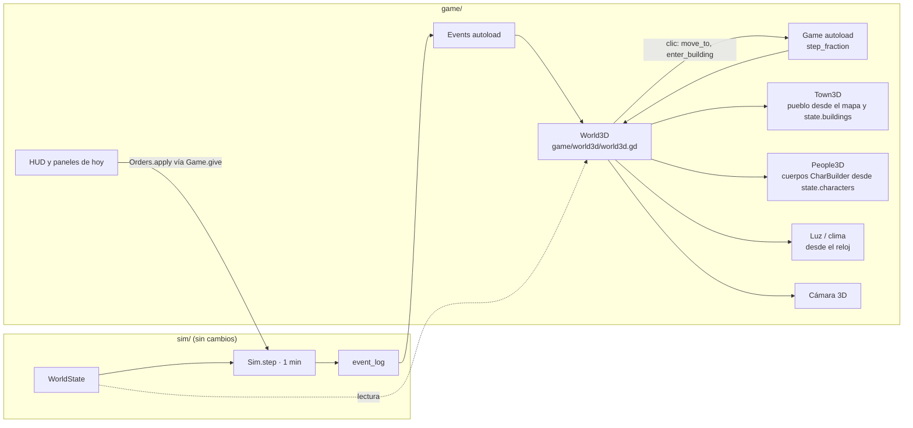

# GuildMaster 3D · plan de migración (M3D-0)

> Decisión del owner (2026-11-25): GuildMaster pasa a 3D. La rama `2d` (0c29e28f) es la copia congelada del juego 2D y
> no se toca; la migración vive en la rama `3d`. La referencia es la prueba `~/Code/Prueba3D`, tomada en su master
> **c79c4fb** (2026-11-25, «Lanzador ciudad.command…»). Lo que cambie allí después se trae en otra tanda, por hash.

La prueba demostró el 3D (town_e entero a 150-200 fps con clima, vida, sonido y fiestas; 16 de 17 edificios se abren
donde están; 30 animaciones de oficio; ~630 piezas propias en el estilo del Medieval Village MegaKit de Quaternius),
pero allí no se juega: reproduce una **traza** grabada de la sim (`tools/sim_trace.gd`). Aquí la vista 3D lee la sim
**en vivo**, dentro de las reglas de GuildMaster (CLAUDE.md, `docs/gdd/05_arquitectura.md`).

## 1. Arquitectura de la vista 3D

- **Dónde**: `game/world3d/`. `World3D` (`world3d.gd` + `world3d.tscn`) es la fachada que usa `app.gd`, con las mismas
  señales y métodos que `WorldView` (`selection_changed`, `building_picked`, `select()`, `first_selectable()`,
  `pick_building_id()`, `selected_id`, `rebuild_town()`, `set_active()`, centrar la cámara en una casilla). Dentro:
  - `town/`: el constructor del pueblo de la prueba (`pueblo.gd` + la base de `main.gd`, `house_builder.gd`,
    `building_types.gd`, `landmark_builder.gd`, `road_builder.gd`, `opt3d.gd`, `tree_far.gd`, `pueblo_vivo.gd`, …).
  - `people/`: `people3d.gd` (nuevo: estado → cuerpos y animaciones) y `char_builder.gd`, `char_age.gd`,
    `char_skirt.gd` de la prueba.
  - `light/`: `luz.gd`, `clima.gd`, `fx.gd`, `vida.gd` de la prueba (`scripts/clima/`).
  - `interior/` (M3D-3): `situ_shell.gd`, `situ_cut.gd`, el montador de interiores 3D.
  - `shaders/`, `kit_paths.gd` (id → ruta del kit, el `visual_paths` del 3D) y `kit_data/` (catálogos del kit que
    llevan rutas: piezas de personaje, animaciones, muebles).
- **Qué lee de la sim, sin traza**:
  - Al montar (`Game.started`): `catalog.maps()[state.map_id]` (filas, decor, sitios, zonas: lo mismo que la prueba
    leía del fichero de GuildMaster), `state.buildings` (tipo, huella, puerta, mejoras hechas, obras en curso, estado),
    la rejilla transitable (`Grid` de la sim: lo que la traza llevaba en `map.walkable`) y la estación de
    `Clock.season`.
  - Cada fotograma: `state.characters` (posición, `path`, `move_progress`, `location`, empleo, familia, edad, aspecto)
    y el reloj (`state.clock.minute` + `Game.step_fraction()`).
  - Cada minuto de juego (como hoy `WorldView`): lo que hace cada uno («doing»: trabajar, en casa, dormir, mercado,
    actividad del pueblo…), derivado solo del estado con la misma función que usa la traza (`_doing` de
    `sim_trace.gd`), que pasa a `game/sim_query.gd` como consulta de lectura.
  - `Events`: `construction_started/done`, `building_demolished`, `building_bought`, mejoras terminadas → se rehace esa
    casa (`rebuild_house` de la prueba, una por fotograma); `building_entered/left` → la vista oculta o muestra a la
    persona (y, desde M3D-3, el interior abierto la recibe).
- **Interpolación minuto a minuto**: la sim mueve por casillas, una casilla cada `minutes_per_tile`. La posición en
  pantalla es la de hoy en 2D (`CharacterView.tile_position(ch, mpt, frac)`, con `frac = Game.step_fraction()`), pasada
  a metros (1 casilla = 2 m; centro de la casilla `(c·2+1, r·2+1)`). La velocidad sale de `path[0] − position`; con ella
  se elige el paso (andar, trote) y su ritmo para que los pies no patinen, como en `sim3d_chars.gd`. Parado: la
  animación de lo que hace (trabajar por oficio, hablar, sentarse en el banco de su sitio social). Los bancos y la cruz
  apartan a quien pasa (`avoid()` de la prueba), solo en la vista.
- **Determinismo**: la vista no escribe nunca el estado ni usa `state.rng`. Todo su azar (variaciones de casas,
  desplazamiento de cada persona dentro de su casilla, el tiempo del día) sale de semillas propias: el hash del id, la
  semilla de la partida y el día. Las órdenes salen solo por `Game.give` (clic derecho en el suelo → `move_to`; en una
  puerta → `enter_building`). Guardar y cargar no cambian: la vista no guarda nada; al cargar se rehace (`Game.started`).
- **Un interior es una vista** (M3D-3): abrir una casa en sitio (techo que se funde, paredes del frente que bajan:
  `SituCut`) monta su interior leyendo `state.buildings[b]` (nivel, mejoras, puestos) y coloca a quien la sim tiene
  dentro en su puesto (`SituLive`, alimentado con `SimQuery`, no con la traza). Cerrarla lo destruye. La producción
  sigue en la sim se mire o no.
- **El clima** es de la vista (cosmético, por datos y semilla del día), como en la prueba. Si algún día cambia reglas
  (cosechas, clientela), pasa a la sim con su estado guardado: decisión del owner (§7).

## 2. Qué viene de Prueba3D y cómo se reorganiza

| De la prueba | Aquí | Cambio |
|---|---|---|
| `scripts/pueblo.gd`, `main.gd` (base) | `game/world3d/town/town_builder.gd`, `town_base.gd` | El mapa sale del catálogo, no de `~/Code/GuildMaster/...`; `sim_buildings` sale de `state.buildings`; `walk_mask` de la rejilla de la sim; sin la calle de muestra de `main.gd` |
| `house_builder`, `building_types`, `landmark_builder`, `road_builder`, `opt3d`, `tree_far`, `pueblo_vivo`, `fiestas_pueblo` | `game/world3d/town/` | Rutas del kit tras `kit_paths.gd` a medida que se toquen |
| `char_builder`, `char_age`, `char_skirt` | `game/world3d/people/` | Igual |
| `sim3d.gd` + `sim3d_chars.gd` (lectura de la traza, cuerpos, pasos, asientos, luz, faroles, ventanas) | `people3d.gd`, `world3d.gd`, `night3d.gd` | Reescritos sobre el estado en vivo; se conserva la lógica de pasos, asientos, faroles y ventanas |
| `scripts/clima/` (`luz`, `clima`, `fx`, `vida`, `lluvia_gente`) | `game/world3d/light/` | La hora y la estación del reloj de la sim |
| `scripts/audio/` (sonido de pueblo, vida, fiestas) | M3D-5, dentro de `AudioDirector` | Por id de `data/audio.json` (la prueba toca ficheros directamente) |
| `interior3d`, `interior_builder`, `situ_shell`, `situ_cut`, `situ_live` | `game/world3d/interior/` (M3D-3) | `InteriorBuilder` choca con la clase 2D del mismo nombre: aquí `Interior3DBuilder` |
| `shaders/*.gdshader` | `game/world3d/shaders/` | — |
| `data/*.json` sin rutas (`building_types`, `clima`, `pueblo_vivo`, `fiestas`, `mercancias`, `sonido`, `chars/palettes`, `chars/villagers`, `extras/*`, `interiors/*_sitio_*`) | `data/view3d/` | Cifras de presentación: el validador comprueba que no llevan rutas |
| `data/chars/kit.json`, `chars/anims.json`, `interiors/muebles.json`, `props/ropa_muebles.json` (llevan rutas) | `game/world3d/kit_data/` | Son el «visual_paths» del 3D: id → pieza del kit |
| `kit/` (Quaternius + piezas propias) | `kit/` en la raíz (`res://kit/`) | Misma estructura: los `.gltf` se referencian entre carpetas (`../village/T_*.png`). Ver §5 |
| `tools/make_*.py` (Blender), `make_char_meshes.gd`, `make_anims.gd`, texturas | `tools/kit3d/` | Van a git: regeneran las piezas propias |

**Se queda fuera**: la reproducción de la traza y `--simcheck` (aquí está la sim de verdad), las escenas de muestra y
banco (`hitos`, `extras`, `modulos`, `oficios`, `fiestas`, `villa`, `chars*`, `bench3d`, `ropa`, `edades`), el interior
grande con fundido, el carro que cruza el pueblo por guion (`cart_trip`, `convoy`: hasta que la sim tenga carros), las
láminas y capturas (`out/`), `ui3d/` (las tres direcciones de interfaz: M3D-7) y `region_hitos` (M3D-6).

**Deuda declarada**: el código portado usa inferencia (`:=`) pero bucles sin tipo y diccionarios con acceso por
punto, y nombra el kit por ruta. Se tipa y se pasa a `kit_paths.gd` al tocar cada fichero, no de golpe.

## 3. Qué se sustituye del 2D y qué se reutiliza

- **Se sustituye**: `game/world/` (suelo, edificios, caminantes, cámara, día/noche, capa de fiestas, letreros 2D),
  `game/iso.gd` en la vista (queda para lo que no es vista: escenarios y herramientas que hablan en casillas),
  `game/visuals/{buildings,props,characters}` y el interior 2D (`game/interior/`) cuando llegue M3D-3.
- **Se reutiliza tal cual**: `sim/` entero, los autoloads (`Log`, `Data`, `Events`, `Game`), `game/sim_query.gd`, la UI
  (`game/ui/`: HUD, paneles, tarjetas, menús, tutorial, retratos 2D), `AudioDirector` y `data/audio.json`, guardado,
  escenarios, bots, herramientas de QA.
- **Recomendación: las dos vistas conviven durante la migración**, con `view_mode` en `data/view.json` (`"3d"`) y
  `--view=2d|3d` en la línea de órdenes. El juego normal arranca en 3D. Las capturas antiguas (`--smoke-script=<id>` de
  hoy), los flujos de interfaz (`--flow`, paso `ui` de `run_all`), la galería y las pruebas que instancian `WorldView`
  siguen con el 2D hasta que se porten, y cada guion 3D nuevo se registra como 3D. Razones:
  - 41 ficheros llaman a `app.world()`, 18 pruebas instancian la vista 2D, hay 93 guiones de captura y los flujos de
    `data/flows/` juegan con clics en coordenadas del 2D: retirar el 2D de golpe deja la QA de interfaz ciega semanas.
  - La sim no depende de la vista: convivir no cuesta reglas, solo un interruptor en `app.gd`.
  - Permite comparar 2D y 3D sobre la misma partida (`--view=2d`) mientras se porta cada pantalla.
  - Se retira el 2D en M3D-8, cuando cada guion y flujo tenga su versión 3D; la rama `2d` lo conserva entero.

## 4. Render

- El proyecto pasa de `gl_compatibility` a **Forward+** (`renderer/rendering_method="forward_plus"`): la luz de la prueba
  usa SSAO, sombras direccionales en cascada, glow nocturno, niebla y partículas GPU. Compatibility no tiene SSAO ni
  SSIL y su glow y sus sombras son más pobres. En macOS va sobre Metal.
- **Escala**: hoy la ventana usa `stretch/mode="viewport"` a 960×540 ×2 entero (D2): todo se dibuja a 960×540 y se
  amplía. El 3D así saldría a media resolución. En modo 3D la app cambia al arrancar a `canvas_items` con factor
  entero (`Window.content_scale_mode`): el 3D se dibuja a la resolución real de la ventana y la UI sigue en su
  rejilla de 960×540 ×2, nítida (filtro Nearest, factor entero). Con `--view=2d` todo queda como hoy.
- **UI y arte 2D**: siguen siendo `Control` y sprites en `CanvasLayer` por encima del 3D; Forward+ dibuja el 2D igual
  (mismos shaders `canvas_item`). Los retratos, iconos y tarjetas de PixelLab siguen valiendo. Lo que deja de usarse es
  el arte del mundo (suelos, fachadas, árboles y caminantes 2D).
- **Coste**: Forward+ pide una GPU con Vulkan/Metal/D3D12 (sube el mínimo de Steam; los Mac con Apple Silicon y
  cualquier PC de los últimos 8 años valen). Sin ventana (`--headless`) no cambia nada: pruebas y bots igual.

## 5. Recursos en git

El kit de la prueba ocupa ~970 MB fuera de git: packs de Quaternius (CC0) en `kit/village` (59 MB), `kit/q_props`
(94 MB), `kit/q_nature` (85 MB), `kit/q_trees` (5,5 MB), `kit/chars` (560 MB: tres packs de personaje y animación, sus
FBX, y lo horneado en `derived/` y `custom/`), y piezas propias generadas por scripts de Blender (`modules`,
`landmarks`, `extras`, `fiestas`, `muebles`, `utiles`, `mercancias`, `variants`, `trees`, `streets`). Ningún fichero
pasa de 23 MB. El repo ya pesa 870 MB empaquetado y no hay Git LFS.

Propuesta:
- **Entra en git solo lo que el juego carga**: la clausura de lo que se abre al montar la partida (cada `.gltf`/`.glb`
  /`.res` cargado, su `.bin`, sus imágenes y sus `.import`), medida con el registro de carga del motor
  (`godot --verbose`, líneas `Loading resource`) y guardada en `tools/kit3d/usados.txt`. `kit/` está en `.gitignore`
  y lo usado se añade con `git add -f` (`tools/kit3d/kit.py sellar`): el resto de los packs puede estar en disco sin
  entrar. Ningún fichero de más de 50 MB (el script lo rechaza). El total se mide y se apunta aquí en cada tanda.
- **Se instala con un script** (`tools/kit3d/kit.py instalar [--desde=<carpeta>]`): los packs completos, para quien
  vaya a montar contenido nuevo. Hoy copia de `~/Code/Prueba3D/kit` (o de la carpeta de los zips de Quaternius) a
  `kit/`, sin tocar lo sellado.
- **Se regenera**: las piezas propias con sus scripts de Blender (`tools/kit3d/blender/make_*.py`) y el horneado de
  personajes (`make_char_meshes.gd`, `make_anims.gd`); los scripts van a git, y lo que generan entra solo si el juego
  lo usa.
- Las fuentes que el juego no abre (FBX, carpetas Unity/Unreal de los packs, texturas de 4 K que el horneado ya
  reduce) no entran nunca.

**Medido en M3D-1** (se actualiza en cada tanda): ver §8.

## 6. Hitos

| Hito | Qué | Criterios de aceptación (comprobables) |
|---|---|---|
| **M3D-0** | Este plan | Plan en `docs/3d/plan.md`, decisión en `docs/decisiones.json`, artifact registrado |
| **M3D-1** | Pueblo en vivo | `game/app.tscn`, partida nueva normal, arranca en el pueblo 3D de town_e construido desde el mapa del catálogo y `state.buildings` (casas por tipo y nivel, extras, árboles, setos); la gente se mueve según la sim en vivo, interpolada, con andar / trabajar / sentarse, ropa por oficio, familia y edad. Luz, sol, noche con faroles y estación del reloj de la sim. Cámara de la prueba (WASD, Q/E, RePág/AvPág, zoom continuo 3-90). HUD de hoy encima (fecha, oro, avisos, pausa, velocidad). ≥ 60 fps a 1600×900 con el pueblo entero (medido). `run_all` en verde, `boot_check` limpio, captura `--smoke-script=pueblo3d` |
| **M3D-2** | Seleccionar y dar órdenes | Clic en una persona de la familia la selecciona (anillo, nombre, retrato del HUD); 1-2-3 y retratos; clic derecho en el suelo → `move_to` y en una puerta → `enter_building` (prueba de entrada real como H1). Edificios: resalte al pasar, letrero, «Gestionar» y doble clic abren los paneles de hoy; letreros de puestos y tablón. Avisos centran la cámara 3D. Flujos `quick` de `data/flows` portados a 3D en verde |
| **M3D-3** | Interiores en sitio en vivo | Al entrar la persona elegida (o «Gestionar») la casa se abre donde está; el interior de su tipo y nivel con sus mejoras; empleados y clientes de la sim en su puesto con su animación; cola y barras de producción del sim; cerrar no cambia nada (prueba: producción idéntica con 0 o 1 interiores abiertos, como L1). Coste de abrir medido (< 1 fotograma perdido de 100 ms) |
| **M3D-4** | Forja jugable de punta a punta | Desde partida nueva: comprar materia prima, producir lingote y espada, vender, pagar la deuda, contratar, mejorar, todo con la UI de hoy sobre el 3D. Guion `--smoke-script=forja3d` y el flujo de la forja en verde; el owner juega 3 días sin consola |
| **M3D-5** | Oficios y vida | Interiores de carpintería, cantería, sastrería, armería, posada, granja, consulta, banco y guarida en vivo; obras y mejoras exteriores (casas que cambian de nivel); fiestas de `Festivals` (decoración, puestos, espectáculos); clima; sonido de pueblo por `AudioDirector`; vida (rondas con faroles, corrillos, altercados). Capturas por oficio y fiesta; ≥ 60 fps con fiesta grande y lluvia |
| **M3D-6** | Región | Mapa de la región y los asentamientos pequeños en 3D (`region_hitos`), la capital Bellcaire; viajes y caravanas visibles. Capturas de cada asentamiento; ≥ 60 fps en la capital |
| **M3D-7** | Interfaz nueva | La dirección que elija el owner entre las tres de Prueba3D (`ui3d/`), aplicada al HUD y los paneles; `--smoke-script=paneles` y `hud` en 3D |
| **M3D-8** | Retirar el 2D | Todos los guiones y flujos con su versión 3D; fuera `game/world/`, `game/interior/` 2D y el arte del mundo 2D; `view_mode` desaparece; `run_all --visual` en verde |

## 7. Riesgos y lo que necesita decisión del owner

**Riesgos**
- **Rendimiento en vivo**: la sim cuesta < 2 ms por paso y a ×4 son ~19 pasos por segundo; la vista suma la gente con
  esqueleto (6-10 draw calls por persona). Se mide en cada hito a 1600×900; los límites de la prueba (luces de puerta,
  sombras de la gente lejos apagadas) se conservan.
- **Memoria y arranque**: montar town_e en 3D tarda segundos (lo mide M3D-1); el `boot_check` arranca 60+ escenarios y
  cada uno monta el pueblo. Si se alarga demasiado, el 3D se comprueba en una muestra de escenarios.
- **Tamaño del repo**: cada tanda de piezas suma; se vigila con `kit.py medir` y se para antes de 1,5 GB empaquetado
  (entonces, LFS o descarga aparte).
- **La prueba sigue viva**: dos workers trabajan hoy en interiores y en interfaz. Lo portado queda fijado en c79c4fb; lo
  nuevo se trae por diferencias de hash, no copiando carpetas enteras.
- **QA de interfaz**: mientras convivan las vistas, los flujos prueban el 2D, no lo que juega el owner. M3D-2 porta los
  `quick`.
- **Estilo**: el juego deja el pixel art isométrico en el mundo; la biblia (`docs/style/biblia.md`), D2 y las reglas de
  arte del mundo quedan para la UI y los retratos.

**Decisiones del owner**
1. **WASD**: en 2D, WASD anda con la persona elegida (último commit de `main`) y las flechas mueven la cámara; en la
   prueba WASD mueve la cámara. Este plan pone la cámara en WASD (lo pide el encargo de M3D-1). ¿Andar con teclas pasa a
   las flechas, a mantener una tecla, o se quita?
2. **Kit en git**: ¿vale meter en git solo lo usado (cifra en §8), con los packs completos por script? ¿O se prefiere
   LFS o una descarga aparte desde ya?
3. **Clima**: ¿se queda cosmético en la vista, o debe afectar reglas (cosechas, clientela, salud) y pasar a la sim?
4. **Estilo y biblia**: confirmar que la biblia de pixel art queda solo para la UI y los retratos.
5. **Cuándo retirar el 2D** (M3D-8 propuesto) y si la rama `2d` debe seguir recibiendo arreglos.
6. **Interfaz** (M3D-7): elegir entre las tres direcciones de Prueba3D cuando estén listas.

## 8. Medidas

Se rellena con cada hito (máquina: MacBook Air de 16 GB compartida con otros hilos; los fps bailan, los draw calls son
la medida estable).

| Medida | M3D-1 |
|---|---|
| fps a 1600×900, pueblo entero | — |
| draw calls | — |
| tiempo de montar el pueblo | — |
| kit en git (ficheros, MB) | — |
