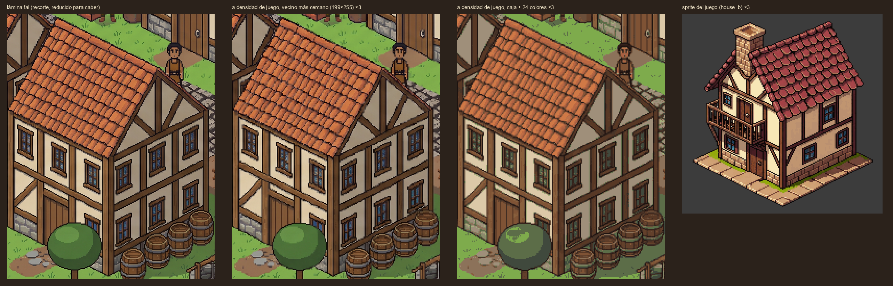
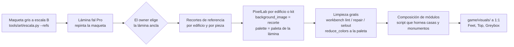

# De las láminas de fal a sprites de PixelLab

Análisis de viabilidad (2026-11-02), sin gastar PixelLab: límites y costes consultados con `search_help` (gratis) y
pruebas hechas con Pillow. Escala de referencia: la **propuesta B** de `docs/arte/escala.md` (puerta 52, planta baja
64, planta alta 48, monumentos con tope de 400 px, densidad única 1:1).

## 1. Las láminas (fal, `assets/concept/ciudades2/`)

Todas salen de una **maqueta gris a la escala B** (`tools/art/escala.py --refs`: bloques sobre la rejilla de 64×32 con
los personajes reales del juego) que Nano Banana Pro repinta con el estilo de la biblia. Por eso, a diferencia de las
láminas del 2026-11-01, **la escala de estas es la del juego propuesta**: personas de 1,7 m, casas de 2 plantas a 3,7×,
monumentos comprimidos. Las de E y A son la vista de zoom 1 ampliada ×2; las demás, una vista de 1920×1080 a 1:1.

| Lámina | Qué enseña | Nota |
|---|---|---|
| `E_pueblo_calle/E_pueblo_calle.png` | Rebanada (D10: E) a zoom 1: calle, casas de entramado de 1-2 plantas, forja con fuego y chimenea, capilla, huertos, cercas, pozo, ropa tendida. | **La mejor como ancla de estilo.** Escala B clavada. |
| `E_pueblo_calle/E_pueblo_calle_amplia.png` | El pueblo E entero en la vista amplia: frutales, campos, cercas. | La forja se movió a la parcela del sur (el modelo reinterpreta). |
| `A_plaza_mercado/A_plaza_mercado.png` | Plaza A a zoom 1: puestos, fuente, ayuntamiento porticado de piedra, iglesia, casas de 2-3 plantas. | Se inventó un río al sur: encaja con A+C. |
| `AC_plaza_rio/AC_plaza_rio.png` | D10 EA (A+C): plaza con iglesia y ayuntamiento, casas hanseáticas de ladrillo con piñón escalonado, río, puente de arcos, muelles, grúa, barcas. | Puso tejados de paja a las casas de entramado. |
| `catedral/catedral.png` | Catedral con dos torres, arbotantes y rosetón, en su plaza rodeada de casas de 2-3 plantas. | Tamaño respetado (400 px de torres frente a 176 de casa). |
| `castillo_muralla/castillo_muralla.png` | Castillo: muralla almenada, torres de esquina, puerta con rastrillo, homenaje con estandartes, patio; arrabal fuera. | Escala respetada. |
| `catalogo_edificios/catalogo_edificios.png` | Fila de tipos sobre la misma calle: cabaña, casa de 2 y 3 plantas, forja, capilla, muralla, torre, catedral. | **Infló la catedral** (más alta que en la maqueta): los modelos exageran los monumentos si se les deja. |
| `kit_entramado/kit_entramado.png` | Kit de casa de entramado: muros con puerta y ventana, esquinas, piñón, faldones de tejado, chimenea, buhardilla, contraventana, letrero; dos casas montadas. | Buena guía para pedir el `create_building_kit`. |
| `kit_castillo/kit_castillo.png` | Kit de muralla: tramos, esquinas, torres cuadrada y redonda, puerta, escalera, ruina, cadalso; un castillo montado. | Hecha sin maqueta: **la escala de los soldados no es la propuesta**. Vale por las piezas. |

Descartadas (fuera del repo): las 6 pruebas con Nano Banana (iteración barata: siguen la maqueta pero con menos
detalle) y dos kits de castillo que pegaban trozos de la imagen de referencia (fallo del modo edición de Pro).

**Lección**: sin maqueta gris, el modelo ignora la escala (kit de castillo). Con maqueta, la respeta (todas las
demás). La maqueta a escala es lo que hace útil la lámina para producir.

## 2. Herramientas de PixelLab y sus límites (consultados 2026-11-02)

| Herramienta | Tamaño máximo | Coste | Referencia de estilo | Uso aquí |
|---|---|---|---|---|
| `create_map_object` | 32-400 px por lado | 1 gen | `background_image` (encaje con lo que hay) | Edificios sueltos y piezas grandes. Vistas `low top-down` / `high top-down` / `side`: no hay «isométrica»; los 192 px de Guild Renew salieron con esta herramienta pidiéndolo en el texto. |
| `create_building_kit` | casilla iso de 32-96 px; muros de 1-3 casillas | 10-25 gen (pide 15 libres) | no; sí `palette` en hex | Kits de casas y de muralla. No documenta cuánto mide una planta en px: **hay que medirlo en la prueba**. |
| `image_to_pixelart` | salida ≤512×512 | 1 gen | no (convierte la imagen dada; `faithful=True`) | Pasar un recorte de la lámina a sprite. No garantiza 2:1 exacto ni contorno de un color, ni quita el fondo. |
| `create_image_pixen` | ≤768 por lado, área ≤512×512 | 1 gen | no | Piezas altas y estrechas (torres). |
| `edit_image_pixen` | área ≤256×256 | 1 gen | no | Retoques de piezas pequeñas. |
| `create_object_pro_flash` / `edit_image_pro_flash` / `inpaint_image_pro_flash` | ≤256 | 5/6/9 gen | `style_image` / `reference_image` / `context_image` | Calidad alta, pero 256 se queda corto para una casa B de 272. |
| `create_image_pro` | 512×512 (16:9: 688×384) | 10/15/25 gen | `style_image` + `reference_images` | Caro; útil para una pieza única muy especial. |
| `inpaint_image` | 32-512 | 10/15/25 gen | no | Coser uniones de un edificio por trozos. |
| `reduce_colors` | — | 0,1 gen | `palette_image` | Forzar la paleta del juego en todo. |
| `unzoom_image` | — | 0,1 gen | — | Devolver a su rejilla una imagen ampliada. |
| `pixelart_workbench` | — | gratis | — | `lint`, `score`, `repair`, `selout`, `edit` (copiar regiones), `join`. |

## 3. Cómo se pasaría cada lámina

| Lámina | Qué se extrae | Herramienta y tamaño | De una pieza o por módulos | Generaciones | Riesgo de que se note la diferencia de calidad |
|---|---|---|---|---|---|
| E (rebanada) | 8-10 casas, forja, capilla, pozo, cercas, huertos, campos | Casas: 1 `create_building_kit` de entramado (casilla 64, muros de 2) + 3-4 casas «héroe» con `create_map_object` (192×272, `background_image` = recorte de la lámina). Forja 256×300 y armería con `create_map_object`. Capilla: torre (128×280) + nave (288×320) por separado. Suelos con `create_tiles_pro`. | Casas por kit; el resto de una pieza | ~150-200 (ver §6) | **Medio**: kit y objetos sueltos salen de motores distintos; hay que igualar con `reduce_colors` a una paleta común y contorno con el workbench. |
| A (plaza) | Ayuntamiento porticado, iglesia, puestos, fuente, casas de 3 plantas | Ayuntamiento 6×4: 320×~400 → `create_map_object` justo en el límite; si no, en dos tramos (pórtico + plantas altas). Iglesia por piezas. Puestos y fuente `create_map_object` (≤128). | Mixto | ~60-80 | Medio. |
| A+C (río) | Casas de ladrillo con piñón escalonado, puente, muelles, grúa, barcas, agua y orillas | 1 kit de ladrillo; puente en 3 piezas (estribos + arco); grúa y barcas objetos sueltos; agua y orillas `create_tiles_pro`. | Kit + objetos | ~80-120 | Medio-alto en el agua (animarla y casar orillas cuesta). |
| Catedral | Torres, nave, crucero, cabecera, arbotantes, rosetón | Por módulos (§4). | Módulos | ~30-45 | **Alto si se intenta de una pieza** (no cabe en ninguna herramienta); medio por módulos. |
| Castillo | Tramos de muralla, torres, puerta, homenaje, cadalso | 1 `create_building_kit` de piedra (casilla 64, muros de 3) para tramos y esquinas; torres, puerta y homenaje con `create_map_object` (≤400; el homenaje, en dos tramos). | Módulos | ~40-60 | Medio. |
| Catálogo / kits | Guía de piezas | No se producen: se usan como lista de lo que pedir y como `background_image`. | — | 0 | — |

## 4. Edificios grandes: cuatro vías

| Vía | Cómo | Veredicto |
|---|---|---|
| **a. Módulos sobre la rejilla** | Muralla en tramos de 2-4 casillas + esquinas + torres; catedral como fachada con dos torres (cada torre en 2-3 tramos verticales apilados), nave en tramos de 2 casillas que se repiten, crucero, cabecera, tejados por faldones; casas por kit. Se montan en la escena o se hornean a un PNG con un script. | **Recomendada.** Cada pieza cabe en una generación (≤400), se reutiliza (la nave son 4-6 tramos iguales), la densidad es la misma que en todo, y la rejilla esconde las uniones. La prueba de §7 de `escala.md` (subir plantas duplicando filas en 2:1) demuestra que apilar en vertical a la misma densidad funciona sin reescalar. |
| b. Trozos con inpaint sobre una referencia y cosidos | Recorte de la lámina por trozos de ≤512 (`inpaint_image`, 10-25 gen) o ≤256 (Pro Flash, 5-9 gen), cosidos con máscaras que se solapan. | Posible para una pieza única (la catedral), caro (4-8 trozos × 10-25 gen = 40-200) y frágil: cada trozo interpreta la luz y el contorno a su manera y las costuras se ven. Solo para retocar uniones. |
| c. Generar grande y reducir | Pedir la catedral a 512 y bajarla, o reducir la lámina de fal a la densidad del juego. | **Destroza el pixel art** si el factor no es entero o la imagen no es pixel art de verdad: líneas 2:1 con escalones irregulares, contorno roto o de 2 px, colores intermedios. Lámina 15: la lámina de fal, que ya viene «pixelada» a ~2,9 px por píxel, aguanta mejor de lo esperado al reducirla, pero el resultado no tiene contorno limpio, las líneas bailan y el fondo va pegado. Sirve como **entrada** de `image_to_pixelart` (1 gen) y para limpiar, no como sprite. |
| d. Props y tiles | Lo grande «sugerido» con piezas pequeñas: un muro bajo de tiles con almenas, ruinas, andamios; plazas que se leen por el suelo. | Complemento, no vía principal. Barato para muralla baja, cercas, arrabal. |

## 5. Flujo propuesto de fal a PixelLab

1. **Lámina ancla**: la que elija el owner (recomiendo `E_pueblo_calle.png`) fija paleta, contorno y luz.
2. **Recortes**: de cada edificio de la lámina, un recorte reducido a la densidad del juego (lámina 15) que sirve de
   `background_image` en `create_map_object` y de entrada en `image_to_pixelart`. Una paleta de 24-32 colores sacada
   de la lámina para `palette` (kit) y `reduce_colors`.
3. **Generación**: casas por kit; edificios clave de una pieza si caben en 400; monumentos por módulos. Cada pieza con
   su huella exacta (múltiplos de 64×32) y el ancla en el centro de la base.
4. **Limpieza**: `lint` y `repair` del workbench, contorno de 1 px, `reduce_colors` a la paleta común; revisión contra
   la biblia y el personaje al lado (lámina de alineación).
5. **Godot**: escena en `game/visuals/` a escala 1, sin `scale`.

## 6. Presupuesto en generaciones

Plan: 2.000 generaciones al mes (se renuevan el 15). Cifras con reintentos (de media 3 intentos por objeto suelto).

**Rebanada (pueblo E)**

| Bloque | Cantidad | Generaciones |
|---|---|---|
| Kit de entramado | 1 | 15-25 |
| Casas «héroe» (`create_map_object`) | 4 | 12 |
| Forja, armería, ayuntamiento (rehecho a 1:1), taberna | 4 | 12-20 |
| Capilla (torre + nave + ábside) | 3 piezas | 9-12 |
| Estados (obras, dañado) de los 4 edificios clave | 8 | 8-16 |
| Suelos: hierba, tierra, adoquín, huerto, campo | 5 hojas | 50-100 |
| Props (pozo, cercas, carros, barriles, ropa tendida, frutales…) | ~20 | 20-30 |
| Limpieza y paleta (`reduce_colors`, 0,1 cada uno) | ~50 | 5 |
| **Total** | | **~130-220** (7-11 % del mes) |

**Mapa del EA (A + C)**, exteriores:

| Bloque | Generaciones |
|---|---|
| 5 kits (entramado, piedra noble, ladrillo del puerto, madera rural, muralla) | 75-125 |
| ~28 edificios clave × 3 intentos | 85-110 |
| Estados de los edificios clave (2 × 28) | 55-85 |
| Iglesia grande y catedral por módulos | 40-60 |
| Castillo / muralla y puertas (piezas sueltas) | 30-45 |
| Puerto: muelles, grúa, barcas, puente | 20-30 |
| Suelos y caminos (8 hojas) + agua y orillas | 100-180 |
| Props (40-60) | 40-60 |
| Margen (20 %) | 90-140 |
| **Total exteriores** | **~540-835** |

Con los interiores del GDD (145-200), el EA queda en **~700-1.050 generaciones: la mitad de un mes**. Es más que la
estimación de 9.3 (300-525 exteriores) porque a la escala B las casas y edificios clave pasan de 256 px (descarta Pro
Flash y obliga a trocear algunos) y porque se cuentan reintentos.

## 7. Prueba mínima para el 15-nov (~40 generaciones)

1. `get_balance` y fila en `assets/art/MANIFEST.md`.
2. **Kit de entramado** (`create_building_kit`, iso, casilla 64, muros de 2, `palette` sacada de la lámina E): 15-25
   gen. Medir cuánto mide una planta en px y si cuadra con 64/48 (si no, se decide entre ajustar la escala o el kit).
3. **3 casas de 2 plantas** con `create_map_object` a 192×272, `background_image` = recorte de la lámina E: 3-6 gen.
4. **2 conversiones** con `image_to_pixelart` (casa y forja de la lámina E, `faithful=True`, 192×272 y 256×300): 2 gen.
5. **Torre de capilla en dos tramos** apilados (`create_map_object` 128×200 + 128×120): 2-4 gen. Valida los módulos
   verticales.
6. **Tramo de muralla + torre**: 2-4 gen.
7. `reduce_colors` de todo a una paleta (≈1 gen), `lint` del workbench, y una escena de 960×540 con personajes al lado
   comparada con la lámina E. El owner decide la vía (kit, objeto suelto o conversión) antes de producir.

## 8. Qué puede ir antes del 15 sin gastar

- **Probar la escala B en el juego** con las casas de Guild Renew estiradas por plantas (`tools/art/estirar_iso.py`,
  lámina 14) y el ayuntamiento a 1:1: da una captura real para decidir. Toca `game/visuals/` y assets, así que va en su
  propio encargo.
- Sacar la paleta de la lámina ancla y los recortes de referencia (Pillow).
- Script que compone casas a partir de piezas de kit y las hornea (se puede probar con piezas recortadas de los sprites
  actuales).
