# Estudio de escala: personaje, casas y monumentos

Estudio y propuesta: la escala del juego no cambia hasta que el owner decida. Todas las láminas de
`docs/arte/escala/` están a **densidad 1:1** (1 px de arte = 1 px lógico del viewport de 960×540) y salen de
`python3 tools/art/escala.py` (las maquetas grises para fal: `--refs`). Las pruebas sin créditos salen de
`tools/art/estirar_iso.py` y `tools/art/reducir_concepto.py`.

## 1. Medidas de hoy (con PIL sobre los PNG y las capturas)

| Qué | Medida | Cómo |
|---|---|---|
| Personaje | 48-49 px de figura (y 9→57 dentro de un frame de 68), 18 px de ancho | bbox de alfa de `artisan_m/idle_s` y `townsfolk_f/idle_s` |
| Casilla | 64×32 | |
| Casa de 2 plantas (`house_b`) | muros 68 px en la esquina delantera, **34 px por planta**, puerta ~40 px, 158 px de alto en pantalla | recorte ×4 con rejilla; esquina de la base en (96, 167) |
| Cabaña (`house`) | muro 72 px (una planta + buhardilla), **puerta 43 px** | esquina de la base en (91, 176) |
| Forja | puerta ~48 px | |
| Ayuntamiento (H9) | `house_noble_2` a escala 1,6: ~274 px en pantalla con píxeles de 1,6 | `town_hall.tscn` |
| Captura real (`personajes_plaza_dia`) | 1920×1080 = 960×540 ×2: el personaje ocupa 96 px de pantalla; las casas, ~2,5 veces su altura | |

**El problema que ve el owner, en números.** Si el personaje mide 1,7 m, el juego dibuja a **28 px por metro**. Las
casas de Guild Renew dibujan cada planta a 34 px (1,2 m) y la puerta a 40-43 px (1,5 m): **la puerta es más baja que
el personaje** y una planta mide lo que medio cuerpo. La planta (3×3 casillas ≈ 4,2 m de lado si la casilla mide 1,4 m)
está a ~0,7 de lo real, pero la altura a ~0,4. Por eso la casa parece una caseta: el ancho es de casa y la altura de
cobertizo, y además el tejado ocupa tanto como los muros.

## 2. Real frente a juego (lámina 01)

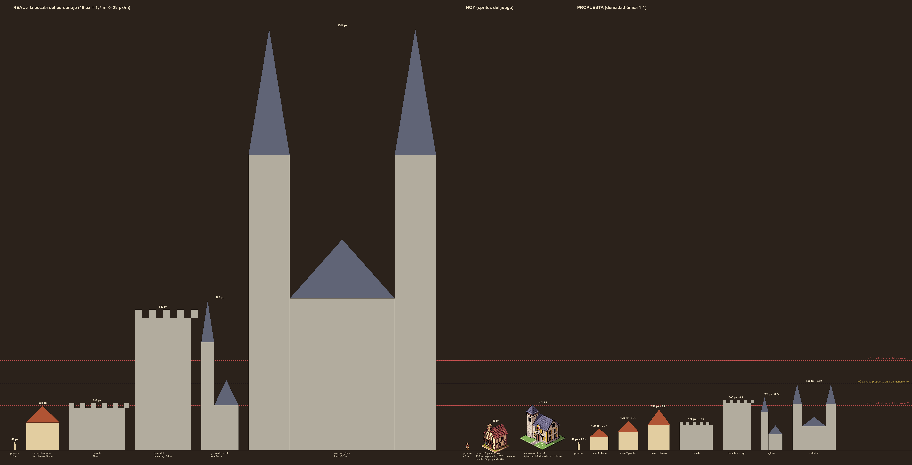

A la escala del personaje (28 px/m), sin comprimir nada:

| Elemento | Real | Real en px | Hoy | Propuesta B | B / real |
|---|---|---|---|---|---|
| Persona | 1,7 m | 48 | 48 | 48 | 1,00 |
| Puerta | 2,0 m | 56 | 40-43 | **52** | 0,93 |
| Planta baja | 3,0 m | 85 | 34 | **64** | 0,75 |
| Planta alta | 2,8 m | 79 | 34 | **48** | 0,61 |
| Casa de 2 plantas (cumbrera) | 9,5 m | 268 | ~120 | **176** | 0,66 |
| Casa patricia de 3 plantas | 12 m | 338 | — | **246** | 0,73 |
| Muralla (sin almenas) | 10 m | 282 | — | **160** | 0,57 |
| Torre de muralla | 16 m | 451 | — | **240** | 0,53 |
| Torre del homenaje | 30 m | 846 | — | **300** | 0,35 |
| Torre de iglesia de pueblo | 32 m | 902 | — | **320** | 0,35 |
| Catedral gótica (torres) | 90 m | 2.538 | — | **400** | 0,16 |

(Alturas en px verticales sobre el suelo de la fachada, sin contar la huella. La pantalla a zoom 1 mide 540 px de alto
y a zoom 2, 270.)

Una catedral real a esta escala mediría 2.538 px: casi cinco pantallas de alto. Una casa real (268 px) ya llena media
pantalla. A píxel fijo hay que comprimir, y la cuestión es cuánto y dónde.

## 3. Cómo lo resuelven otros (lectura a ojo de capturas conocidas, aproximada; no se copia nada)

| Juego | Qué hace | Lo que nos sirve |
|---|---|---|
| **The Guild 2/3** (3D, zoom libre) | Personas y casas casi a escala real; la cámara se aleja para ver la ciudad y se acerca para ver a la gente. | En 3D la escala real sale gratis porque el zoom es continuo. A píxel fijo no podemos: hay que comprimir. |
| **Stronghold** (sprites 2D isométricos) | La gente es pequeña; una casa mide ~2 personas; torres, homenaje y catedral están muy comprimidos, y la muralla se engorda para poder pasear por ella. | Lo grande se comprime mucho más que lo pequeño, y la muralla se dibuja para el juego (grosor jugable), no para el plano. |
| **Anno (1404)** | Parcelas pequeñas, alturas exageradas para el perfil; la gente es casi decorativa. | El perfil de la ciudad (tejados, torres) importa más que el tamaño real; la huella se comprime más que la altura. |
| **Age of Empires II** | Aldeano ~1/3 de una casa; castillo ~5-6 aldeanos; maravilla ~8-10. | Una escalera clara de tamaños: cada salto de importancia es visible de lejos. |

Patrón común: **lo que toca la persona va casi a escala real** (puertas, mostradores, carros, barriles) y **lo grande
se comprime cada vez más** (una compresión casi logarítmica). Además, cada escalón de importancia (casa → casa rica →
iglesia → catedral) mide al menos ×1,3 del anterior para que se lea de lejos.

## 4. Propuesta: tres opciones de casa (lámina 02)

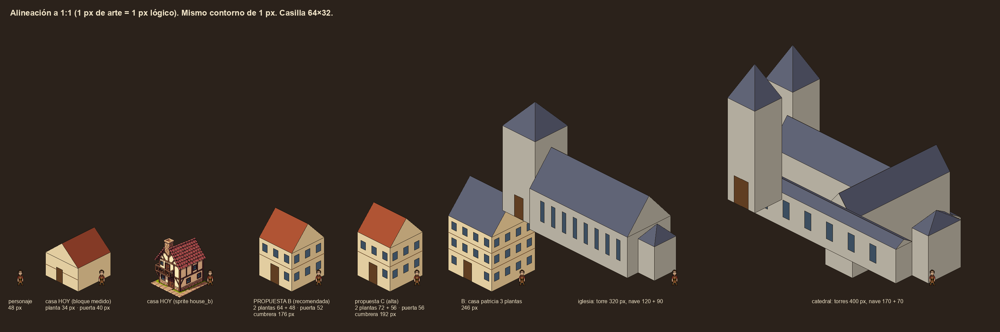

| Opción | Planta baja | Planta alta | Puerta | Casa de 2 plantas | Casa / personaje | Comentario |
|---|---|---|---|---|---|---|
| Hoy | 34 | 34 | 40-43 | ~120 (158 en pantalla) | ~2,5× | Caseta: puerta más baja que la persona. |
| **B (recomendada)** | **64** | **48** | **52** | **176** (272 en pantalla) | **3,7×** | La puerta y la planta baja ya son de persona; las plantas altas se comprimen como en los juegos de referencia. |
| C (alta) | 72 | 56 | 56 | 192 | 4,0× | Más realista, pero a zoom 1 la ciudad tapa la calle y a zoom 2 la casa no cabe. |

Regla de la propuesta B:

1. **Lo que toca la persona, a ~0,9 de lo real**: puerta 52, mostrador, carro, barril, pozo.
2. **Casas a ~0,65**: planta baja 64, plantas altas 48, tejado según el fondo de la casa (unos 22 px por casilla de
   fondo). Las plantas son el lenguaje de la riqueza: 1 planta (cabaña, forja), 2 (artesano), 3 (patricio).
3. **Monumentos comprimidos con tope de 400 px** de alto (74 % de la pantalla a zoom 1): torre de iglesia 320,
   homenaje 300, catedral 400. La huella también se comprime (catedral de 17×9 casillas en vez de 80×30).
4. **Huellas**: se mantienen (3×3 casa, 4×4 casa rica o forja). Lo que crece es la altura, no el solar: así no hay
   que rehacer el mapa ni las reglas de parcelas.

Tamaños de sprite resultantes (ancho × alto, incluida la huella):

| Pieza | Huella | Sprite | Cabe en una generación de PixelLab |
|---|---|---|---|
| Casa de 1 planta | 3×3 | 192×~228 | sí (todas las herramientas) |
| Casa de 2 plantas | 3×3 | 192×~272 | sí, salvo Pro Flash (≤256) |
| Casa patricia de 3 plantas | 4×4 | 256×~376 | `create_map_object` (≤400), `image_to_pixelart` (≤512) |
| Forja / taberna | 4×4 | 256×~300 | ídem |
| Tramo de muralla | 4×1 | 160×~250 | sí |
| Torre de muralla | 3×3 | 192×~336 | `create_map_object`, `image_to_pixelart` |
| Torre del homenaje | 5×5 | 320×~460 | no en `create_map_object` (400): en dos tramos apilados |
| Iglesia de pueblo | 12×4 | ~590×~400 | no: torre + nave + ábside por separado |
| Catedral | 17×9 | ~830×~720 | no: por módulos |
| Castillo (recinto) | 16×12 | ~1.024×~700 | no: kit de muralla + torres + homenaje |

El castillo (lámina 03) es más ancho que la pantalla: se recorre como un barrio, no se ve de un vistazo.

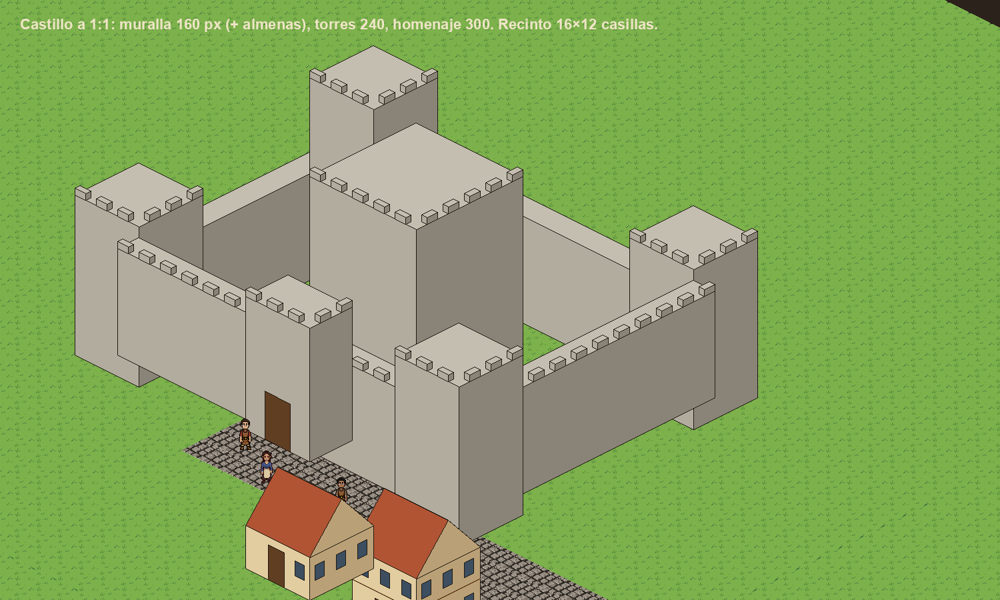

## 5. Qué cabe en 960×540 y qué implica para la cámara

A zoom 1 la pantalla abarca unas 500 casillas (≈22×22). Las huellas no cambian, así que caben **las mismas ~12 casas**
que hoy; lo que cambia es que tapan más: una casa B de 176 px oculta ~5 casillas de suelo detrás (hoy ~4).

| Vista | Lámina |
|---|---|
| Hoy, zoom 1 (captura real reducida a 960×540) | 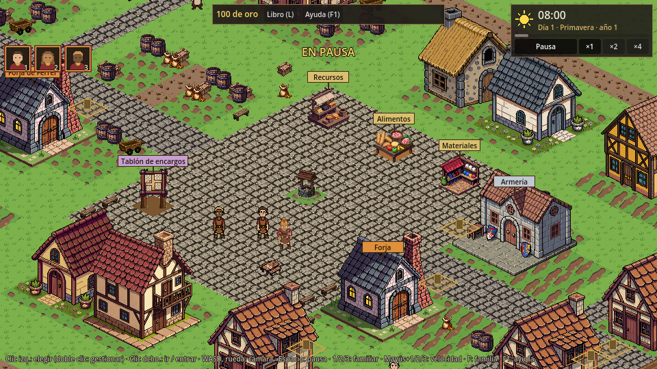 |
| Propuesta B, zoom 1, pueblo E | 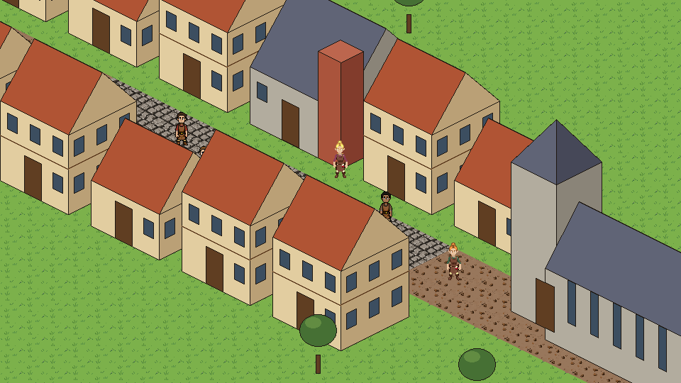 |
| Propuesta B, zoom 2 (480×270 ampliado) | 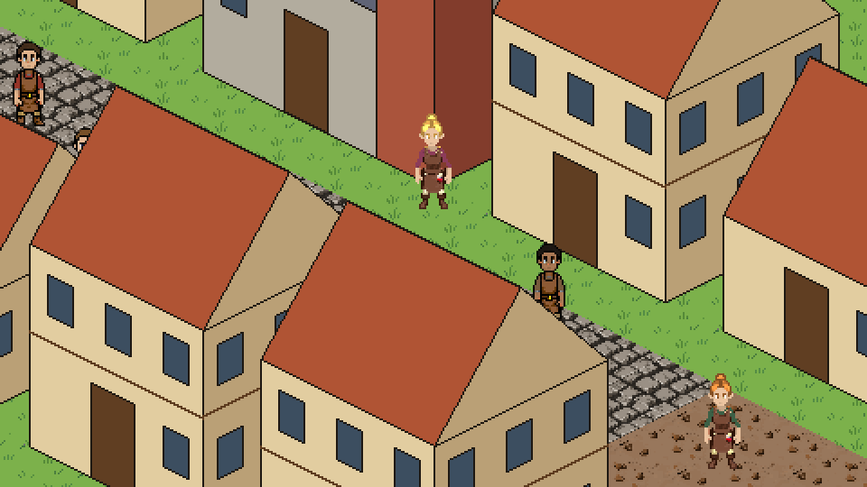 |
| Propuesta B, zoom 1, plaza A | 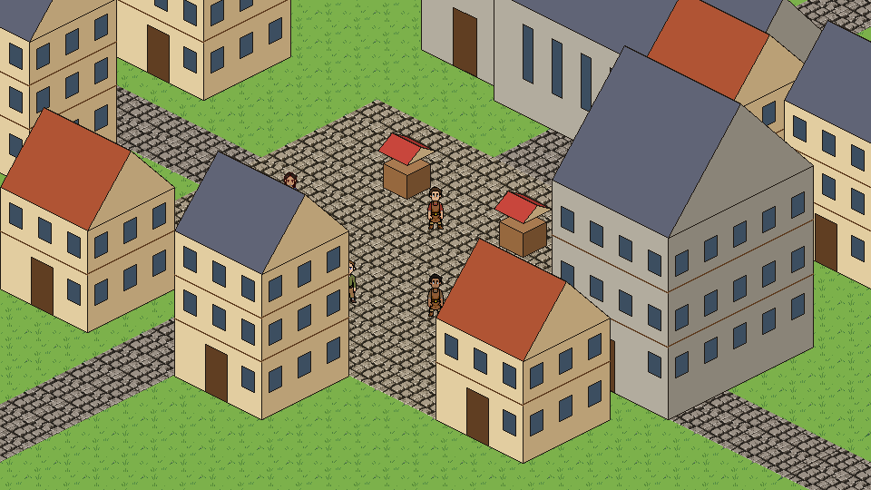 |
| Catedral a zoom 1: no cabe entera | 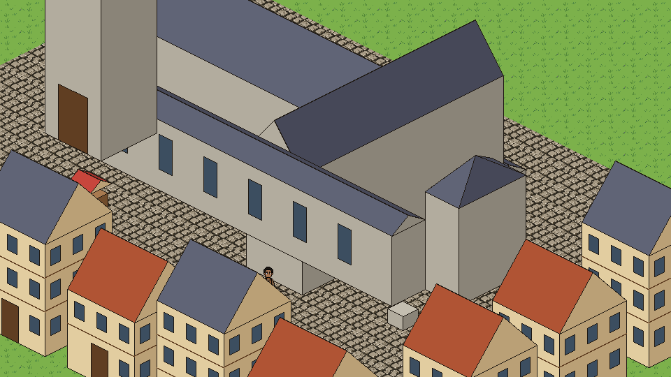 |
| Castillo a zoom 1: se ve un trozo | 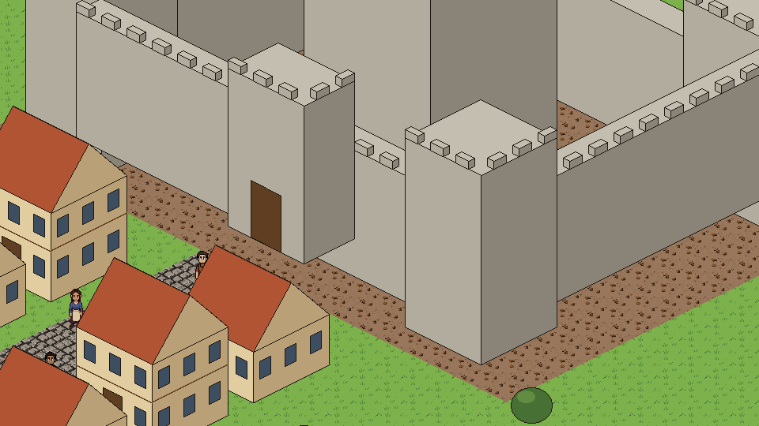 |
| Vista de 1920×1080 a 1:1 (lo que daría un zoom «×½» nativo) | 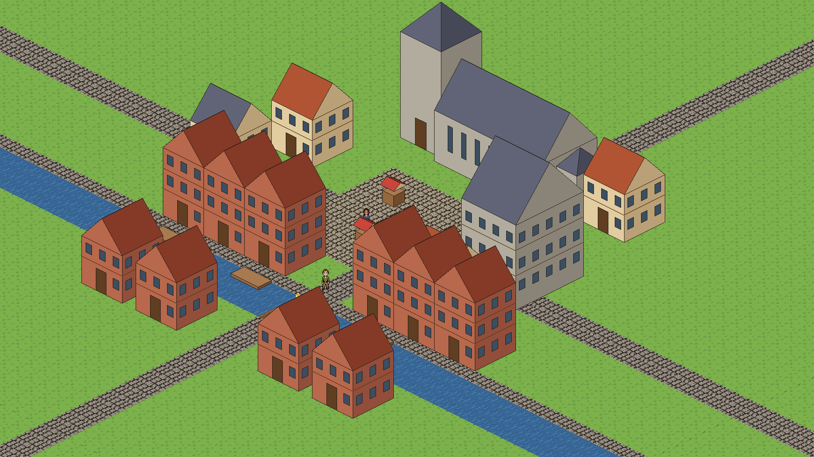 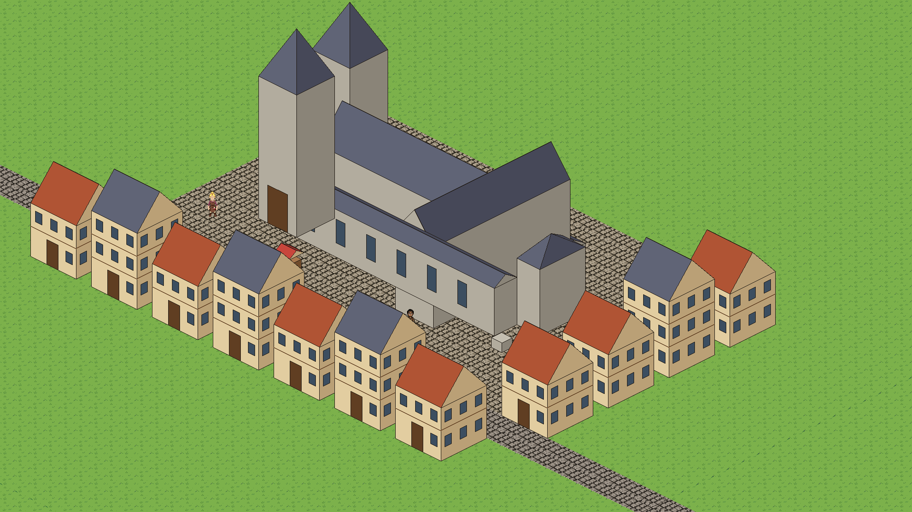 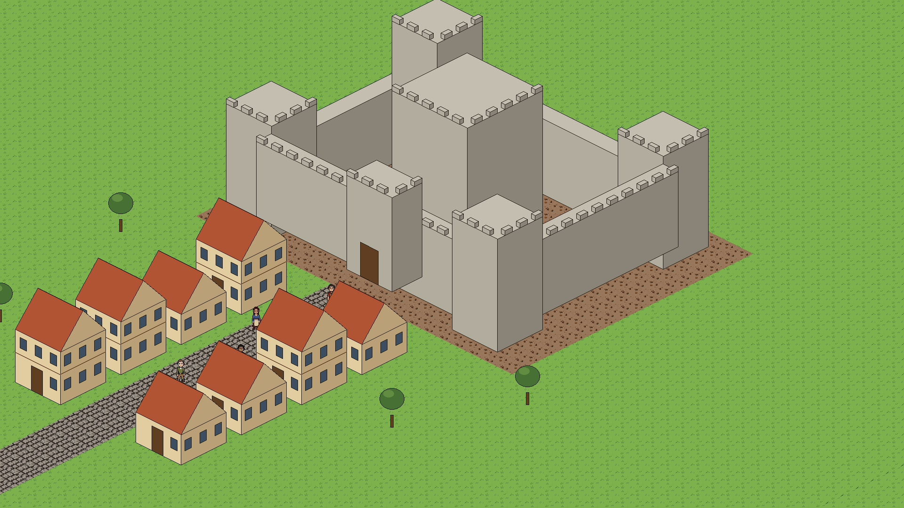 |

Consecuencias:

- **Zoom 1 pasa a ser la vista de juego.** Zoom 2 (480×270 de mundo) queda como lupa: una casa B de 272 px de sprite
  no cabe entera, ni la iglesia.
- **Calles de 3 casillas** en los ejes que se miran de frente, y **transparencia del edificio** (o silueta del personaje)
  cuando la persona elegida, el cursor o un NPC con aviso quedan detrás. Es lo que hacen todos los isométricos con
  edificios altos; hoy no hace falta porque las casas son bajas.
- **Una vista más amplia** solo puede ser nítida si el mundo se dibuja a 1:1 sobre 1920×1080 (un píxel de arte = un
  píxel de pantalla a 1080p), con el mundo en su propio SubViewport y la interfaz aparte. Con el estiramiento
  `viewport` de D2, un zoom de 0,5 se come píxeles. Es un cambio de `game/` que no toca hacer ahora: queda como
  decisión.
- **Monumentos**: con el tope de 400 px, la catedral llena la pantalla a zoom 1 y se ve entera en la vista amplia. Es el
  efecto que se busca: un monumento se reconoce de lejos y se recorre de cerca.

## 6. Regla de densidad única

**Un píxel de arte es un píxel lógico. Ningún sprite se escala** (ni 1,6 ni 2 ni 0,5). Lo que es más grande se dibuja
más grande o se compone por piezas a la misma densidad. Consecuencias:

- El ayuntamiento de H9 (`town_hall.tscn`, escala 1,6) incumple la regla: sus píxeles miden 1,6 y se notan junto a las
  casas. Se rehace a 1:1 con la escala B (de 192×192 a ~256×376, generado o estirado por plantas).
- Se acaba la tentación de «hacer la catedral a 192 y escalarla ×2»: se notaría a la primera (píxeles el doble de
  gordos y contorno de 2 px junto a todo lo demás, de 1).
- El contorno es de 1 px en todo. Si un edificio grande se compone de piezas, las uniones se limpian a mano o con el
  workbench (`lint`, `repair`).

## 7. Prueba sin créditos: subir plantas sin reescalar (lámina 14)

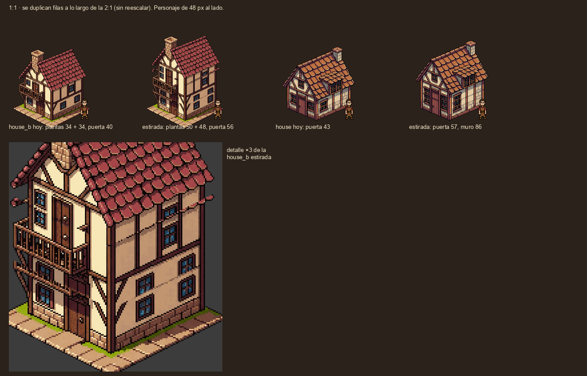

`tools/art/estirar_iso.py` duplica una franja de filas que sigue la diagonal 2:1 de la base del muro. Cada columna sube
lo mismo, así que las líneas isométricas siguen siendo 2:1 y ningún píxel se reescala. Con `house_b` (plantas 34 + 34,
puerta 40) sale una casa B aproximada (plantas 50 + 48, puerta 56); con la cabaña, la puerta pasa de 43 a 57.

Funciona y se lee como una casa de verdad junto al personaje. Defectos que se ven: las ventanas que cruza la franja se
duplican (dos ventanas apiladas), el balcón se alarga y queda algún píxel de alero repetido en el borde. Para usarlo en
serio, la franja se elige por casa (una banda de muro liso) y se repasa a mano. Sirve para **probar la escala B en el
juego antes del 15-nov sin gastar**, no como arte final.

## 8. Recomendación

- **Escala B**: puerta 52, planta baja 64, planta alta 48; casa de 2 plantas a 176 px de cumbrera (3,7× el personaje),
  casa de 3 plantas a 246 (5,1×), muralla 160 + almenas, torres 240, torre de iglesia 320, homenaje 300, catedral 400
  (tope). Huellas sin cambios.
- **Densidad única 1:1** sin excepciones; el ayuntamiento se rehace.
- **Zoom 1 como vista de juego**, zoom 2 como lupa; transparencia de edificios cuando tapen algo importante.
- La vista amplia nativa a 1080p queda pendiente de decisión (no hace falta para la rebanada).

## 9. Aplicado en el juego (rama escala-b, 2026-11-02)

El owner aprobó la escala B. Primera prueba en el juego, sin créditos:
- Las casas, la forja, la armería y el ayuntamiento de Guild Renew, estirados con `tools/art/escala_b.py`. El
  ayuntamiento queda a 1:1 sobre su solar de 6×4, alargado con 4 crujías de ventanas.
- Las escenas guardan el sprite de antes como `SpriteAntes`.
- Los edificios se vuelven translúcidos con la persona elegida detrás (`see_through` en `data/view.json`).
- Detalles y vuelta atrás en `docs/arte/reuso_guild.md` («Escala B»). Kits de casa nuevos: `docs/arte/kits.md`.

