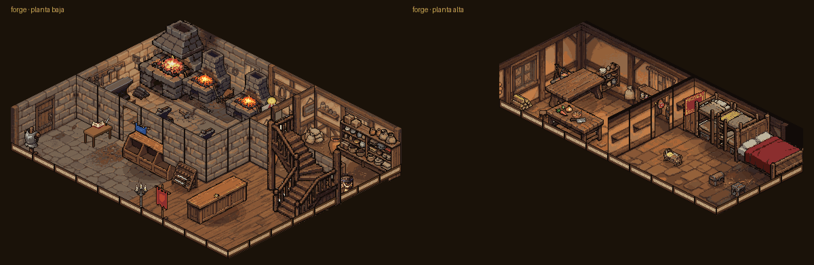
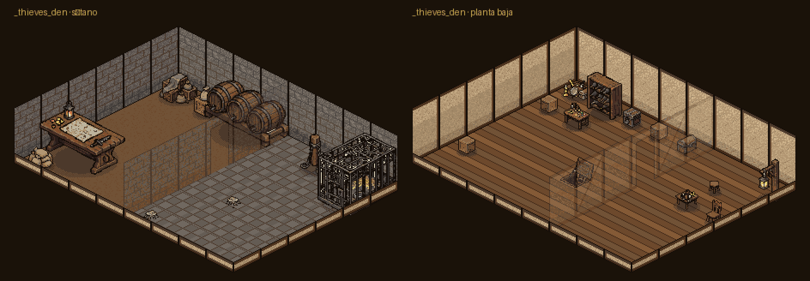
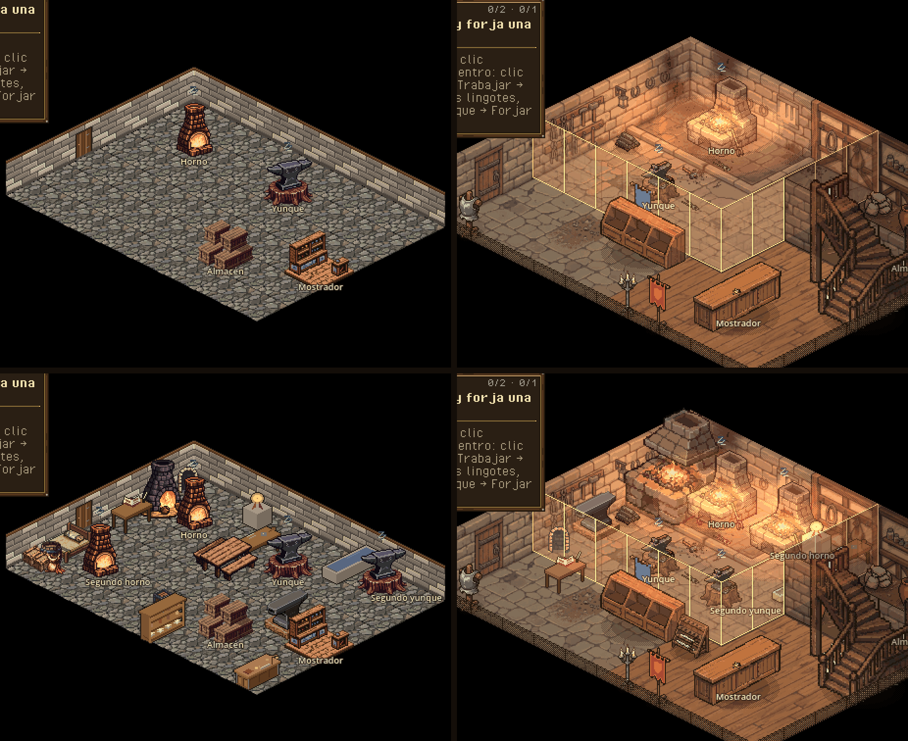
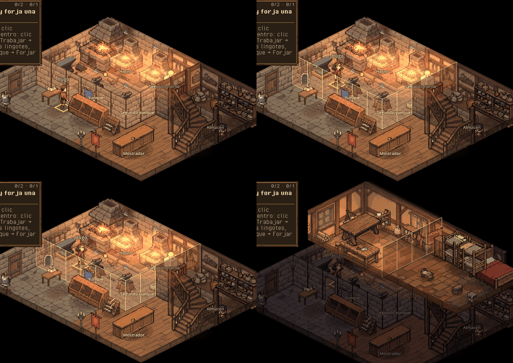
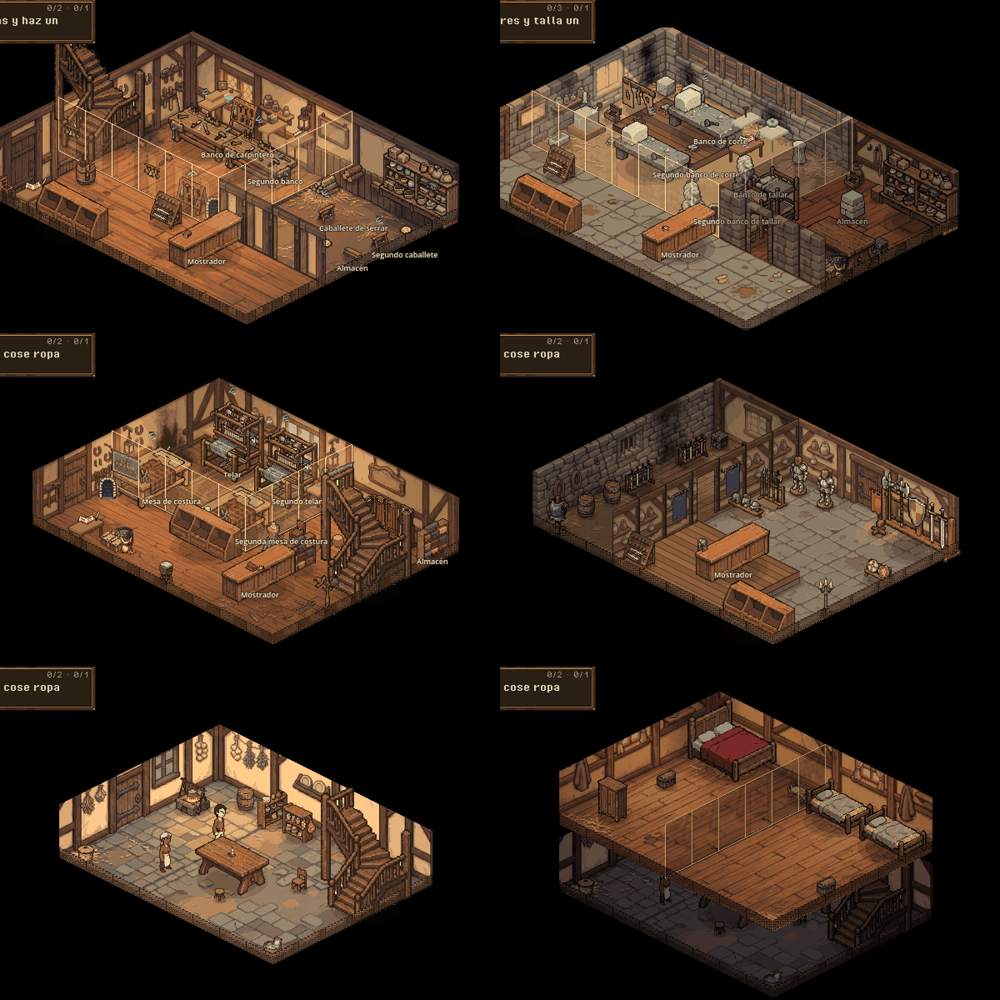

# Interiores bonitos: referencias, análisis y piloto de la forja

> Fecha: 2026-11-05 · Rama `interiores` · Diseño: `docs/gdd/04g_interiores.md` (§4.6.5) · Gasto: 7,57 USD de fal
> (detalle en `assets/art/MANIFEST.md` y `assets/art/fal_piloto/gasto.json`, tanda `interiores`).
> No cambia reglas del sim: solo cómo se monta y se ve un interior, y dónde se dibuja a la gente que el sim ya tiene.

## 1. Punto de partida

Hoy cada interior es el kit modular de GDD 4.6.4 sobre la rejilla isométrica 2:1 (rombos de 64×32), visto en el
viewport de 960×540 ×2 con zoom 1 (un píxel de arte = dos de pantalla; el personaje mide 48 px):

- **Sala**: `GreyboxKit` (`game/visuals/greybox/greybox_kit.gd`) pone una casilla `KitFloor` por casilla (la misma
  textura de 64×32 repetida) y un tramo `KitWall` de 32 px por borde del fondo, con la puerta en su tramo. Paredes de
  36 px: la puerta se queda en 29 px, por debajo de la cabeza del personaje (la escala B pide 52).
- **Puestos**: un `Marker2D` por zona bajo `Stations`, con la escena del puesto (`game/visuals/stations/<zona>.tscn`).
- **Mejoras que se ven**: nodos bajo `Upgrades`, ocultos hasta que el edificio tiene la mejora; la vista los mueve a
  su capa de objetos, ordenada por Y con la gente.

Lo que se ve (capturas `--smoke-script=interiores`): salas planas de un solo suelo y una sola pared, sin luz, sin
nada en las paredes, muebles sueltos de dos procedencias (Guild Renew y Pillow) y mucho suelo vacío. La carpintería,
la cantería y la sastrería siguen en greybox (kit de la forja recoloreado).

## 2. Referencias (bloque 1)

Diez interiores, dos variantes cada uno (a: de día, con la luz de la ventana; b: al anochecer, solo con fuegos y
velas), en `assets/art/interiors/_referencias/<interior>_<a|b>.png`. La referencia de cámara de todas es la forja de
hoy compuesta con Pillow desde su escena (suelo, paredes, puestos y mejoras en su sitio, sin rótulos, con el herrero
de 48 px para la escala): así el modelo copia la proyección, la forma de la sala y el tamaño del personaje.

**Prueba de modelos** (la misma referencia y el mismo encargo, una imagen cada uno; precios de
`api.fal.ai/v1/models/pricing` del 2026-11-04):

| Modelo | USD/imagen | Resultado |
|---|---|---|
| nano-banana-2/edit | 0,08 | Respeta la cámara, el rombo de la sala, las dos paredes y el tamaño del personaje. **Elegido.** |
| nano-banana-pro/edit | 0,15 | La mejor luz y el mejor ambiente, pero acerca la cámara (la sala no cabe igual). Útil para una pieza suelta de lujo, no para la tanda. |
| seedream 4.5/edit | 0,04 | Rompe la proyección (cámara baja, casi frontal) y pierde el personaje. Descartado. |

**Revisión de las 20** (todas con nano-banana-2):

| Interior | Qué aporta | Pegas |
|---|---|---|
| Forja | Fragua de piedra con campana, fuelle, yunque en tocón, cubo de temple con vapor, armero, carbonera, lingotes, chispas y el charco de luz de la fragua. | La variante a gira la sala (fragua a la derecha). |
| Armería | Mostrador con balanza, panoplias, maniquí con armadura, baúles de malla, estandartes. | La b mete dos hornos que no son de una tienda. |
| Carpintería | Banco con tornillo, sierra colgada, tablones, troncos, virutas por el suelo, torno. | — |
| Cantería | Bloques y sillares, banco con estatua a medio tallar, grúa, polvo de piedra. | La a mezcla pared de piedra y de entramado a medias. |
| Sastrería | Mesa de corte, rueca, telar, maniquí, rollos de tela, probador con cortina, espejo. | — |
| Taberna-Posada | Barra con toneles, chimenea, mesas con jarras, rincón del juglar, escalera. | La b falló dos veces (el filtro del modelo; pasó al quitar «beer»). |
| Ayuntamiento | Mesa larga del concejo, sillón del Alcalde en estrado, escudos, archivo, alfombra. | La a deja un pico de suelo fuera de la rejilla. |
| Tribunal | Estrado con sillón, banco de acusados con baranda, testigos, público, escribano. | Más oscuro (bien para la paleta 2, otoñal). |
| Casa de la familia | Hogar con caldero, mesa, camas, arcón, cuna, ristras colgadas. | — |
| Iglesia | Altar, bancos, púlpito, vidriera con luz de color, pila bautismal, columna. | La b recorta una pared. |

Lo que tienen en común, y es lo que falta en el juego:

1. **Paredes con oficio**: entramado de vigas con yeso o ladrillo, ventana con luz, y la pared llena de lo del oficio
   (armero, estantes, escudos, herraduras). Paredes más altas que hoy (~1,5 veces el personaje).
2. **Suelo variado**: losas, tierra pisada y tablas mezcladas, caminos de paso, manchas (hollín, virutas, polvo),
   paja, una alfombra. Nunca una baldosa repetida.
3. **Luz por capas**: un ambiente cálido de base, charcos de luz bajo la ventana y alrededor del fuego, y el fuego que
   tiñe lo que tiene cerca.
4. **Atrezo pequeño**: herramientas por el suelo, cubos, sacos, velas, jarras. Llena los huecos entre puestos.
5. **Sombras** suaves bajo cada mueble.
6. **Partículas**: chispas, vapor, polvo en la luz.

## 3. Qué se puede hacer con nuestro sistema (bloque 2)

| Qué | ¿Se puede hoy? | Cómo |
|---|---|---|
| Puestos propios y mejoras que se ven | Sí | Ya existe: marcadores en `Stations` y nodos en `Upgrades`. Solo cambia el arte. |
| Paredes con vigas y ventanas | A medias | El kit dibuja un tramo de 32 px repetido: se puede alternar tramos (viga, ventana, armero), pero la pared repetida se nota y el atrezo de pared cruza tramos. |
| Suelo variado | A medias | Una textura por casilla: con variantes al azar se rompe la repetición, pero los caminos, manchas y charcos de luz cruzan casillas. |
| Luz cálida por capas | Sí, con capas | Halo aditivo (`CanvasItemMaterial` Add) sobre el fuego, que parpadea; la luz de base, pintada en el arte. Sin `CanvasModulate` (tiñe el mapa y choca con el día/noche). |
| Chispas, vapor, polvo | Sí | `CPUParticles2D` (funciona en GL Compatibility) con una brasa de 1 px y su rampa de color. |
| Atrezo pequeño | Sí | Piezas sueltas en un nodo `Props` que la vista ordena con la gente (nuevo en este piloto). |
| Sombras | Sí | Pintadas en el suelo del fondo bajo los puestos fijos; en las piezas, una sombra en su propio sprite. |

### Tres caminos

**A. Piezas sueltas con fal/edit** (como las fachadas y la taberna): suelos, tramos de pared y muebles generados con la
referencia, sobre el kit de siempre.
- A favor: un kit sirve para cualquier tamaño de sala; las mejoras siguen siendo piezas; nada cambia en la vista.
- En contra: lo que hace bonita la referencia es justo lo que cruza casillas (caminos, manchas, luz, la pared llena
  de cosas). Con piezas de 64×32 y 32×64 vuelve a salir una cuadrícula repetida. Muchas piezas por interior.

**B. El interior entero pintado como fondo**, con los puestos encima.
- A favor: es la referencia, casi tal cual: luz, suelo, paredes y atrezo de pared en una sola imagen coherente.
- En contra: la sala queda fija (tamaño y puerta); lo que está en el fondo no se ordena con la gente, así que solo
  vale para lo plano o lo que cuelga de las paredes del fondo (nadie pasa por detrás). Una mejora que cambie la sala
  entera (suelo de piedra) pide otro fondo o una capa encima. Un fondo por tipo de edificio.
- Profundidad: no hay problema mientras el fondo no tenga nada de pie en el suelo. Todo lo que tenga altura (puestos,
  mejoras, atrezo de pie) va como pieza en la capa de objetos.

**C. Mezcla** (**recomendada**):
1. **Fondo pintado por tipo de interior**: suelo + las dos paredes del fondo + la puerta + todo lo que cuelga de ellas
   + la luz de base y las manchas. Se genera con fal/edit sobre una **plantilla de la geometría exacta** de la sala
   (`GreyboxKit` size, puerta, altura de pared) y la referencia como dirección de arte, y se reduce a ×1 (448×288 en la
   forja) con 48 colores. El kit sigue construyendo sus piezas (puerta, tamaño, pruebas) pero ocultas.
2. **Piezas sueltas** para todo lo que tiene altura: puestos, mejoras y atrezo de pie, con fal/edit en rejillas 2×2 y
   image2pixel (bloques de 8, o de 6 para una pieza grande), como la taberna.
3. **Capas de luz y partículas** en las piezas que dan luz (halo aditivo que respira, chispas, polvo en la ventana).

Las mejoras siguen igual: nodos en `Upgrades` que se encienden. Una mejora que cambie la sala (suelo de piedra,
tapices) se hace como pieza plana en `Upgrades` encima del fondo, o, si cambia todo, con un segundo fondo que la
mejora enciende (pendiente: hoy no hace falta en ningún oficio).

## 4. Primer piloto: una sala de una pieza (superado)

El primer piloto pintó la forja de siempre (8×6) como un solo fondo con los puestos encima, paredes de 64 px, halo
y chispas en la fragua y atrezo de pared. Funcionó, y sirvió para fijar la decisión del owner (§4.6.5.1): la mezcla,
pero **un fondo por sala y por planta**, y una **biblioteca de props** para todo lo que tiene altura, con los
interiores montados **por datos**. Lo que queda de él: la fragua con su luz (`stations/furnace.tscn`), el yunque y
la plantilla de geometría, que ahora saca el montador.

> [!NOTE]
> El encargo ampliado decía «el owner no quiere interiores pintados como fondo». El diseño de main dice lo contrario
> desde `f626162` (2026-11-05 00:38, «Decision del owner, tras ver el piloto»): fondo pintado por sala + piezas. Se
> ha seguido el diseño; si la decisión cambió después, solo hay que borrar los `room_*.png` y el montador vuelve a
> los suelos y paredes de la biblioteca.

## 5. Interiores II (04g §4.6.5): biblioteca, datos y escenario



*La forja montada desde `data/interiors/forge.json` (vista previa de `tools/interiors/interiores.py vista forge`).*

### 5.1 Biblioteca de props (§4.6.5.1)

- `tools/art/fal_props.py`: 162 piezas en **19 rejillas** de fal (nano-banana-2/edit, 0,08 USD por llamada): 4×4 para
  el atrezo pequeño (16 por llamada), 3×3 para lo de una casilla (9), 2×2 para lo de 2×1 (4) y 3×3 para lo que cuelga
  de la pared. Cada rejilla lleva la referencia de su sala y la hoja de la forja ×4 (escala, contorno, proyección).
  **≈ 0,01 USD por pieza.**
- Cada pieza se pixela a **su tamaño de juego** (una altura objetivo por pieza, a escala del personaje de 48 px: una
  jarra 16, una silla 30, un armario 56; las de 2×1, 96 de ancho) y con una **paleta fija de interiores** (64 colores
  de los fondos y las referencias + 20 de acento para telas, escudos y vidrios), para que case con los fondos.
- `tools/art/props_estructura.py`: lo exacto, con Pillow: tramos de pared (32 × 80), con puerta, zócalos, barandillas
  y suelos de respaldo; y 24 piezas de antes de las mejoras (Guild Renew y Pillow) hasta que tengan una nueva.
- **Catálogo** `data/props/interior.json` (218 piezas), exportado del campo `prop` de `assets/inventario.json` por
  `tools/interiors/props_catalog.py` y comprobado por el validador: categoría (`structure`, `furniture`, `trade`,
  `container`, `light`, `small`, `textile`), huella, ancla (pies), altura, si se pisa, si va contra la pared, si va
  encima de otra, si cuelga, espejo (la otra diagonal), oficios y estilo (`poor`, `common`, `rich`).
- Hojas de contacto: en la galería de Grimoire.

### 5.2 Interiores por datos (§4.6.5.2)

`data/interiors/<edificio>.json`: rejilla, salas por planta (rectángulos, tipo, suelo, estilo de pared, luz),
puertas, desniveles (foso −1, tarima +1), escaleras entre plantas, puestos (con su pieza o su escena), sitios de
clientes (mostrador y cola), sitios de espera, atrezo a mano (con `"glow": tamaño`, una pieza de fuego lleva su halo
que respira, el de la fragua: brasero, chimenea), **reglas** (`wall_fill`, `on_top`, `scatter`, `hang`) y
las piezas de cada mejora por su nodo (`visual.interior_node`, como antes).

- `tools/interiors/interiores.py validar` comprueba que todo está conectado, que las puertas dan a algo, que se
  llega a cada puesto, sitio de cliente y sala desde la puerta de la calle, que nada pisa una puerta ni una escalera y
  que `resolved` coincide con las reglas. `reglas` resuelve las reglas con la semilla (un solo motor: Godot solo lee
  `resolved`). `vista` saca la vista previa en PNG; `plantilla`, la plantilla de una planta para pintar su fondo.
- **Paredes:** salen solas. Las del fondo del edificio van pintadas; entre salas, piezas (`InteriorWall`); delante,
  zócalos. Las de entre salas y los zócalos se **sacan de la propia pared pintada** de cada sala (`fal_salas.py`):
  casan al píxel.
- **Fondos:** `tools/art/fal_salas.py` pinta cada planta sobre su plantilla y la corta en un fondo por sala.
- **Montador** (`game/interior/interior_builder.gd`): construye la sala con la estructura de las escenas de antes
  (`Kit`, `Stations`, `Upgrades`, `Props`), así la vista, la vista previa de mejoras y la galería no cambian. La forja
  ya no tiene escena hecha a mano.

### 5.3 Ver dentro (§4.6.5.3) y gente (§4.6.5.4-4.6.5.5): `InteriorStage`

- **Plantas:** se ve la planta de la persona seleccionada; las de arriba, ocultas; las de abajo, en penumbra. Rueda,
  AvPág / RePág o el botón «Planta alta» para ver la otra sin mover a nadie.
- **Paredes que se abren:** las de entre salas quedan al 25 % con su contorno mientras el ratón (o la persona
  seleccionada) está en la sala de detrás. Sin nadie a quien seguir, la sala de trabajo queda abierta.
- **Luz por sala** (`data/interiors/lights.json`): la fragua roja y viva, la cocina cálida, el almacén en penumbra.
- **Andar:** tu gente y los empleados andan de la puerta a su puesto por puertas y escaleras. Solo se dibuja: el sim
  ya los cuenta en el puesto (dentro no hay tiempo de andar), así que **las dianas no cambian**.
- **Clientes del mostrador** (4.5.4): aparecen en su sitio con un fundido de 0,3 s, con la burbuja de lo que vienen a
  comprar (el producto que el mostrador les vendería) o «…» en la cola, y su barra de paciencia (o la dorada de la
  venta). Clic en uno: la persona seleccionada va al mostrador a atender (`go_to_station counter`, la misma orden de
  siempre). Al irse, cualquier cliente (vecino, de la comarca o huésped de la posada) **se desvanece** en 0,3 s en vez
  de desaparecer de golpe (`InteriorStage.fade_out`); mientras se va ya no se puede elegir.
- **Expositor:** enseña lo que hay a la venta en el almacén (los productos más caros primero), hasta sus huecos.

### 5.4 Clientes en dos capas (§4.6.5.7) y sótano (O-I1)

- **Vecinos** (los habitantes del pueblo, con su agenda): andan por la calle hasta tu puerta (TownLife, como desde H7)
  y dentro **entran andando** desde la puerta hasta su sitio del mostrador.
- **Clientela de la comarca** (`sim/town/clientele.gd`): no son personajes del pueblo, sino registros en
  `state.town.clientele`. Vienen según `base(tipo) × fama × estación × fiesta × reparto` y pagan con oro de fuera hasta
  su precio máximo; los atiende quien esté en el mostrador. Dentro **aparecen** en su sitio con un fundido, vestidos de
  aldea, con la burbuja del producto que vienen a comprar, y **se van** con otro fundido. **Apagada por defecto**
  (`data/town.json` `counter.clientele.enabled`), así las dianas no se mueven. Pendiente del owner: la `fama` de un
  taller (hoy vale 1) y medir `base_per_day` con los bots antes de encenderla (`docs/decisiones.json`).
- **Sótano:** un tipo de planta del montador: `level` negativo en `data/interiors/<edificio>.json`, al que se baja
  por una escalera hacia abajo (una entrada de `stairs` con `to_floor` negativo y la pieza `cellar_stairs`). Va bajo tierra y, si la sala no pide otra luz, lleva luz baja
  (`dim`). Desde arriba no se ve, y cuando miras el sótano se ocultan las de encima. Hoy lo usa la bodega de la
  Taberna-Posada. La **guarida del Pícaro** existe de momento solo como piezas (jaula, poste con cadenas,
  trampilla, contrabando, mesa del perista y de dados, objetos robados, botellero, toneles, escalera de piedra) y como
  plantilla de datos, `data/interiors/_thieves_den.json`. Planta baja: taller del perista y sala de juego. Sótano,
  tras la trampilla: el contrabando y la celda con la jaula. El `_` la deja fuera del juego hasta que haya edificio.



**Lo que no hay todavía:** clientes de encargos (4.5.6), porque el sim no los tiene como personas.

## 6. La forja de §4.6.5.6



*Arriba, sin mejoras; abajo, con las 24. Izquierda, antes; derecha, ahora.*



- Planta baja (10×8): **taller** de piedra con la fragua en un **foso** de un escalón (y su segunda fragua y la forja
  de maestro), yunques, temple; **tienda** en L con el mostrador largo (2 sitios de cliente y 3 de cola), el expositor
  y la escalera; **almacén** de tierra con su puerta, lleno de cajas y sacos por regla.
- Planta alta: **cocina** (hogar, alacena, mesa con pan y jarra por regla) y **dormitorio** (cama, cuna, arcón,
  armario). Las literas, la mesa de comedor y la caja fuerte de las mejoras van arriba.
- Puestos, clics, puerta y mejoras como antes (pruebas `test_game_forja`, `test_visuals_paths`, `test_game_pulido` y
  las nuevas `test_interiores_datos`).

## 7. Los demás interiores



*Capturas del juego (`--smoke-script=interiores`): carpintería, cantería y sastrería con todas sus mejoras, armería,
casa y su planta alta.*

| Interior | Planta baja | Planta alta |
|---|---|---|
| Armería | tienda grande de losas con el mostrador en una tarima, panoplias, maniquíes y expositor; trastienda | — |
| Carpintería | taller con bancos y caballetes, patio de tablones, tienda pequeña | cocina y dormitorio |
| Cantería | patio de bloques con tarima de trabajo, cobertizo, tienda | — |
| Sastrería | taller con telares y mesas de corte, tienda en L con probador | cocina y dormitorio |
| Casa | hogar, cocina y mesa | dormitorio y cuarto de los hijos |
| Taberna-Posada | salón con la barra grande en L (6 casillas, dos taburetes, toneles, baldas de jarras y caja de jarras detrás), brasero con su luz, mesa larga con bancos, rincón del juglar y mesa de dados; con mejoras, otra mesa y la chimenea; cocina | dos habitaciones con 8 camas; **sótano**: la bodega con el almacén |

Ya no queda ninguna escena de interior hecha a mano (solo `_generic.tscn`). La taberna llegó con la rama `posada`: su
`InnLayer` (huéspedes sentados y camas) lee los asientos y las camas que el montador saca de los datos (`seats`, `beds`)
y solo dibuja los de la planta que se ve. Sus 16 asientos: 0-3 en la barra (dos de pie en la barra, entre los
taburetes, y dos esperando detrás), 4-7 en la mesa larga, 8-11 en la mesa de «Más mesas» y 12-15 junto al brasero (para
más `inn_seats`); cada uno con `facing`, adónde mira el cliente (los de la barra, a la barra). Lo aprendido al pintar los fondos: el
modelo respeta las paredes y la puerta de la plantilla, pero **confunde suelos de colores parecidos** (la plantilla
usa ahora colores bien distintos y el texto dice qué color es cada suelo) y **no respeta las tarimas** (se dibujan con
Pillow encima del fondo, exactas). El foso de la forja sí salió bien a la cuarta.

**Ayuntamiento y tribunal:** no tienen tipo de edificio en `data/buildings/` ni interior en el juego; quedan sus
referencias para cuando lo tengan. Por interior nuevo: unos 0,2-0,6 USD de fondos.

**PixelLab (desde el 15-nov):** para las piezas que piden varias direcciones o animación (fuego, fuelle, telar) y
para repasar el detalle y la paleta de los personajes frente a los fondos (§4.6.5.1). Apuntado en la lista de la
compra de `assets/art/MANIFEST.md`.

## 8. Revisión con lupa: que case la estética (2026-11-05)

El owner aprobó el camino C con una condición: «el tema es que case la estética». He revisado a nivel de píxel las
capturas del juego y he medido lo que se ve:

| Qué | Medida | Qué se hizo |
|---|---|---|
| Piezas de antes de las mejoras (Guild Renew y Pillow) | ΔE medio 10,5 a la paleta del fondo (las de fal, 7,1); tablas planas, grises fríos, otro sombreado | Repintadas las 24 con fal y la referencia de su sala (0,33 USD) |
| Contorno | El 85 % del borde de las piezas por debajo de luminancia 35; en el fondo, ni el 2 % más oscuro baja de 44: se leían como pegatinas | Contorno selectivo en toda la biblioteca: el borde toma el color de la pieza oscurecido, más claro del lado de la luz, nunca más oscuro que el fondo |
| Paleta | Las piezas iban con la paleta común de la biblioteca | Cada interior lleva sus piezas pasadas a la paleta de sus fondos (`tools/interiors/remap_props.py`): el 82-95 % de los píxeles; los acentos (rojos, brillos, llamas) se quedan. Pasar los fondos a la paleta común los empeoraba (ΔE 4,1 frente a 1,8) |
| Luz | Piezas y fondos con la luz arriba a la izquierda; la luz por sala tiñe las dos cosas igual | Nada |
| Sombras | Las piezas llevan su sombra tramada; el fondo, sombras suaves pintadas | Nada (se leen igual) |
| **Personajes** | Planos al lado de los fondos: 2 tonos por color, contorno pardo uniforme, más claros, sin la luz de la sala | Apuntados para PixelLab el día 15 (lista de la compra, fila 14) |


## 9. Cómo repetirlo

```bash
python3 tools/art/fal_props.py gen && python3 tools/art/fal_props.py proc   # biblioteca (sin gasto si hay crudos)
python3 tools/art/props_estructura.py                                         # piezas exactas
python3 tools/interiors/props_catalog.py                                      # catálogo data/props/interior.json
python3 tools/interiors/interiores.py reglas forge && python3 tools/interiors/interiores.py validar forge
python3 tools/interiors/interiores.py vista forge --marcas                    # reports/interiores/forge.png
python3 tools/art/fal_salas.py gen forge 0 --tag v1                           # fondo de una planta (0,08 USD)
python3 tools/art/fal_salas.py ver forge 0 --tag v1                           # encaje con la plantilla
python3 tools/art/fal_salas.py proc forge 0 --tag v1                          # fondos por sala y paredes
python3 tools/interiors/remap_props.py forge                                  # sus piezas con la paleta de sus fondos
```

Los crudos quedan en `~/Code/GuildMaster-arte-crudos/fal_produccion/{interiores,props_interior,salas}/`. Capturas:
`grimoire heavy --timeout 3m -- /opt/homebrew/bin/godot --audio-driver Dummy --always-on-top --path . --
--smoke-script=interiores` → `reports/shots/interiores_<oficio>[_mejoras|_andando|_trabajando|_cliente|_arriba].png`.
