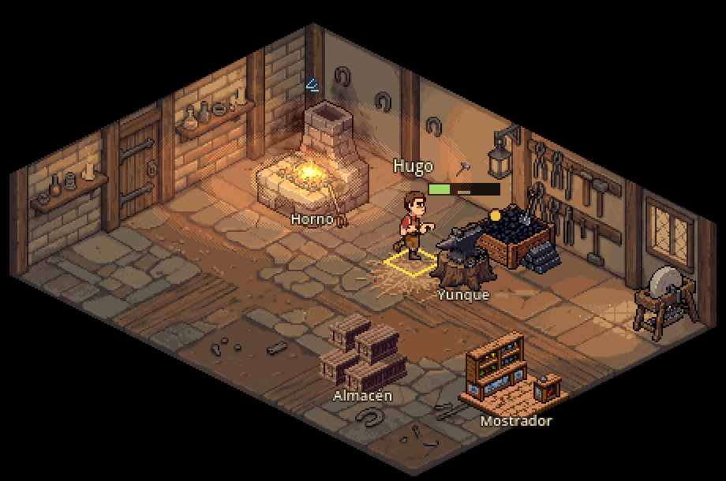

# Interiores bonitos: referencias, análisis y piloto de la forja

> Fecha: 2026-11-05 · Rama `interiores` · Script: `tools/art/fal_interiores.py` · Gasto: 2,35 USD de fal (detalle en
> `assets/art/MANIFEST.md` y `assets/art/fal_piloto/gasto.json`, tanda `interiores`).
> No cambia reglas del sim: solo la vista de los interiores y su arte.

## 1. Punto de partida

Hoy cada interior es el kit modular de GDD 4.6.4 sobre la rejilla isométrica 2:1 (rombos de 64×32), visto en el
viewport de 960×540 ×2 con zoom 1 (un píxel de arte = dos de pantalla; el personaje mide 48 px):

- **Sala**: `GreyboxKit` (`game/visuals/greybox/greybox_kit.gd`) pone una casilla `KitFloor` por casilla (la misma
  textura de 64×32 repetida) y un tramo `KitWall` de 32 px por borde del fondo, con la puerta en su tramo. Paredes de
  36 px: la puerta se queda en 29 px, por debajo de la cabeza del personaje (la escala B pide 52).
- **Puestos**: un `Marker2D` por zona bajo `Stations`, con la escena del puesto (`game/visuals/stations/<zona>.tscn`).
- **Mejoras que se ven**: nodos bajo `Upgrades`, ocultos hasta que el edificio tiene la mejora; la vista los mueve a
  su capa de objetos, ordenada por Y con la gente.

Lo que se ve (capturas `--smoke-script=interiores`): salas planas de un solo suelo y una sola pared, sin luz, sin
nada en las paredes, muebles sueltos de dos procedencias (Guild Renew y Pillow) y mucho suelo vacío. La carpintería,
la cantería y la sastrería siguen en greybox (kit de la forja recoloreado).

## 2. Referencias (bloque 1)

Diez interiores, dos variantes cada uno (a: de día, con la luz de la ventana; b: al anochecer, solo con fuegos y
velas), en `assets/art/interiors/_referencias/<interior>_<a|b>.png`. La referencia de cámara de todas es la forja de
hoy compuesta con Pillow desde su escena (suelo, paredes, puestos y mejoras en su sitio, sin rótulos, con el herrero
de 48 px para la escala): así el modelo copia la proyección, la forma de la sala y el tamaño del personaje.

**Prueba de modelos** (la misma referencia y el mismo encargo, una imagen cada uno; precios de
`api.fal.ai/v1/models/pricing` del 2026-11-04):

| Modelo | USD/imagen | Resultado |
|---|---|---|
| nano-banana-2/edit | 0,08 | Respeta la cámara, el rombo de la sala, las dos paredes y el tamaño del personaje. **Elegido.** |
| nano-banana-pro/edit | 0,15 | La mejor luz y el mejor ambiente, pero acerca la cámara (la sala no cabe igual). Útil para una pieza suelta de lujo, no para la tanda. |
| seedream 4.5/edit | 0,04 | Rompe la proyección (cámara baja, casi frontal) y pierde el personaje. Descartado. |

**Revisión de las 20** (todas con nano-banana-2):

| Interior | Qué aporta | Pegas |
|---|---|---|
| Forja | Fragua de piedra con campana, fuelle, yunque en tocón, cubo de temple con vapor, armero, carbonera, lingotes, chispas y el charco de luz de la fragua. | La variante a gira la sala (fragua a la derecha). |
| Armería | Mostrador con balanza, panoplias, maniquí con armadura, baúles de malla, estandartes. | La b mete dos hornos que no son de una tienda. |
| Carpintería | Banco con tornillo, sierra colgada, tablones, troncos, virutas por el suelo, torno. | — |
| Cantería | Bloques y sillares, banco con estatua a medio tallar, grúa, polvo de piedra. | La a mezcla pared de piedra y de entramado a medias. |
| Sastrería | Mesa de corte, rueca, telar, maniquí, rollos de tela, probador con cortina, espejo. | — |
| Taberna-Posada | Barra con toneles, chimenea, mesas con jarras, rincón del juglar, escalera. | La b falló dos veces (el filtro del modelo; pasó al quitar «beer»). |
| Ayuntamiento | Mesa larga del concejo, sillón del Alcalde en estrado, escudos, archivo, alfombra. | La a deja un pico de suelo fuera de la rejilla. |
| Tribunal | Estrado con sillón, banco de acusados con baranda, testigos, público, escribano. | Más oscuro (bien para la paleta 2, otoñal). |
| Casa de la familia | Hogar con caldero, mesa, camas, arcón, cuna, ristras colgadas. | — |
| Iglesia | Altar, bancos, púlpito, vidriera con luz de color, pila bautismal, columna. | La b recorta una pared. |

Lo que tienen en común, y es lo que falta en el juego:

1. **Paredes con oficio**: entramado de vigas con yeso o ladrillo, ventana con luz, y la pared llena de lo del oficio
   (armero, estantes, escudos, herraduras). Paredes más altas que hoy (~1,5 veces el personaje).
2. **Suelo variado**: losas, tierra pisada y tablas mezcladas, caminos de paso, manchas (hollín, virutas, polvo),
   paja, una alfombra. Nunca una baldosa repetida.
3. **Luz por capas**: un ambiente cálido de base, charcos de luz bajo la ventana y alrededor del fuego, y el fuego que
   tiñe lo que tiene cerca.
4. **Atrezo pequeño**: herramientas por el suelo, cubos, sacos, velas, jarras. Llena los huecos entre puestos.
5. **Sombras** suaves bajo cada mueble.
6. **Partículas**: chispas, vapor, polvo en la luz.

## 3. Qué se puede hacer con nuestro sistema (bloque 2)

| Qué | ¿Se puede hoy? | Cómo |
|---|---|---|
| Puestos propios y mejoras que se ven | Sí | Ya existe: marcadores en `Stations` y nodos en `Upgrades`. Solo cambia el arte. |
| Paredes con vigas y ventanas | A medias | El kit dibuja un tramo de 32 px repetido: se puede alternar tramos (viga, ventana, armero), pero la pared repetida se nota y el atrezo de pared cruza tramos. |
| Suelo variado | A medias | Una textura por casilla: con variantes al azar se rompe la repetición, pero los caminos, manchas y charcos de luz cruzan casillas. |
| Luz cálida por capas | Sí, con capas | Halo aditivo (`CanvasItemMaterial` Add) sobre el fuego, que parpadea; la luz de base, pintada en el arte. Sin `CanvasModulate` (tiñe el mapa y choca con el día/noche). |
| Chispas, vapor, polvo | Sí | `CPUParticles2D` (funciona en GL Compatibility) con una brasa de 1 px y su rampa de color. |
| Atrezo pequeño | Sí | Piezas sueltas en un nodo `Props` que la vista ordena con la gente (nuevo en este piloto). |
| Sombras | Sí | Pintadas en el suelo del fondo bajo los puestos fijos; en las piezas, una sombra en su propio sprite. |

### Tres caminos

**A. Piezas sueltas con fal/edit** (como las fachadas y la taberna): suelos, tramos de pared y muebles generados con la
referencia, sobre el kit de siempre.
- A favor: un kit sirve para cualquier tamaño de sala; las mejoras siguen siendo piezas; nada cambia en la vista.
- En contra: lo que hace bonita la referencia es justo lo que cruza casillas (caminos, manchas, luz, la pared llena
  de cosas). Con piezas de 64×32 y 32×64 vuelve a salir una cuadrícula repetida. Muchas piezas por interior.

**B. El interior entero pintado como fondo**, con los puestos encima.
- A favor: es la referencia, casi tal cual: luz, suelo, paredes y atrezo de pared en una sola imagen coherente.
- En contra: la sala queda fija (tamaño y puerta); lo que está en el fondo no se ordena con la gente, así que solo
  vale para lo plano o lo que cuelga de las paredes del fondo (nadie pasa por detrás). Una mejora que cambie la sala
  entera (suelo de piedra) pide otro fondo o una capa encima. Un fondo por tipo de edificio.
- Profundidad: no hay problema mientras el fondo no tenga nada de pie en el suelo. Todo lo que tenga altura (puestos,
  mejoras, atrezo de pie) va como pieza en la capa de objetos.

**C. Mezcla** (**recomendada**):
1. **Fondo pintado por tipo de interior**: suelo + las dos paredes del fondo + la puerta + todo lo que cuelga de ellas
   + la luz de base y las manchas. Se genera con fal/edit sobre una **plantilla de la geometría exacta** de la sala
   (`GreyboxKit` size, puerta, altura de pared) y la referencia como dirección de arte, y se reduce a ×1 (448×288 en la
   forja) con 48 colores. El kit sigue construyendo sus piezas (puerta, tamaño, pruebas) pero ocultas.
2. **Piezas sueltas** para todo lo que tiene altura: puestos, mejoras y atrezo de pie, con fal/edit en rejillas 2×2 y
   image2pixel (bloques de 8, o de 6 para una pieza grande), como la taberna.
3. **Capas de luz y partículas** en las piezas que dan luz (halo aditivo que respira, chispas, polvo en la ventana).

Las mejoras siguen igual: nodos en `Upgrades` que se encienden. Una mejora que cambie la sala (suelo de piedra,
tapices) se hace como pieza plana en `Upgrades` encima del fondo, o, si cambia todo, con un segundo fondo que la
mejora enciende (pendiente: hoy no hace falta en ningún oficio).

## 4. Piloto: la forja (bloque 3)

Hecho con el camino C. Capturas de antes y después: `docs/arte/interiores/forja_antes_despues.png` (arriba sin
mejoras, abajo con las 24) y Hugo forjando: `docs/arte/interiores/forja_trabajando.png`.




- **Fondo** `assets/art/interiors/forge/backdrop.png` (448×288): plantilla de la sala de 8×6 con paredes de 64 px y
  la puerta en (0, 3) → 3 fondos (2 nano-banana-2, 1 pro), los tres encajan en la plantilla; elegido el v2 (ventana,
  farol, armero, estantes, herraduras, hollín en la esquina de la fragua, camino de la puerta, paja). Va en el nodo
  `Kit` de `game/visuals/interiors/forge.tscn` (`backdrop`, `backdrop_offset = (-192, -80)`, `wall_height = 64`: la
  puerta pasa a 52 px, la de la escala B).
- **Puestos nuevos**: `hearth.png` (fragua de piedra con campana, 80×96, image2pixel a bloques de 6) en
  `stations/furnace.tscn`, con su halo `glow_hearth.png` (elipse 2:1 en tres bandas tramadas, aditiva, z 1: tiñe el
  suelo, la pared y a quien esté cerca) que respira con `LightFlicker`, y las chispas (`CPUParticles2D`, 8 brasas de
  1 px). `anvil_stump.png` (yunque en tocón) en `stations/anvil.tscn`. Los marcadores no se mueven: el yunque, el horno
  y sus segundos siguen en sus casillas, con el mismo `Feet` y su `Top` a la altura nueva.
- **Atrezo**: nodo `Props` con `coal_bin.png` (carbonera con lingotes, casilla (4, 0)), `grindstone.png` (muela, (7, 0),
  bajo la ventana) y el polvo en la luz de la ventana. La vista los mueve a la capa de objetos como las mejoras.
- **Rótulos de los puestos** sobre el atrezo y las mejoras (z 2): antes los tapaba cualquier cosa de delante.
- Sin cambios en reglas, navegación, clic en puestos y puerta, ni en las mejoras (salen todas: captura con las 24).

Lo que falta para llegar a la referencia:
- Las **mejoras de la forja** siguen en el estilo de antes (Guild Renew y Pillow): fuelle, tina, forja de maestro,
  literas, mesa… Son el siguiente paso: rehacerlas en rejillas 2×2 con la referencia (6 de Producción y Calidad
  propias de la forja + las comunes, que se reutilizan en los demás oficios).
- **Almacén y mostrador** (comunes a todos los oficios) también son de antes.
- Sombras bajo las piezas sueltas (hoy solo las del fondo).

## 5. Para los demás interiores

Por interior, con el mismo script (`fal_interiores.py`): una plantilla de su sala (size y puerta de su `Kit`), 2-3
fondos (0,16-0,31 USD), una rejilla 2×2 de puestos y atrezo por cada 4 piezas (0,08 USD) e image2pixel. Unos 0,5 USD
por interior de oficio, más sus 6 mejoras de Producción y Calidad (0,16 USD). La taberna lo lleva otro worker (rama
`posada`); el ayuntamiento, el tribunal, la casa y la iglesia aún no tienen escena de interior: sus referencias sirven
para cuando la tengan.

**PixelLab (desde el 15-nov)**: para los **puestos y el atrezo** de pie, `create_map_object` / `create_1_direction_object`
con la referencia de estilo daría piezas a su tamaño exacto, con contorno limpio y sin recorte de fondo, mejor que
fal + image2pixel. El **fondo pintado** sigue siendo de fal: PixelLab no pinta una sala entera ajustada a una
plantilla. Apuntado en la lista de la compra de `assets/art/MANIFEST.md`.

## 6. Cómo repetirlo

```bash
python3 tools/art/fal_interiores.py ref          # referencias de cámara (forja de hoy, sala vacía)
python3 tools/art/fal_interiores.py gen --room forge --model nano2 --variant a
python3 tools/art/fal_interiores.py tanda        # las dos variantes de todos los interiores que falten
python3 tools/art/fal_interiores.py fondo --tag v2           # fondo del piloto sobre la plantilla
python3 tools/art/fal_interiores.py piezas --tag v1          # rejilla 2×2 de piezas
python3 tools/art/fal_interiores.py proc         # fondo a ×1 + piezas (sin gasto si los crudos ya están)
python3 tools/art/fal_interiores.py luz          # halo y brasa (Pillow)
```

Los crudos quedan en `~/Code/GuildMaster-arte-crudos/fal_produccion/interiores/`. Capturas:
`grimoire heavy --timeout 3m -- /opt/homebrew/bin/godot --audio-driver Dummy --always-on-top --path . --
--smoke-script=interiores` → `reports/shots/interiores_<oficio>[_mejoras].png`.
