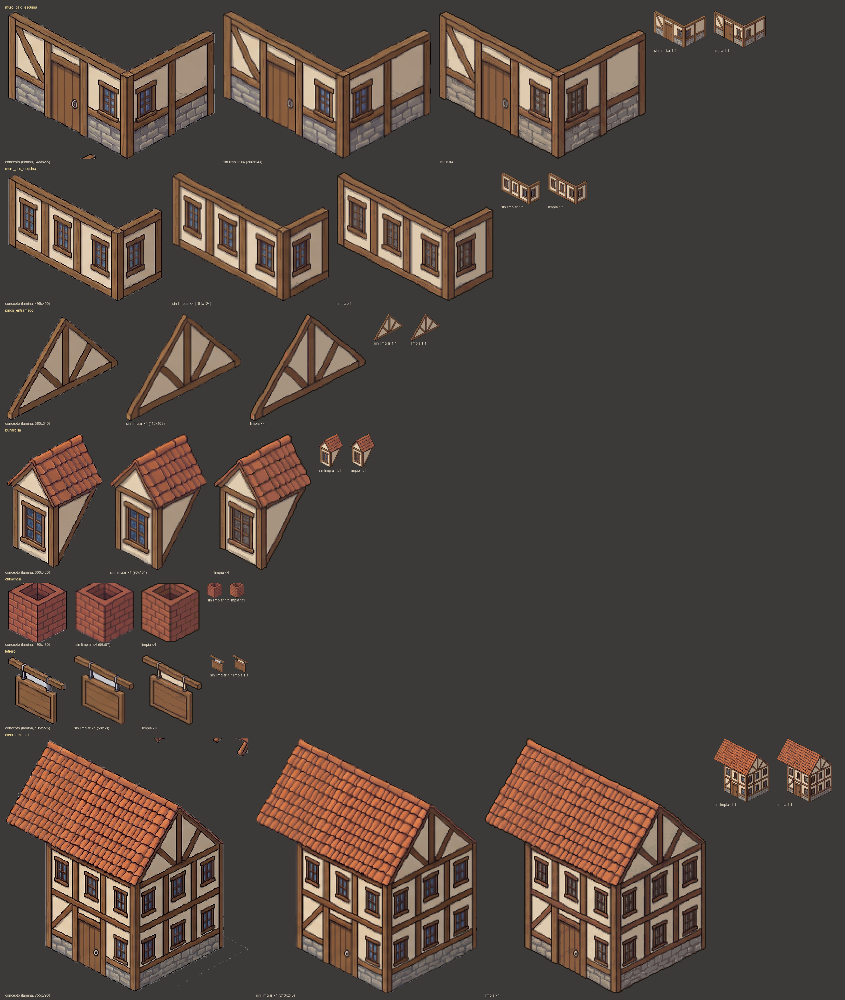
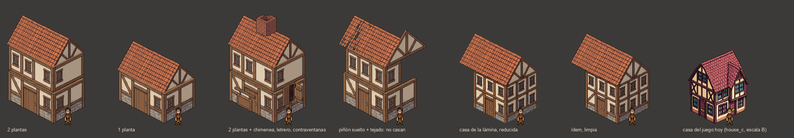

# Kits de casa: ¿se puede tener la lámina «kit de entramado» en el juego?

Pregunta del owner (2026-11-02), sobre `assets/concept/ciudades2/kit_entramado/kit_entramado.jpg`: piezas de pared de
entramado con puerta y ventanas, postes, piñones, faldones, chimenea, buhardilla y letrero, y casas montadas. «Esa nitidez
y calidad me ultra flipa». ¿Se pueden hacer kits así?

Prueba hecha **sin créditos** (Pillow + `pixelart_workbench` gratis): `python3 tools/art/kit_prueba.py` →
`docs/arte/kits/*.png` (piezas sueltas en `tmp/kit_prueba/piezas/`).

## Respuesta corta

- **Sí es viable**, con un matiz que conviene tener claro: la nitidez de la lámina viene de que está pintada a
  **~3,2 veces la densidad del juego** (su figura mide 152 px; el personaje del juego, 48). A la densidad real se
  conservan la forma, el color, la lectura del entramado, las puertas y las ventanas, pero el detalle fino (cada teja,
  los cristales, las vetas) se queda en 1-3 px. Queda al nivel de detalle de las casas que ya tenemos (lámina 02, a la
  derecha, `house_c` a escala B), no al de la lámina.
- Ese «ultra» solo se ve ampliando. Para tenerlo de verdad habría que dibujar todo a 2-3× (personajes de ~100-150 px)
  y cambiar la escala del juego: no lo recomiendo.
- **Las piezas de la lámina sirven** como punto de partida: reducidas y limpias, las casas montadas con ellas se leen
  como del mismo juego (lámina 02). Lo que **no** sirve tal cual: las piezas de la lámina no tienen medidas
  coherentes entre sí (el muro de planta alta es más corto que el de la baja y el piñón suelto es más ancho que el
  tejado de la casa montada). Un kit de verdad necesita módulos medidos en casillas.

## Qué se hizo

1. **Recorte** de 14 piezas de la lámina y fondo fuera (relleno desde el borde: el gris y la sombra; lo encerrado por el
   contorno se queda).
2. **Reducción** a la densidad del juego: ÷3,17 (152 / 48), con media por bloques (BOX) y alfa binaria.
3. **Limpieza**: paleta común del kit de 32 colores (median cut de todas las piezas, y cada color cambiado por el del
   juego si están a menos de 12 de distancia: 8 de 32 coinciden), fuera trozos sueltos y huecos de 1 px, contorno de
   1 px `#1e1812` (el de los personajes) en el borde de la silueta.
4. **Montaje**: muros de planta baja y alta apilados por la esquina delantera; sus fachadas alargadas hasta medir lo
   mismo (repitiendo franjas de revoco de 2 px en la dirección de la rejilla, sin reescalar: la técnica de
   `tools/art/escala_b.py`); encima, la cubierta (tejado + piñón) como **una sola pieza** sacada de la casa montada de
   la lámina.
5. **Workbench** (gratis): `score` de la chimenea limpia = **76,5 / 100** (19 colores; le restan los colores casi
   repetidos y los píxeles sueltos). `repair --ops stray,snap` no cambia nada en una imagen importada: las
   herramientas de arreglo del workbench (`clean-lines`, `aa`, `selout`) trabajan sobre dibujos hechos con su `draw`,
   no sobre imágenes de fuera. Sirve para medir; la limpieza la hace Pillow.

## Láminas

**01 · concepto, reducida y limpia** (por pieza: la lámina, la pieza a la densidad del juego ×4 sin limpiar y limpia,
y las dos a 1:1).

Lo que se ve:

- **Reducida sin limpiar**: sorprendentemente buena, porque la lámina ya está pintada con «píxeles gordos» (~3 px de
  lámina por píxel). Pierde el contorno: queda difuso y de grosor irregular, y las líneas en 2:1 tienen algún escalón
  doble.
- **Limpia**: gana el contorno de un píxel y una paleta corta (se lee mejor sobre la hierba), pero pierde matices
  (cristales y piedra más planos). Es lo que hace falta para que las piezas casen entre sí y con lo que ya hay.
- **A 1:1** (lo que verá el jugador a zoom 1): las dos se leen igual de bien; la diferencia está en el borde.

**02 / 03 · casas montadas con las piezas limpias**, junto al personaje de 48 px (1:1 y ×3).

De izquierda a derecha:

1. **Dos plantas**: muro bajo + muro alto + cubierta.
2. **Una planta**: muro bajo + cubierta.
3. **Dos plantas con chimenea, letrero y contraventanas**: los adornos se pegan encima.
4. **Piñón suelto + tejado: no casan**. El piñón de la lámina es más ancho que el tejado, sin cubrir su canto, y el
   muro alto es más corto que el bajo.
5. **La casa montada de la lámina**, reducida y limpia, como referencia.
6. **Una casa del juego** a escala B, para comparar el nivel de detalle.

Con tres piezas salen tres casas distintas, de 210×225 a 210×295 px (≈ 4×3 casillas), con la puerta a ~54 px: la
escala B.

## Cómo se combinan las piezas en 2D isométrico

- **Módulo**: a lo largo de una fachada, 1 casilla = 32 px en horizontal y 16 en vertical (la diagonal 2:1); en alto,
  las plantas de la escala B (planta baja 64, alta 48). Toda pieza mide un número entero de módulos; si no, no casa
  (pasó con la lámina).
- **Dos orientaciones, sin espejo**: la fachada izquierda (cara +v) está a la luz y la derecha (cara +u) en sombra
  (luz de arriba a la izquierda). Cada muro, piñón y faldón se dibuja en las dos orientaciones.
- **Solo la cáscara visible**: fachada izquierda, fachada derecha y cubierta. Las caras de atrás no se ven nunca.
- **Las uniones se tapan con piezas**:
  - el poste de esquina tapa la junta entre fachadas;
  - la viga de forjado, la junta entre plantas;
  - el alero, lo alto de los muros;
  - el canto del tejado, el borde del piñón.
- **Piezas de tejado que hay que dibujar aparte**:
  - faldón por tramo de 1 casilla y extremos con canto (izquierdo y derecho);
  - tramo de cumbrera y su remate en el piñón;
  - esquina de alero.
  - Para casas en L o T, además: limahoya (encuentro en rincón), limatesa (esquina saliente) y encuentro de cumbreras.
  - La chimenea y la buhardilla, con el recorte del faldón donde se apoyan.
- **Cubierta de una pieza** (tejado + piñón) para las plantas rectangulares, como en la prueba: es lo más barato y lo
  que menos se nota. Las piezas sueltas de tejado solo hacen falta para plantas en L o T.

Kit de entramado completo (planta rectangular, 3 anchos de fachada):

| Grupo | Piezas |
|---|---|
| Muros: 2 caras × (planta baja liso / ventana / puerta + planta alta liso / ventana), tramos de 1 casilla | 10 |
| Postes de esquina y de extremo, viga de forjado (2 caras) | 4 |
| Cubiertas de una pieza (piñón a la izquierda o a la derecha) × 3 anchos (3, 4, 5 casillas) | 6 |
| Variante de piso volado (planta alta que sobresale) | 2 |
| Adornos: chimenea ×2, buhardilla ×2, letrero, contraventanas, puerta abierta, macetas | 8 |
| **Total** | **~30** (+6-8 de tejado si hay plantas en L) |

## Qué haría falta de PixelLab y cuánto cuesta

| Vía | Cómo | Generaciones (kit completo) | Valoración |
|---|---|---|---|
| `create_building_kit` | Vocabulario de piezas iso (suelos, muros, esquinas, puertas, cubiertas, pilares), casilla de 32-96 px, muros de 1-3 casillas, **sin imagen de referencia** de estilo (sí `palette`). | 10-25 por kit; 2 intentos: **25-50** | Barato y modular de verdad, pero no copia la lámina: el estilo sale de la descripción y la paleta. Hay que medir cuánto mide una planta (no está documentado). |
| `create_object_pro_flash` con la pieza limpia como `style_image` | Una generación por pieza, hasta 256 px. | 5 por pieza (≤96 px) o 6 (100-208): 30 piezas × 5-6 × 1,5 intentos = **225-270** | La más fiel al estilo, pero cara, y sus vistas son `low top-down`, `high top-down` o `side`: no hay vista isométrica, y la diagonal 2:1 de los módulos corre riesgo. |
| `create_map_object` con `background_image` | 1 generación por pieza, hasta 400 px. | 30 × 1-3 = **30-90** | Barata, pero sin vista isométrica. Para adornos (chimenea, letrero), bien. |
| **Recomendada: lámina de fal sobre maqueta de módulos + reducción y limpieza gratis + retoque en PixelLab** | Maqueta gris con los módulos ya medidos (como las de `tools/art/escala.py`) → Nano Banana Pro la pinta (las medidas salen bien, como en las láminas de ciudad) → `kit_prueba.py` reduce y limpia → `edit_image_pro_flash` con `reference_image` solo para las piezas que salgan mal; `reduce_colors` con la paleta del juego. | fal: 2-3 láminas (~0,45 USD). PixelLab: 10-15 retoques × 5-6 + `reduce_colors` = **~60-100** | La más parecida a la lámina que gustó y la que menos gasta. Necesita que el owner vuelva a autorizar fal. |

En todas, la diferencia de calidad con la lámina es la misma: la impone la densidad del juego, no la herramienta.

## Cómo se usaría en Godot

Dos maneras:

1. **Casas horneadas (recomendada)**. Un script (como `kit_prueba.py`) monta cada variante (2 plantas, 1 planta, con
   chimenea, piñón a la izquierda…) y la guarda como un PNG. Cada variante es una escena normal de
   `game/visuals/props/lot_house_*.tscn` o `buildings/` (un `Sprite2D`, `Feet`, `Top`).
   - Funciona con todo lo que ya hay: solares de relleno, `building_variants`, el clic, la transparencia (que mira los
     píxeles del sprite), las mejoras como adornos encima y el día y la noche.
   - Las uniones se repasan una vez en el PNG.
   - Si cambia una pieza, se vuelve a hornear.
   - Con 30 piezas salen fácilmente 20-40 casas distintas.
2. **Casas montadas en escena**: una escena por casa con un `Sprite2D` por pieza (muros, postes, cubierta, adornos).
   - Se edita en Godot cambiando piezas.
   - A cambio: 8-15 nodos por casa, el orden de dibujo dentro de la casa a mano (sin `y_sort` entre piezas), uniones
     que se ven si una pieza se mueve un píxel, y la transparencia y el clic tienen que mirar varias piezas.
   - Solo compensa para las casas que cambian en partida (obras por plantas, ampliaciones).

**Recomendación**: hornear. Montaje en escena solo para la casa del jugador si algún día crece por plantas.

## Prueba mínima para el 15-nov (añadir a la de `ciudad_con_pixellab.md`)

1. Un `create_building_kit` de entramado (casilla 64, muros de 2 casillas, la paleta de `kit_prueba.py`): 15-25 gen.
   Medir planta y módulo y montar 3 casas con el script.
2. Tres `edit_image_pro_flash` (`method=reference`) sobre piezas reducidas de esta prueba (muro bajo, muro alto,
   cubierta), con la pieza de la lámina como referencia: 15-18 gen. ¿Mejora el contorno y el detalle frente a la
   limpieza gratis?
3. Comparar en una lámina las casas de las dos vías con las de esta prueba y con `house_c`.
