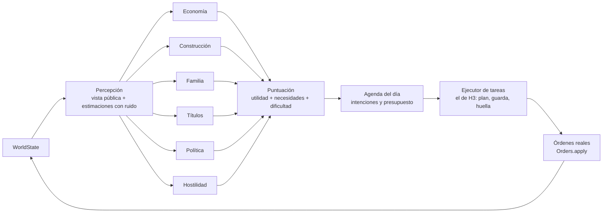
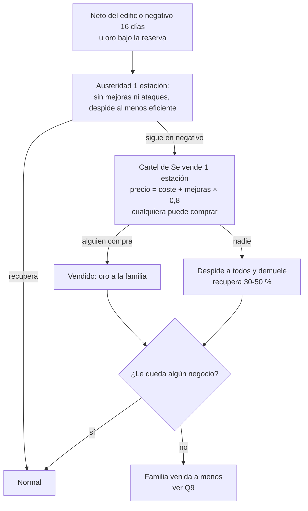

## 4c. IA de las familias rivales: diseño detallado (Gate «Antes de H6»)

Desarrolla 4.21 ([04b_partida_y_rivales.md](04b_partida_y_rivales.md#421-ia-de-las-familias-rivales)). **Estado: aprobado por el owner el 2026-11-05** con las recomendaciones de 4.21.14 (borrador del 2026-11-01). Cuando lo apruebe, se apunta en `docs/decisiones.json` y se marca el [Gate] en `docs/hitos.json`; sin eso no empieza H6 (10_hitos.md).

Las cifras marcadas **[balance]** son valores iniciales: se ajustan con bots contra `data/targets.json`. Donde este documento cambia o precisa algo de 4.21 se dice explícitamente (resumen en 4.21.1). Las decisiones que solo puede tomar el owner están en 4.21.14.

---

### 4.21.1 Resumen y qué precisa respecto a 4.21

La IA rival es **un bot más dentro del sim**: cada minuto, después de las órdenes de fuera, da órdenes reales (`Orders.apply`) para los personajes de las familias con `controlled_by: "ai"`, con las mismas validaciones que el jugador. Lo que añade este diseño sobre el herrero de H3 es **qué decide** (módulos con utilidad), **con qué información** (una percepción pública y con ruido) y **cuándo ataca** (rivalidad, lista cerrada de ataques, presagios).

Precisiones y cambios propuestos sobre 4.21 (cada uno con su pregunta en 4.21.14 si cambia el diseño aprobado):

| # | Qué | Por qué |
|---|---|---|
| P1 | **Percepción como única puerta:** los módulos no leen `sim.state`; solo una vista pública (4.21.4). Se comprueba con un test. | Que el juego limpio no dependa de la disciplina de quien programa. |
| P2 | **Umbral efectivo = umbral del perfil + ajuste de dificultad** (+20 / 0 / −20). | La tabla de 4.21 (80/60/40) y el umbral por perfil eran dos fuentes para lo mismo. Con un perfil medio (60) sale exactamente la tabla de 4.21. |
| P3 | **La erosión de la rivalidad (−1/día) solo actúa en días sin motivo de subida.** | Con 4.21 tal cual, «cuota > 50 %: +1/día» y «−1/día» se anulan: la rivalidad por mercado nunca subiría. |
| P4 | **Tope común de ataques al jugador** entre todas las familias (1 por estación en Normal). | Con 5 familias y enfriamientos por atacante, el jugador podría recibir varios ataques seguidos. |
| P5 | **Presagio obligatorio** antes de cada ataque (aviso detectable con margen para reaccionar). | Requisito de «nunca injusto». |
| P6 | **Ruido sin desordenar el RNG del mundo:** una tirada de `state.rng` por familia y día; el resto del ruido sale de un hash. | Cambiar cuántas candidatas evalúa la IA no debe cambiar los microeventos ni los clientes. |
| P7 | **Quiebra definida** en pasos (austeridad → venta → venida a menos). | 4.9 y 4.21 la nombran sin reglas. |
| P8 | **Tregua de sucesión:** nadie ataca al jugador durante 1 estación tras morir su cabeza de familia. | Evita rematar al jugador en el peor momento por pura coincidencia. |
| P9 | **En Fácil, «al azar entre las 3 mejores» solo para expansión y hostilidad;** la economía diaria elige la mejor con ruido alto. | Si no, las familias IA de Fácil quiebran por decisiones absurdas y la ciudad se vacía. |

---

### 4.21.2 Principios

1. **Mismas órdenes, mismas reglas.** La IA da las órdenes de 5.5 (en el código, `type` en snake_case: `buy`, `sell`, `work_at`, `hire`, `queue_add`, `buy_upgrade`…; las de hitos futuros llevan el nombre que fije su contrato). Ninguna orden especial para la IA. Antes de dar una orden comprueba con las mismas consultas que usa la UI (como ya hace `RivalAI`), así que no da órdenes que se rechacen.
2. **Ve lo que vería un jugador.** Precios, demanda, parcelas, edificios ajenos por fuera, títulos, reputación, cargos, candidatos, avisos públicos (multas, juicios) y lo que han visto con sus propios ojos sus miembros y empleados. Nunca el oro, los inventarios, la cola ni las mejoras interiores de otra familia: los estima con ruido.
3. **La dificultad cambia cómo decide, no lo que puede hacer.** Ni oro extra, ni descuentos, ni información extra en Difícil. Tampoco *rubber band*: la IA no mejora porque el jugador vaya ganando (su rivalidad sí sube por motivos de juego, a la vista).
4. **Determinista.** Misma semilla + mismas órdenes de fuera = misma partida, también tras guardar y cargar a mitad de un plan.
5. **Acotada.** Coste por paso medido con `tools/sim_bench.gd` (4.21.3.4).
6. **Legible.** Cada decisión deja en el log DEBUG las 3 mejores candidatas con su puntuación desglosada; cada ataque, su motivo. Al jugador le llega lo que un jugador sabría: presagios, avisos y la banda de rivalidad.

---

### 4.21.3 Arquitectura

#### 4.21.3.1 Encaje con lo que ya existe

Hoy (`sim/ai/rival_ai.gd`, H3): `Sim.step` llama a `RivalAI.orders(sim)` justo después de las órdenes de fuera y antes de `Clock.tick`; recorre las familias IA **ordenadas por id**; al amanecer y en cada cambio de fase decide un **plan** (lista de tareas en `families[fam].ai_state.plan`) y, cada minuto que el actor está libre, la primera tarea da una orden o termina. Una guarda (misma orden + misma huella del estado) suelta la tarea atascada.

Desde H6 eso **no se tira**: pasa a ser la capa de **ejecución**. Encima se añaden la percepción y la estrategia. El punto de entrada en `Sim.step` no cambia (el nombre del fichero, `rival_ai.gd` o `family_ai.gd` como dice 5.2, lo decide el contrato de H6).



#### 4.21.3.2 Las tres capas

| Capa | Qué hace | Lee | Escribe |
|---|---|---|---|
| **Percepción** (`sim/ai/perception.gd`) | Construye la vista de una familia: lo propio completo; lo ajeno, lo público y estimaciones con ruido. Se refresca al amanecer y se recalcula solo lo barato (precios, demanda) en cada fase. | `sim.state` (es la única que lo lee) | Un diccionario de vista, no se guarda (se reconstruye igual tras cargar). |
| **Estrategia** (módulos + puntuación) | Cada módulo propone candidatas; la puntuación elige; el resultado es la **agenda**: intenciones con presupuesto («ahorrar 120 para la parcela par_0007», «contratar 1 oficial», «pedir Ciudadano cuando oro ≥ 110»). | La vista | `ai_state.agenda` |
| **Ejecución** (el ejecutor de H3) | Convierte la agenda en tareas por personaje y las tareas en órdenes, una por actor y minuto como mucho. Las órdenes de gestión (`hire`, `fire`, `queue_add`, `buy_upgrade`, y en H6 construir, comprar o vender edificio) no caminan: las da el cabeza de familia en cuanto la agenda lo pide. | La vista + las consultas de validación de la UI | Órdenes; `ai_state.members[chr].plan` |

**Actores de una familia IA** (igual que el jugador, 4.10.5): hasta 3 miembros controlados. El **cabeza** compra, vende, gestiona y hace política; los demás trabajan en los edificios asignados con su rutina (4.10.8, mismas órdenes). Los empleados trabajan con la cola de producción (4.7.4), que la IA rellena con `queue_add`. Hasta H8 cada familia IA tiene un solo miembro (como Bernat Ferrer hoy).

#### 4.21.3.3 Cuándo decide cada módulo

| Módulo | Decide | Candidatas máx. por decisión [balance] | Desde |
|---|---|---|---|
| Economía, tareas del día (comprar, producir, vender, encargos) | Amanecer y cada cambio de fase (como H3) | 8 | H3 |
| Economía, gestión (receta de la cola, contratar, despedir, mejoras) | Amanecer | 8 | H6 |
| Construcción (parcelas, construir, comprar, vender, quiebra) | Amanecer | 6 | H6 |
| Familia (cortejo, boda, heredero, asignar edificio) | Amanecer | 4 | H8 |
| Títulos (pedir el siguiente) | Amanecer | 1 | H9 |
| Política (presentarse; acciones de campaña) | Amanecer; durante la campaña, cada cambio de fase | 4 | H10 |
| Hostilidad (elegir ataque) | Amanecer, solo si la puerta de ataque está abierta (4.21.8.2) | 5 | H6 |
| Rivalidad (actualizar valores) | Amanecer, para todas las parejas | — | H6 |

**Escalonado:** al amanecer, la familia que ocupa el lugar *k* en el orden por id hace su decisión estratégica en el minuto `amanecer + 3·k` [balance]. Así nunca hay dos decisiones estratégicas en el mismo paso. Mientras no le toca, sigue con la agenda del día anterior.

**Compromiso mínimo (histéresis):** una intención de la agenda no se cambia por otra salvo que la nueva supere su utilidad en un 20 % [balance] o salte una necesidad (4.21.5.3). Un empleado contratado no se despide antes de 1 año salvo por solvencia. Evita bucles de contratar y despedir o de cambiar de receta cada fase.

#### 4.21.3.4 Presupuesto de CPU

El sim entero tiene que caber en **< 2 ms por paso** con 40 NPC y 30 edificios (5.4). Reparto para la IA [balance]:

| Medida (`sim_bench`, 6 familias IA) | Diana |
|---|---|
| Media de la IA por paso (todas las familias) | ≤ 0,2 ms |
| Paso con una decisión estratégica | ≤ 1,0 ms de IA (≤ 1,8 ms el paso entero) |
| Candidatas evaluadas por decisión estratégica (suma de módulos) | ≤ 32 |
| Pasos con más de una decisión estratégica | 0 (escalonado) |

Cómo se cumple: la percepción cachea el día; las candidatas se generan a partir de listas cortas (las 3 recetas de mayor margen, las 3 parcelas mejor valoradas, los 3 solteros con más afinidad…), no de todo el mundo; las búsquedas de rutas solo se piden para la candidata elegida. `sim_bench` gana las medidas `ai_ms_avg` y `ai_ms_max_step`.

#### 4.21.3.5 Determinismo y ruido

- Las familias se recorren por id y las candidatas se ordenan por una clave estable (módulo, tipo, id del objetivo) antes de puntuar; los empates se rompen por esa clave.
- **Una tirada al día por familia:** en su decisión del amanecer, la familia saca `day_seed = state.rng.randi()` y lo guarda en `ai_state`. Todo su ruido del día es `ruido(candidata) = hash(day_seed, fase, módulo, clave) → [−1, 1]`, sin más tiradas de `state.rng`. Así añadir o quitar candidatas no desplaza los números aleatorios del resto del mundo (microeventos, clientes, SkillChecks) y los rituales de balance no se vuelven ruidosos con cada cambio de la IA.
- Los SkillCheck que hagan las órdenes (fabricar pruebas, difamar…) siguen usando `state.rng` dentro de la orden, como para el jugador.
- `ai_state` se guarda con la partida (ya lo hace H3). La vista no se guarda: se reconstruye igual.

#### 4.21.3.6 `ai_state` (memoria de la IA, por familia)

```
ai_state: {
  phase, day_seed,
  agenda: [ {kind, target, budget, utility, since_day} ],        # intenciones vigentes
  members: { chr_id → {plan: [task], last_order, last_fp} },     # ejecutor de H3, por miembro
  recipe, bought_day,                                             # (H3, se conservan)
  known: [ {fact, about_family, source, day} ],                   # hechos vistos (4.21.4), caducan a los 2 años
  last_attack_day, attacks: [ {kind, target, day} ],              # enfriamientos y dianas
  presage: {kind, target, until} | null,                          # ataque anunciado y pendiente
  austerity_since: int | null, for_sale: [bld_id]                 # quiebra (4.21.6.3)
}
```

Regla de H3 que se mantiene: dentro de `ai_state` el dueño añade campos sin subir versión del guardado, con su prueba de ida y vuelta. La rivalidad vive fuera, en `state.rivalry` (5.3), porque la lee la UI.

---

### 4.21.4 Percepción: qué sabe la IA

| Información | ¿La ve? | De dónde / con qué error [balance] |
|---|---|---|
| Lo suyo (oro, inventarios, cola, libro de cuentas, relaciones de sus miembros) | Sí, exacto | Su familia |
| Precios y demanda del mercado | Sí, exacto | El panel del mercado (lo ve cualquiera en la plaza) |
| **Ventas por familia y objeto del último año** | Sí, redondeado al 10 % | Registro público del mercado (ver pregunta Q4): el mismo panel lo enseña al jugador |
| Parcelas libres, ocupadas, en venta; edificios ajenos (tipo, estado, obra en curso) | Sí | El mapa |
| Mejoras ajenas | Solo las que se ven por fuera (fachada, escaparate, overlays exteriores) | El mapa |
| Empleados ajenos | Cuántos | Se les ve llegar y salir |
| Títulos, reputación pública, cargos, candidatos, campañas | Sí | Organigrama y panel de familias |
| Oro y patrimonio ajenos | Estimación | `edificios × valor + mejoras visibles + empleados × salario × 8 + título`, × (1 ± 25 %) con el ruido del día |
| Inventarios y almacenes ajenos | No | — |
| Mejoras de Secretos ajenas | Solo si hay un hecho que lo revela | Multa de inspección (aviso público) o testigo |
| Delitos ajenos | Solo si los vio un miembro o empleado suyo, o salieron en un juicio | `ai_state.known` |
| Intenciones del jugador (qué parcela quiere, a qué cargo irá) | No | Las infiere de lo público (4.21.9.1) |

**Test de ceguera (H6):** dos simulaciones iguales en todo salvo el oro y el inventario del jugador (bot `idle`, que no los usa) producen exactamente las mismas órdenes de la IA. Y un test de código: los módulos de `sim/ai/` (salvo `perception.gd` y el ejecutor) no contienen `sim.state.` ni `state.`.

---

### 4.21.5 Cómo decide: utilidad

#### 4.21.5.1 Fórmula

La de 4.21, con cada término definido:

```
utilidad(a) = peso_oro    × avance_oro(a)
            + peso_título × avance_título(a)
            + peso_cargo  × avance_cargo(a)
            − coste_oro(a) / max(P, P_min)
            − riesgo(a) × aversión_al_riesgo
            + σ(dificultad) × ruido(a)

P      = patrimonio propio (oro + valor de edificios y mejoras, 4.17)       P_min = 200 [balance]
avance_oro(a)    = beneficio bruto estimado de a en el horizonte (1 año = 8 días) / max(P, P_min), en [0, 1]
avance_título(a) = lo que a acerca los requisitos del siguiente título (oro, reputación, requisito extra;
                   1/3 cada uno); pedir la ceremonia con todo cumplido = 1
avance_cargo(a)  = subida estimada de la probabilidad de ganar el cargo objetivo (fórmula de voto de 4.12.4
                   con datos públicos)
riesgo(a)        = probabilidad de que salga mal × gravedad (0-1). P. ej. fabricar pruebas:
                   P(fallar el check de Sigilo) × 1 (−50 de reputación y juicio en contra)
```

- Una candidata solo se ejecuta si `utilidad ≥ U_min` (0,05 [balance]). No hacer nada es siempre una opción válida: la IA no gasta ni ataca porque pueda.
- **Candidatas hostiles** (4.21.9): `utilidad_hostil = utilidad × peso_hostil(dificultad) × (0,5 + agresividad) × sesgo_ataque(perfil, tipo)`.
- Las candidatas de un mismo módulo compiten entre sí; los módulos compiten por el **presupuesto del día**: oro disponible = oro − reserva (4.21.5.4). Se aceptan por utilidad descendente mientras quede presupuesto.

#### 4.21.5.2 Elección según dificultad

| | Fácil | Normal | Difícil |
|---|---|---|---|
| Economía diaria y gestión | La mejor, σ = 0,20 | La mejor, σ = 0,10 | La mejor, σ = 0,03 |
| Expansión, política y hostilidad | Al azar entre las 3 mejores con utilidad ≥ U_min, σ = 0,20 | La mejor, σ = 0,10 | La mejor, σ = 0,03 |

(4.21 decía «al azar entre las 3 mejores» para todo en Fácil; ver P9 y Q8.)

#### 4.21.5.3 Necesidades que pasan delante

Antes de puntuar objetivos, en este orden fijo; la primera que se cumple manda en la agenda del día:

1. **Solvencia:** si `oro < coste_fijo_diario × reserve_days` (salarios + mantenimiento) → modo austeridad (4.21.6.3): solo vender, producir y cumplir encargos; nada de gasto discrecional ni ataques.
2. **Deuda que vence** (si la familia tiene un `Loan`): reservar para la cuota.
3. **Heredero** (desde H8): sin heredero válido y cabeza ≥ 40 años, o sin hijos y casado sin hijos posibles → cortejar, casarse y designar heredero pasan delante (4.21: «para que las familias IA sobrevivan a las generaciones»).
4. **Obligaciones:** encargos aceptados que vencen hoy.

#### 4.21.5.4 Reservas y ahorro

- **Reserva de supervivencia** = `max(gold_reserve, coste_fijo_diario × reserve_days)`. `gold_reserve` es el campo de H3 (20); `reserve_days` es nuevo.
- **Ahorro con objetivo:** si la mejor candidata no se puede pagar hoy pero sí en ≤ 1 año con el beneficio estimado, entra en la agenda como «ahorrar para X»: aparta ese oro del presupuesto discrecional de los días siguientes. Sin esto, la IA nunca juntaría para una parcela o un título porque cada día se lo gastaría en algo pequeño.

---

### 4.21.6 Módulos

Cada módulo es un fichero en `sim/ai/modules/` con dos funciones: `propose(view) -> [candidata]` y `tasks(view, intención) -> [tarea]`. Las tareas las ejecuta el ejecutor común.

#### 4.21.6.1 Economía (H3 → H6)

**Tareas del día (lo de H3, sin cambios de comportamiento):** encargos → vender → comprar → a casa → trabajar. Vende mientras la demanda esté ≥ `sell_min_demand` (la dificultad la sustituye), elige la receta de mayor margen que su Artesanía permite, compra entradas para `buy_days` dejando la reserva, acepta encargos que llega a cumplir.

**Gestión (H6):**

| Candidata | Cuándo se propone | Avance / coste |
|---|---|---|
| **Contratar** (`hire`) | Hueco libre y la cola tiene trabajo para más de lo que producen los que hay | Beneficio = margen × unidades extra/día × días de horizonte − salario × días |
| **Despedir** (`fire`) | Empleado ocioso > 2 días seguidos, o austeridad | Ahorro de salario; riesgo = reputación −2 si lealtad > 70 |
| **Receta de la cola** (`queue_add`, `queue_remove`) | Cada amanecer | Las 2 recetas de mayor margen ajustado por demanda prevista: si su propia producción del día hundiría la demanda bajo `sell_min_demand`, reparte entre recetas |
| **Mejora** (`buy_upgrade`) | Disponible (`Upgrades.status_of == "available"`), sin obra en curso | Beneficio de sus efectos en el horizonte (velocidad → unidades; calidad → precio; huecos → contratar; Fachada → avance de título; Seguridad → menos riesgo de robo y sabotaje) − coste − producción perdida durante la obra |
| **Mejora de Secretos** | Solo si honestidad de la familia < 0 | Beneficio ilegal − riesgo de inspección × multa × aversión |
| **Microevento** (`resolve_microevent`, H7) | Al aparecer uno propio | Elige la opción de mayor utilidad; si no puede evaluarla, la opción por defecto |

**Pago:** a mano no paga recados salvo que trabaje todo el día en el edificio y el recado le ahorre más de lo que cuesta (tiempo de producción perdido en el viaje × margen por hora).

#### 4.21.6.2 Construcción (H6)

| Candidata | Condición | Avance / coste |
|---|---|---|
| **Construir** (comprar parcela + obra) | Parcela libre del tipo; límite de edificios por título; la **válvula** de 4.9 se respeta *después* de la compra (quedan ≥ 2 libres del tipo) | Beneficio del negocio nuevo en el horizonte (margen de su mejor receta × producción esperada, descontada la saturación del mercado) − coste de obra − días sin producir; × `expansion` del perfil × expansión(dificultad) |
| **Comprar edificio a un NPC** | Edificio de un NPC o de otra familia en venta, o NPC con relación que acepte (4.9) | Como construir, sin días de obra; coste = precio de 4.9 |
| **Vender / demoler** | Edificio con neto negativo durante 2 años (16 días) en el libro | Ver quiebra |

**Saturación:** el beneficio esperado de un negocio nuevo se descuenta por el número de productores del mismo objeto que ya hay en la ciudad (ventas del registro del mercado). Sin esto, con solo la Forja en el MVP todas las familias abrirían forjas y hundirían la demanda de espadas.

**Elección de parcela:** cercanía a su casa y al mercado; las 3 mejor valoradas son las candidatas. La IA no sabe qué parcela «quiere» el jugador (4.21.4): si coincide, es competencia normal y no cuenta como ataque (salvo la acción hostil de 4.21.9).

**Contrato del módulo (H6, construido en la rama posada, 2026-11-06; `sim/build/construction.gd`, fuera de `sim/ai`)**:

- `Construction.candidates(sim: Sim, fam: String) -> Array`: lo que la familia podría hacer hoy, la mejor primero:
  `{kind: "build" | "buy", plot (build), building (buy), building_type, price, daily, score}`. `build`: las 3 parcelas
  libres de producción mejor situadas donde cabe un taller de sus oficios (el que tiene, los de su perfil
  `preferred_professions` y, si vendió el suyo, el que vendió); `buy`: un edificio sin dueño en venta de sus oficios.
  Ya filtra el tope por título y la válvula (`Plots.can_build`). `daily` = mejor margen de sus recetas ×
  `units_per_day` / (1 + talleres del mismo tipo) − mantenimiento; `score` = `daily × horizon_days × expansión` /
  `price`.
- `Construction.choose(sim, fam) -> Dictionary`: la mejor candidata que paga su oro por encima de la reserva
  (`Construction.budget`: oro − `gold_reserve` − `reserve_days` × coste fijo diario) y pasa `min_score`; una familia que
  vendió su taller y monta otro (`after_sale.fate` rebuilds) toma la mejor que pague. `{}` si ninguna.
- `Construction.order_for(sim, fam, cand) -> Dictionary`: la orden de gestión del cabeza (`build` o `buy_building`).
- Mientras la agenda de `sim/ai` no lo llame, `Construction.step` lo hace al amanecer (`ai_orders`: desde
  `first_day`, `cooldown_days` por familia, `max_per_day` en el pueblo). Cuando la agenda lo llame, pone
  `data/construction.json` `ai.enabled` a false y este paso se calla.

#### 4.21.6.3 Quiebra (H6)

Se evalúa al amanecer. Un negocio con **neto negativo en el libro durante 2 años** y la familia en austeridad sigue estos pasos [balance]:



- El cartel «Se vende» es público: el jugador puede comprar el edificio con `buy_building` a ese precio. Es una oportunidad de juego que nace de la quiebra ajena.
- La quiebra va a la crónica y al registro de avisos («La forja de los Ferrer está en venta»).
- D15 (mantenimiento impagado → edificio Dañado) también aplica a la IA: es la misma regla.

#### 4.21.6.4 Familia (H8)

| Candidata | Regla |
|---|---|
| Cortejar (`talk`, `gift`) | Al soltero adulto de la familia con más utilidad: afinidad actual, Carisma, y para el perfil trepador un bonus por título y reputación de la familia del pretendiente. Como mucho una acción de cortejo por día y miembro. |
| Casarse (`propose`) | Afinidad ≥ 80 (regla de 4.10.1). |
| Designar heredero (`set_heir`) | El hijo adulto con mejor suma de atributos del oficio; por defecto el mayor. Se revisa al cumplir alguno 16. |
| Asignar edificio y rutina (`assign_building`, `set_schedule`) | Cada miembro adulto al edificio con hueco donde más produce. |

Las familias IA cortejan a NPC de la ciudad, no a miembros de la familia del jugador (el jugador sí puede cortejar a miembros de familias IA). Que la IA pueda pedir la mano de alguien de tu familia queda [POST-MVP].

#### 4.21.6.5 Títulos (H9)

Una sola candidata: pedir el siguiente título (`request_title`) cuando se cumplen los requisitos de 4.12.2 y queda la reserva después de pagar. Mientras tanto, el avance de título empuja a las demás candidatas (Fachada, reputación, segundo negocio) según el peso de título del perfil. La IA respeta la aprobación por afinidad del Alcalde o Concejal como el jugador.

#### 4.21.6.6 Política (H10)

- **Presentarse** (`run_for_office`): elige el cargo con mejor `peso_cargo × P(ganar) × valor del cargo` que su título permite, antes de que empiece la estación de campaña. Nivel de campaña según presupuesto y aversión al riesgo.
- **Acciones de campaña** (`campaign_action`): visitar familia influyente, discurso (si Retórica ≥ 5), sobornar (solo honestidad < 0) y difamar (hostil, 4.21.9; solo honestidad < 20).
- **Con cargo:** cobra y aplica los pasivos (4.12.3). El uso de poderes **activos** por la IA está en la pregunta Q6 (recomendación: en el MVP solo los que no apuntan a una familia).

#### 4.21.6.7 Hostilidad (H6 → H13)

Propone ataques de la lista cerrada (4.21.9) contra la familia objetivo cuando la puerta está abierta. Además, **se defiende**: si la acusan (H11), usa `witness_action` en la preparación del juicio igual que haría el jugador (convencer siempre; sobornar y amenazar según honestidad y aversión al riesgo).

---

### 4.21.7 Perfiles (`data/ai_profiles/<id>.json`)

#### 4.21.7.1 Campos

| Campo | Tipo | Qué es | Lo usa | Desde |
|---|---|---|---|---|
| `id` | string | Id del perfil | — | H3 |
| `weights` | `{gold, title, office}` | Pesos de los objetivos | Puntuación | H3 (datos) / H6 (uso) |
| `aggression` | 0-1 | Cuánto pesan las candidatas hostiles | Hostilidad | H6 |
| `risk_aversion` | 0-1 | Cuánto resta el riesgo | Puntuación | H6 |
| `rivalry_threshold` | 0-100 | Umbral base; el efectivo suma el ajuste de dificultad (P2) | Puerta de ataque | H6 |
| `preferred_professions` | [id] | Oficios que prefiere al construir; ×1,25 a su avance [balance] | Construcción | H6 |
| `expansion` | ≥ 0 | Multiplicador del avance de construir y comprar edificios | Construcción | H6 |
| `reserve_days` | días | Días de coste fijo que guarda (4.21.5.4) | Puntuación | H6 |
| `attack_bias` | `{price_war, parcel, office, accuse, sabotage}` | Sesgo por tipo de ataque (0 = nunca) | Hostilidad | H6 |
| `spouse_title_bonus` | 0-1 | Bonus al cortejar a familias de más título | Familia | H8 |
| `sell_min_demand`, `gold_reserve`, `work_mode`, `work_phases`, `decide_on`, `buy_days`, `accepts_contracts`, `max_contracts`, `accepts_scripted_contracts` | — | Los de H3, sin cambios | Economía | H3 |

**La moral no está en el perfil:** honestidad, generosidad y diplomacia son actitudes de la familia (4.2.3), cambian con lo que hace y se heredan. El perfil solo da los **valores iniciales** de las familias del escenario (`initial_attitudes`), que se copian a la familia al crear la partida. Si la entidad Familia aún no tiene `attitudes`, añadirla es un cambio de formato que se pide en el contrato de H6.

#### 4.21.7.2 Seis perfiles [balance]

| | `rival_smith` (Ferrer) | `merchant` (mercantil) | `climber` (trepadora) | `politician` (política) | `ruthless` (agresiva) | `devout` (devota) |
|---|---|---|---|---|---|---|
| Idea | Artesano tozudo: vive de su forja | Comercia y se expande; guerra de precios | Quiere subir: fachadas, bodas, títulos | Quiere cargos; juicios y campañas | Gana como sea | Honrada y prudente; reputación |
| `weights` oro / título / cargo | 1,0 / 0,2 / 0,0 | 1,0 / 0,3 / 0,2 | 0,5 / 1,0 / 0,3 | 0,4 / 0,6 / 1,0 | 0,8 / 0,4 / 0,3 | 0,6 / 0,5 / 0,3 |
| `aggression` | 0,3 | 0,4 | 0,3 | 0,5 | 0,9 | 0,1 |
| `risk_aversion` | 0,6 | 0,3 | 0,5 | 0,5 | 0,2 | 0,8 |
| `rivalry_threshold` | 60 | 55 | 65 | 55 | 40 | 80 |
| `expansion` | 0,8 | 1,3 | 1,0 | 0,8 | 1,0 | 0,7 |
| `reserve_days` | 3 | 2 | 3 | 3 | 2 | 4 |
| `attack_bias` precios / parcela / cargo / juicio / sabotaje | 1,2 / 0,8 / 0 / 0,5 / 0,3 | 1,5 / 1,2 / 0,5 / 0,5 / 0,3 | 0,5 / 1,0 / 1,0 / 0,8 / 0,3 | 0,5 / 0,5 / 1,5 / 1,3 / 0,5 | 1,0 / 1,0 / 0,8 / 1,2 / 1,5 | 0,5 / 0,8 / 0,8 / 0,7 / 0 |
| `spouse_title_bonus` | 0 | 0,2 | 0,6 | 0,3 | 0,1 | 0,1 |
| `initial_attitudes` honestidad / generosidad / diplomacia | 20 / 0 / 10 | 0 / −10 / 20 | 10 / 0 / 30 | −20 / 0 / 20 | −50 / −30 / −30 | 60 / 50 / 20 |
| `preferred_professions` (MVP: solo hay Forja) | blacksmith | blacksmith; EA: tailor, baker | blacksmith; EA: carpenter, tailor | blacksmith; EA: scribe | blacksmith; EA: thief | blacksmith; EA: priest, doctor |

Consecuencias que se buscan:

- La **devota** nunca sabotea (`sabotage 0`) y, con honestidad 60, solo acusa con motivo real. Es la rival que el jugador puede tener de aliada.
- La **agresiva** es la única con umbral 40 de base: en Difícil (−20) ataca desde rivalidad 20. Es la que más llega a las dianas de ataques; por eso conviene que haya una como mucho (Q3).
- La **política** pelea en las elecciones y en el tribunal, poco en el mercado.
- **Ferrer** (`rival_smith`) mantiene en H6 su comportamiento de H3 y suma contratar, mejorar, construir y quebrar; su agresividad baja hace que su único ataque probable sea la guerra de precios sobre la espada.

Ejemplo de fichero (H6, los campos de H3 se conservan):

```json
{
  "id": "merchant",
  "weights": {"gold": 1.0, "title": 0.3, "office": 0.2},
  "aggression": 0.4, "risk_aversion": 0.3, "rivalry_threshold": 55,
  "preferred_professions": ["blacksmith"], "expansion": 1.3, "reserve_days": 2,
  "attack_bias": {"price_war": 1.5, "parcel": 1.2, "office": 0.5, "accuse": 0.5, "sabotage": 0.3},
  "spouse_title_bonus": 0.2,
  "initial_attitudes": {"honesty": 0, "generosity": -10, "diplomacy": 20},
  "sell_min_demand": 0.8, "gold_reserve": 20, "work_mode": "normal", "work_phases": ["day"],
  "decide_on": ["dawn", "phase_change"], "buy_days": 1, "accepts_contracts": true, "max_contracts": 1,
  "accepts_scripted_contracts": false
}
```

Las cifras globales que no dependen del perfil (U_min, P_min, horizonte, histéresis, candidatas máximas, reglas de rivalidad y parámetros de cada ataque) van en un fichero nuevo `data/ai.json`; las de dificultad, en un bloque `ai` de `data/difficulty.json` (4.21.9).

---

### 4.21.8 Rivalidad

#### 4.21.8.1 Qué es y cómo se mide

- Un valor **0-100 dirigido**: lo que la familia A siente hacia B. Se guarda en `state.rivalry["A|B"]` (5.3); `"A|B"` y `"B|A"` son valores distintos. Existe para cada pareja de familias, también entre familias IA y del jugador hacia las IA (este último no lo usa nadie en el MVP; queda para estadísticas y crónica).
- Se actualiza **al amanecer**, con lo ocurrido el día anterior; los saltos (+20, +30) se aplican al momento del hecho.
- Empieza en 0 entre todas, salvo lo que diga el escenario (p. ej. una rama cadete, POST-MVP, empieza hostil).

| Sube | Valor [balance] | Cómo se detecta |
|---|---|---|
| B le gana una parcela que A tenía en su agenda (ahorrando o a punto de comprar) | +20 | La intención de A estaba en su agenda y B compra antes |
| B le gana una elección a la que A se presentaba | +20 | Resultado de la elección |
| Cuota de B en las ventas de un objeto que A también vende > 50 % (últimos 2 días) | +1/día | Registro público del mercado |
| B acusa, sabotea o roba a A | +30 | Acusación (pública); sabotaje o robo **detectados** |
| B gana a A un juicio en el que A era el acusado | +15 | Veredicto |
| Relación entre cabezas de familia < −30 | +1/día | Relaciones |
| **Baja** | | |
| Con el tiempo | −1/día **solo en días sin ninguna subida** (P3) | — |
| Relación entre cabezas > +30 | −1/día adicional | Relaciones |
| Regalo de B al cabeza de A (o a su pareja) | −(valor del regalo / 10), máx. −10 por regalo y −20 por estación | Orden `gift` |
| Boda entre las dos familias (H8) | −40 y tope 30 durante 2 años | Boda |

**Bandas visibles** en el panel de familias (el jugador ve la banda y el motivo principal, no el número; ver Q5):

| 0-19 | 20-39 | 40-59 | 60-79 | 80-100 |
|---|---|---|---|---|
| Cordial | Neutral | Tensa | Hostil | Enemiga |

Cuenta de referencia (Normal): un jugador que domina las ventas de espada (> 50 %) sin más roces sube a Ferrer de 0 a 60 en ~60 días (7,5 años) si nada lo baja; ganarle una parcela lo acorta a ~40. Con regalos y buena relación se mantiene en Neutral. Así los ataques son raros y tienen causa (dianas de 4.21.12).

#### 4.21.8.2 Puerta de ataque

Una familia IA A puede proponer un ataque contra B solo si se cumple **todo**:

1. `rivalry[A|B] ≥ umbral_efectivo(A) = clamp(rivalry_threshold + ajuste_dificultad, 20, 95)`.
2. Ha pasado el **enfriamiento** de A desde su último ataque (contra quien sea).
3. No es el **primer año** de partida (días 1-8).
4. Si B es el jugador: ha pasado el **tope común** desde el último ataque que recibió el jugador de cualquier familia (P4) y no está en **tregua de sucesión** (P8).
5. A no está en austeridad ni tiene un ataque en curso o anunciado.
6. El ataque existe en este hito y cumple sus requisitos (tabla de 4.21.9.1).

Si la puerta se abre y la mejor candidata hostil supera `U_min`, A lanza el **presagio** y, cumplido su plazo, el ataque (si sigue siendo válido).

---

### 4.21.9 Ataques

#### 4.21.9.1 Lista cerrada

No hay más ataques que estos. Un tipo nuevo exige cambiar este documento.

| Ataque | Requisitos | Qué tiene que saber y de dónde | Presagio (aviso detectable) [balance] | Efecto | Qué puede hacer el jugador | Coste o riesgo para la IA | Desde |
|---|---|---|---|---|---|---|---|
| **Guerra de precios** | Produce un objeto que B vende (registro del mercado) | Ventas públicas | **12 h antes**: deja de vender ese objeto y acumula (se nota en el mercado: la demanda sube) + aviso «Rumor en el mercado: los X acumulan espadas». | Durante **1 estación** vende ese objeto aunque la demanda baje hasta 0,5 (ignora su `sell_min_demand`) mientras su oro esté por encima de su reserva. Hunde la demanda y el precio. | Vender antes (aprovechar la subida), pasar a encargos, mostrador u otra receta, aguantar: la IA pierde margen | Vende con pérdida; si su oro baja de la reserva, la guerra termina sola | H6 |
| **Competir por parcela** | Hay una parcela libre del tipo que B usa, junto a sus edificios o en su calle, y A tiene hueco por título | Mapa (parcelas libres junto a los edificios de B) | **1 día antes**: aviso «Los X han preguntado por la parcela de la calle Y». | La compra y construye (respetando la válvula de 4.9). | Comprarla antes; hay ≥ 2 libres por tipo siempre | El coste de la obra | H6 |
| **Competir por cargo** (+ difamar) | B es candidato a un cargo al que A puede presentarse | Candidaturas públicas | La candidatura es pública desde que empieza la campaña. Difamar: aviso del rumor el día que ocurre. | Se presenta contra B; puede usar `campaign_action` difamar contra B (baja sus votos). | Campaña, visitas, discurso; contradifamar | Difamar: check de Retórica; si falla, −reputación propia | H10 |
| **Juicio** (`accuse`) | Motivo real en `known` (multa de inspección por Secretos, robo visto por un miembro o empleado suyo, delito probado en un juicio) **o** pruebas fabricadas si honestidad ≤ −30 (check de Sigilo) | `ai_state.known`, solo hechos vistos o públicos | La acusación es pública e inicia 1 estación de preparación (4.12.5). Fabricar: sin aviso extra, pero si el check falla, aviso «Los X intentaban fabricar pruebas contra ti». | Tribunal (4.12.5). | Preparar el juicio con los testigos; si eran falsas y gana, el acusador pierde 50 de reputación; contraacusar | Acusación falsa descubierta: −50 de reputación y +30 de rivalidad de B hacia A | H11 |
| **Sabotaje** | Intrigas (EA); de noche; un miembro o un sicario (EA) | Mapa (edificio de B por fuera) | **La noche anterior**: aviso «Se ha visto a alguien rondando tu forja» (dice el edificio, no la familia). | Edificio Dañado o destruye la última mejora de una rama. La Seguridad lo reduce (20/40/60 %). | Seguridad, un familiar dentro esa noche, guardias (EA) | Si lo detectan (Seguridad, testigos, guardias): aviso con el culpable = motivo real para acusarle; +30 de rivalidad | H13 |

**Qué cuenta como ataque** (para enfriamientos, tope y dianas): solo lo que propone el módulo de hostilidad y llega a ejecutarse. Comprar una parcela por expansión normal o presentarse a un cargo por su peso de cargo no es un ataque, aunque al jugador le moleste; eso es competencia y sube la rivalidad del que pierde por las reglas de arriba.

**Un ataque anunciado se cancela** si deja de cumplir sus requisitos antes de ejecutarse (el jugador compró la parcela, dejó de vender el objeto…). Un ataque cancelado no consume enfriamiento: así reaccionar a tiempo es una victoria real del jugador.

#### 4.21.9.2 Juego limpio: reglas que se comprueban

1. **Sin información privada:** el test de ceguera (4.21.4) y el test de código de los módulos.
2. **Presagio siempre**, con su plazo mínimo, en todos los niveles de dificultad. Test: el 100 % de los ataques ejecutados tienen un presagio anterior con ese margen (el juicio y la candidatura cuentan como su propio presagio).
3. **Todo ataque detectado** va al registro de avisos (gravedad *urgente*, con clic al edificio o la familia) y a la crónica.
4. **Simetría:** todo lo que la IA hace contra el jugador, el jugador lo puede hacer contra la IA con las mismas órdenes (guerra de precios = vender por debajo; acusar; sabotear en EA).
5. **Protecciones del jugador:** primer año, tope común, tregua de sucesión, válvula de parcelas, guerra de precios limitada a 1 estación y a la reserva del atacante.

#### 4.21.9.3 Entre familias IA

Las familias IA se atacan entre sí con las mismas reglas (ver Q1). No hay tope común entre IA, solo el enfriamiento de cada atacante. Los ataques entre IA que el jugador podría ver (una guerra de precios, una acusación, un cartel de Se vende) salen en el registro como *info*; los sabotajes entre IA solo si se detectan. Es lo que hace que la ciudad se mueva sin el jugador.

---

### 4.21.10 Escala por dificultad

Tabla consolidada; sustituye a la de 4.21 cuando se apruebe [balance]. Se guarda como bloque `ai` de cada nivel en `data/difficulty.json`.

| Palanca | Fácil | Normal | Difícil | Clave en `difficulty.json` |
|---|---|---|---|---|
| Elección (4.21.5.2) | Mejor con σ 0,20; azar entre las 3 mejores en expansión, política y hostilidad | Mejor, σ 0,10 | Mejor, σ 0,03 | `ai.noise`, `ai.top_k_strategic` |
| Ajuste del umbral de rivalidad | +20 | 0 | −20 | `ai.threshold_offset` |
| Enfriamiento entre ataques del mismo atacante | 2 años | 1 año | 1 estación | `ai.attack_cooldown_days` (16 / 8 / 2) |
| Tope común de ataques al jugador | 1 por año | 1 por estación | 1 por estación | `ai.player_attack_gap_days` (8 / 2 / 2) |
| Peso de las acciones hostiles | ×0,5 | ×1 | ×1,5 | `ai.hostile_weight` |
| Expansión (construir y comprar) | ×0,5 | ×1 | ×1,5 | `ai.expansion` (= la palanca de 4.23 para familias IA) |
| Presagio | Igual en todos | | | — (no es palanca: es juego limpio) |
| Herrero rival: Artesanía y demanda mínima (H3) | 4 / 0,9 | 5 / 0,8 | 6 / 0,7 | `rival_craft`, `rival_sell_min_demand` (ya existen) |

Orden que vigilan los bots (4.23): oro neto del jugador Fácil > Normal > Difícil, y ataques recibidos Fácil ≤ Normal ≤ Difícil (mediana de 30 semillas).

---

### 4.21.11 Qué entra en cada hito

| Hito | Entra | Criterios propios de la IA (además de los de 10_hitos.md) |
|---|---|---|
| **H6** | Percepción y test de ceguera; puntuación y agenda; escalonado; ruido con `day_seed`; `data/ai.json` y bloque `ai` de dificultad; rivalidad (mercado, parcela, regalos, erosión P3) con bandas en el panel de familias; registro público del mercado (si Q4); módulo de economía con gestión (contratar, despedir, cola, mejoras); módulo de construcción (construir, comprar, vender, quiebra con cartel Se vende); hostilidad: **guerra de precios** y **competir por parcela**, con presagios; Ferrer migra a la IA nueva; segunda familia IA si se aprueba Q2. | Ferrer contrata, mejora o quiebra según su IA (sim de 60 días). Ninguna guerra de precios ni ataque en el primer año (test). Válvula respetada siempre. Test de presagio (100 %). `sim_bench` con las medidas de la IA en verde. Determinismo: mismo hash tras 60 días con IA, también guardando y cargando a mitad. |
| **H7** | La IA resuelve sus microeventos (`resolve_microevent`). | Sin respuesta no hay bloqueo: la IA elige antes de las 2 h. |
| **H8** | Módulo de familia (cortejo, boda, heredero, asignar edificio y rutina); varios miembros por familia IA; necesidad de heredero; boda entre familias baja la rivalidad; tregua de sucesión. | Las familias IA sobreviven a la primera herencia (diana de 4.21.12). |
| **H9** | Módulo de títulos. | Al menos una familia IA sube de título en 10 años (10_hitos.md). |
| **H10** | Módulo de política (presentarse, campaña); ataque **competir por cargo** (+ difamar); uso de cargo según Q6. | La IA se presenta y a veces gana; nunca dos candidaturas de la misma familia al mismo cargo. |
| **H11** | Ataque **juicio** (`accuse`, motivo real o fabricado) con `ai_state.known`; la IA se defiende cuando la acusan. | Una familia IA acusa solo con motivo real, o con pruebas fabricadas si honestidad ≤ −30 (10_hitos.md). |
| **H13** | Las 5 familias del EA con perfiles propios; **sabotaje**; ataques entre IA completos; todas las palancas de dificultad. | Dianas de 4.21 en Normal (4.21.12) y orden de dificultad. |

---

### 4.21.12 Dianas medibles con bots

Normal, sim sin ventana con `tools/sim_runner.gd`, 30 semillas salvo que se diga. Las de 4.21 y H13 van primero.

| Diana [balance] | Valor | Bot / escenario | Hito |
|---|---|---|---|
| Ninguna familia con más del 60 % de las parcelas de producción | 100 % de semillas, en todo momento | `artisan_expert`, 10 años | H13 (H6 con 60 días) |
| Familias IA que suben de título | ≥ 2 en 10 años (mediana) | `artisan_expert` | H13 (H9: ≥ 1) |
| Ataques recibidos por el jugador | Entre 1 y 4 en 10 años, en ≥ 80 % de las semillas | `artisan_expert` | H13 |
| Válvula de parcelas (≥ 2 libres por tipo) | Siempre | Todos | H6 |
| Ningún ataque en el primer año | 0 | Todos | H6 |
| Presagio antes de cada ataque, con su plazo | 100 % | Todos | H6 |
| Órdenes de la IA rechazadas | 0 con `idle`; ≤ 1 por familia y año con otros bots (carreras legítimas con el jugador) | `idle`, `artisan_expert` | H6 |
| Test de ceguera | Mismas órdenes de la IA | `idle`, 2 sims | H6 |
| Determinismo | Mismo hash tras 60 días (H6) / 80 días (H13), con guardar y cargar a mitad | `idle` | H6 |
| CPU de la IA | Media ≤ 0,2 ms/paso; paso con decisión ≤ 1,0 ms de IA | `sim_bench`, 6 familias | H6 / H13 |
| Quiebras de familias IA | Entre 0 y 3 negocios cerrados por cada 10 años; ninguna ciudad sin familias IA con negocio | `artisan_expert` | H6 / H13 |
| Patrimonio de las familias IA a los 10 años | Mediana entre 0,5× y 2× el del bot `artisan_expert` | `artisan_expert` | H13 |
| Cuota de mercado | Ninguna familia IA vende > 70 % de un objeto durante un año entero | `artisan_expert` | H13 |
| Guerra de precios acotada | El oro neto del jugador en la estación de guerra cae ≤ 40 % frente a la anterior y no es negativo de media | escenario `price_war` | H6 |
| Herencia de las familias IA | ≥ 90 % de las muertes de cabezas IA con heredero válido; ninguna familia IA extinguida en 10 años en ≥ 80 % de semillas | `idle`, 10 años | H8 / H13 |
| Orden de dificultad | Oro neto del jugador Fácil > Normal > Difícil; ataques Fácil ≤ Normal ≤ Difícil | `artisan_expert`, 3 niveles | H13 |
| Conservación del oro | Suma de asientos = variación de oro, también de las familias IA | `random_clicker` | H6 |

Escenarios nuevos que necesita H6 (`data/scenarios/`): `price_war` (Ferrer con rivalidad 70 hacia el jugador, año 2, ambos vendiendo espadas) y `rival_bankrupt` (Ferrer con 10 de oro, dos empleados y neto negativo: debe pasar por austeridad y cartel Se vende).

---

### 4.21.12b Lo que entra en H13: Bellcaire (rama `plantillas`, 2026-11-06)

Lo construido sobre la IA que ya existía (el ejecutor de H3 en `sim/ai/rival_ai.gd`, con sus reglas de título, cargo y
juicio), sin cambiar nada fuera de los mapas de `data/ai.json` `hostility_maps` (hoy solo Bellcaire): Vilarrasa y sus
dianas siguen byte a byte igual.

- **Las 5 familias de Bellcaire** (Q3 = b): `data/world/region.json`, asentamiento `capital`, `ai_families`. Ferrer
  (`rival_smith`) fijo; los tres competidores del inicio y una familia propia de la ciudad (los pañeros de la Lonja, con
  su sastrería `rival_drapery`) reciben cuatro de los cinco perfiles de 4.21.7.2 (`merchant`, `climber`, `politician`,
  `ruthless`, `devout`, en `data/ai_profiles/`), sacados por la semilla del mundo: nunca dos agresivas. Cada una con su
  taller, su cabeza y su pareja. Ferrer mira al recién llegado con rivalidad 30 de salida (`rival_to_player`, lo que
  dice el escenario en 4.21.8.1; con 15 había semillas sin ningún ataque al jugador en 80 días).
- **Rivalidad** (`sim/ai/hostility.gd`, guardada en `town.rivalry`): la tabla de 4.21.8.1 con estas fuentes: cuota de
  mercado (ventas públicas por familia y objeto de los últimos `market_days` días), relación entre cabezas, juicio
  perdido (+15 al condenado hacia quien le acusó) y sabotaje visto (+30); erosión solo en días sin subida (P3). Cifras en
  `data/ai.json` `rivalry` [balance]: la cuota que dispara la subida es 0,4 y la ventana 3 días (con 0,5 y 2 días, el bot
  `artisan_expert` no llegaba a provocar a nadie en 80 días: 4.21.12 se mide con él).
- **Puerta, elección y presagio** (4.21.8.2, 4.21.5.2): cada familia decide en su minuto del amanecer (escalonado);
  umbral del perfil + `threshold_offset` de la dificultad; enfriamiento, primer año y tope común con el jugador (P4) del
  bloque `ai` de `data/difficulty.json`; utilidad = sesgo del ataque × `hostile_weight` × (0,5 + agresividad) ×
  rivalidad/100 + ruido (hash del día: P6, sin tiradas del RNG del mundo). Todo ataque se anuncia antes (P5) y se
  cancela si deja de cumplir sus requisitos.
- **Ataques que existen en H13** (los demás de 4.21.9.1 esperan su hito: la parcela, H6; el cargo como ataque, más
  adelante):
  - *Guerra de precios*: 12 h de presagio (acumula el objeto; aviso del rumor) y 1 estación vendiéndolo hasta demanda
    0,5 mientras su oro esté por encima de su reserva.
  - *Juicio*: la acusación de H11 (`accuse_rule`), solo cuando la hostilidad la pide; es su propio presagio.
  - *Sabotaje* (nuevo): aviso la noche antes («Se ha visto a alguien rondando tu forja»); la noche siguiente el taller
    queda dañado `repair_days` días (no se trabaja en él) salvo que lo frene su Seguridad (20/40/60 % por nivel); si
    se ve al culpable, el dañado recibe el hecho para acusarle y +30 de rivalidad.
  Las familias IA se atacan también entre sí (Q1 = a).
- **Economía con gestión** (4.21.6.1; `sim/ai/economy.gd`, mapas de `data/ai.json` `economy.maps`, hoy Bellcaire): una
  familia IA lleva su taller como una de verdad, con las órdenes del jugador. Su pareja (y los adultos que viven en el
  taller) trabaja en el otro puesto en las fases de trabajo; el cabeza, si su puesto está cogido, trabaja en el otro.
  Fabrica en vez de comprar el intermedio que le sale más barato hacer (las tablas desde la madera), y elige receta por
  su **margen real por hora**: precio de venta menos insumos (cada uno al más barato de comprarlo o hacerlo), entre las
  horas de su ciclo más las de los intermedios que fabrica. No compra insumos
  para piezas que el mercado no se va a llevar en los próximos días (su demanda sobre el suelo de venta y su
  recuperación, menos lo que ya tiene en el almacén). Sale al mercado entre fase y fase cuando tiene un lote vendible o
  le faltan insumos. Al amanecer contrata el aprendiz más barato si el oro de los últimos días no baja, le alcanza para
  varios días de sueldo **por encima de su reserva** y su receta paga el sueldo (las piezas de más que el mercado se lleva × el margen ≥ 1,5 × el
  sueldo), le pone su receta en la cola y la pausa si el taller está dañado; lo despide cuando su oro baja de su
  **reserva** (4.21.5.4: `gold_reserve` + `reserve_days` días de mantenimiento y sueldos), que es también donde acaba
  su guerra de precios. Bajo su reserva vende en **austeridad**: rebaja el suelo de venta de su stock hasta demanda
  `austerity_demand` (0,6) para hacer caja. Lo que gasta en títulos y cargos deja siempre su reserva intacta (una
  candidatura no puede dejarla sin oro para el mantenimiento: la política caía en la espiral del taller dañado). Los insumos no se frenan por la reserva: son su capital de trabajo (frenarlos hundía a la
  familia sin salida). **Crédito** (4.21.6.3 en pequeño; `economy.credit`):
  al amanecer, tras el mantenimiento, la familia que no puede pagar el del día siguiente (mantenimiento y sueldos)
  pide 120 más lo que debe de mantenimiento (hasta 300) al prestamista y debe un 20 % más en 8 días (una abierta, una
  cada 4 días); lo primero que paga es esa deuda, así que el taller dañado se repara (con el taller dañado no compra
  insumos: no podría usarlos); cada amanecer devuelve lo que tiene sobre su reserva. Vencido, la prórroga y el embargo de siempre; lo que el embargo no cubre se perdona: una familia IA
  no se arruina (la ruina acaba la partida del jugador). Sin él, una forja que cubría gastos justos (Ferrer frente al
  jugador, semilla 3) caía a 0 y el taller dañado la dejaba sin salida 68 días. La quiebra completa de 4.21.6.3
  (vender el taller, venida a menos) sigue en H6.
  Todo esto lo mira cada `tick_minutes` (5, escalonado por familia; la gestión, en su minuto del amanecer) y, si no
  había nada que hacer (la pareja sin receta, ningún recado), vuelve a mirar a los `check_minutes` (15): hacer las
  cuentas cada minuto encarecía el paso de Bellcaire.
- **Rivalidad: dos reglas nuevas** [balance] (`data/ai.json` `rivalry`): *desahogo*, tras un ataque ejecutado la
  rivalidad del atacante hacia su víctima baja `vent` (20): el siguiente ataque necesita motivos nuevos (sin ella, la
  agresiva atacaba en cuanto le volvía el enfriamiento); *envidia*, cuando una familia sube a un título por encima del
  de una familia IA, la de esta hacia aquella sube `title_envy` × (0,5 + su agresividad) (10 × …): el que asciende se
  hace notar, también el jugador, y no todo depende de pisar un mercado.
- **Frenos a la guerra entre IA**: una familia bajo su reserva no ataca (la austeridad de 4.21.8.2, punto 5), y una
  familia IA atacada no vuelve a serlo en `victim_gap_days` días (4), como el tope común que protege al jugador; sin
  ellos, en Difícil (enfriamiento de 1 estación) las familias IA se hundían a sabotajes entre ellas y dejaban de
  competir con el jugador.
- **Dianas de H13** con `tools/ai/h13_probe.gd` (Bellcaire, `artisan_expert`, 80 días, Normal, Fácil y Difícil): ver
  `docs/decisiones.json` y la novedad de plantillas.

### 4.21.13 Riesgos

| Riesgo | Consecuencia | Mitigación |
|---|---|---|
| **Monocultivo del MVP:** hasta H12 solo existe la Forja; todas las familias IA hacen espadas | Demanda hundida, todos pobres, quiebras en cadena | Descuento por saturación en construcción; la cola reparte recetas; pocas familias IA en el MVP (Q2); revisar al llegar el segundo tipo de edificio |
| La rivalidad nunca llega al umbral, o llega siempre | 0 ataques o una ciudad hostil | P3 (erosión solo sin motivo) y las dianas de ataques; los valores se ajustan con bots |
| Bucles (contratar-despedir, cambiar de receta, comprar-vender parcela) | Oro tirado, comportamiento absurdo | Histéresis del 20 %, compromiso mínimo de 1 año con empleados, guarda del ejecutor de H3 |
| Fácil demasiado tonto (azar en la economía) | Las IA quiebran y la ciudad se vacía | P9: azar solo en lo estratégico |
| Picos de CPU al amanecer | Tirones a ×4 | Escalonado y candidatas máximas; `sim_bench` en el ritual de H6 |
| Fugas de información (un módulo lee el estado directamente) | IA tramposa sin que nadie lo note | Percepción como única puerta + test de código + test de ceguera |
| Ruido que desordena el RNG del mundo | Rituales de balance inestables con cada cambio de la IA | `day_seed` + hash (P6) |
| Bola de nieve de una IA | Domina parcelas y mercado; el jugador no puede crecer | Dianas del 60 % y 70 %, válvula, quiebra, saturación |
| Explotar a la IA (provocar guerras de precios para arruinarla) | Una estrategia dominante del jugador | La guerra se para en la reserva; la aversión al riesgo la frena; si aun así es divertido, es juego legítimo |
| `ai_state` crece sin límite | Guardados grandes | `known` caduca a los 2 años; `attacks` guarda solo 2 años |
| Ataques que se sienten injustos aunque cumplan las reglas | Frustración | Presagio, bandas de rivalidad visibles con motivo, ataques cancelables, tope común y tregua de sucesión |

---

### 4.21.14 Preguntas para el owner

Cada una con su recomendación. Al aprobar, las respuestas se copian a `docs/decisiones.json`.

| # | Pregunta | Opciones | Recomendación |
|---|---|---|---|
| **Q1** | ¿Las familias IA se atacan entre sí? | (a) Sí, con las mismas reglas. (b) No, solo atacan al jugador. | **(a)**: la ciudad se mueve sola y el jugador ve que la IA no va solo a por él. Coste: más simulación que medir. |
| **Q2** | ¿Cuántas familias IA hay en el MVP (H6-H11)? | (a) Solo Ferrer. (b) Ferrer + 1. (c) Las 5 desde H6. | **(b)**: Ferrer (`rival_smith`) + una `merchant`. Basta para que haya competencia por parcelas y una quiebra posible sin que el monocultivo de la Forja hunda la demanda. Las 5 en H13. |
| **Q3** | ¿Qué 5 familias tiene el EA? | (a) Fijas en el mapa. (b) Ferrer fija + 4 sacadas por semilla de las otras 5, con como mucho 1 `ruthless`. | **(b)**: más rejugabilidad sin perder el control (nunca dos agresivas). |
| **Q4** | ¿Se hace público un **registro de ventas por familia y objeto** (último año) en el panel del mercado? | (a) Sí, para todos. (b) No; la rivalidad por mercado se calcula en secreto. | **(a)**: sin él, la IA usaría información que el jugador no tiene (rompe 4.21). Es una tabla pequeña en el panel que ya existe; al jugador le sirve para elegir qué producir. Entra en H6. |
| **Q5** | ¿Cuánto ve el jugador de la rivalidad? | (a) El número. (b) La banda (Cordial…Enemiga) y el motivo principal. (c) Nada. | **(b)**: se entiende de un vistazo y deja algo de incertidumbre. |
| **Q6** | ¿Una familia IA con cargo usa sus **poderes activos** (regular precios, multar, embargar, arrestar)? | (a) No en el MVP: solo pasivos y los que no apuntan a una familia. (b) Sí, como un ataque más de la lista. | **(a)**: en el MVP los cargos ya dan mucho que equilibrar; abrirlo como ataque nuevo («abuso de cargo») en EA con su presagio. |
| **Q7** | Cambios a 4.21: erosión solo en días sin subida (P3), tope común de ataques al jugador (P4), presagio obligatorio (P5), tregua de sucesión de 1 estación (P8). | Aprobar todos / alguno / ninguno. | **Aprobar los cuatro**: sin P3 la rivalidad por mercado no funciona; P4, P5 y P8 son lo que hace que los ataques se sientan justos. |
| **Q8** | En Fácil, ¿«al azar entre las 3 mejores» también para la economía diaria? | (a) Sí, como dice 4.21. (b) Solo expansión, política y hostilidad (P9). | **(b)**: con azar en la economía diaria las IA de Fácil quiebran por tonterías y la ciudad se vacía; Fácil debe ser una IA menos ambiciosa, no torpe. |
| **Q9** | ¿Qué le pasa a una familia IA que pierde su **último negocio**? | (a) Se va de la ciudad. (b) **Venida a menos:** sus miembros pasan a ser candidatos a empleado (también del jugador), conserva título y reputación y vuelve a abrir negocio si junta oro. (c) Llega otra familia a sustituirla. | **(b)**, y en H13 además (c) si la ciudad se queda con menos de 3 familias IA con negocio. Da historias (contratar al hijo del rival arruinado) sin vaciar la ciudad. |
| **Q10** | ¿La IA puede **pedir la mano** de miembros de la familia del jugador? | (a) No (POST-MVP). (b) Sí desde H8. | **(a)**: necesita UI de propuesta entrante y reglas de dote; en el MVP la boda entre familias solo la inicia el jugador. |
