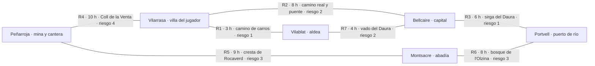

## 9b. La región: varias ciudades y pueblos

> [!NOTE]
> **Estado: propuesta (2026-11-04), pendiente del owner.** Lo que se juega hoy no cambia: la partida sigue en un solo
> mapa y ninguna regla del sim lee la región. Existe ya, como **datos y vista**: `data/world/region.json` (validado
> por `tools/validate_content.py`), un mapa generado para cada asentamiento (`data/maps/region_*.json`) y la pantalla
> «Mapa de la región» (menú de pausa o tecla `R`), con el botón de viajar deshabilitado («Próximamente»). Los viajes,
> las caravanas y los tratados de este capítulo están **diseñados, no implementados**. Las preguntas O-R* (9b.8) son
> del owner; los nombres (9b.9) son propuestas, y el del mapa EA es la decisión D9.

### 9b.1 El cambio de planteamiento

Hasta ahora H13 pedía **un mapa EA de 80×80 con 6 zonas**. El owner pide **una región con varios asentamientos**, para
desbloquear más adelante viajar a otras ciudades y firmar tratados mercantiles. Las dos cosas encajan así
(propuesta **P-R1**, en `12_decisiones.md`):

| Pieza | Tamaño | Papel |
|---|---|---|
| **La capital** | El mapa EA de 80×80 con sus 6 zonas, estilo A + C (D10) | El mapa grande de H13: 30-40 NPC, 5 familias rivales, todos los cargos. Hoy hay una **maqueta** generada (`region_capital`, 80×80) que el mapa de H13 sustituirá |
| **La villa del jugador** | 40×40 (`town_e`, estilo E) | La rebanada vertical de hoy. No se toca: las dianas de los bots dependen de sus solares |
| **Los demás asentamientos** | De 32×32 a 48×48 | Más pequeños y baratos de producir: un trazado, una plaza de mercado y pocas casas |

Solo un asentamiento se simula entero (personas en casillas, bots, edificios). Es el **asentamiento de casa**. Los demás
llevan una simulación abstracta, sin coste (9b.6). Así la región no multiplica el coste del sim ni el del arte: la
capital es el único mapa grande y los demás cuestan lo que un pueblo de prueba del constructor de ciudades.

Dónde vive el jugador en EA (en la villa o en la capital) es la pregunta **O-R1**. Los inicios ya llevan su `map`
(`data/starts`), así que elegir ciudad de casa no pide código nuevo en el sim.

### 9b.2 Geografía

La región de **Valldaura** (nombre propuesto, 9b.9) es un valle con el río **Daura** de oeste a este por el sur.
Al norte está la sierra de **Rocaverd**, al este el bosque de **l'Olzina** y en medio los campos de cereal.

### 9b.3 Los asentamientos

Seis asentamientos, cada uno con su mapa en `data/maps/` (los ids de los mapas no llevan el nombre: los nombres están
pendientes). «Oficios que abundan» usa las 18 profesiones del GDD (§1): es identidad de diseño. En los mapas de hoy,
todos llevan los solares del inicio del herrero (forja, forja rival, carpintería, cantería y sastrería), porque su
escenario de prueba juega `artisan_blacksmith`. La capital y el puerto llevan además los rivales de los otros tres
oficios (los cuatro inicios del Artesano). Los multiplicadores de precio son **[balance] de diseño**: el sim no los
lee (9b.5).

| | Vilarrasa (villa) | Bellcaire (capital) | Portvell (puerto) | Peñarroja (mina y cantera) | Vilablat (aldea) | Montsacre (abadía) |
|---|---|---|---|---|---|---|
| **Mapa** | `town_e` (a mano) | `region_capital` | `region_port` | `region_quarry` | `region_hamlet` | `region_abbey` |
| **Tamaño** | 40×40 · 8 casas · ~300 almas | 80×80 · 16 casas · ~4.000 almas | 48×48 · 10 casas · ~900 almas | 40×40 · 6 casas · ~400 almas | 32×32 · 4 casas · ~120 almas | 36×36 · 4 casas · ~150 almas (60 monjes) |
| **Trazado** | `calle` | `plaza` | `rio` | `cruce` | `aldea` (nuevo) | `abadia` (nuevo) |
| **Estilo (9.2)** | E · pueblo-calle | A + C · villa de mercado con puerto (la maqueta de hoy: A, plaza con tres anillos; el río llega con el mapa de H13) | C · río y puerto | B en pequeño · casas de piedra al pie de la sierra | E · granjas y huertos | B · recinto cerrado, iglesia y claustro |
| **Oficios que abundan** | Herrero, carpintero, cantero, sastre | Comerciante, prestamista, sastre, orfebre, notario, guardias | Barquero, tonelero, carpintero de ribera, pescador | Minero, cantero, carbonero, herrero | Labrador, molinero, panadero, pastor | Monjes copistas, herbolario, boticario, tejedor |
| **Produce barato** | — (referencia, ×1) | Telas y ropa fina ×0,85, documentos ×0,8 | Madera ×0,75, tablones ×0,8, barriles ×0,8 | Hierro ×0,6, carbón ×0,7, piedra ×0,7, sillares ×0,85 | Trigo ×0,6, harina ×0,75, pan ×0,85, lana ×0,8 | Hierbas ×0,6, vendas ×0,75, documentos ×0,7 |
| **Paga caro** | — | Comida ×1,3, armas ×1,25, construcción ×1,2, lujo ×1,4 | Lingotes y acero ×1,2, herramientas ×1,2, capas de viaje ×1,3 | Comida ×1,35, ropa de trabajo ×1,3, martillos ×1,3, vendas ×1,3 | Azadas ×1,35, ruedas de carro ×1,3, muelas ×1,3, ropa común ×1,2 | Sillares ×1,35, estatuas ×1,5, telas ×1,2, tablones ×1,15 |
| **Arancel** (a forasteros) | 0 % (casa) | 10 % | 5 % (portazgo) | 8 % | 0 % | 0 % (se pide limosna) |
| **Quién manda** | El Alcalde y el concejo elegidos entre las casas (4.12); el jugador y el herrero rival compiten | Un concejo de patricios: las 5 familias rivales de H13 y los 6 cargos; la **Lonja** (gremio de mercaderes) firma los tratados | La **Cofradía de barqueros**: su prior hace de Alcalde y cobra el portazgo (recaudador) | Una casa de **barones** con la concesión de la mina; su batlle hace de Alcalde y tiene alguacil | El **batlle** de la aldea, elegido por las casas; las tierras son de la abadía (diezmo) | El **abad**; el cillerero lleva las compras y las ventas. Sin elecciones |

**Qué da cada uno al jugador del Artesano** (por qué viajar). La forja compra hierro y carbón baratos en Peñarroja.
Las armas se venden caras en la capital, sobre todo en guerra, y las herramientas de labranza en Vilablat. La
cantería encuentra en Montsacre (el claustro en obras) y en la capital (la catedral) los mejores compradores de
sillares y estatuas, y la carpintería compra la madera bajada por el río en Portvell.

### 9b.4 Rutas

Siete rutas, con un ciclo en el sur (Vilarrasa, Vilablat y Bellcaire) y otro por la sierra y el bosque; la región es
**conexa** (el validador lo comprueba). Las horas son **horas de juego** (1 h = 12,5 s reales a ×1, D4): andando, 30
casillas por hora (`minutes_per_tile` 2). Un viaje de 8 h es un tercio del día y una estación dura dos días (D1(b)),
así que **ir y volver a la capital cuesta dos tercios de un día**, un tercio de la estación. La distancia de la ficha
es el camino más corto por las rutas abiertas: a la capital, 7 h por Vilablat y el vado antes que 8 h por el camino
real.
El riesgo va de 0 a 5: la probabilidad de asalto por viaje sin escolta es `riesgo × 4 %` [balance].

| Ruta | Une | Horas | Terreno | Riesgo | La cortan |
|---|---|---|---|---|---|
| R1 | Vilarrasa – Vilablat | 3 | Camino de carros entre campos | 1 | — |
| R2 | Vilarrasa – Bellcaire | 8 | Camino real, con el puente del Daura | 2 | Guerra (requisas), revuelta en la capital |
| R3 | Bellcaire – Portvell | 6 | Camino de sirga por la orilla (o barcaza río abajo) | 1 | Crecida, guerra |
| R4 | Vilarrasa – Peñarroja | 10 | Sendero de montaña por el Coll de la Venta | 4 | Nieve, guerra |
| R5 | Peñarroja – Montsacre | 9 | Sendero de cresta por la sierra de Rocaverd | 3 | Nieve |
| R6 | Montsacre – Portvell | 8 | Camino del bosque de l'Olzina | 3 | — (bandidos del bosque) |
| R7 | Vilablat – Bellcaire | 4 | Vado del Daura | 2 | Crecida |

**Eventos que cortan rutas.** La **guerra** ya existe en `data/events.json` y su «rutas cortadas» hoy alarga los
recados ×1,5. En la región, además, cierra las rutas que la llevan en `cut_by` o dobla su riesgo [balance]. **Nieve**
(invierno, rutas de montaña) y **crecida** (primavera, rutas del río) son **eventos nuevos propuestos**: están en
`region.json` (`events_proposed`), no en `data/events.json`, porque añadirlos movería las tiradas de eventos y las
dianas (O-R8). Una ruta cortada no se puede tomar; el mapa regional la dibuja tachada.

**Bandidos.** El riesgo de una ruta es la probabilidad de cruzarse con una banda. Enlaza con el **Bandido del Pícaro**
(4.22.6.6): el puesto `road` de su Nido se ata a un tramo de camino de su mapa (`roads`). En la región, un Nido junto
a una ruta (o una familia IA Pícaro que lo tenga) **sube el riesgo de esa ruta** en +1. Un Bandido del jugador podría
asaltar caravanas de otras familias en las rutas de su ciudad, con su tirada de 4.22.6.6. La recompensa `bounty`
(«vencer a un bandido que ronda un camino») baja el riesgo de la ruta una estación.

### 9b.5 Viajar, comerciar y firmar tratados (diseño, desbloqueo futuro)

#### Viajar

- **Desbloqueo** (O-R2): el título de **Ciudadano** (`citizen`) da el salvoconducto del Alcalde para viajar. Las
  caravanas piden además un **carro** (D8, carros con coste, [POST-MVP]). Los tratados piden el título de **Patricio**
  y reputación en esa ciudad (abajo).
- **Qué cuesta:** el **tiempo** de la ruta, ×1,5 en guerra; el **portazgo** de las rutas que lo llevan; la **escolta**
  si se quiere (un guardia o un Mercenario de 4.22: 15-30 oro por viaje, divide el riesgo por 2 [balance]); y el
  **carro** para llevar más de lo que cabe en el inventario del viajero.
- **Mientras estás fuera:** el viajero sale del mapa (`location: "route:<ruta>"` y después `"city:<asentamiento>"`).
  Los **empleados siguen trabajando** con sus recetas y la cola del taller. Los **familiares siguen sus directivas**
  (H14: Comerciar, Producir…). El control pasa al siguiente miembro del grupo (4.10.5); si el viajero era el único
  adulto, la casa queda sin nadie que dé órdenes y el libro sigue apuntando los avisos. El rival no espera: un viaje
  largo es una apuesta. Se puede ordenar la vuelta en cualquier momento (se paga la ruta de vuelta).
- **Cómo se ve** (O-R3): el viaje es un **desplazamiento abstracto en el mapa regional**: el emblema de la familia avanza
  por la ruta a la velocidad del reloj y, al llegar, se abre la **página de la ciudad**, con su mercado, su tablón de
  encargos y la mesa de tratados, sin cargar su mapa. Cargar la otra ciudad en el mundo (andar por sus calles) pide
  varias ciudades en el `WorldState` y queda para después de EA.

#### Comercio entre ciudades

- **Precio en cada ciudad**: `precio_base × calidad × demanda_ciudad × estación × evento_ciudad × mod_ciudad`. Es la
  fórmula de 4.5.3 con dos piezas nuevas: la **demanda propia** de cada ciudad (misma regla que el mercado de casa: baja
  `drop_per_unit` por unidad vendida, se recupera al alba) y `mod_ciudad`, que es «produce barato / paga caro» de 9b.3.
  La estación es la de toda la región; los eventos pueden ser de la región (guerra) o locales de una ciudad.
- **Tres formas de comerciar:**
  1. **Llevarlo uno mismo**: el viajero vende y compra en la página de la ciudad.
  2. **Caravana**: un carro con un empleado de **carretero** sale por una ruta, vende en destino lo que lleva (con un
     precio mínimo por objeto), compra lo encargado y vuelve. Tarda ida + vuelta + 2 h y tira el riesgo de cada tramo.
     Un asalto se lleva la carga, no el carro, y el carretero vuelve herido (4.22.6.1).
  3. **Encargos de fuera** en el tablón (4.5.6), por ejemplo «La abadía de Montsacre pide 4 sillares en 2 días». Se
     entregan con una caravana, pagan más que el mercado y dan reputación en esa ciudad.
- **Aranceles**: cada ciudad cobra un % de lo que un forastero vende en su mercado (tabla de 9b.3). Es un sumidero de
  oro nuevo (4.19) y lo cobra el recaudador de esa ciudad.

#### Tratados mercantiles

Un tratado se firma con quien manda (9b.3: el concejo o la Lonja, el prior, el barón, el batlle o el abad). Dura N
estaciones y cuesta una **cuota de firma** (oro o un regalo).

| Tratado | Qué da | Requisito propuesto [balance] |
|---|---|---|
| **Exención de aranceles** | Tu familia no paga arancel en esa ciudad | Patricio · reputación ≥ 20 en esa ciudad · 4 estaciones |
| **Exclusividad de un producto** | Solo tu familia vende ese objeto en esa ciudad: las caravanas de los demás no lo descargan | Barón · reputación ≥ 40 · 2 estaciones · cuota alta |
| **Cuota fija a buen precio** | La ciudad te compra Q unidades por estación a un precio fijo (×1,2 del base): un encargo que se repite | Ciudadano · reputación ≥ 10 · 4 estaciones. Si no entregas: −10 de reputación y multa |

- **Con los cargos:** el **Alcalde** puede firmar tratados **en nombre de su ciudad**, que valen para todas las
  familias de casa (por ejemplo, «los de Vilarrasa no pagan portazgo en Portvell»). Pasan por el concejo como una
  votación (4.12) y suben la reputación del Alcalde en casa. Un tratado de familia lo firma el cabeza de familia.
- **Con la reputación:** cada familia lleva una **reputación por ciudad** (en las de fuera empieza en 0). La suben los
  encargos cumplidos, los tratados respetados y los donativos; la bajan los tratados rotos y los asaltos probados (si
  un Bandido es juzgado, 4.22.6.3). La reputación de casa (4.10.5) no cambia.
- **Con las familias rivales:** una familia IA con carro también manda caravanas (una tirada por estación). Sus ventas
  bajan la demanda en destino, así que una exclusividad del jugador la deja fuera.

### 9b.6 Simulación de las ciudades lejanas

Lo mínimo para que tengan vida, sin coste:

- **Por ciudad**: la demanda de cada objeto que trata su mercado, los eventos locales activos, la reputación de cada
  familia y los tratados en vigor. **No hay personas, ni edificios, ni bots por casilla.**
- **Al alba**: la demanda vuelve hacia su `rest` (la misma regla del mercado de casa), se tiran los eventos locales de
  esa ciudad (la tabla de `data/events.json` con una semilla por ciudad, `semilla del mundo | ciudad | clave`, para no
  mover las tiradas de casa) y avanzan las caravanas. La estación y los eventos regionales (guerra, nieve, crecida) son
  de toda la región.
- **Coste**: 6 ciudades × 37 objetos, una vez al día: nada, al lado de lo que cuesta un tic del sim de casa.
- **Guardado** (cuando se implemente; **no en esta fase**: la v15 está reservada a 4.22): un bloque raíz
  `region: {cities: {<id>: {demand: {item: x}, events: [...], reputation: {fam: n}, treaties: [...]}}, caravans: [...],
  travel: {...}}` en la versión que toque (v16 o posterior). La migración rellena la región con los valores de
  `data/world/region.json`. Los datos fijos (rutas, horas, `mod_ciudad`) no se guardan: se leen de `region.json`.
- **La ciudad de casa** sigue con su sim de hoy. Si un día se carga otra ciudad (O-R3), su estado abstracto es la
  semilla de su mercado al entrar.

### 9b.7 Lo que existe ya (esta fase)

| Pieza | Dónde | Qué hace |
|---|---|---|
| Región como datos | `data/world/region.json` | Asentamientos (identidad, mapa, posición en el mapa regional), rutas, eventos propuestos. Lo leen la vista y el validador; **el sim no** |
| Validación | `tools/validate_content.py` (`check_region`) | Ids únicos, rutas entre asentamientos que existen, sin rutas repetidas, región conexa, cada mapa existe, textos en `i18n`, objetos y grupos de `mod_ciudad` que existen |
| Mapas | `data/maps/region_*.json` y `town_e` | Uno por asentamiento, generado con `tools/city` (trazados nuevos `aldea` y `abadia`, número de casas por mapa); su escenario de prueba `<mapa>_start` |
| Mapa de la región | `game/ui/region_screen.gd` | Pergamino ilustrado, rutas, nombres y la ficha de cada asentamiento al pasar o pulsar; «Viajar» deshabilitado con «Próximamente» |

### 9b.8 Preguntas abiertas para el owner

Nada de esto cambia reglas del sim hasta que el owner lo apruebe.

| # | Pregunta | Opciones | Recomendación |
|---|---|---|---|
| **O-R1** | ¿Dónde vive el jugador en EA? | (a) En la villa (40×40): la capital es un destino. (b) En la capital (80×80, el mapa de H13); la villa queda como rebanada vertical y vecina. (c) Se elige al empezar (el `map` del inicio): villa o capital | **(c)**, con la **capital por defecto** en EA: las dianas de H13 (30-40 NPC, 5 familias) piden el mapa grande; la villa sirve de inicio corto y de tutorial, y elegir no cuesta código (los inicios ya llevan su mapa) |
| **O-R2** | ¿Cómo se desbloquea viajar? | (a) Título de Ciudadano. (b) Comprar un carro (D8). (c) Reputación ≥ N en casa. (d) Desde el principio | **(a)** para viajar, y **(b)** solo para las caravanas: viajar es un premio del primer ascenso y el carro es una inversión con mantenimiento |
| **O-R3** | ¿El viaje carga la otra ciudad? | (a) Abstracto en el mapa regional, con la página de la ciudad (mercado, tablón, tratados). (b) Cargar su mapa (varias ciudades en el `WorldState`). (c) (a) en EA y (b) después | **(c)**: (a) cuesta una pantalla y un bloque de guardado; (b) multiplica el sim, el guardado y el arte |
| **O-R4** | ¿Caravanas con carretero o solo viajes del jugador? | (a) Solo el jugador lleva la carga. (b) Caravanas con un empleado de carretero. (c) Las dos | **(c)**: el viaje propio para empezar y la caravana para escalar sin dejar la casa |
| **O-R5** | ¿Aranceles? | (a) Sí, un % por ciudad (9b.3). (b) No. (c) Solo en la capital | **(a)**: es el sumidero de oro de las ganancias entre ciudades (4.19) y lo que da valor a la exención |
| **O-R6** | ¿Quién firma los tratados? | (a) Solo la familia. (b) Solo el Alcalde, por la ciudad. (c) Los dos, cada uno los suyos | **(c)**: da un uso nuevo al cargo de Alcalde (tope EA) sin quitárselo a quien no lo tiene |
| **O-R7** | ¿Reputación por ciudad o una sola? | (a) Una por ciudad. (b) La de casa vale en todas. (c) La de casa ÷ 2 en las demás | **(a)**: cada ciudad tiene que ganarse; la de casa no se toca |
| **O-R8** | ¿Nieve y crecida como eventos del sim? | (a) Sí, en `data/events.json` al implementar los viajes. (b) No: solo la guerra corta rutas | **(a)** cuando lleguen los viajes, con su `min_day` y su estación; antes no, porque moverían las tiradas y las dianas de hoy |
| **O-R9** | ¿Población de los mapas grandes? (`data/town.json population.max_total` es 20 para todos) | (a) Un `max_total` por mapa. (b) Proporcional a las casas del mapa. (c) Igual para todos | **(b)** (5 por casa, el `house_capacity`) cuando la capital sea casa: con 20 la capital no se renueva |
| **O-R10** | Nombres de la región y de los asentamientos (y D9) | Los de 9b.9 u otros | Valldaura y los seis de 9b.9; **D9**: el mapa EA se llama como la ciudad de casa (si O-R1 = (b)/(c), **Bellcaire**) |

### 9b.9 Nombres propuestos

En la línea catalana y castellana de `data/cast.json`. Todo es propuesta: los textos viven en `i18n/strings.csv`
(`region.*`) y se cambian ahí sin tocar ids.

| Pieza | Propuesta | Alternativas | Por qué |
|---|---|---|---|
| Región | **Valldaura** | Vallmora, Valdeoro | «Valle del Daura»: el río le da nombre |
| Río | **Daura** | Llobrec, Ter Vell | Corto y sonoro; de «daurat», dorado como el trigo |
| Villa del jugador | **Vilarrasa** | Vilallonga del Camí, Pradell | «Villa llana»: un pueblo-calle en la llanura |
| Capital | **Bellcaire** | Castellnou de Mercat, Santa Maria del Mercadal | «Buena esquina»: el cruce del camino real y el río |
| Puerto de río | **Portvell** | Gualba de Riu, Pont d'Olzina | «Puerto viejo» de las barcazas del Daura |
| Mina y cantera | **Peñarroja** | Pedrafita, Rocafort de la Mina | La roca roja del hierro; castellano, como los mineros que llegaron de fuera |
| Aldea | **Vilablat** | Trigueros, Campdàsens | «Villa del trigo» |
| Abadía | **Santa Maria de Montsacre** (Montsacre) | Sant Benet de la Vall, Santa Clara del Bosc | «Monte sagrado» en la sierra |
| Sierra · bosque · paso | **Rocaverd** · **l'Olzina** · **Coll de la Venta** | — | La «venta» del paso es donde rondan los bandidos |

**D9 (nombre del mapa EA)** sigue pendiente del owner. Propuesta: si el mapa EA es la capital (O-R1), **Bellcaire**.
