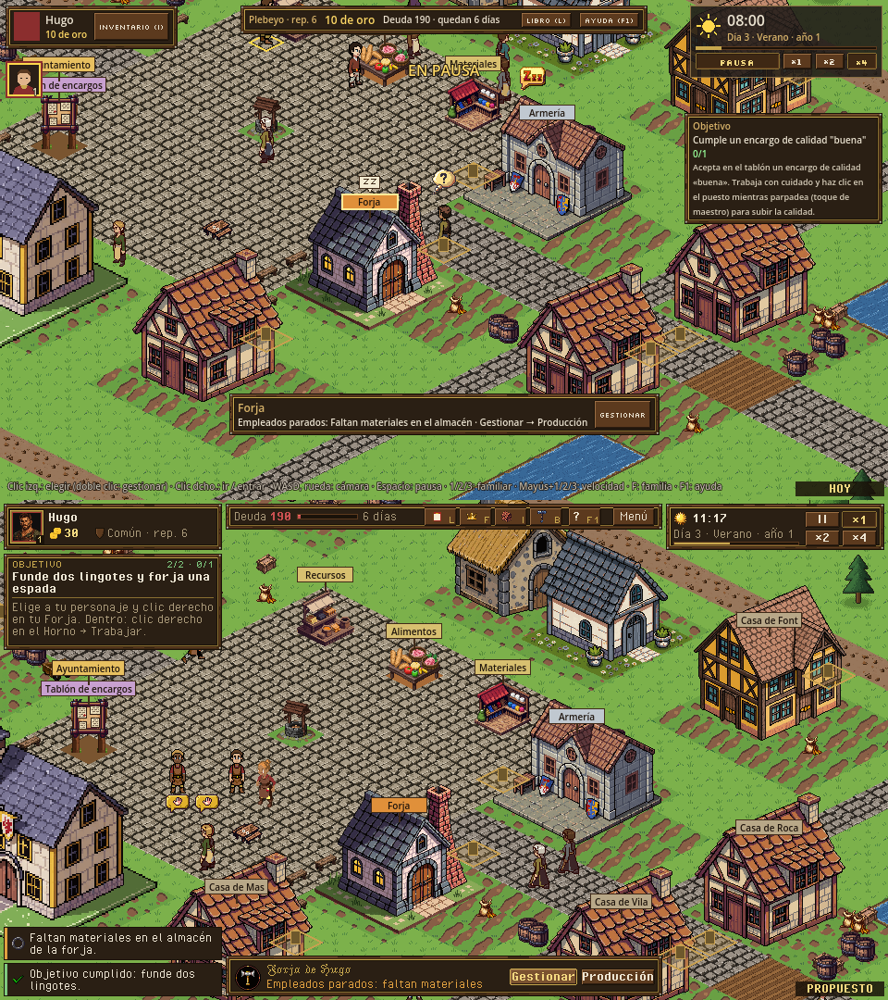
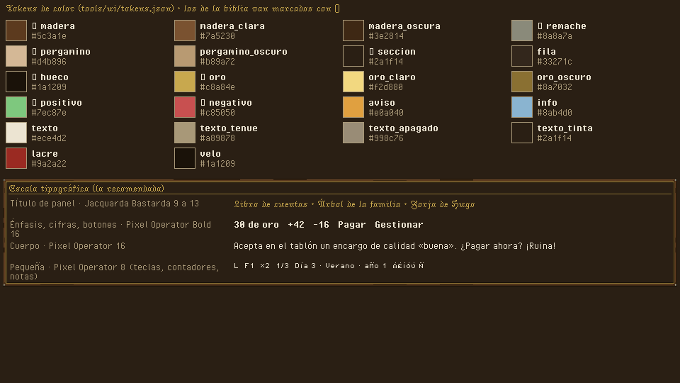
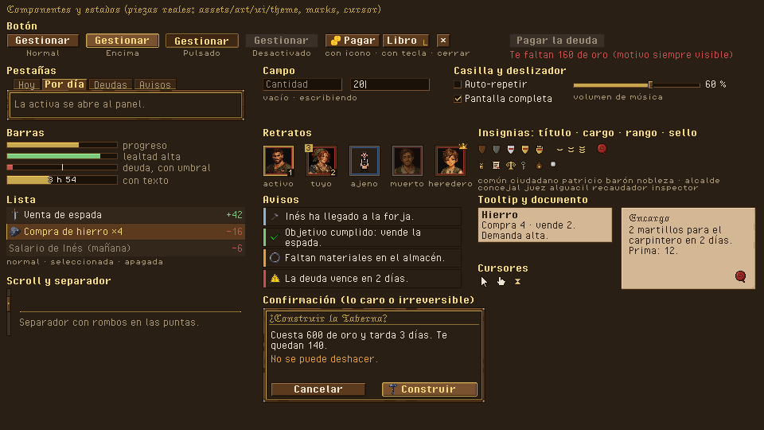
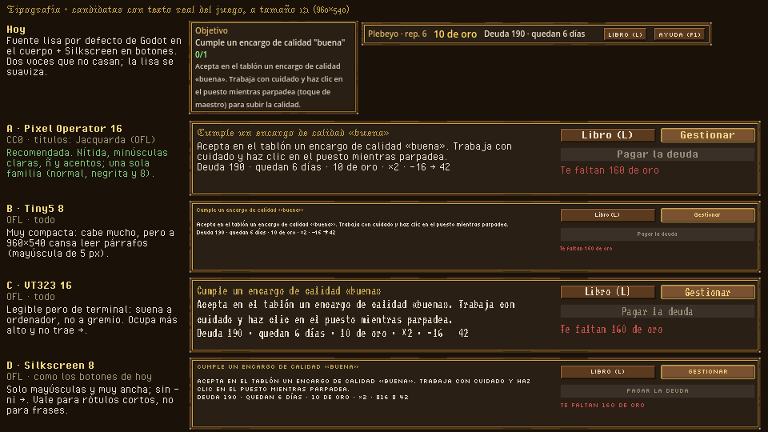
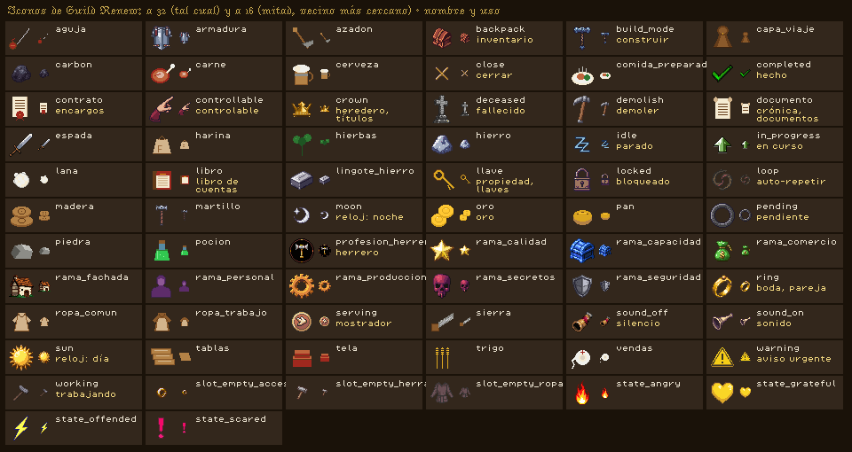

# 00 · Lenguaje visual de la UI

> Dueño: kit · Estado: borrador para revisar · Fecha: 2026-11-02
> Manda sobre `mecanicas/_comun.md` y `mecanicas/_social.md` donde choquen. Fuentes de las láminas:
> `docs/ui/maquetas/src/laminas_00.py` y `docs/ui/maquetas/src/hud.py` (`python3 tools/ui/maqueta.py <fichero>`).

La interfaz de GuildMaster es **un libro de cuentas de gremio**: tablas de madera con remaches, filete de oro, papel de
pergamino para lo escrito y tinta oscura. Todo se dibuja a 960×540 lógicos y se escala ×2 entero, sin suavizado. Esta
guía fija cómo se ve cualquier pantalla; cada documento de mecánica la usa, no la repite.

*Arriba, el HUD de hoy (captura real); abajo, el propuesto sobre el mismo pueblo (`lamina_hud_antes_despues.png`).*

## 1. Principios

1. **El pueblo es lo importante.** El HUD ocupa los bordes; el centro es para mirar. Nada fijo entra en la zona central
   (ver [01_hud.md](01_hud.md)).
2. **Una sola voz.** Una familia tipográfica pixel (Pixel Operator) para todo lo que se lee y una letra gótica solo para
   títulos. Nada de fuentes lisas.
3. **Píxel a píxel.** Medidas múltiplos de 4, escalas enteras, iconos a 16 o 32, retratos a 32 o 64 por dentro.
4. **Nunca solo color.** Cada estado lleva también icono, texto o forma (daltonismo, capturas en gris).
5. **Lo que no se puede hacer, dice por qué.** Botón apagado con el motivo escrito al lado (el `reason` de Orders).

## 2. Rejilla y medidas

Rejilla de **4 px**. Las medidas viven en `tools/ui/tokens.json` (`medida`); las de aquí son las mismas.

| Qué | Medida | Notas |
|---|---|---|
| Margen de pantalla | 4 | Entre el borde y cualquier panel fijo. |
| Separación entre paneles | 4 | Dos paneles nunca se tocan ni se solapan. |
| Relleno de panel | 8 | Marco de 6 + 2 de aire. El contenido empieza a 8 del borde. |
| Botón | 16 de alto (18-20 si lleva icono de 16) | Ancho: texto + 12; con tecla, + ancho de la tecla. |
| Fila de lista | 16 (solo texto) · 20 (con icono de 16) | 1 px de separación entre filas. |
| Pestaña | 15 de alto | La activa tapa el filete del panel y se abre hacia él. |
| Icono | 16 en listas y botones · 32 en rejillas y detalle | Nunca 24 ni escalas raras. |
| Retrato | 38 en el HUD (32 dentro) · 70 en fichas (64 dentro) | Marco de 3 px. Los de Guild Renew (192) entran exactos a /6 y /3. |
| Separador | 1 px oro oscuro, o la pieza `divider` (rombos en las puntas) | Entre secciones de un mismo panel. |
| Línea de texto | 13 (cuerpo y negrita) · 9 (pequeña) · 14 (título) | En Godot: `line_spacing = -3` en Label con Pixel Operator 16. |

## 3. Color

Tokens en `tools/ui/tokens.json` (`color`). Los marcados ● son los de la biblia (`docs/style/biblia.md`, UI medieval);
el resto son sus tonos claros y oscuros, sin colores nuevos.

| Token | Uso |
|---|---|
| ● `madera` / `madera_clara` / `madera_oscura` | Marco de los paneles, botones, fila seleccionada. |
| ● `seccion` | Fondo de los paneles (la sección oscura). |
| `fila` | Fondo de una fila de lista. |
| ● `hueco` | Casillas vacías, barras vacías, campos, contorno de 1 px de toda la UI. |
| ● `oro` / `oro_claro` / `oro_oscuro` | Filete de los paneles, títulos, lo activo y seleccionado, el oro (dinero). |
| ● `pergamino` / `pergamino_oscuro` | Documentos, tooltips y la ayuda: con texto `texto_tinta`. |
| ● `remache` | Solo los remaches de las esquinas del marco. |
| `texto` / `texto_tenue` / `texto_apagado` | Texto normal; secundario; desactivado. |
| ● `positivo` | Ganas, hecho, cabe, cumple. |
| ● `negativo` | Pierdes, falta, motivo de rechazo, urgente. |
| `aviso` | Atención sin urgencia (plazo cerca, empleados parados). |
| `info` | Avisos informativos. |
| `lacre` | Sellos (contratos, decretos, títulos). |

Reglas:
- Fondo de panel siempre opaco (`seccion`). Translúcido solo el velo de los modales (`velo` al 50-60 %).
- Las cifras de oro van en negrita y `oro_claro` con el icono de oro; las diferencias con signo y color (`+42`, `−16`).
- El color de la familia (del sim, `families.<id>.colors`) solo aparece en el borde interior del retrato y en el sello
  de la familia, nunca como fondo de un panel.

## 4. Superficies y marcos

| Superficie | Pieza | Grosor del marco | Para |
|---|---|---|---|
| **Madera** | `panel` (9-patch 32×32, margen 6) | 6 px: contorno 1 + madera 3 + filete de oro 1 + sombra 1 | Todo panel fijo o de gestión. |
| **Sección oscura** | sin pieza (`seccion` + contorno `madera_oscura` de 1) | 1 px | Menús contextuales, la cola de órdenes, desplegables. |
| **Pergamino** | `parchment` (24×24, margen 6) · `tooltip` (12×12, margen 3) | 1-2 px | Documentos (encargo, decreto, crónica final), ayuda F1, tooltips. |
| **Hundido** | `field` (12×12, margen 3) | 1 px | Campos, teclas dibujadas, huecos de inventario. |

Un panel dentro de otro no lleva otro marco de madera: usa una sección oscura o filas.

## 5. Estados

| Estado | Cómo se ve | Pieza |
|---|---|---|
| Normal | Madera con luz arriba-izquierda, texto claro | `button_normal` |
| Encima (ratón o foco de teclado) | Filo de oro, madera más clara, texto oro claro | `button_hover` |
| Pulsado / activo (velocidad elegida, pestaña abierta) | Hundido: sombra arriba, el texto baja 1 px | `button_pressed` |
| Desactivado | Apagado, sin relieve, texto `texto_apagado` **y el motivo al lado** en `negativo` | `button_disabled` |
| Seleccionado (fila, retrato) | Fondo `madera`, franja de oro de 1 px a la izquierda; retrato con marco de oro | `portrait_active` |
| Peligro (acción cara o irreversible) | Normal, pero abre confirmación: título con la pregunta, coste en cifras y «No se puede deshacer» en `aviso` | — |

El foco de teclado usa el mismo aspecto que «encima»: así se puede jugar sin ratón en los menús.

## 6. Tipografía

Hoy se mezclan **Silkscreen** (mayúsculas, en los botones) y la **fuente lisa por defecto de Godot** (el resto), que
además se suaviza. No casan. Candidatas, todas libres y con ñ y acentos, probadas con textos reales del juego a 1:1:

| | Fuente | Licencia | Tamaño nítido | Veredicto |
|---|---|---|---|---|
| **A** | **Pixel Operator** (normal, negrita y «8») + **Jacquarda Bastarda 9** para títulos | CC0 · OFL | 16 (mayúscula de 9 px) · 8 · 13 | **Recomendada.** Minúsculas claras, una sola familia con negrita, cifras anchas. La gótica da el tono de gremio sin cansar, porque solo va en títulos. |
| B | Tiny5 | OFL | 8 (mayúscula de 5 px) | Cabe mucho, pero los párrafos cansan a 960×540. |
| C | VT323 | OFL | 16 | Legible pero suena a terminal; no trae `→`. |
| D | Silkscreen (la de hoy en botones) | OFL | 8 | Solo mayúsculas y muy ancha; sin `−` ni `→`. Vale para rótulos de 1-2 palabras. |

Escala de la recomendada (en `tokens.json` → `fuente`):

| Papel | Fuente y tamaño | Uso |
|---|---|---|
| `titulo` | Jacquarda Bastarda 9 a 13 | Título de panel, de pantalla y de documento. Nunca en frases largas ni en botones. |
| `negrita` | Pixel Operator Bold 16 | Botones, cifras, nombres, el título del objetivo. |
| `cuerpo` | Pixel Operator 16 | Todo lo demás. |
| `pequena` | Pixel Operator 8 | Teclas en los botones, contadores sobre retratos, rótulos en mayúsculas («OBJETIVO»). |

- Pixel Operator no traía `→ ← ↑ ↓ −`, que usan los textos del juego (`i18n/strings.csv` tiene 22 `→` y 6 `−`):
  `tools/ui/glifos_extra.py` los dibuja en su rejilla (es CC0, se puede modificar). Jacquarda no los tiene: en títulos
  no se usan.
- Importación en Godot: sin suavizado, sin hinting y sin subpíxel (ya puesto en los `.import` de
  `assets/art/ui/fonts/`). Solo los tamaños de la tabla: otro tamaño deforma las letras.
- Cada fuente lleva su licencia al lado (`*_ofl.txt`, `pixel_operator_cc0.txt`) y su fila en `assets/inventario.json`.

## 7. Iconografía

- **Tamaños:** 16 en listas, botones y barras; 32 en rejillas de inventario, fichas y la barra de selección.
- Los 68 iconos de Guild Renew (más 6 burbujas) son de 32. A 16 se reducen a la mitad con vecino más cercano; los finos (espada, azadón,
  aguja, sierra, martillo) pierden la línea y hay que repasarlos a mano con el `pixelart_workbench` (gratis) antes de
  usarlos a 16. Los de objeto del juego (`assets/art/icons/`, por id de objeto) siguen la misma regla.
- **Insignias nuevas del kit** (`assets/art/ui/marks/`, de 12 o 16): escudos de los 5 títulos (`badge_title_<id>`, ids
  de `data/titles`), los 6 cargos (`badge_office_<id>`), rango de empleado (`rank_1..3`, galones) y el sello de lacre.

| Uso | Icono | Uso | Icono |
|---|---|---|---|
| Oro | `icon_oro` | Libro de cuentas | `icon_libro` |
| Día / noche (reloj) | `icon_sun` / `icon_moon` | Encargos | `icon_contrato` |
| Familia, heredero, títulos | `icon_crown` | Boda, pareja | `icon_ring` |
| Fallecido | `icon_deceased` | Controlable | `icon_controllable` |
| Inventario | `icon_backpack` | Construir / demoler | `icon_build_mode` / `icon_demolish` |
| Aviso urgente | `icon_warning` | Hecho / pendiente / en curso | `icon_completed` / `icon_pending` / `icon_in_progress` |
| Trabajando / parado | `icon_working` / `icon_idle` | Bloqueado | `icon_locked` |
| Auto-repetir | `icon_loop` | Cerrar | `icon_close` (o «×» en el botón) |
| Sonido sí / no | `icon_sound_on` / `icon_sound_off` | Propiedad | `icon_llave` |
| Mostrador | `icon_serving` | Oficio | `icon_profesion_<oficio>` |
| Ramas de mejora | `icon_rama_<rama>` (8) | Equipo vacío | `slot_empty_<ranura>` |
| Estados de ánimo | `state_<estado>` | Objetos | `icon_<objeto>` o `assets/art/icons/<id>` |

**Faltan** (se piden en [03](03_produccion_sin_creditos.md)): reputación, menú/engranaje, velocidad (hoy «II ×1 ×2 ×4»
en texto, que se lee bien), guardar/cargar, tribunal (mazo), elecciones (urna), mapa de parcelas.

## 8. Animación y feedback

Animaciones cortas, por pasos enteros de píxel, sin desenfoques ni curvas suaves de color. Corren aunque el juego esté
en pausa (son de la vista) y nunca bloquean la entrada: se puede hacer clic durante una animación.

| Qué | Cómo | Duración |
|---|---|---|
| Abrir panel | Entra desde su borde 8 px en 3 pasos (8 → 4 → 0) y aparece a la vez (alfa 0 → 100 % en 2 pasos) | 0,12 s |
| Cerrar panel | Al revés, en 2 pasos | 0,08 s |
| Pulsar | El contenido baja 1 px (pieza `button_pressed`); al soltar vuelve | inmediato |
| Botón desactivado pulsado | Tiembla 1 px a izquierda y derecha 2 veces y suena «no» | 0,15 s |
| Aviso emergente | Entra desde la izquierda en 4 pasos; el urgente hace parpadear su franja 2 veces | 0,15 s · vive 6 s (urgente: hasta clic) |
| Oro que sube / baja | El número de la ficha cuenta hasta el nuevo valor y un «+42» / «−16» sube 8 px desde él y se apaga | 0,4 s / 0,8 s |
| Objetivo cumplido | El panel del objetivo destella en oro (filete claro) y el siguiente entra como un panel nuevo | 0,3 s |
| Cambio de fase del día | El icono sol/luna cambia con 1 frame intermedio | — |

## 9. Cursor

Tres cursores dibujados del kit (`assets/art/ui/cursor/`), con contorno `hueco` y relleno crema, punto activo en el
píxel de arriba a la izquierda:

| Cursor | Cuándo |
|---|---|
| `cursor_arrow` | Siempre por defecto. |
| `cursor_hand` | Sobre algo que se puede usar con clic (edificio, persona, puesto, botón). |
| `cursor_wait` | Mientras se carga o guarda una partida. |

En Godot el cursor no se escala con el viewport: se usa la versión ×2 (`Input.set_custom_mouse_cursor` con la imagen
a 20×30). La de ×2 se genera al implementar, con vecino más cercano.

## 10. Sonidos de UI

Bus `Ui` (`default_bus_layout.tres`). Ids de `data/audio.json`:

| Evento | Id | Estado |
|---|---|---|
| Clic en botón | `sfx_ui_click` | existe |
| Abrir / cerrar panel | `sfx_panel_open` / `sfx_panel_close` | existe |
| Pausa / seguir | `sfx_pause` / `sfx_resume` | existe |
| Aviso / urgente | `sfx_notice` / `sfx_alarm` | existe |
| Oro que entra (compra, venta) | `sfx_coins`, `sfx_sale` | existe |
| Objetivo cumplido / fallado | `sfx_objective_done` / `sfx_objective_failed` | existe |
| Acción no permitida (botón apagado pulsado) | `sfx_ui_denied` | **falta** |
| Cambiar de pestaña | `sfx_ui_tab` (o `sfx_ui_click` más grave) | **falta** (opcional) |
| Confirmar algo caro (sello) | `sfx_ui_seal` | **falta** |
| Pasar el ratón por encima | — | sin sonido (cansa) |

Los que faltan se generan cuando haya créditos de ElevenLabs (tope del owner: 20.000; se renuevan el día 20).

## 11. Cambios para implementarlo

Tareas pequeñas, en este orden (ninguna toca `sim/`):

- [ ] Theme: `Label`, `RichTextLabel`, `LineEdit`, `PopupMenu`, `TooltipLabel` con Pixel Operator 16 y
      `line_spacing = -3`; `Button` con Pixel Operator Bold 16 (sustituye a Silkscreen 8); `default_font` del theme =
      Pixel Operator 16.
- [x] Theme: variaciones nuevas ya en `greybox_theme.tres` (no cambian nada de lo que hay; se usan poniendo su nombre
      en `Theme Type Variation` del nodo): `TitleLabel` (Jacquarda 13, oro), `BodyLabel` y `BoldLabel` (Pixel Operator
      16, `line_spacing` −3), `SmallLabel` (Pixel Operator 8, tenue), `InkLabel` (tinta, para pergamino),
      `ParchmentPanel` (pieza `parchment`), `DarkPanel` (sección oscura). Sirven para probar la fuente en un panel
      antes de cambiarla en todo el theme.
- [ ] Theme: `CheckBox` (`check_on`/`check_off`), `HSlider` (`slider_track`/`slider_grabber`), `VScrollBar`
      (`scroll_track`/`scroll_grabber`), `TabBar`/`TabContainer` (`tab_on`/`tab_off`), `HSeparator` (`divider`).
- [ ] Revisar cada panel de `game/ui/` contra la rejilla de 4 y los tamaños de la sección 2 (los que fuerzan
      `font_size` o colores a mano, quitarlos para que mande el theme).
- [ ] Cursores ×2 y `Input.set_custom_mouse_cursor` (arrow, hand sobre lo clicable, wait al cargar).
- [ ] Animaciones de la sección 8 (un solo script de transiciones para todos los paneles).
- [ ] Sonidos que faltan en `data/audio.json` (con su fichero cuando haya créditos).

## 12. Criterios de aceptación

- [ ] Una captura de cada panel de `game/ui/` no muestra ninguna fuente lisa ni suavizada (mirar a ×2).
- [ ] Ningún texto del juego en español muestra un cuadro de glifo que falta (`glifos_extra.py --falta` con todo
      `i18n/strings.csv` da «-» para Pixel Operator).
- [ ] Todos los botones desactivados del juego muestran su motivo sin pasar el ratón.
- [ ] Un panel nuevo, sin tocar nada, sale con marco de madera, Pixel Operator y los colores de esta guía (hereda el
      theme de la raíz del HUD).

## Decisiones que necesitan al owner

1. **Fuente.** Recomiendo A (Pixel Operator + Jacquarda en títulos). Alternativa: B (Tiny5) si se prefiere ver más
   texto por panel a costa de leer peor.
2. **Gótica en títulos sí o no.** Recomiendo sí (solo títulos). Si no gusta, los títulos van en Pixel Operator Bold
   en oro y nada más cambia.
