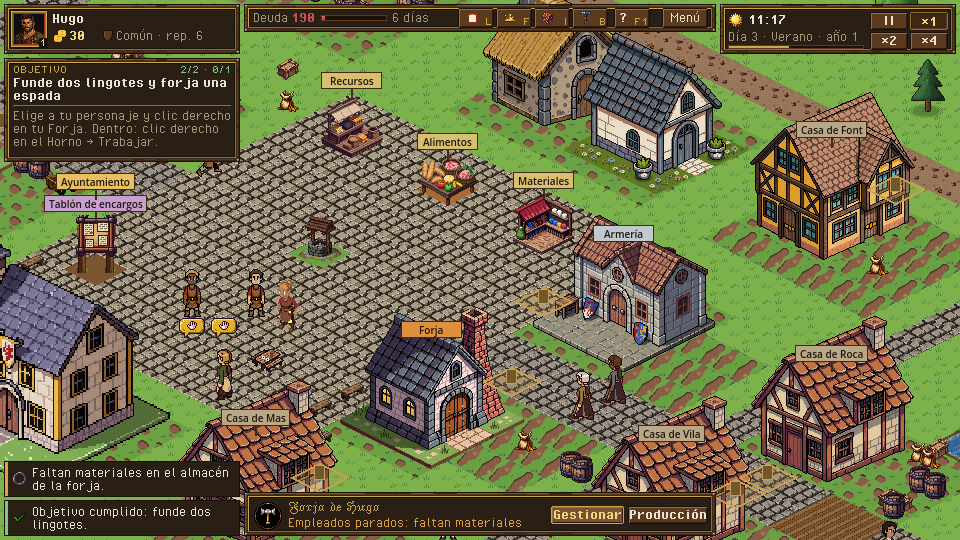
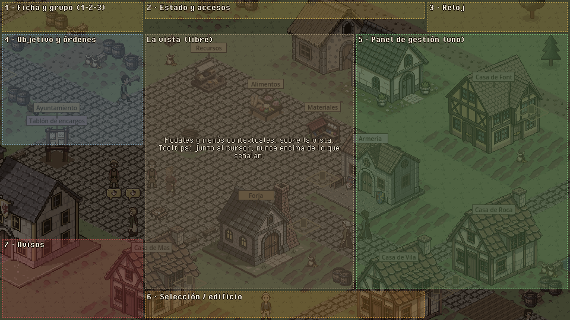
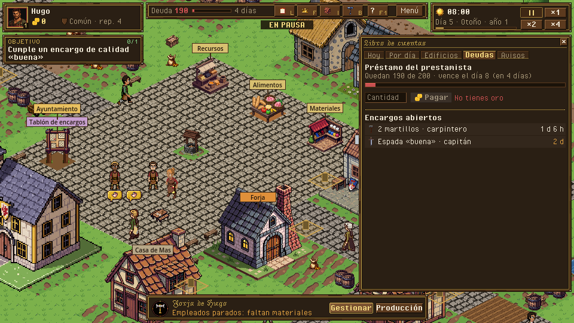
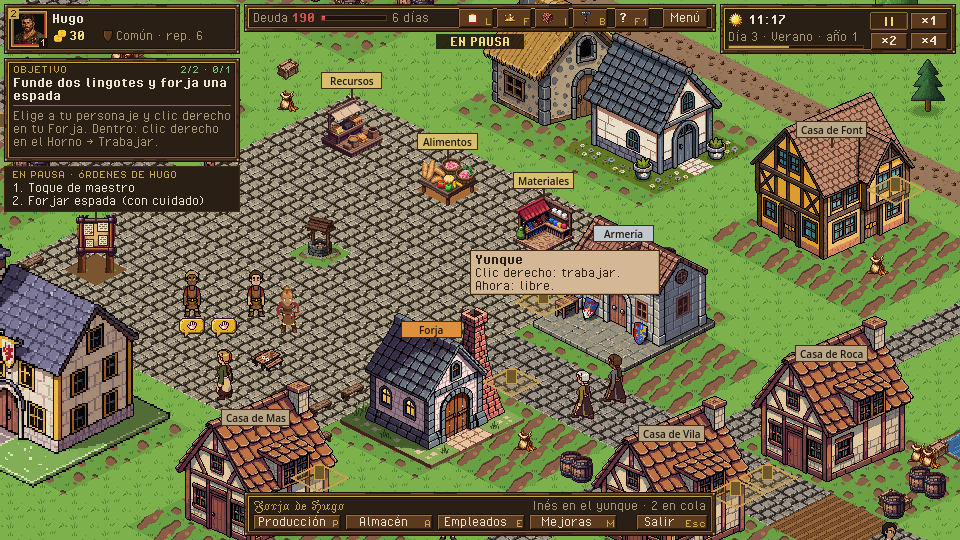
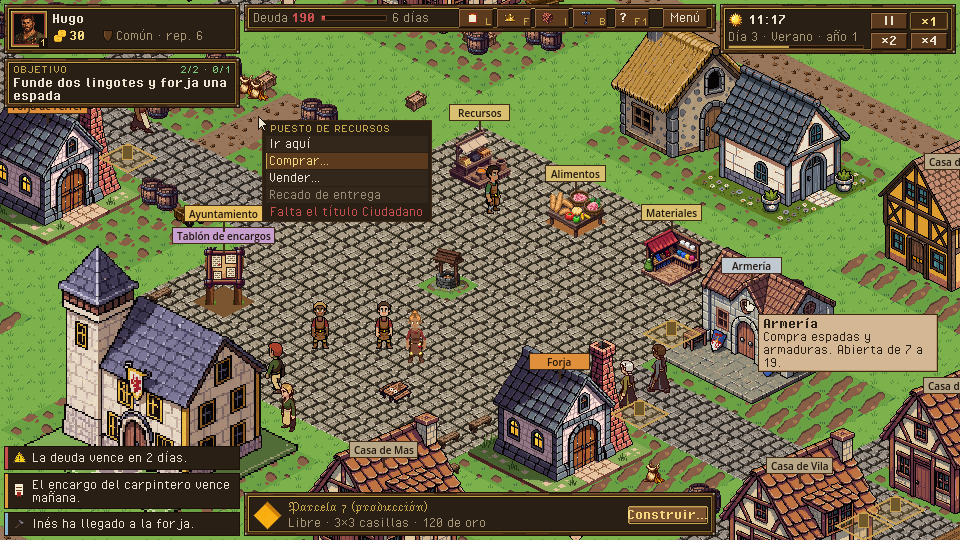
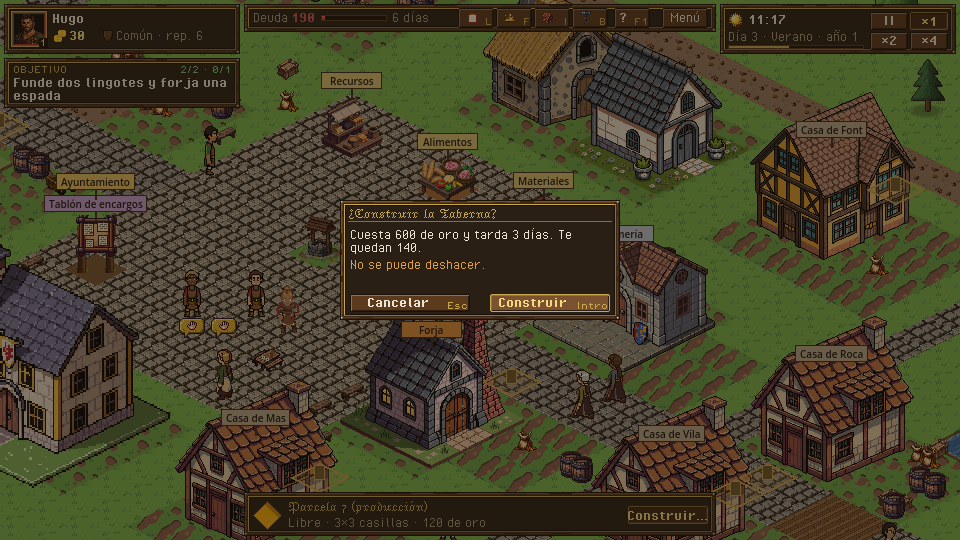
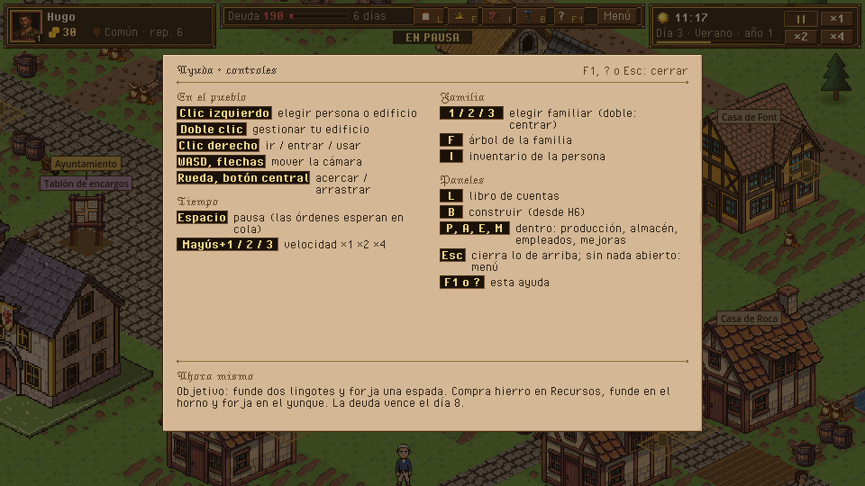

# 01 · HUD: la interfaz general en el mapa y dentro de un edificio

> Dueño: kit · Estado: borrador para revisar · Fecha: 2026-11-02
> Estilo: [00_lenguaje_visual.md](00_lenguaje_visual.md). Maquetas: `docs/ui/maquetas/src/hud.py`
> (`python3 tools/ui/maqueta.py docs/ui/maquetas/src/hud.py`). Cualquier pantalla de mecánica se monta sobre estas zonas
> con las funciones de `hud.py` (`ficha()`, `reloj()`, `lateral()`, `seleccion()`…).

## 1. Para qué sirve

Responde, sin abrir nada, a las cuatro preguntas que el jugador se hace cada minuto:

- **¿Cómo voy?** Oro, deuda y días que quedan, título y reputación.
- **¿Qué hago ahora?** El objetivo de inicio y lo que tiene pendiente el personaje (órdenes en pausa).
- **¿Qué ha pasado?** Los avisos (empleados parados, plazos, la deuda).
- **¿Qué hora es y a qué velocidad va?** Hora, fase del día, estación, pausa y velocidad.

## 2. Cómo se abre y se cierra

- El HUD está siempre. Solo se oculta en el menú de pausa, en las pantallas de título y de final, y en las capturas.
- **Esc cierra lo de más arriba**, en este orden: modal → menú contextual → ayuda (F1) → panel de gestión (lateral) →
  ficha de persona → selección. Con nada abierto, **Esc abre el menú de pausa** (el único que pausa, GDD 4.1).
- Ningún panel del HUD pausa el juego. Con el juego en pausa se siguen dando órdenes (pausa activa): se encolan por
  personaje y se ven en la columna izquierda.

## 3. Jerarquía de información

1. **Primero:** el oro y la deuda (ficha y barra de estado) y lo seleccionado (barra de abajo).
2. **Segundo:** la hora y la velocidad (arriba a la derecha) y el objetivo (columna izquierda).
3. **A demanda:** el detalle en tooltip (hora exacta y estación en el reloj; plazo exacto de la deuda; reputación por
   clase en el título) o en el panel de gestión (libro, producción…).

## 4. Zonas fijas y reglas de solape

Todas a 960×540, margen 4, separación 4. Ninguna zona fija se solapa con otra (están en `hud.ZONAS`).

| # | Zona | Rect `[x, y, w, h]` | Qué lleva |
|---|---|---|---|
| 1 | Ficha y grupo | `[4, 4, 236, 50]` | Retratos 1-2-3 del grupo; nombre, oro, título y reputación del activo. |
| 2 | Estado y accesos | `[244, 4, 472, 28]` | Deuda (cifra, barra y días); botones con tecla: Libro (L), Familia (F), Inventario (I), Construir (B), Ayuda (F1); Menú. «EN PAUSA» cuelga debajo. |
| 3 | Reloj | `[720, 4, 236, 50]` | Sol/luna, hora, fecha, barra de la fase, pausa y ×1 ×2 ×4. |
| 4 | Columna izquierda | `[4, 58, 236, 186]` | Objetivo (plegable) y, en pausa, las órdenes en cola del activo. |
| 5 | Panel de gestión | `[600, 58, 356, 430]` | Un solo panel a la vez: libro, producción, almacén, empleados, mejoras, mercado, tablón, ficha de vecino, ayuntamiento… |
| 6 | Selección | `[244, 492, 472, 44]` | Lo seleccionado (edificio, persona, parcela) con su estado y 1-3 acciones; dentro de un edificio, la barra del edificio. |
| 7 | Avisos | `[4, 404, 236, 132]` | Avisos emergentes, apilados de abajo arriba, 3 como mucho. |
| — | La vista | `[244, 58, 352, 430]` y lo que dejen libre 5 y 7 | Solo cosas que flotan: menú contextual, tooltip, modales. |

**Reglas de prioridad** (de abajo arriba al dibujar):

1. Mundo (pueblo o interior) → letreros del mundo (nombres de edificios, burbujas) → **zonas fijas** (opacas) →
   panel de gestión → menú contextual → tooltip → velo y modal → ayuda F1 → menú de pausa.
2. **Un solo panel de gestión.** Abrir otro sustituye al que hubiera (con el sonido de cerrar y abrir). Por eso el libro
   de cuentas ya no tapa el panel del edificio: el libro es un panel de gestión (zona 5) y el edificio está en la
   selección (zona 6), que no se tocan. Era el solape pendiente:

   

3. **La columna se pliega antes que solaparse.** Si objetivo + órdenes no caben en 186 px, el objetivo se pliega a su
   título y progreso (como hoy hace a los 20 s, `hud.objective_hint_seconds` de `data/view.json`).
4. **Avisos:** como mucho 3; el que entra empuja al más viejo, que sigue en el libro (pestaña Avisos).
5. **Lo flotante no tapa lo que señala.** El tooltip sale abajo a la derecha del cursor y se da la vuelta si fuera a
   pisar una zona fija o el borde. El menú contextual sale junto al cursor y se desplaza para no salirse.
6. **La cámara deja ver lo seleccionado.** Si lo seleccionado queda debajo del panel de gestión o de la selección, la
   cámara se mueve lo justo para dejarlo en la vista libre (en el interior, el interior se dibuja centrado en la vista
   libre, no en la pantalla).
7. **Pantallas grandes** (árbol de la familia, organigrama, crónica): modal grande de 912×440 centrado sobre el velo.
   No pausan (salvo que su documento diga otra cosa); el HUD de arriba sigue a la vista.

**Dentro de un edificio** las zonas son las mismas. La barra de selección pasa a ser la **barra del edificio**:
nombre, estado (quién trabaja, cuántos en cola) y los botones que abren su panel de gestión (Producción, Almacén,
Empleados, Mejoras) más Salir. Hoy esos botones están arriba a la derecha, debajo del reloj.

## 5. Avisos, tooltips, modales y confirmaciones

**Avisos emergentes** (zona 7). Salen del registro de avisos del sim (`notice_added`, GDD 4.18):

| Gravedad | Franja | Cuánto dura | Sonido |
|---|---|---|---|
| Urgente | `negativo`, parpadea 2 veces al entrar | Hasta que se hace clic o se abre el libro | `sfx_alarm` |
| Aviso | `aviso` | 8 s (`notices.popup_seconds`) | `sfx_notice` |
| Cumplido (objetivo, encargo) | `positivo` | 5 s | `sfx_objective_done` |
| Info | `info` | Solo en el libro (no salta) | — |

Clic en un aviso: centra la cámara en su edificio o persona o abre su panel (como hoy, `notice_action`). Cada aviso
lleva el icono de su tipo (sección 7 de 00).

**Tooltips.** Pergamino, aparecen a los 0,4 s quietos encima de algo y se van al moverse. Contenido fijo: **qué es**
(negrita) · **qué puedes hacer** · **por qué no** si está apagado. Ancho máximo 200. Nunca llevan información que no se
pueda conseguir de otra forma (el motivo de un botón apagado también se ve sin ratón).

**Menú contextual** (clic derecho en un puesto, una persona o una parcela). Sección oscura junto al cursor, con un
rótulo pequeño de qué es, una fila por acción y las acciones imposibles apagadas con su motivo debajo. Se cierra con
Esc, con clic fuera o al dar la orden.

**Confirmaciones.** Modal de 280×120 en el centro con velo. Solo para lo **caro o irreversible**: construir, demoler,
despedir, comprar un título, mejora cara, pagar la deuda si deja el oro por debajo de los salarios de mañana, cerrar
la dinastía. Título con la pregunta, coste en cifras, «No se puede deshacer» si es el caso, y dos botones: Cancelar
(Esc) a la izquierda, la acción (Intro) a la derecha y resaltada. Nunca para lo rutinario (comprar, vender, encolar).

## 6. Objetivos y ayuda (F1)

- **Objetivo** (zona 4): rótulo «OBJETIVO» pequeño en oro, progreso a la derecha en `positivo`, el título en negrita y
  la pista debajo en `texto_tenue`. Plegado: solo rótulo, progreso y título. Se despliega al cambiar de objetivo, al
  pasar el ratón y siempre dentro de un edificio (lo que ya hace `HudLayout.hint_shown`).
- Objetivo cumplido: destello de oro (00, sección 8), aviso «cumplido» y el siguiente entra desplegado.
- **Ayuda F1** (también `?` y el botón «?» de la barra): pergamino grande sobre el velo con el mapa de teclas por
  secciones y un bloque **«Ahora mismo»** con el objetivo y su pista. Sustituye a la línea de ayuda que hoy ocupa el
  borde de abajo (se quita: la selección ocupa ese sitio y las teclas se ven en los botones).

## 7. Selector de familiares (grupo 1-2-3)

- En la ficha (zona 1): hasta 3 retratos de 38 (32 dentro), en el orden del grupo. El activo con marco de oro; los
  demás con marco de madera. Cada uno lleva su **número** (tecla) abajo a la derecha, el **borde interior en el color
  de la familia**, la **corona** si es el heredero y, en pausa activa, un **contador de órdenes en cola** arriba a la
  izquierda.
- Clic o tecla 1-2-3: lo elige. Doble clic o doble pulsación: centra la cámara en él. Un familiar que muere sale del
  grupo con un aviso; un hijo que cumple 16 entra (GDD 4.10.5).
- Junto a los retratos, del **activo**: nombre, oro de la familia (con el icono), insignia y nombre del título y la
  reputación. El oro es de la familia (es lo que se gasta); por eso va aquí y no en cada retrato.

## 8. Reloj y velocidad

- Sol o luna según la fase (`icon_sun` / `icon_moon`), hora `HH:MM` en negrita, fecha `Día 3 · Verano · año 1`, y
  debajo la barra de progreso de la fase (GDD 4.15). Tooltip: hora, fase y estación (`hud.clock`).
- Botones `II ×1 ×2 ×4` en una rejilla de 2×2; el activo hundido (`button_pressed`). En pausa, además, «EN PAUSA»
  cuelga bajo la barra de estado, centrado, pequeño (hoy es un texto grande en medio de la vista).

## 9. Mapa de teclas completo

| Tecla | Hace | Hoy |
|---|---|---|
| Clic izquierdo | Elegir persona, edificio, puesto | sí |
| Doble clic | Gestionar tu edificio sin ir andando | sí |
| Clic derecho | Ir / entrar / usar (con persona elegida); en un puesto, menú contextual | sí |
| WASD, flechas | Mover la cámara | sí |
| Rueda · botón central | Acercar · arrastrar la cámara | sí |
| Espacio | Pausa / seguir | sí |
| Mayús+1 / 2 / 3 | Velocidad ×1 / ×2 / ×4 | sí (ver tarea: `speed_1..3` del mapa de entrada están en 1-2-3 sin Mayús) |
| 1 / 2 / 3 | Elegir familiar del grupo | sí |
| F | Árbol de la familia | sí |
| I | Inventario de la persona elegida | sí |
| L | Libro de cuentas | sí |
| F1 · ? | Ayuda | sí |
| Esc | Cierra lo de arriba; con nada abierto, menú de pausa | sí (sin menú de pausa todavía) |
| B | Modo construcción (H6) | **propuesta** |
| P · A · E · M | Dentro de tu edificio: Producción · Almacén · Empleados · Mejoras | **propuesta** |
| Intro | Confirmar el modal | **propuesta** |
| F5 · F9 | Guardado rápido · cargar el rápido (ver [02](02_menu_inicial.md)) | **propuesta** |

Todas las teclas van al mapa de entrada de `project.godot` (no `KEY_*` en el código) para poder cambiarlas en
opciones más adelante.

## 10. Datos

Solo lee; no calcula reglas. Lo que lee hoy `game/ui/hud.gd` y sigue igual:

- Reloj: `sim.now()` (`hour`, `minute`, `day`, `season`, `year`, `phase`), `DayNight.phase_progress()`,
  `Game.paused`, `Game.speed`.
- Ficha: `SimQuery.player_family()`, `Money.gold(state, fam)`, `Titles.current(sim, fam)` + `SimQuery.title_name()`,
  `Reputation.of(state, fam)`; grupo: `characters.<id>.controlled_by == "human"` de la familia, heredero, cola
  (`SimQuery.queue_lines(sim, actor, Game.pending(), paused)`).
- Deuda: `SimQuery.loans_of(sim, fam)` (`outstanding`, `days_left`, `due_minute`; `SimQuery.minute_label()` para el
  plazo exacto del tooltip). La barra: lo pagado sobre el total del préstamo.
- Objetivo: el objetivo actual de la familia y `SimQuery.objective_name()`; pista en i18n.
- Selección: `SimQuery.building_label()`, `SimQuery.idle_employees()`, `SimQuery.queue_view()` (`stalled`) y
  `SimQuery.reason_text()`.
- Avisos: evento `notice_added` y `SimQuery.notice_text()`.

Órdenes que emite: ninguna propia; los botones abren paneles o cambian `Game` (pausa, velocidad), que no son órdenes
del sim. **Consulta nueva** (cuando se implemente): «salarios y mantenimiento de mañana» para avisar al confirmar el
pago de la deuda.

## 11. Sonido y feedback

`sfx_ui_click` en cada botón; `sfx_panel_open` / `sfx_panel_close` al abrir y cerrar el panel de gestión;
`sfx_pause` / `sfx_resume`; los avisos según la tabla de la sección 5. Falta `sfx_ui_denied` (botón apagado pulsado).
Oro: el número cuenta y sale un «+42» / «−16» flotante (00, sección 8).

## 12. Diferencias con hoy y tareas

Hoy (`game/ui/hud.tscn`): `SelectedPanel` (persona: cuadro de color, nombre, oro, Inventario, cola) arriba a la
izquierda; `GroupBar` con retratos debajo; `FamilyPanel` arriba en el centro (título, oro, deuda, Libro, Ayuda);
`ClockPanel` arriba a la derecha; `ObjectivePanel` a la derecha en el mapa y a la izquierda dentro; `BuildingPanel`
abajo en el centro; `NoticePopups`; `PausedLabel` grande en el centro; `HelpLabel` en el borde de abajo; los paneles
de gestión salen cada uno donde quiere (el libro en el centro, encima del `BuildingPanel`).

- [x] Fijar las zonas: un `Control` por zona en `hud.tscn` con sus anclas y el rect de la tabla (o márgenes), y que
      los paneles se metan en su zona en vez de posicionarse solos.
- [x] Fundir `SelectedPanel` y `GroupBar` en la **ficha** (zona 1): retratos 1-2-3 + datos del activo; el oro y el
      título pasan de `FamilyPanel` a la ficha.
- [x] `FamilyPanel` → **barra de estado** (zona 2): deuda con barra, botones con icono y tecla, Menú.
- [x] `PausedLabel` → rótulo pequeño bajo la barra de estado.
- [x] `ObjectivePanel` → siempre en la columna izquierda (zona 4), con la cola de órdenes debajo (sale de la ficha).
- [x] Panel de gestión único (zona 5): `MarketPanel`, `BoardPanel`, `LedgerPanel`, `NpcPanel`, `TownHallPanel` y los
      del interior se abren en esa caja; abrir uno cierra el otro.
- [x] `BuildingPanel` → **selección** (zona 6) para edificio, persona o parcela; en el interior, barra del edificio con
      Producción / Almacén / Empleados / Mejoras / Salir (se quita la barra del interior de arriba a la derecha).
- [x] `NoticePopups` → zona 7, con gravedades aviso y cumplido además de urgente; franja e icono.
- [x] Quitar `HelpLabel`; la ayuda F1 gana el bloque «Ahora mismo».
- [x] Mapa de entrada: `speed_1..3` a Mayús+1..3; acciones nuevas `build_mode`, `panel_production`… para las teclas
      propuestas.
- [x] Cámara: desplazar para que lo seleccionado no quede bajo las zonas 5 y 6.
- [ ] Menú de pausa (Esc sin nada abierto), según [02](02_menu_inicial.md). El HUD ya lo pide: `hud.pause_menu_requested` (Esc sin nada abierto o el botón Menú); la escena es de la rama de menús.

## 13. Criterios de aceptación

- [x] Con la Forja seleccionada en el mapa y el libro abierto, el panel del edificio se ve entero (captura
      `ui_hud_libro.png`).
- [x] En ninguna captura de `--smoke-script=rebanada` dos paneles fijos se solapan (se puede comprobar con los rects de
      las zonas en una prueba de `HudLayout`).
- [x] Dentro de la forja en pausa con 2 órdenes, se ven el objetivo y las 2 órdenes sin solaparse ni salirse de la
      columna.
- [x] Llegan 4 avisos urgentes seguidos: se ven 3 y el cuarto está en el libro.
- [ ] Esc cierra en el orden de la sección 2 y, con nada abierto, abre el menú de pausa (que sí pausa).
- [x] Todas las teclas de la tabla funcionan y salen en la ayuda F1 (salvo F5 / F9, que son de guardar y cargar: rama de menús).

## Implementado (rama ui-hud, 2026-11-03)

Capturas reales: `maquetas/hud_hoy_mapa.png`, `hud_hoy_libro.png`, `hud_hoy_avisos.png`, `hud_hoy_ayuda.png`,
`hud_hoy_interior.png` y `hud_hoy_produccion.png` (`--smoke-script=hud`, que también comprueba los criterios de §13), y
cada panel en su zona con `--smoke-script=paneles` (`reports/shots/ui_panel_<id>.png`).

- Zonas: `HudLayout.ZONES` (`game/ui/hud_layout.gd`), una caja por zona en `hud.tscn`; los paneles de gestión van dentro
  de `ManageZone` (zona 5), el árbol, los cargos y el juicio dentro de `ModalZone` (912×440 sobre el velo) y, en el
  interior, almacén, producción y empleados en la zona 5 y el árbol de mejoras en el panel ancho `[244, 58, 712, 430]`
  (`_comun.md`). Las tarjetas (microevento) van en la columna, bajo el objetivo (`_social.md`).
- Un solo panel a la vez: `ManageSlot` (grupo `manage_panel`), el del HUD y el del interior juntos.
- Teclas: `HudKeys` las registra en el mapa de entrada al arrancar (ver la desviación en el informe de la rama:
  `project.godot` no se comparte entre ramas); Esc sin nada abierto emite `pause_menu_requested`.
- Avisos: urgente (hasta clic o abrir el libro), aviso (8 s) y cumplido (5 s, claves en `data/view.json`
  `notices.done_keys`); como mucho 3.

## Decisiones que necesitan al owner

1. **Qué avisos saltan.** GDD 4.18 dice solo los urgentes. Propongo también los de aviso y los cumplidos (8 s y 5 s),
   porque hoy «empleados parados» pasa desapercibido. Alternativa: solo urgentes, como el GDD.
2. **Línea de ayuda del borde de abajo.** Propongo quitarla (las teclas van en los botones y en F1). Alternativa:
   dejarla solo el primer día de juego.
3. **Teclas nuevas** (B, P/A/E/M, Intro, F5/F9). Propongo todas; son atajos, no cambian reglas.
