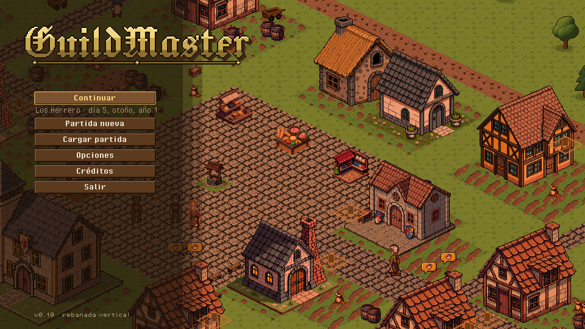
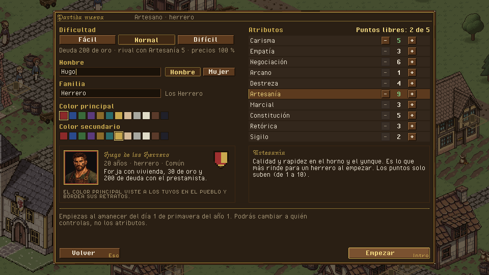
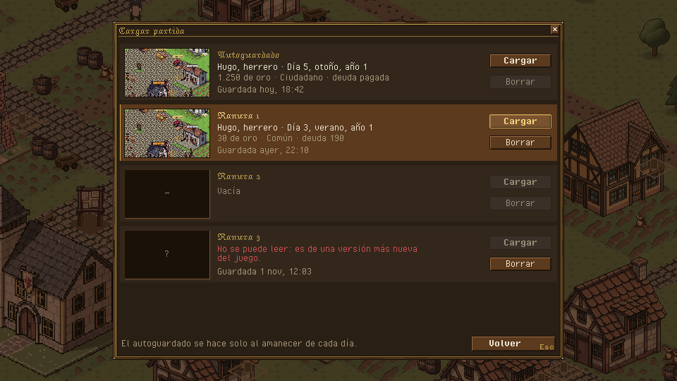
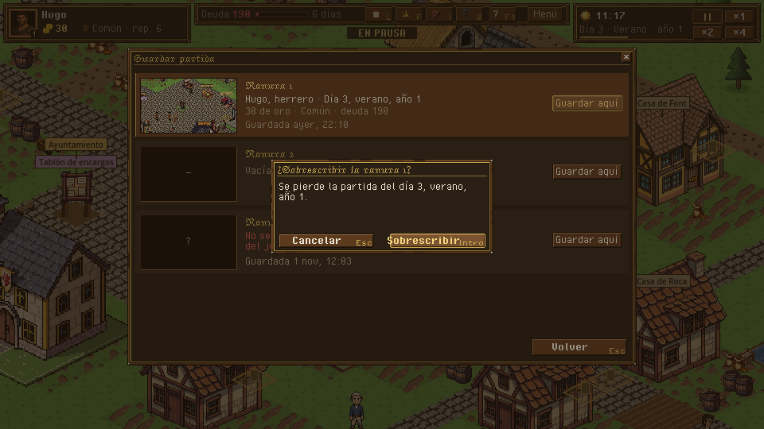
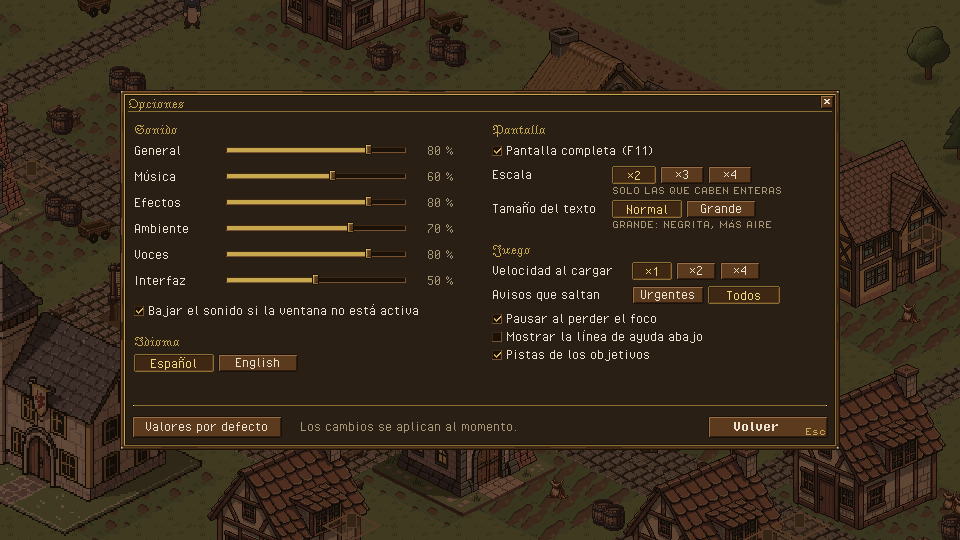
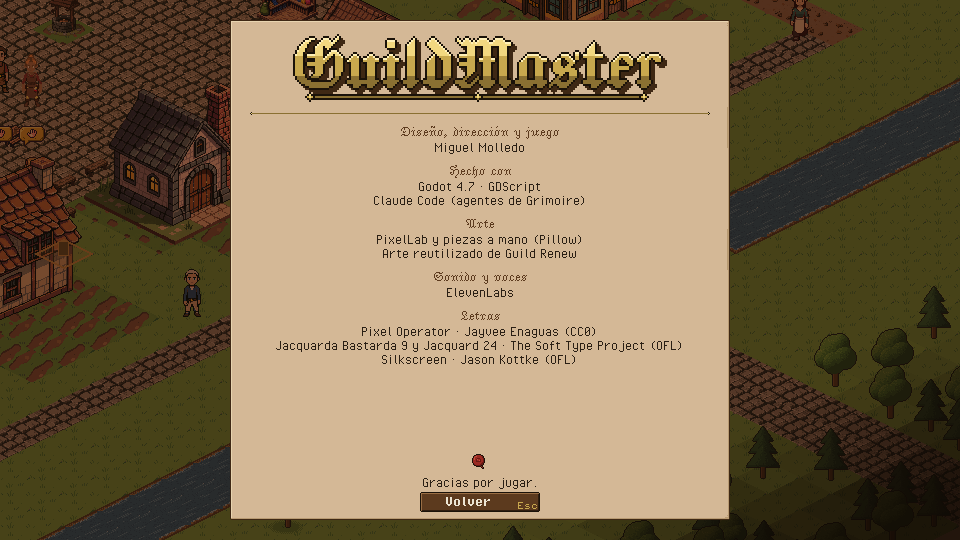
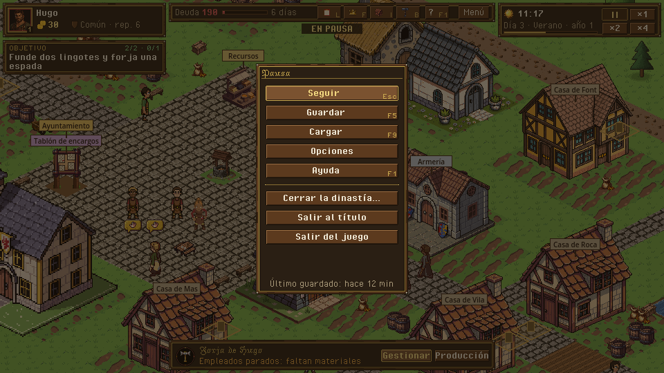
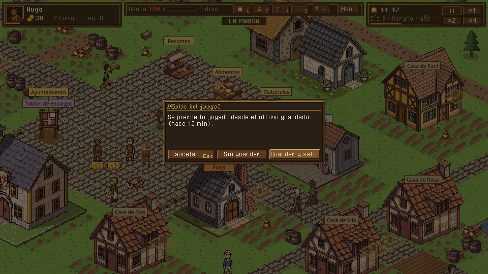
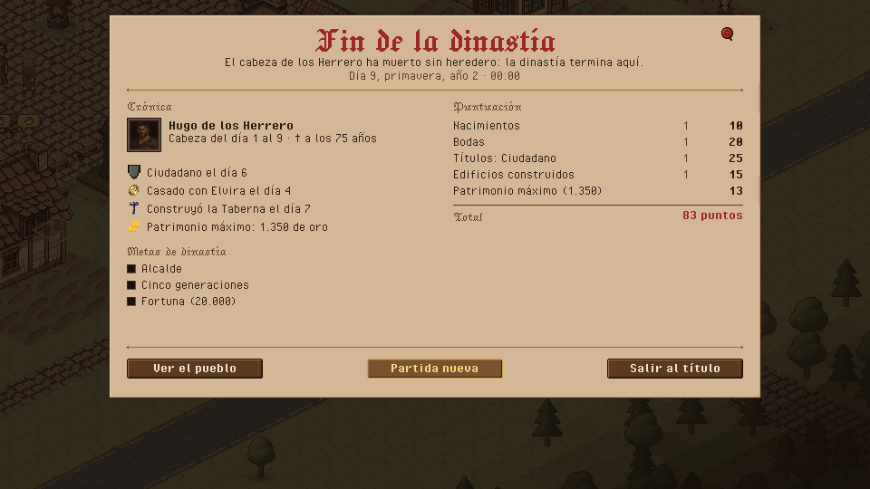

# 02 · Menú inicial, partidas, opciones y final

> Dueño: kit · Estado: borrador para revisar · Fecha: 2026-11-02
> Estilo: [00_lenguaje_visual.md](00_lenguaje_visual.md) · HUD: [01_hud.md](01_hud.md) · Maquetas:
> `docs/ui/maquetas/src/menu.py`. Logotipo: `tools/ui/logo.py` → `assets/art/ui/logo/`.

Un documento para todas las pantallas que no son el pueblo: título, partida nueva, cargar y guardar, opciones,
créditos, el menú de pausa, salir y el final de partida. Las diez secciones de la plantilla van por pantalla donde
cambian, y juntas donde son comunes (sonido, datos, tareas).

## Común a todas

- **Fondo:** el pueblo real (capturas del juego sin HUD, `docs/ui/maquetas/fondos/`), oscurecido y desaturado cuando
  hay un panel encima. En el título, vivo y al atardecer.
- **Teclado completo:** flechas o Tab mueven el foco (aspecto «encima»), Intro acepta, Esc vuelve. El primer botón
  útil tiene el foco al entrar.
- **Música:** `music_title` en título, partida nueva, cargar, opciones y créditos (`screen_music` de `data/audio.json`);
  el final usa la misma o una propia (falta `music_ending`).
- **Nada pausa por su cuenta** salvo el menú de pausa y el final (que ya pausa hoy, `ending_screen.gd`).

## 1. Pantalla de título

**Para qué:** «¿sigo donde lo dejé o empiezo?». **Abre:** al arrancar el juego sin `--scenario` (hoy abre directamente
partida nueva, `Game.parse_args()["new_game"]`). **Cierra:** al elegir.

- Logotipo «GuildMaster» arriba a la izquierda: letra gótica pixel **Jacquard 24** (OFL) a su tamaño nativo, relleno de
  oro en tres franjas, contorno, sombra de madera y regla con rombos; en pantalla a ×2 (374×68). Es el único texto
  dentro de una imagen; el resto sale de i18n.
- Columna de botones de 200×22 sobre un velo a la izquierda en tres escalones (sin degradado suave):
  1. **Continuar** (solo si hay alguna partida): carga la más reciente (autoguardado o ranura). Debajo, una línea con
     familia y fecha de juego.
  2. **Partida nueva** → sección 2.
  3. **Cargar partida** → sección 3 (apagado si no hay ninguna, con «No hay partidas guardadas»).
  4. **Opciones** → sección 4. 5. **Créditos** → sección 5. 6. **Salir** (sin confirmación: no hay nada que perder).
- Versión abajo a la izquierda en pequeño.
- **Primera vez:** sin partidas, «Continuar» no sale y «Partida nueva» tiene el foco.

## 2. Partida nueva

**Para qué:** «¿quién soy y cómo de difícil?». **Abre:** desde el título. **Cierra:** Volver (Esc) al título; Empezar
(Intro) arranca la partida al amanecer del día 1 (GDD 4.16).

Lo que hay hoy (`new_game_screen.tscn`) se reordena en dos columnas dentro de un panel de 752×500:

| Izquierda | Derecha |
|---|---|
| Dificultad (Fácil / Normal / Difícil, la elegida hundida) y debajo **lo que cambia** en cifras (deuda, Artesanía del rival, precios: `DifficultyHint`). | **Atributos** en filas: nombre, −, valor, +. Arriba a la derecha «Puntos libres: 2 de 5». El valor subido en `positivo`. «−» apagado cuando está en su base (los puntos solo suben, D5). |
| Nombre (campo) + Hombre / Mujer. Familia (campo) y cómo se leerá («Los Herrero»). | Al pasar por un atributo, abajo, qué hace (texto de i18n). |
| Colores principal y secundario: 12 muestras de 14×14; la elegida con marco de oro. | |
| **Vista previa:** retrato de 64 con el borde de la familia, «Hugo de los Herrero», edad, oficio y título, lo que tiene al empezar y el **escudo de la familia** con sus dos colores. | |

- Empezar apagado con motivo si falta el nombre o la familia («Falta el nombre»); hoy el error sale en `ErrorLabel`
  abajo: se mantiene, pero junto al botón.
- **Datos:** `Catalog.starts()`, `difficulty` (con `default`), `data/view.json` `new_game` (nombre, familia, paleta y
  colores por defecto). Emite `NewGame.from_start(catalog, start, difficulty, choices, seed)` (sin cambios).

## 3. Cargar y guardar

**Para qué:** «¿qué partida es cuál?». Hoy no hay pantalla: el juego tiene `Game.save_slot()` con 3 ranuras
(`slot_1..3`) y el autoguardado de cada amanecer (`auto`), D6. **Abre:** Cargar desde el título o la pausa (F9); Guardar
desde la pausa (F5). **Cierra:** Volver (Esc).

- Una fila de 80 px por ranura: **miniatura** (120×68, captura del pueblo al guardar, reducida a 1/8), nombre de la
  ranura en gótica, quién y cuándo en el juego («Hugo, herrero · Día 5, otoño, año 1»), cómo va («1.250 de oro ·
  Ciudadano · deuda pagada») y cuándo se guardó en la vida real.
- **Cargar:** Cargar / Borrar por fila. El autoguardado no se borra. Una ranura **rota** (vacía, cortada, de una
  versión más nueva: `SaveFile.load_file()` → `{"ok": false, "error"}`) dice por qué en `negativo` y deja Borrar.
- **Guardar** (desde la pausa): las 3 ranuras, sin el autoguardado, con «Guardar aquí». Si la ranura tiene partida,
  confirmación «¿Sobrescribir la ranura 1?» con lo que se pierde.

- **Datos nuevos (consulta nueva, no en esta rama):** una cabecera ligera en cada guardado para no cargar la partida
  entera al listar: `{family_name, head, day, season, year, gold, title, debt, saved_at, version}` y la miniatura
  `user://saves/<ranura>.png`. Propuesta: `SaveFile.peek(path)` que lea solo la cabecera.
- **Sonido:** `sfx_ui_seal` (falta) al guardar; `sfx_ui_click` al cargar.

## 4. Opciones

**Para qué:** «¿cómo lo quiero oír y ver?». **Abre:** desde el título o la pausa. Los cambios se aplican al momento y se
guardan en `user://settings.cfg` (no en la partida). **Cierra:** Volver (Esc).

| Grupo | Opción | Valores | Notas |
|---|---|---|---|
| Sonido | General, Música, Efectos, Ambiente, Voces, Interfaz | 0-100 % (deslizador) | Un deslizador por bus de `default_bus_layout.tres` (Master, Music, Sfx, Ambient, Voice, Ui). |
| Sonido | Bajar el sonido si la ventana no está activa | sí / no | |
| Idioma | Español · English | | `TranslationServer.set_locale` (hoy `--lang`). |
| Pantalla | Pantalla completa (F11) | sí / no | |
| Pantalla | Escala | ×2 · ×3 · ×4 | Solo escalas enteras que quepan en el monitor (D2); las otras, apagadas con el motivo. |
| Pantalla | Tamaño del texto | Normal · Grande | Ver decisión 1: a 960×540 no hay tamaños intermedios nítidos. |
| Juego | Velocidad al cargar | ×1 · ×2 · ×4 | |
| Juego | Avisos que saltan | Urgentes · Todos | Ver 01, decisión 1. |
| Juego | Pausar al perder el foco | sí / no | |
| Juego | Mostrar la línea de ayuda abajo | sí / no | Ver 01, decisión 2. |
| Juego | Pistas de los objetivos | sí / no | Apagado = el objetivo siempre plegado. |

«Valores por defecto» abajo a la izquierda (sin confirmación: solo son opciones).

## 5. Créditos

Un pergamino con el logotipo, secciones en gótica y nombres en tinta, el sello al pie. Incluye **las licencias de las
fuentes** (obligatorio en OFL: el nombre y la licencia; CC0 no lo exige pero se agradece): las que usa el juego, Pixel Operator
(Jayvee Enaguas, CC0) y Jacquard 24 (The Soft Type Project, OFL).
Los textos salen de i18n; los nombres propios, de un `data/credits.json` (propuesta).

## 6. Menú de pausa

**Abre:** Esc con nada abierto, o el botón Menú de la barra de estado. **Pausa** el juego y **bloquea las órdenes**
(GDD 4.1: es la única pausa que no es activa). **Cierra:** Seguir o Esc (vuelve la velocidad de antes).

Seguir (Esc) · Guardar (F5) · Cargar (F9) · Opciones · Ayuda (F1) · ─ · **Cerrar la dinastía…** (D19, con
confirmación fuerte: termina la partida y abre el final) · Salir al título · Salir del juego. Abajo, «Último guardado:
hace 12 min».

**Salir** (al título o del juego) con partida sin guardar: confirmación con tres botones.

## 7. Final de partida

**Para qué:** «¿qué ha sido de mi dinastía?». **Abre:** cuando el sim pone `state.ending` (evento `game_over`): ruina
(D18), sin heredero o cierre voluntario (D19). **Cierra:** sus botones; Esc no hace nada (hay que elegir).

- Pergamino grande con el título en gótica grande (**Jacquard 24**) y en lacre: «Fin de la dinastía», «La ruina» o
  «La dinastía se retira» según `ending.kind`; debajo qué pasó y la fecha de juego; el sello arriba a la derecha.
- **Crónica** a la izquierda: los cabezas de familia con su retrato (marco de fallecido), sus días y su edad al morir;
  los hechos con su icono (títulos, bodas, edificios, cargos, juicios, patrimonio máximo); las **metas de dinastía**
  con su casilla.
- **Puntuación** a la derecha: una fila por tipo de hecho (cuántos y puntos, en negrita) y el **total** en lacre.
- Botones: **Ver el pueblo** (cierra el pergamino y deja mirar la ciudad en pausa, con un botón «Volver al final»),
  **Partida nueva**, **Salir al título**.
- **Datos:** los de hoy (`Dynasty.summary` / `score`, `ending_screen.gd`): sin cambios en el sim.
- **Sonido:** `music_ending` (falta) o silencio y `sfx_ui_seal` al aparecer el sello.

## Diferencias con hoy y tareas

Hoy: no hay título, ni cargar/guardar con pantalla, ni opciones, ni créditos, ni menú de pausa. `new_game_screen` y
`ending_screen` existen con el aspecto de las capturas `h3_partida_nueva.png` y `h8_game_over.png` (fuente lisa, una
sola columna, sin vista previa).

- [ ] `title_screen.tscn` (nueva) con el fondo: una escena del pueblo real cargada en pausa detrás (o la captura
      `titulo_atardecer.png` si se prefiere estático: ver decisión 2) y el logotipo `guildmaster_logo_x2.png`.
- [ ] `app.gd`: arrancar en el título (no en partida nueva) cuando no hay `--scenario`; «Continuar» = ranura más
      reciente.
- [ ] `new_game_screen.tscn`: dos columnas, vista previa con retrato y escudo, motivo del botón apagado junto a él.
- [ ] `save_screen.tscn` (cargar y guardar en una, con modo), cabecera ligera y miniatura al guardar (consulta nueva
      `SaveFile.peek`, en el hito que lo implemente).
- [ ] `options_screen.tscn` + `user://settings.cfg`; volúmenes por bus con `AudioServer.set_bus_volume_db`.
- [ ] `credits_screen.tscn` + `data/credits.json`.
- [ ] `pause_menu.tscn` y Esc con nada abierto (01, sección 2); F5 / F9.
- [ ] `ending_screen.tscn`: pergamino, dos columnas, título en Jacquard 24, «Ver el pueblo».
- [ ] Sonidos que faltan: `sfx_ui_seal`, `music_ending`.

## Criterios de aceptación

- [ ] Sin partidas guardadas, el juego abre en el título con «Partida nueva» enfocada y sin «Continuar».
- [ ] Con una partida guardada, «Continuar» la carga y la línea de debajo dice su familia y fecha de juego.
- [ ] Una ranura con un fichero roto sale como «No se puede leer» con su motivo y no rompe la lista
      (`tests/data/saves/` tiene ejemplos).
- [ ] Bajar «Música» a 0 silencia la música en el acto y se recuerda al reiniciar el juego.
- [ ] Esc en el pueblo con nada abierto abre la pausa; con la pausa abierta, una orden no se encola.
- [ ] Se puede llegar de título a partida empezada solo con teclado.
- [ ] El final muestra su título según `ending.kind` y la suma de las filas de puntuación es el total.

## Decisiones que necesitan al owner

1. **Tamaño del texto.** A 960×540 con escala entera no hay tamaños intermedios nítidos. Propongo «Grande» = negrita
   y más interlineado (mismo tamaño). Alternativa: un modo de texto ×2 real, que obliga a rehacer los paneles para
   que quepa (caro).
2. **Fondo del título vivo o fijo.** Propongo el pueblo real en pausa al atardecer (con la gente quieta y las antorchas
   encendidas): cuesta poco y enseña el juego. Alternativa: la captura fija.
3. **Cierre voluntario (D19).** El menú de pausa lo pone con confirmación fuerte. Si D19 se decide «no», se quita
   la fila y nada más cambia.
