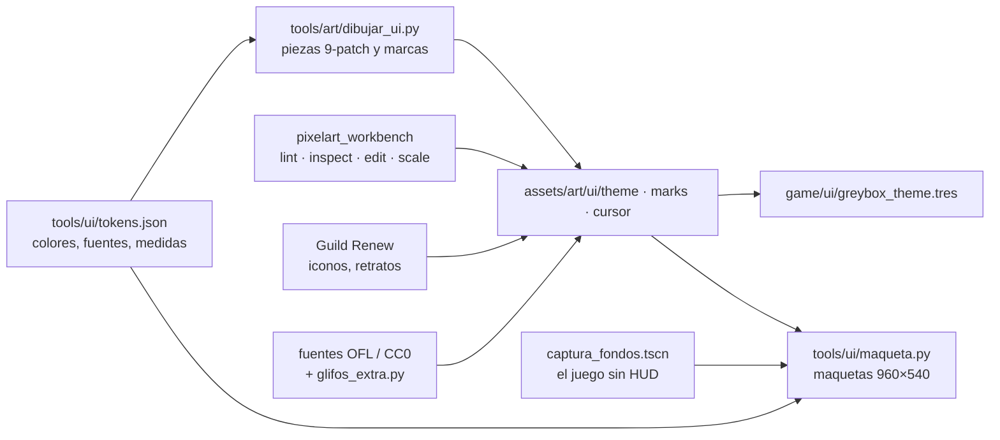

# 03 · Cómo hacemos la UI pixel art sin créditos

> Dueño: kit · Estado: borrador para revisar · Fecha: 2026-11-02
> Saldo de PixelLab consultado hoy (`get_balance`, gratis): **0 generaciones** de 2.000 del ciclo; se renuevan el
> **15-nov**. fal.ai no está autorizado. Todo lo de este documento hasta la sección 5 cuesta cero.

## 1. El pipeline real

| Paso | Herramienta | Qué sale | Coste |
|---|---|---|---|
| 1. Decidir colores y medidas | `tools/ui/tokens.json` | Tokens que usan maquetas y theme | 0 |
| 2. Piezas del kit | `python3 tools/art/dibujar_ui.py` (Pillow) | `assets/art/ui/theme/` (panel, botones, campo, tooltip, pestañas, retrato, pergamino, casilla, deslizador, scroll, separador), `marks/` (insignias, galones, sello), `cursor/` | 0 |
| 3. Repaso a mano | `pixelart_workbench` (MCP de PixelLab, gratis para suscriptores) | Píxeles sueltos, contornos, iconos a 16 | 0 |
| 4. Reuso | Arte ya pagado de Guild Renew (`~/Code/guild/assets/sprites/ui/`, solo lectura) | Iconos, retratos, parcelas | 0 |
| 5. Letras | Fuentes OFL/CC0 con su licencia al lado + `tools/ui/glifos_extra.py` | `assets/art/ui/fonts/` | 0 |
| 6. Logotipo | `python3 tools/ui/logo.py` | `assets/art/ui/logo/` | 0 |
| 7. Fondos reales | `tools/ui/captura_fondos.tscn` (por `grimoire heavy`) | `docs/ui/maquetas/fondos/` | 0 |
| 8. Maquetas | `python3 tools/ui/maqueta.py docs/ui/maquetas/src/<doc>.py` | `docs/ui/maquetas/<id>.png` + `_x2` | 0 |
| 9. Al juego | `game/ui/greybox_theme.tres` (un solo theme, en la raíz del HUD) | Todos los paneles | 0 |

### 1.1 Kit procedural (Pillow)

`tools/art/dibujar_ui.py` dibuja cada pieza por código con los colores de la biblia: así se regenera igual y un cambio de
paleta es un cambio de número. Para **añadir una pieza**:

1. Una función que dibuje la imagen (con `bitmap([...])` para lo pequeño: una letra por color, `INK`) y la guarde con
   `save(img, "nombre.png")`.
2. Si es 9-patch, su margen en `PIECES` (un número o `(x, y)`); `maqueta.py` lo lee de ahí y el theme usa el mismo.
3. `python3 tools/art/dibujar_ui.py`, después `/opt/homebrew/bin/godot --headless --path . --import` y
   `python3 tools/uids.py --fix`; fila en `assets/inventario.json` y en `assets/art/MANIFEST.md`.

### 1.2 pixelart_workbench (gratis)

Es la línea de órdenes de PixelLab para revisar y retocar sin generar: `lint`, `score`, `inspect`, `measure`, `edit`
(píxeles exactos), `draw`, `shade`, `selout`, `repair`, `scale`, `split`/`join`. No lee rutas de disco: se le pasa la
imagen como `data:image/png;base64,…` y devuelve un id nuevo.

- Prueba hecha hoy: `lint` del logotipo → **0 errores, 0 avisos**, 3 notas (25 brillos de 1-2 px y las franjas de oro,
  que son a propósito).
- Uso previsto: repasar los iconos de Guild Renew reducidos a 16 (los finos pierden la línea), comprobar contornos de
  las piezas nuevas (`lint --rules outline_gap,orphan_pixel`) y dibujar a mano piezas únicas (`draw`, `edit`).
- `vfx_workbench` (también gratis) sirve para efectos cortos de UI: el destello del objetivo cumplido, monedas.

### 1.3 Reuso de Guild Renew

| Qué | Dónde | Sirve para | Ojo |
|---|---|---|---|
| 68 iconos de 32 (+ 6 burbujas) | `icons/` | Oro, libro, contrato, estados de trabajo, ramas de mejora, ánimo, objetos… (mapa en 00, sección 7) | A 16 hay que repasar los finos. |
| 13 retratos de 192 | `portraits/` | Maquetas; posible base de retratos | No llevan los colores clave del shader de identidad (4.10.9). |
| 7 retratos de familia | `portraits/family/` | Maquetas del árbol | Igual. |
| Parcelas 64×32 | `parcels/` | Modo construcción | Ya en el estilo 2:1. |
| Radial (entrar, examinar, gestionar) | `radial/` | Menú contextual con iconos | |
| Marcos (`frame_*`) | `frames/` | — | Demasiado gruesos para 960×540 (el de madera es de 256 con ~37 px de borde); por eso el kit dibuja los suyos. |

Se copian a `assets/art/…` con `"origen": "guild-renew"` en el inventario. El repo `guild` no se toca.

### 1.4 Fuentes libres

Solo OFL o CC0, con la licencia junto al fichero (`<fuente>_ofl.txt`, `pixel_operator_cc0.txt`), su fila en el
inventario y su línea en los créditos (02, sección 5). Hoy: Pixel Operator (CC0), Jacquarda Bastarda 9, Jacquard 24,
Tiny5, VT323, Silkscreen (OFL). Las que no tienen un glifo que usa el juego se completan con `glifos_extra.py` solo si
la licencia lo permite (CC0 sí; en OFL, una versión modificada no puede llevar el nombre reservado: no se tocan).

### 1.5 Paquetes CC0 de terceros

No se ha bajado nada. Los conocidos que podrían encajar, y por qué no hacen falta ahora:

| Paquete | Licencia (comprobar en su página antes de bajar) | ¿Encaja con la biblia? |
|---|---|---|
| Kenney · UI Pack / Pixel UI Pack / Fantasy UI Borders | CC0 | Limpios y genéricos; los marcos de fantasía podrían servir de referencia, no tal cual (paleta fría, sin remaches). |
| Ninja Adventure (Pixel-boy y AAA) | CC0 | Estilo top-down de 16 px, más infantil; los iconos chocarían con los de Guild Renew. |

Regla: un paquete entra solo si su paleta se puede llevar a los tokens sin repintarlo entero y su licencia es CC0 u
OFL en su página oficial (no en espejos). Ante la duda, no se baja.

## 2. Lista de la compra para PixelLab (cuando se renueven, el 15-nov)

Por prioridad, con la herramienta y lo que cuesta según su propia descripción. Todo con `palette` = los tokens de
color (cada píxel sale de la paleta) y, donde se puede, una imagen de estilo del kit o de Guild Renew. **Total previsto:
~190-230 generaciones de 2.000** (en torno al 10 % del ciclo).

| # | Qué | Herramienta | Cuánto | Generaciones | Por qué ahora |
|---|---|---|---|---|---|
| 1 | **Iconos que faltan** (reputación, menú, guardar, cargar, mazo del tribunal, urna, campaña, parcela, mapa, campana, velocidad, cofre, escudo de familia, propuesta de boda, nacimiento…) | `create_1_direction_object`, `size` 32, `item_descriptions` (hasta 64 por hoja), `style_images` = 8 iconos de Guild Renew | 1 hoja de 64 + 1 de repesca | 10 + 10 | 64 iconos por 10: lo que más rinde. Los de Guild Renew no cubren política ni tribunal. |
| 2 | **Iconos de objeto nativos a 16** para listas (en vez de reducir los de 32) | `create_1_direction_object`, `size` 16, `item_descriptions` con los objetos de `data/items/` | 1 hoja | 10 | Las listas son lo más visto; reducidos a 16 los finos se rompen. |
| 3 | **Retratos del juego** desde los sprites de personaje (6 visuales: artesano/a, trabajador/a, vecino/a) | `create_portrait_character` (`character_to_portrait`, `result_size` 64) | 6 + 3 de repesca | 90 | Hoy el retrato es un dibujo por código; uno de verdad con los **colores clave** del shader (pelo, piel, ropa) hereda la identidad de familia gratis. Requisito: pasar `palette` con los colores clave. |
| 4 | **Marco ornamentado** para las pantallas grandes (título, final, árbol, organigrama): madera tallada con esquinas de hierro | `create_ui_asset` 256×256, `style_image` = `panel.png` a ×4, `palette` = tokens | 2-3 intentos | 20-30 | Las pantallas «de ceremonia» merecen más que el marco de diario. Se corta a 9-patch con el workbench. |
| 5 | **Pergamino de documento** con bordes gastados, cinta y lacre (encargos, decretos, crónica final) | `create_ui_asset` 256×256 (o 341×192 apaisado) | 2 | 20 | Sustituye al `parchment` liso del kit en los documentos importantes. |
| 6 | **Blasones de las familias rivales** (5) | `create_image_pixflux` 32×32 o 48×48, `palette` | 5 × 3 intentos | 15 | 1 generación cada uno: barato y da identidad a rivales en avisos y organigrama. |
| 7 | Reserva para repetir lo que salga mal | — | — | 25-50 | |

**No merece la pena pedir:** fuentes (`create_font`, 15: las libres ya resuelven tildes, ñ y estilo), botones, campos,
casillas y barras (el kit procedural los hace exactos y a la medida), cursores, el fondo del título (el pueblo real es
mejor reclamo), la pantalla de título entera.

Al pedir: saldo antes y después en `assets/art/MANIFEST.md`, cada asset con su fila en el inventario
(`"origen": "pixellab"`), revisión contra la biblia y `lint` del workbench antes de darlo por bueno.

## 3. Cómo cambia el owner una pieza en Godot

**Cambiar el aspecto de todos los paneles** (marco, botones, colores, letras): un solo fichero,
`game/ui/greybox_theme.tres`.

1. En Godot, panel FileSystem → doble clic en `game/ui/greybox_theme.tres`: se abre el editor de Theme abajo.
2. Elegir el tipo a la izquierda (`PanelContainer`, `Button`, `Label`…). Pestaña de estilos (el icono de la caja).
3. `PanelContainer → panel` es un **StyleBoxTexture**: en el Inspector, `Texture` es la imagen
   (`assets/art/ui/theme/panel.png`) y `Texture Margins` (izquierda, arriba, derecha, abajo) dicen cuántos píxeles del
   borde no se estiran (el 9-patch). `Content Margins` es el aire de dentro.
4. Botones: `Button → normal / hover / pressed / disabled`, cada uno su StyleBoxTexture (`button_<estado>.png`,
   márgenes 3). Colores del texto en la pestaña de colores (`font_color`, `font_hover_color`…).
5. Guardar (Ctrl+S). Lo ve cualquier panel al momento, también los que se añadan (el theme está en la raíz del HUD).

**Retocar el dibujo de una pieza:**

1. Abrir el PNG (`assets/art/ui/theme/<pieza>.png`) en un editor de píxeles (Aseprite, Pixelorama, LibreSprite) a
   tamaño real. Mantener el tamaño o, si cambia el grosor del borde, cambiar también sus `Texture Margins` en el theme.
2. Guardar. Godot lo reimporta solo (filtro Nearest ya por defecto en el proyecto).
3. **Importante:** `dibujar_ui.py` vuelve a dibujar sus piezas si se ejecuta. Si una pieza se retoca a mano, se quita su
   función de `dibujar_ui.py` (o se guarda con otro nombre) para que no se pise. Anotarlo en el inventario
   (`"origen": "a mano"`).

**Una variación para un panel concreto** (p. ej. pergamino para un documento). Ya existen `ParchmentPanel`,
`DarkPanel`, `TitleLabel`, `BodyLabel`, `BoldLabel`, `SmallLabel` e `InkLabel`; para una nueva:

1. En el editor de Theme: «+» (Add Type) → nombre `ParchmentPanel` → en sus propiedades, `Base Type` =
   `PanelContainer`.
2. Darle su `panel` (StyleBoxTexture con `parchment.png`, márgenes 6) y el color de texto `texto_tinta`.
3. En la escena del panel, en el nodo: Inspector → Theme → `Theme Type Variation` = `ParchmentPanel`.

**Letras:** en el theme, `Default Font` (y `Button → fonts → font`, `Label → fonts → font`) apunta al `.ttf`. Al importar
una fuente pixel nueva (pestaña Import con el fichero elegido): `Antialiasing` = None, `Hinting` = None,
`Subpixel Positioning` = Disabled, «Reimport». Usar solo su tamaño nítido (Pixel Operator 16, Jacquarda 13…).

Lo mismo, resumido, está en la fila «Paneles de la UI» de `docs/protocolos/editar-a-mano.md`.

## 4. Criterios de aceptación

- [ ] Se regenera todo el kit desde cero sin créditos: `dibujar_ui.py`, `logo.py`, `maqueta.py` sobre
      `docs/ui/maquetas/src/*.py`, y las imágenes salen iguales (salvo los fondos, que dependen del juego).
- [ ] Cada fuente de `assets/art/ui/fonts/` tiene su licencia al lado y su fila en el inventario.
- [ ] Siguiendo la sección 3, el owner cambia el color del filete de los paneles y lo ve en el juego sin tocar código.

## Decisiones que necesitan al owner

1. **Presupuesto de UI del ciclo del 15-nov.** Propongo ~200 generaciones (lista de la sección 2). Si hay que
   recortar, el orden de corte es de abajo arriba: lo primero que se queda es la hoja de iconos (10 por 64 iconos).
2. **Retratos generados (punto 3).** Propongo pedirlos (90 generaciones) porque el retrato sale en el HUD, el árbol, la
   contratación y el final. Alternativa: seguir con el retrato por código y gastar esas generaciones en otra cosa.
