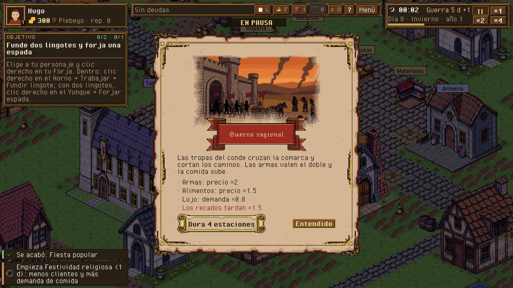
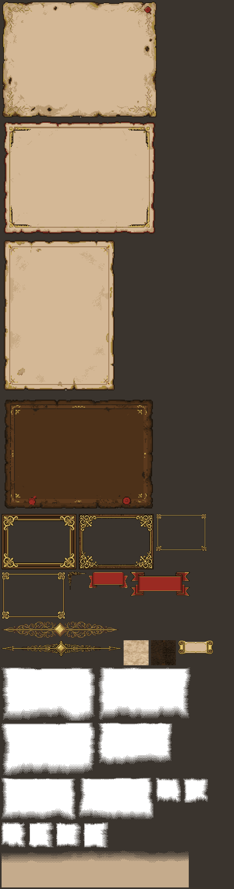
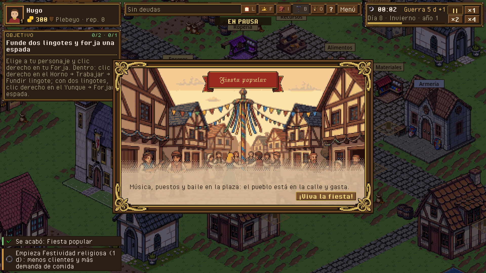
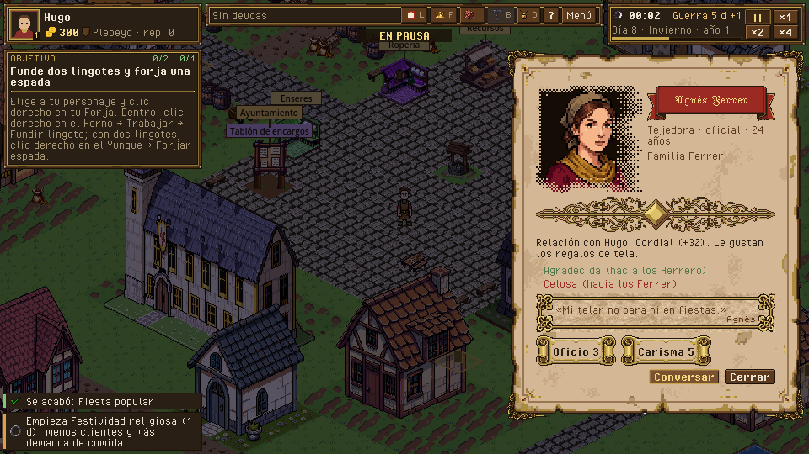
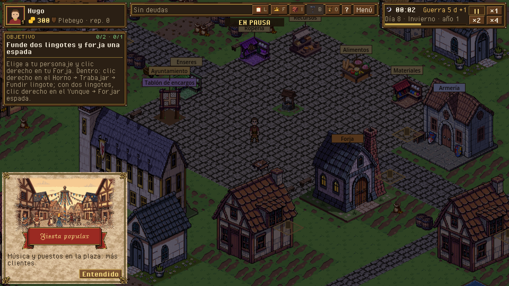
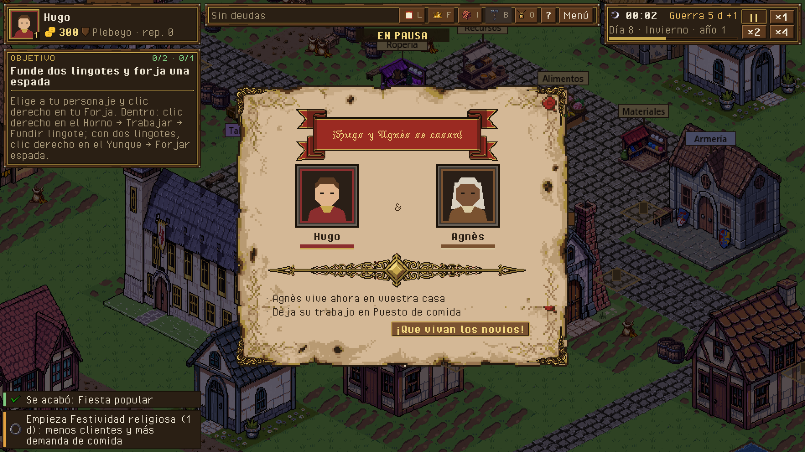

# 04 · Kit de página · cartas, láminas y fichas

> Dueño: kit-página · Estado: borrador para revisar · Fecha: 2026-11-03
> Guía de estilo: [00_lenguaje_visual.md](00_lenguaje_visual.md) · Zonas y reglas del HUD: [01_hud.md](01_hud.md) ·
> Convenciones sociales: [mecanicas/_social.md](mecanicas/_social.md)

Las ventanas narrativas (un evento que empieza, una boda, una muerte, un veredicto, una ceremonia, la crónica) no son
paneles de gestión: cuentan algo. Este kit las maqueta como **páginas de un libro iluminado** en pixel art: papel
envejecido con su zona segura medida, marco con esquinas labradas, la ilustración fundida con el papel con un pincel
tramado, el título en una cinta, separadores con adorno, el sello de lacre y botones del theme de siempre.

La idea sale del kit de estilo de Publicación de RolApp (`~/Code/rolApp/src/lib/publication/`): huecos con su motor de
generación, corte de 9 trozos medido desde el alfa, zona segura de los fondos medida en vez de prohibida, máscaras de
pincel procedurales, velo de legibilidad y variantes que se alternan. Aquí se pasa todo a píxel: medidas enteras,
alfa de 1 bit (tramado ordenado en vez de degradado), escalas ×1 o ×2 y la paleta de la biblia.

Herramientas: `tools/art/kit_pagina.py` (genera, pixela, mide y escribe `assets/art/ui/page_kit/kit.json`) ·
componente `game/ui/page_card.gd` + `page_card.tscn` · lectura del kit `game/ui/page_kit.gd`.



*La carta de un evento global al empezar, con el kit piloto (captura real, `--smoke-script=pagina`).*

## 1. Para qué sirve

- Evento, boda, sucesión, veredicto: «¿qué ha pasado, qué me cambia y hasta cuándo?».
- Ceremonia, elección ganada: «lo he conseguido: ¿qué se abre?».
- Ficha de personaje y crónica: «¿quién es y qué ha hecho?».

Una página nunca es un sitio para gestionar: dice, como mucho, una o dos cosas que se pueden hacer («Entendido»,
«Preparar la defensa», «Continuar con Pere»).

## 2. Los huecos del kit, en píxel

Medidas en píxeles lógicos (960×540). «Medido» quiere decir que `kit_pagina.py measure` lo calcula sobre la imagen y
lo escribe en `kit.json`; el componente no usa números a mano. Ficheros: `assets/art/ui/page_kit/<hueco>_<n>.png`
(n = variante, desde 1). Tabla con lo que hay en el kit piloto (2026-11-03):

| Hueco | Id | Tamaño | Fondo | Medido (kit piloto) | Motor | Variantes elegidas | Alterna por |
|---|---|---|---|---|---|---|---|
| Pergamino claro, apaisado | `page_bg` | 400×296 (rejilla nativa ×2) | papel rasgado, fuera transparente | 9 trozos 24-48 · zona segura 28-52 | nano-banana-2/edit | 2 (`_1`, `_3`) | página |
| Pergamino claro, vertical | `page_bg_tall` | 296×398 (×2) | igual | 9 trozos 32/40 · zona segura 36/44 | nano-banana-2/edit | 1 | página |
| Cuero oscuro | `page_bg_dark` | 398×296 (×2) | igual | zona segura 56 a los lados: **solo decorativo** | nano-banana-2/edit | 0 (falta uno usable) | página |
| Marco de cuadro (Lámina) | `plate_frame` | 192×142 | transparente | corte 32 / listón 18 · corte 44-47 / listón 11-13 | nano-banana-2/edit + croma | 2 | elemento |
| Marco de caja (cajas y aviso) | `box_frame` | 130×95 y 164×121 | transparente | corte 14-16 / listón 5-6 · corte 21 / listón 7-8 | nano-banana-2/edit + croma | 2 | elemento |
| Esquina de página | `page_corner` | 47×46 | transparente | caja del alfa | nano-banana-2/edit + croma, a la mitad | 1 | página |
| Cinta del título | `ribbon` | 101×42 y 153×62 | transparente | remates 22 y 37 · franja del texto | nano-banana-2/edit + croma | 2 | elemento |
| Separador | `divider` | 301×42 y 307×42 | transparente | caja del alfa | nano-banana-2/edit + croma | 2 | elemento |
| Textura clara repetible | `tile_light` | 64×64 | opaco, sin costuras | — | z-image/turbo/tiling + rampa de 4 tonos | 1 | elemento |
| Textura oscura repetible | `tile_dark` | 64×64 | opaco, sin costuras | — | z-image/turbo/tiling + rampa de 4 tonos | 1 | elemento |
| Cartucho (adorno de cifra) | `folio` | 90×36 | transparente | hueco 18 a los lados, 9/7 arriba y abajo | nano-banana-2/edit + croma | 1 | página |
| Máscara de pie | `mask_foot_240`, `mask_foot_192` | 240×135 · 192×108 | alfa de 1 bit | — | Pillow, gratis | 3 + 3 | imagen |
| Máscara de esquina | `mask_corner` | 64×64 | alfa de 1 bit | — | Pillow, gratis | 3 | imagen |
| Máscara lateral | `mask_side` | 64×64 (el retrato va a ×2) | alfa de 1 bit | — | Pillow, gratis | 3 | imagen |
| Velo de legibilidad | `veil` | 480×96 | papel con alfa tramado | — | Pillow, gratis | 1 | — |

Lo que cambió al verlo hecho (respecto al primer borrador de este documento):

- **La página es el papel rasgado**, no papel + marco: nano-banana dibuja el pergamino con su borde quemado y rasgado
  sobre blanco; ese blanco pasa a transparente y la carta flota sobre el pueblo como una carta de verdad. El marco de
  madera y oro grande se quedó para **enmarcar la ilustración de la Lámina** (`plate_frame`) y uno fino para las
  **cajas de dentro** (`box_frame`: citas, el aviso corto), como el `boxFrame` de RolApp.
- **Las piezas van a la rejilla nativa del modelo.** La salida de nano-banana ya es pixel art con su píxel a 5-17 px;
  `fal-ai/image2pixel` (snap_grid) lo detecta y la pieza se baja exacta a esa rejilla (sin píxeles de tamaños mezclados).
  Por eso los tamaños no son redondos. Los fondos, cuya rejilla nativa es de ~200×148, van a ×2.
- **Las cartas miden 400 de ancho** (el ancho del pergamino): más anchas repetirían el borde. Más altas que 296, el
  centro y los lados se repiten (`TILE`); se nota poco porque el centro es liso.



Reglas de cada hueco:

- **Fondos de página.** Papel liso en el centro (al menos el 80 % del ancho y del alto) y el envejecimiento (manchas,
  bordes quemados y rasgados, adornos) solo en una franja exterior de ≤ 10 % por lado, como pide RolApp a sus fondos. Se usan como
  `StyleBoxTexture` de 9 trozos: los márgenes de textura son la **franja medida** (el adorno no se estira) y el centro
  se **recorta, no se escala** (`axis_stretch = TILE`: con el fondo más grande que la ventana se ve su parte de arriba a
  la izquierda, a tamaño natural). Los márgenes de contenido son la **zona segura** (la franja + 4 de aire, redondeada
  a 4): ningún texto entra en el adorno. Un fondo cuya franja pase de 48 px por lado no entra en la alternancia (es
  «solo decorativo», como en RolApp).
- **Marcos (`plate_frame`, `box_frame`).** Adornos solo en las cuatro esquinas, aristas lisas. El 9 trozos se mide como `nine-slice.ts`: el listón en la franja central de cada arista, la esquina
  recorriendo la arista mientras el adorno sea más grueso que el listón. Después se **normalizan las aristas**: cada
  arista se rehace repitiendo su columna o fila central, para que estirarla no deje saltos.
- **Cinta.** Remates labrados a los lados y el centro liso: se corta en 3 (izquierda, centro que se estira, derecha);
  la franja del texto (alto útil) se mide en la columna central. Título en Jacquarda 9 a 13, nunca en mayúsculas.
- **Máscaras.** Blanco opaco = se ve, transparente = papel. Borde de pincel con ruido (armónicos con semilla fija,
  como `generate-masks.mjs`) y una banda de 6-10 px **tramada con Bayer 4×4**: el pixel art no admite alfa suave, la
  trama hace el fundido. `pie` funde abajo y a los lados (la ilustración de la carta), `esquina` funde los dos lados
  de una esquina (retratos pequeños), `lateral` funde el lado que mira al texto (el retrato de la ficha).
- **Velo.** El color del papel medido en el centro del fondo, con alfa tramado que sube bajo el texto: solo en la
  Lámina, donde el texto va encima de la ilustración.

Proceso de cada pieza generada (gratis salvo la llamada al modelo; cada llamada con su coste en
`assets/art/MANIFEST.md` y en `assets/art/ui/page_kit/gasto.json`):

1. Referencia: hoja con el kit actual a ×8 (`panel`, `parchment`, `divider`, `seal`, insignias) para el estilo.
2. Prompt con la composición obligatoria del hueco (inglés, como en RolApp) y, si es transparente, fondo magenta plano
   `#FF00FF` (nano-banana no da alfa de verdad; el croma sobre pixel art es exacto). gpt-image-2 se dejó fuera: su
   precio en fal es «1 USD por unidad» sin decir qué es una unidad, y el croma bastó.
3. Pixelado: `fal-ai/image2pixel` da el tamaño del píxel y la imagen alineada (0,0005 USD por pieza); se baja a la
   rejilla nativa, la paleta de la página (tokens de `tools/ui/tokens.json` y sus tonos intermedios, sin tramado) y el
   croma a alfa de 1 bit. Las texturas, de 1024 a 64 (factor entero: siguen sin costuras) y a una rampa de 4 tonos.
4. Medidas (9 trozos, zona segura, franja de la cinta, hueco del cartucho) → `kit.json`.

## 3. Plantillas

Tres plantillas, como las de la ficha de personaje de RolApp («Retrato + ficha», «Lámina», «Solo ficha»), más el
aviso corto. Todas: fondo de página + marco + 4 esquinas, y dentro, en la zona segura, una columna de bloques.

### Carta

Ilustración arriba, fundida con el pincel de pie; la cinta con el título cruza su borde de abajo; cuerpo; sello y
botones al pie. **400 de ancho**, alto según el contenido (≤ 296 sin repetir el papel; la de guerra mide 421). Centrada.

```
+= marco ====================================================+
|◤                                                         ◥|
|            ░▒▓ ilustración 240×135 (pie) ▓▒░               |
|            ░▒▓                           ▓▒░               |
|       ◀═══════════ Guerra regional ═══════════▶            |
|   La guerra corta los caminos del condado. Las armas        |
|   valen el doble y la comida sube.                          |
|   ─────────────────── ◆ ───────────────────                 |
|   · Armas ×2 en el mercado        · Recados ×1,5 más lentos |
|   · Comida ×1,5                   · Lujo: menos demanda     |
|   [═ Dura 4 estaciones ═]                    (sello) [Entendido] |
|◣                                                         ◢|
+============================================================+
```

- Ilustración 240×135 a ×1, centrada, con `mask_foot`. Sin ilustración (falta el arte): la cinta sube y la carta
  queda como una página de texto.
- Retratos en vez de ilustración (boda, sucesión): dos retratos 64 a ×1 con `mask_corner`, uno a cada lado.
- Cinta de 288 de ancho como mucho; si el título no cabe en una línea, se baja a Jacquarda 9 y se ensancha la cinta.

### Lámina

La ilustración a toda la ventana a **×2** (240×135 → 480×270, escala entera), la cinta con el título arriba y una banda
de texto abajo sobre el velo. **516×306** (480×270 + el listón medido del marco, 18). Para los momentos grandes: poca letra, mucha imagen.

```
+= marco ============================================+
|   ◀══════ Patricio de la villa ══════▶              |
|                                                     |
|          ilustración 480×270 (×2)                   |
|                                                     |
|▒▒▒▒▒▒▒▒▒▒▒▒▒▒▒▒▒▒▒ velo ▒▒▒▒▒▒▒▒▒▒▒▒▒▒▒▒▒▒▒▒▒▒▒▒▒▒▒▒|
|  Hugo recibe el título para los Herrero.  [¡Viva!] |
+=====================================================+
```

### Ficha

Retrato fundido a un lado (64 a **×2** = 128×128, `mask_side`) y los datos al otro. Para la zona 5 (`356×430`) o
dentro del modal grande. Sin retrato («Solo ficha»): la columna ocupa todo el ancho y el fondo es el vertical.

```
+= marco =================================+
|  ▓▓▓▓▓▓▓▓▒░   ◀═ Agnès Ferrer ═▶         |
|  ▓ retrato ▒░  Tejedora · oficial · 24    |
|  ▓  128   ▒░  Familia Ferrer (sello)      |
|  ▓▓▓▓▓▓▓▓▒░  ───────── ◆ ─────────       |
|  Relación: Cordial (+32)                  |
|  Emociones · Qué hace ahora · Acciones    |
+==========================================+
```

### Aviso corto

La carta en pequeño para la columna izquierda (zona 4, **236 de ancho**): ilustración 192×108 con `mask_foot`, cinta,
una o dos líneas y un botón. No tapa el centro. Para lo que avisa sin parar el juego y tiene imagen (microevento,
nacimiento, presagio).

| Lámina | Ficha | Aviso corto | Boda (Carta con retratos) |
|---|---|---|---|
|  |  |  |  |

### Bloques de la columna

| Bloque | Datos | Cómo se pinta |
|---|---|---|
| `paragraph` | `text` | Pixel Operator 16 en tinta (`PageInk`), ajuste por palabras al ancho de la zona segura. |
| `effects` | `items: [{text, sign}]` | Una línea por efecto con «·»; `sign` = `+` (verde tinta), `−` (lacre) o vacío (tinta). Nunca solo color: el texto dice el sentido. |
| `figures` | `items: [{label, value}]` | Cifras en un cartucho (`folio`) o sobre `tile_light`: rótulo tenue y valor en negrita. |
| `quote` | `text`, `who` | Caja con `tile_light`, sangría de 8 y la firma alineada a la derecha. |
| `divider` | — | La pieza `divider` centrada (fallback: el `DividerSeparator` del theme). |
| `portraits` | `left`, `right` (texturas) | Dos retratos fundidos con `mask_corner` y un icono en medio (anillo, flecha). |

El pie lleva el sello (`seal`, con la inicial o la palabra encima, p. ej. CULPABLE) y los botones (los del theme; el
principal con `PrimaryButton`).

### Alternancia de variantes

Como `kit-variants.ts`: cada hueco con varias variantes elegidas las va alternando en orden. Los de **página** (fondos,
esquina, cartucho) cambian con cada carta que se abre; los de **elemento** (marco, cinta, separador, texturas) y las
**máscaras** cambian con cada aparición dentro de la carta. El contador vive en la vista (no en el sim) y se puede
poner a cero (pruebas). El kit dice qué variantes están elegidas (`chosen` en `kit.json`).

### Si falta una pieza

El componente cae a lo que hay hoy en el theme, pieza a pieza:

| Falta | Se usa |
|---|---|
| Fondo de página | `ParchmentPanel` (pieza `parchment`, margen 6, contenido 8) |
| Marco, esquinas, cartucho, texturas | nada (el pergamino ya tiene su borde) |
| Cinta | el título en `InkTitleLabel` centrado |
| Separador | `HSeparator` con `DividerSeparator` |
| Máscara | la imagen sin fundir, con el marco de retrato del theme |
| Ilustración | la carta sin imagen (la cinta sube) |

## 4. A qué ventana va cada plantilla

Tamaños y pausas de los documentos de mecánica (`docs/ui/mecanicas/*.md`); aquí solo cambia cómo se viste.

| Ventana | Plantilla | Imagen | Tamaño | Cierre y pausa (de su documento) |
|---|---|---|---|---|
| **Evento global que empieza** (H13) | Carta | ilustración del evento 240×135 | 400 × ≤421 | «Entendido» o 12 s (`view.event_card_seconds`). No pausa. El aviso de la zona 7 sigue saliendo y queda en el libro. |
| Evento declarado por el Alcalde | Carta | la del evento + sello | igual | igual; línea «Lo declara Hugo, Alcalde». |
| Evento que acaba | — (aviso de la zona 7 de hoy) | — | — | — |
| Boda (`wedding`) | Carta | dos retratos 64 (`mask_corner`) y el anillo | 400 × ≤240 | Botón o 8 s. No pausa (cortejo_y_boda §2). |
| Nacimiento, mayoría de edad | Aviso corto | retrato del bebé o del hijo | 236 × ≤160 | Clic o 8 s. No pausa (familia §2). |
| Muerte de un familiar (no el cabeza) | Aviso corto, fondo oscuro | retrato con marco de fallecido | 236 × ≤160 | Clic o 8 s. No pausa. |
| **Sucesión** (muere el cabeza) | Carta, sobre velo | el muerto y el heredero (`mask_corner`) | 420 × ≤260 | «Continuar con Pere» · «Ver el árbol». Pausa (decisión (a) de familia.md, ya hecha). |
| Te acusan | Aviso corto | — (falta ilustración del tribunal) | 236 | «Preparar la defensa» · «Más tarde». No pausa. |
| Veredicto | Carta, sobre velo | ilustración del tribunal (falta) | 420 × ≤260 | Botón. Sello grande CULPABLE (lacre) / INOCENTE (oro). |
| Ceremonia de título | Lámina | ilustración del ayuntamiento (falta: hasta tenerla, Carta con el estandarte) | 496×286 | Botón o 8 s. No pausa. |
| Recuento de elección | Carta | — (barras de votos en el color de cada familia) | 380 × ≤220 | Clic o 10 s. No pausa. |
| Crónica de la dinastía (fin de partida) | Ficha «Solo ficha» a lo ancho, fondo vertical | retratos 32 de los cabezas | 912×440 (modal grande) | Sus botones; Esc no hace nada (02 §7). |
| Ficha de vecino / de personaje | Ficha | retrato 64 a ×2 (`mask_side`) | 356×430 (zona 5) | X, Esc. No pausa. |
| Microevento | Aviso corto | ilustración 192×108 si la hay | 236 | Elegir, plazo o «Más tarde». No pausa. |

Orden de implementación: el evento global (bloque 4 de este encargo), luego la boda o la sucesión; el resto cuando
llegue su ilustración (rama arte-fal: `assets/art/illustrations/` y `portraits/`).

## 5. Toque ligero y lo que no se decora

| Qué | Qué lleva del kit |
|---|---|
| Paneles de gestión (zona 5 y panel ancho: producción, almacén, empleados, mercado, libro de cuentas, mejoras, ayuntamiento, tablón, cortejo, organigrama, árbol) | **Solo** la cinta pequeña en el título del panel (la cinta del kit a 16 de alto, recortada en 3), el separador del kit entre secciones y las 4 esquinas del kit sobre el marco de madera. Fondo y filas, los de hoy. |
| Confirmaciones (280×120) | Nada: tienen que leerse en un golpe de vista. |
| HUD (ficha, barra de estado, reloj, objetivo, selección, teclas), avisos de la zona 7, tooltips, menús contextuales, listas largas (filas de inventario, cola, empleados, registro) | **Nada.** Son instrumentos: el kit les robaría espacio y legibilidad. |
| Menús (título, pausa, opciones) | Lo que fija 02_menu_inicial.md; el kit no entra. |

## 6. Datos

- El componente recibe un diccionario (`PageCard.show_page(data)`): `template` (`card` | `plate` | `sheet` | `notice`),
  `title`, `ribbon` (texto de la cinta si no es el título), `image` (textura) o `portrait` (textura), `mask`
  (`foot` | `corner` | `side` | ``), `dark` (fondo oscuro), `blocks` (lista de la sección 3), `seal` (`{text}`),
  `buttons` (`[{id, text, primary}]`), `seconds` (cierre solo).
- Quien lo usa traduce el estado a ese diccionario (p. ej. `EventPage.data_for(sim, e)` para los eventos) y no calcula
  reglas: las cifras salen de `data/` y de `SimQuery`.
- El kit (`kit.json`) no está en `data/`: es la descripción de un asset (como un `.import`), con ficheros por hueco y
  sus medidas.

## 7. Sonido

- Abrir una carta: `sfx_panel_open`; la de evento, `sfx_notice` (el aviso ya suena: no se dobla).
- Sello: `sfx_ui_seal`. Los de cada mecánica (campanas, mazo) los fija su documento.

## 8. Tareas

- [x] `tools/art/kit_pagina.py`: generar, pixelar, máscaras procedurales, medir y escribir `kit.json`.
- [x] Kit piloto en `assets/art/ui/page_kit/` con su entrada en `assets/inventario.json` y el gasto en MANIFEST.
- [x] `PageKit` (lee el kit, alterna variantes, cae al theme) y `PageCard` (monta las 4 plantillas) con pruebas
      (`tests/test_ui_page_card.gd`).
- [x] Variaciones nuevas del theme con prefijo `Page*`: `PageInk`, `PageInkBold`, `PageInkDim`, `PageGood`, `PageBad`
      (positivo y negativo legibles sobre papel), `PageTitle`, `PageRibbon`, `PageSmall`, `PageSeal`.
- [x] Carta del evento global al empezar (H13, `EventCard` en `app.tscn` › CardsLayer) y captura con
      `--smoke-script=pagina`.
- [x] Carta de boda con el kit (`wedding_card.gd`/`.tscn` sobre `PageCard`).
- [ ] Un cuero oscuro usable (el piloto salió con dos sellos en el borde: solo decorativo).
- [ ] Sucesión, veredicto, ceremonia y ficha de vecino con el kit, cuando llegue su ilustración.

## 9. Criterios de aceptación

- [x] Al empezar un evento global sale su carta con la ilustración fundida, el título en cinta, qué cambia, cuánto
      dura y «Entendido» (capturas `docs/novedades/kit_pagina_evento.png` y `kit_pagina_guerra.png`).
- [x] Ningún texto de una página queda fuera de la zona segura medida (prueba de montaje y, en pantalla, el guion `pagina`: 0 fuera en 6 capturas).
- [x] Sin `kit.json` o sin una pieza, la carta sale igual con las piezas del theme de hoy (prueba).
- [x] Dos cartas seguidas usan variantes distintas de fondo y cinta cuando el kit tiene dos (prueba).

## Decisiones que necesitan al owner

1. **¿Lámina para la ceremonia de título?** Propongo sí, cuando haya ilustración del ayuntamiento; hasta entonces sigue
   la carta de hoy vestida con el kit.
2. **Toque ligero en los paneles de gestión** (cinta en el título, separador y esquinas): propongo hacerlo después de
   ver las cartas en juego, panel a panel, para no pisar a los workers de economía y social.
