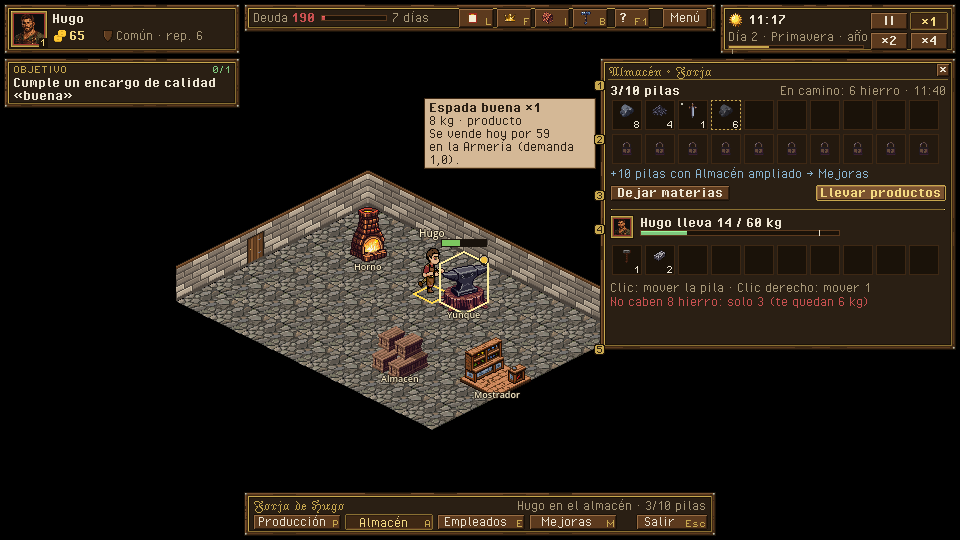
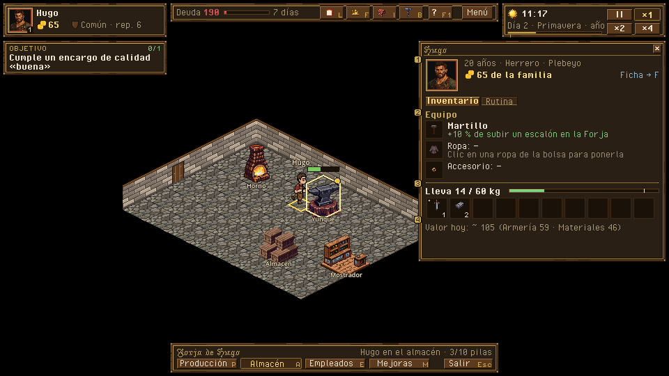

# Almacén y personaje: panel de almacén, ficha del personaje e inventario (I)

> Dueño: mecánicas-economía · Estado: borrador · Fecha: 2026-11-02
> Guía de estilo: [00_lenguaje_visual.md](../00_lenguaje_visual.md) · Zonas y reglas del HUD: [01_hud.md](../01_hud.md)

Id: `almacen_y_personaje` · Paneles de hoy: `game/ui/storage_panel.tscn`, `game/ui/character_panel.tscn` · GDD
4.3 (objetos, calidad, inventarios, transferencias), 4.4.3 (D11), 4.6.4 · Convenciones: [_comun.md](_comun.md)

## 1. Para qué sirve

Dos inventarios con reglas distintas (GDD 4.3.4): el **edificio cuenta pilas** (10, +10 con *Almacén ampliado*) y el
**personaje cuenta peso** (60 kg). Las transferencias solo se hacen con el personaje dentro (proximidad física).
Preguntas que responde:

- **«¿Qué tengo y dónde?»** Lo del almacén y lo que lleva el personaje, con su calidad.
- **«¿Me cabe?»** Pilas libres del almacén y kilos libres del personaje, antes de intentar mover, comprar o
  producir.
- **«¿Cuánto vale lo que llevo?»** Precio de venta de hoy en el mercado, para decidir si ir a vender.
- **«¿Qué llevo puesto y qué me da?»** Herramienta, ropa y accesorio, y su efecto (el martillo: +10 % de subir un
  escalón de calidad en la Forja).

## 2. Cómo se abre y se cierra

| Qué | Abrir | Cerrar | Pausa |
|---|---|---|---|
| Almacén del edificio | Botón *Almacén* de la barra del interior, tecla A, o clic derecho en el puesto *Almacén* | X, Esc u otro panel lateral | No |
| Ficha del personaje (I) | Tecla I, botón *Inventario (I)* del HUD o doble clic en su retrato del grupo | I, X, Esc u otro panel | No |

Con el almacén abierto y un personaje dentro, la ficha no hace falta: el panel del almacén ya enseña la bolsa del
personaje (las dos columnas de una transferencia). Si se pulsa I con el almacén abierto, se cambia a la ficha.

## 3. Jerarquía de información

**Almacén:**
1. La rejilla del almacén con **todas sus casillas**, también las vacías: la capacidad se ve sin leer números.
2. Debajo, la bolsa del personaje que está dentro, con su **barra de peso**.
3. A demanda (tooltip de una pila): nombre con calidad, cantidad, peso por unidad y total, precio de venta de hoy
   y receta que la usa.

**Ficha (I):**
1. Cabecera: retrato 64, nombre, edad, oficio y oro de la familia.
2. Pestañas: **Inventario** (por defecto) · **Rutina** (diseño en [forja_interior.md](forja_interior.md) §4.5). Los
   atributos y las acciones de familia están en la tarjeta del árbol (F); diseño en `familia.md`, del worker social.
3. Inventario: 3 casillas de equipo con su efecto, barra de peso y rejilla de la bolsa.

## 4. Acciones y sus estados

### 4.1 Almacén (dentro del edificio, con personaje)

```
 ┌ ALMACÉN · Forja ─────────────────────────────────── [x] ┐
 │ 3/10 pilas                                              │
 │ ┌──┐┌──┐┌──┐┌──┐┌──┐┌──┐┌──┐┌──┐┌──┐┌──┐               │  10 casillas de 30×30
 │ │▪8││◆4││⚔1││  ││  ││  ││  ││  ││  ││  │               │  icono + cantidad
 │ └──┘└──┘└─•┘└──┘└──┘└──┘└──┘└──┘└──┘└──┘               │  • = punto de calidad
 │ ┌──┐┌──┐ ... 10 casillas en gris con 🔒                 │  2.ª fila: Almacén ampliado
 │ └──┘└──┘  «+10 pilas con Almacén ampliado → Mejoras»     │
 │ [ Dejar materias ]                    [ Llevar productos ]│  atajos
 ├──────────────────────────────────────────────────────────┤
 │ HUGO lleva 14 / 60 kg  ███████░░░░░░░░░░░░░░░░░         │  barra de peso
 │ ┌──┐┌──┐┌──┐                                            │
 │ │⚒1││▣2││  │ ...                                        │  bolsa (pilas por peso)
 │ └──┘└──┘└──┘                                            │
 │ Clic: mover la pila · Clic derecho: mover 1             │  ayuda fija de una línea
 └──────────────────────────────────────────────────────────┘
```

| Acción | Orden | Deshabilitado / rechazo (motivo visible) |
|---|---|---|
| Clic en una pila del almacén | `transfer {from: bld, to: actor, item, quality, qty: lo que quepa}` | `too_heavy`: «Solo caben 3 de 8 (te quedan 6 kg)». Mueve lo que cabe y lo dice |
| Clic derecho en una pila | `transfer` de 1 unidad | Igual |
| Clic en una pila de la bolsa | `transfer {from: actor, to: bld}` | `storage_full`: «El almacén está lleno (10/10)» |
| *Dejar materias* | Un `transfer` por cada pila de materia prima o material de la bolsa | Deshabilitado si no lleva ninguna |
| *Llevar productos* | Un `transfer` por cada producto del almacén, mientras quepa por peso, empezando por el más caro | Deshabilitado si no hay productos |
| Arrastrar (opcional) | Igual que el clic, con selector de cantidad al soltar | — |

**Punto de calidad** en la esquina de la casilla: ninguno = normal, plata = buena, oro = excelente. El nombre
completo («Espada buena») sale en el tooltip. Calidades distintas son pilas distintas (GDD 4.3.3): se ven juntas y
ordenadas.

**Sin personaje dentro (gestión):** solo la rejilla del almacén, sin mover, con la línea «Entra con un personaje
para coger o dejar (las cosas se mueven a mano)». Hoy sale «Vacío» en la parte del personaje y no se explica por qué.

### 4.2 Ficha del personaje (I), pestaña Inventario

```
 ┌ [retrato 64]  HUGO  · 20 años · Herrero ─────────── [x] ┐
 │               Plebeyo · 65 ⦿ de la familia              │
 │ [Inventario] [Rutina]                    Ficha → F       │
 ├──────────────────────────────────────────────────────────┤
 │ EQUIPO                                                   │
 │ ┌──┐ Martillo           +10 % calidad en la Forja        │  herramienta
 │ └──┘                    (y en el yunque, más rápido)     │
 │ ┌──┐ Ropa: —            (slot_empty_ropa)                │
 │ └──┘                                                     │
 │ ┌──┐ Accesorio: —       (slot_empty_accesorio)           │
 │ └──┘                                                     │
 ├──────────────────────────────────────────────────────────┤
 │ Lleva 14 / 60 kg  ███████░░░░░░░░░░░░░░░░░               │
 │ ┌──┐┌──┐┌──┐┌──┐┌──┐┌──┐┌──┐┌──┐┌──┐┌──┐                 │  bolsa
 │ │⚔1││▣2││  ││  │...                                     │
 │ └─•┘└──┘└──┘└──┘                                         │
 │ Valor de venta hoy: ~ 105 ⦿ (Armería 59 · Materiales 46)│  suma de precios de venta
 └──────────────────────────────────────────────────────────┘
```

| Acción | Orden | Estados |
|---|---|---|
| Clic en un objeto con ranura (herramienta, ropa, accesorio) | `equip {item, quality}` | Lo que había vuelve a la bolsa. Sin ranura: el clic no hace nada y el tooltip dice «No se puede equipar» |
| Clic en una casilla de equipo | `unequip {slot}` | Siempre cabe (el peso es el mismo, GDD 4.3.4) |
| *Ficha → F* | Abre el árbol con este personaje elegido (vista) | — |
| Soltar o tirar objetos | **No existe** (no hay orden) | — |

Línea del efecto del equipo: sale de los datos, no de un texto fijo. La herramienta adecuada del edificio
(`buildings/<tipo>.tool`) da `tool_step_up_chance` (+10 %). La velocidad que dice el GDD para la herramienta aún no
tiene cifra en `data/`: si no hay cifra, no se escribe.

## 5. Estados especiales

| Estado | Qué se ve |
|---|---|
| **Almacén lleno** | Contador `10/10` en rojo, casillas sin hueco, y la barra del edificio lo dice en rojo. Si un puesto está parado por esto, el aviso lo dice (ver [produccion.md](produccion.md)) |
| **Personaje casi al límite** (> 90 %) | Barra en ámbar; al 100 %, en rojo y la línea «No puedes coger más: deja algo o usa el recado de entrega» |
| **Cosas en el suelo de un puesto** (D11, no cabían) | En el almacén, una fila extra «En el suelo del yunque: 2 lingotes [Recoger]» → `transfer` desde el suelo, **si el sim lo permite** (hoy nadie las recoge: ver 7) |
| **Recado en camino** | Fila gris al final del almacén: «En camino: 6 hierro · llega a las 11:40». Las pilas reservadas se ven como casillas con borde punteado |
| **Personaje menor de 16** | Sin bolsa (GDD 4.3.4: inventario desde los 16); la ficha dice «Aún no carga cosas» |
| **Difunto** | La ficha no se abre; su inventario está en el almacén de la residencia (GDD 4.3.4) |
| **Primera vez** | Primer almacén abierto: globo en la primera casilla «Clic: coger. Lo que llevas, abajo». Primera vez que la bolsa llega al 90 %: globo en la barra |

## 6. Maqueta

- Hoy: [almacen_y_personaje_hoy.png](../maquetas/almacen_y_personaje_hoy.png). Lista con `SpinBox` + *Coger* por
  pila y «Hugo (6.0/60 kg) · Vacío», sin casillas vacías ni barra. La ficha de hoy es la columna izquierda de
  [forja_interior_hoy_rutina.png](../maquetas/forja_interior_hoy_rutina.png): equipo como texto y «Quitar» en gris.
- Propuesta (guion `docs/ui/maquetas/src/almacen_y_personaje.py`):
  - [almacen_y_personaje.png](../maquetas/almacen_y_personaje.png): pilas con huecos y un recado reservado (1, 2), atajos (3),
    la bolsa con su barra de peso (4) y el rechazo por peso (5);
  - [almacen_y_personaje_ficha.png](../maquetas/almacen_y_personaje_ficha.png): ficha (I) con cabecera (1), equipo con su
    efecto (2), peso (3) y valor de venta (4).




**Piezas de kit pendientes:**
- casilla de inventario de 30×30 en 4 estados (vacía `#1a1209`, con objeto, bloqueada, reservada con borde
  punteado);
- punto de calidad (plata y oro, 3×3);
- barra de peso con umbrales (verde, ámbar al 90 %, rojo al 100 %);
- casilla de equipo con la silueta de la ranura (`slot_empty_*` de Guild Renew reducidos a 24×24).

## 7. Datos

| Lee | De dónde |
|---|---|
| Pilas del almacén y su límite | `state.buildings[bld].storage` → `{limit_kind: "stacks", limit, stacks}` |
| Pilas extra posibles | `Upgrades` (`extra_storage` de *Almacén ampliado*) vía `tree_view` |
| Bolsa del personaje | `state.characters[chr].inventory` |
| Peso | `SimQuery.carried_weight` / `SimQuery.max_weight` (`Equipment`) |
| Equipo | `state.characters[chr].equipment` + `Equipment.slot_of(catalog, item)` |
| Efecto de la herramienta | `Production.has_right_tool(sim, actor, type)` + `catalog.production.tool_step_up_chance` |
| Precio de venta de hoy | `Market.price(sim, item, quality, "sell")`; el puesto, de `catalog.market.stalls[*].sells` |
| Recados en camino | `Market.pending(sim, fam)` |
| Suelo de un puesto | `state.buildings[bld].zones[zone].floor` |

**Huecos del sim** (no se tocan aquí; se apuntan para su hito):
- Recoger del suelo de un puesto: hoy no hay orden. Propuesta: que `transfer` acepte `from: "<bld>/floor/<zone>"`
  con el personaje dentro, o una orden `pick_up`. Hasta entonces, la fila del suelo se enseña sin botón.
- *Dejar materias* y *Llevar productos* son varias órdenes `transfer` seguidas. Si se quiere que sean una sola (para
  el registro y la pausa activa), sería una orden nueva `transfer_many`. Recomendación: varias `transfer`, sin
  orden nueva.

**Órdenes que emite:** `transfer`, `equip`, `unequip`.

## 8. Sonido y feedback

| Evento | Sonido | Visual |
|---|---|---|
| `items_moved` | **falta**: `sfx_item_move`, un golpe de saco corto | La pila «vuela» 4 px hacia su destino y parpadea |
| `item_equipped` / `item_unequipped` | **falta**: `sfx_equip`, metal | La casilla de equipo destella dorado |
| Rechazo (`order_refused`) | **falta**: `sfx_refuse`, común a toda la UI (lo puede tener ya el kit) | Motivo en rojo 2 s bajo la rejilla |
| `errand_arrived` | `sfx_coins` no encaja; **falta** `sfx_delivery` (carro) | La casilla reservada se llena |

## 9. Diferencias con hoy y tareas

| Hoy | Propuesta |
|---|---|
| Lista de pilas con `SpinBox` + *Coger* | Rejilla de casillas con huecos visibles; clic mueve la pila, clic derecho 1 |
| Capacidad como texto «3/10 pilas» | Casillas vacías + 2.ª fila bloqueada que enseña la mejora |
| Calidad como sufijo en la lista | Punto de color en la casilla + sufijo en el tooltip |
| Peso «6.0/60 kg» | Barra con umbrales |
| Gestión sin personaje: «Vacío» sin explicación | Línea que explica por qué no se puede mover |
| Equipo: «Herramienta: —» + *Quitar* | Casillas con silueta, efecto escrito, clic para quitar |
| Sin valor de lo que se lleva | Valor de venta de hoy |

Tareas:
1. Pieza «casilla de inventario» en el kit (4 estados + punto de calidad) y su escena de UI reutilizable.
2. `StoragePanel` con rejilla, fila bloqueada, atajos y línea de ayuda.
3. Fila de recados en camino (lee `Market.pending`).
4. `CharacterPanel`: cabecera, pestañas Inventario / Rutina, equipo con efecto, valor de venta.
5. Barra de peso con umbrales (pieza común, la usan también el mercado y el recado).
6. Orden para recoger del suelo, si el owner la quiere (sim, en su hito).
7. Sonidos `sfx_item_move`, `sfx_equip`, `sfx_delivery` (y `sfx_refuse` si el kit no lo tiene).

## 10. Criterios de aceptación

- [ ] Con 3 pilas en un almacén de 10, se ven 7 casillas vacías y una fila bloqueada con el nombre de la mejora.
- [ ] Coger 8 hierro (16 kg) con 6 kg libres mueve 3 y dice «Solo caben 3 de 8».
- [ ] *Llevar productos* con 2 espadas y 1 martillo en el almacén y 20 kg libres coge las 2 espadas (16 kg) y deja
      el martillo (6 kg) con el motivo.
- [ ] Una espada buena y una normal se ven como dos casillas, la buena con punto de plata.
- [ ] En gestión (sin personaje), el panel lo dice con una línea y no ofrece mover.
- [ ] La ficha (I) dice qué da el martillo equipado sin pasar el ratón.
- [ ] Un recado comprado se ve «en camino» en el almacén con su hora de llegada.
