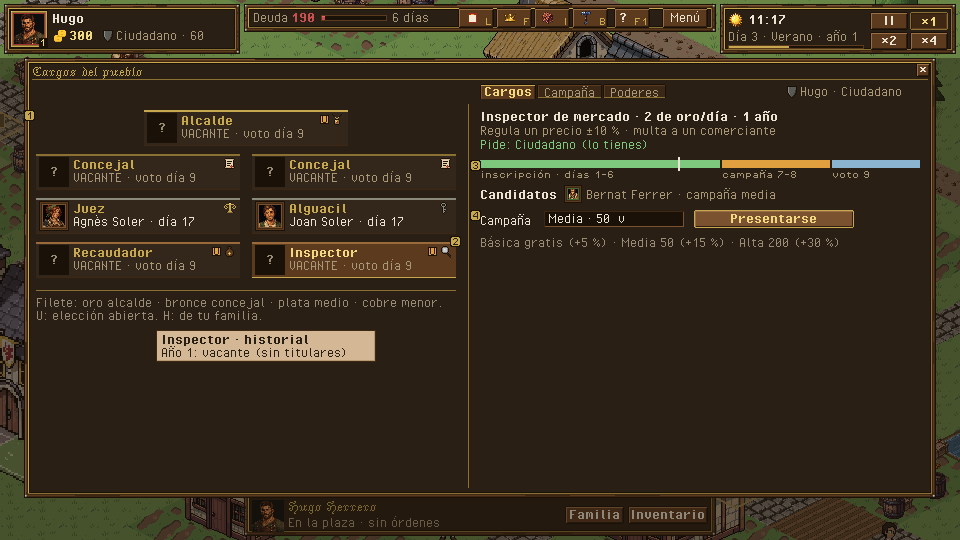
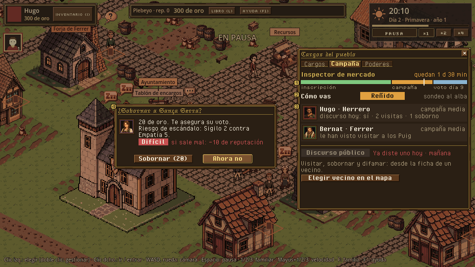
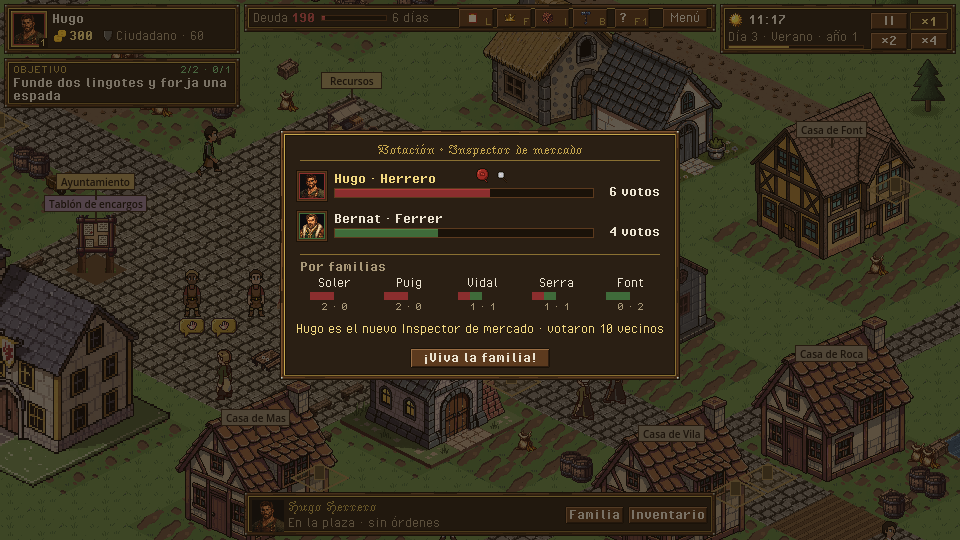
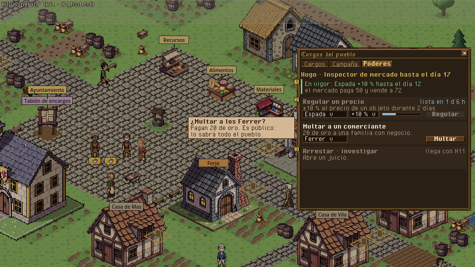

# Cargos y elecciones · organigrama, campaña, recuento y poderes

> Dueño: mecánicas-social · Estado: borrador · Fecha: 2026-11-02
> Guía de estilo: [00_lenguaje_visual.md](../00_lenguaje_visual.md) · Zonas y reglas del HUD: [01_hud.md](../01_hud.md) · Convenciones: [_comun.md](_comun.md), [_social.md](_social.md)

Mecánica de H10 (GDD 4.12.3, 4.12.4; contrato `docs/contratos/h10_cargos.md`). **Se diseña sobre la rama
`h10-cargos`** (commits `dd2994b`, `cf6cda5`, `051b966`; sin juntar con `main` cuando se escribió esto). Piezas:

| Pieza | Escena (rama `h10-cargos`) | Qué es |
|---|---|---|
| Organigrama | `game/ui/offices_panel.tscn` | Los 7 asientos, quién los ocupa, cuándo se vota y «Presentarse». |
| Campaña | sección del mismo panel + acciones de campaña en `npc_panel` | Qué hacer durante el invierno de la elección. |
| Recuento | `game/ui/office_card.tscn` | El resultado de la votación. |
| Poderes | sección del mismo panel | Regular un precio, multar, fijar el impuesto. |
| Cargo en fichas | `character_panel`, `npc_panel`, `family_tree_node` | Quién ocupa qué. |

Capturas de hoy (rama `h10-cargos`, antes del tema pixel art): `../maquetas/cargos_y_elecciones_hoy_organigrama.png`,
`../maquetas/cargos_y_elecciones_hoy_campana.png`, `../maquetas/cargos_y_elecciones_hoy_resultado.png`,
`../maquetas/cargos_y_elecciones_hoy_poderes.png`. Zonas y reglas: [`_comun.md`](_comun.md), [`_social.md`](_social.md).

---

## 1. Para qué sirve y qué pregunta responde

- Organigrama: «¿Qué cargos hay, quién los tiene y hasta cuándo?» · «¿A cuál me puedo presentar ya, y si no, por qué y
  cuándo?» · «¿Cuánto cobra y qué poder da?».
- Campaña: «¿Voy ganando?» · «¿Qué me queda por hacer y cuántos días quedan?» · «¿Qué está haciendo mi rival?».
- Recuento: «¿He ganado, por cuánto y quién votó a quién (por familias)?».
- Poderes: «¿Qué puedo hacer con mi cargo hoy y cuándo podré volver a usarlo?».

## 2. Cómo se abre / cierra y la pausa

| Pieza | Abrir | Cerrar | Pausa |
|---|---|---|---|
| Organigrama | Tecla **O**, botón «Cargos» de la barra superior, «Cargos y elecciones» del Ayuntamiento (como en la rama). Clic en el aviso `notice.campaign_started` → abre la pestaña Campaña. | O, ESC, X. | No pausa. |
| Campaña | Pestaña del organigrama, visible solo si la persona elegida es candidata. | — | No pausa. |
| Acciones de campaña sobre un vecino | Ficha del vecino, sección «Campaña» (dorada) mientras eres candidato. | — | No pausa. |
| Recuento | `election_held` con un candidato de tu familia (como en la rama). | Clic o `view.office_card_seconds` (10 s). | No pausa. |
| Poderes | Pestaña del organigrama, visible si la persona elegida ocupa un cargo. | — | No pausa. |

## 3. Jerarquía de información

### Organigrama (panel lateral, pestaña «Cargos»)

1. **Primero**: el **árbol de asientos** (GDD 4.12.4: Alcalde arriba; Concejales ×2; Juez y Alguacil; Recaudador e
   Inspector), cada asiento con el **retrato del titular** con el color de su familia o «VACANTE», y su nombre. El rango
   se lee por la fila (y por un filete de color: oro mayor, plata medio, bronce menor).
2. **Segundo**: en cada asiento, cuándo acaba (**«hasta el día 17»**) o «se vota el día 9»; una insignia «urna» si hay
   elección abierta, y el anillo de tu familia si es vuestro.
3. **Tercero**: el **detalle del asiento elegido** debajo del árbol: salario/día, mandato, título mínimo, pasivos y
   poderes (con su hito si aún no existen), la **línea de calendario** de su próxima elección y los candidatos, y
   «Presentarse» con el nivel de campaña.
4. **A demanda**: tooltip del asiento con el historial (últimos titulares: `Elections.last_result`).

**Línea de calendario** (lo que más confunde hoy): una barra con los tres tramos de la elección de ese asiento y la
marca de hoy.

```
 inscripción (días 9-14)        campaña (invierno, 15-16)   votación (cambio de año, día 17)
 [=============|------]          [--------]                   [x]
               ^ hoy
```

### Campaña (pestaña)

1. **Primero**: cargo, **días que quedan** y la estimación de cómo vas (ver decisión).
2. **Segundo**: los candidatos con retrato, familia, nivel de campaña; y **lo que has hecho**: discurso hoy sí/no,
   visitas, sobornos (con riesgo de escándalo marcado), difamaciones.
3. **Tercero**: qué puedes hacer ahora: «Discurso público» (aquí) y un recordatorio: «Visita, soborna o difama desde la
   ficha de un vecino» con enlace «Elegir vecino» que activa el modo de elegir en el mapa.

### Recuento (carta)

Cargo, una barra por candidato **en el color de su familia** con sus votos y el reparto por familias votantes
(`result.by_family`), el ganador con sello, «Votaron 10 vecinos». Si fue sin oposición: «Elegido sin votación».

### Poderes (pestaña)

Una fila por poder: nombre, qué hace en una línea, argumentos (objeto y ±10 %; familia; impuesto 5-15 %), botón, y el
**enfriamiento como barra** («lista en 1 d 6 h»). Los de H11 y EA, apagados con su hito («Juicios: llega con el
tribunal»). Lo que está en vigor (regulación, impuesto) en una caja arriba con su fin.

> [!NOTE]
> **Decisión del owner · ¿se ve cómo va la elección antes de votar?** La votación es determinista (contrato H10: sin
> azar), así que una estimación exacta revela el ganador y la afinidad de cada vecino.
> (a) **Sondeo por bandas**: «Ventaja clara · Reñido · Por detrás», recalculado al amanecer, con la misma fórmula
> (consulta nueva `Elections.forecast`). (b) Cifra exacta de votos estimados. (c) Nada hasta el recuento.
> **Recomendación: (a)**. Sin ninguna señal la campaña es a ciegas (no sabes si gastar en sobornos); con la cifra exacta
> se vuelve una cuenta. La banda deja margen para la sorpresa y premia hacer campaña.

## 4. Acciones y sus estados

| Acción | Orden | Deshabilitado (motivo visible, con «cuándo») | Confirmación |
|---|---|---|---|
| Presentarse | `run_for_office {actor, office, level}` | `office_needs_title` «Hace falta ser Patricio» · `holds_office` · `already_candidate` · `registration_closed` «Inscripción cerrada: vuelve a abrir el día 25» · `no_election` · `not_enough_gold` | **Sí** si el nivel cuesta oro: «Campaña media: 50 de oro. Votación el día 17.» |
| Nivel de campaña | (selector) Básica (gratis, +5 %) · Media (50, +15 %) · Alta (200, +30 %) | Niveles que no se pueden pagar, apagados con el oro que falta | — |
| Discurso público | `campaign_action {kind: speech}` | `campaign_not_started` «La campaña empieza en invierno (día 15)» · `already_today` «Mañana» · `indoors` «Sal a la calle» · `campaign_busy` | No (SkillCheck Retórica contra 5: banda Fácil/Dudoso/Difícil) |
| Visitar a la familia (ficha) | `campaign_action {kind: visit, target}` | `campaign_busy` «Ocupado 4 h tras una visita» · `too_far` → camina | No |
| Sobornar (ficha) | `campaign_action {kind: bribe, target}` | `already_bribed` · `not_a_voter` «No vota (no es Ciudadano)» · `not_enough_gold` | **Sí**: «20 de oro. Riesgo de escándalo (Sigilo 2 contra Empatía 5: difícil): −10 de reputación.» |
| Difamar (ficha de otro candidato) | `campaign_action {kind: defame, target}` | `not_a_candidate` · `already_today` | **Sí**: «Si sale mal: −20 de reputación.» |
| Regular precio | `use_office_power {power: regulate_price, args: {item, percent}}` | `power_cooldown` (barra) · `already_regulated` | **Sí** (afecta a todo el mercado 2 días) |
| Multar a un comerciante | `use_office_power {power: fine_merchant, args: {family}}` | `not_a_merchant` · `power_cooldown` | **Sí**: «Multa de 20 de oro a los Ferrer. Sube su rivalidad contigo.» (la segunda frase, cuando exista 04c) |
| Fijar impuesto | `use_office_power {power: set_tax, args: {percent}}` | `power_cooldown` | **Sí** |
| Poderes futuros | — | `power_not_ready` «Llega con el tribunal (H11)» / «Early Access» | — |

## 5. Estados especiales

| Estado | Qué se ve |
|---|---|
| Título insuficiente | Asientos que no puedes pedir con candado pequeño; el detalle dice qué título hace falta y enlaza al Ayuntamiento. |
| Gobierno vacío (sin Ayuntamiento en el mapa) | «Esta ciudad no tiene Ayuntamiento». |
| Vacante sin candidatos | «VACANTE · se vota el día 9 · nadie se ha presentado»: es la oportunidad del jugador (GDD: se gana sin votar). |
| Reelección | El titular que vuelve a presentarse, con insignia «titular» en la lista de candidatos. |
| Muerte del titular | El asiento pasa a VACANTE con aviso; si era tuyo, lo dice la carta de sucesión ([`familia.md`](familia.md)). |
| Sin oposición | Recuento: «Elegido sin votación», sin barras. |
| Primera vez | Primer organigrama: globo sobre la línea de calendario «Hay que inscribirse antes del invierno; la campaña dura el invierno y se vota al cambiar de año». |

## 6. Maqueta

Organigrama (panel lateral, 352 × ~410, pestañas Cargos · Campaña · Poderes):

```
+==================================================================+
| CARGOS DEL PUEBLO                                           [x]  |
| [Cargos] [Campaña] [Poderes]        Para Hugo · Ciudadano        |
|------------------------------------------------------------------|
|                  +[ret]ALCALDE----------+                         |
|                  | VACANTE · vota día 9 |                         |
|                  +----------------------+                         |
|      +[ret]CONCEJAL-------+  +[ret]CONCEJAL-------+              |
|      | VACANTE            |  | VACANTE            |              |
|      +--------------------+  +--------------------+              |
|      +[ret]JUEZ-----------+  +[ret]ALGUACIL-------+              |
|      | Agnès Soler · d.17 |  | Joan Soler · d.17  |              |
|      +--------------------+  +--------------------+              |
|      +[ret]RECAUDADOR-----+  +[ret]INSPECTOR------+  <- elegido  |
|      | VACANTE · d.9 [urna]  | VACANTE · d.9 [urna]              |
|      +--------------------+  +--------------------+              |
|------------------------------------------------------------------|
| INSPECTOR DE MERCADO · menor · 2 oro/día · 1 año · Ciudadano     |
| Regula un precio ±10 % · multa a un comerciante                  |
| [inscripción ====|---][campaña ---][votación x]  hoy: día 5      |
| Candidatos: Bernat (Ferrer, media)                               |
| Campaña [Media 50 v]   [ PRESENTARSE ]                           |
+==================================================================+
```

Recuento (carta 380 × 200), poderes (pestaña) y campaña (pestaña) en los PNG.

**PNG** (fuente: `tools/ui/mecanicas/cargos_y_elecciones.py`): `../maquetas/cargos_y_elecciones_organigrama.png`,
`../maquetas/cargos_y_elecciones_campana.png`, `../maquetas/cargos_y_elecciones_recuento.png`,
`../maquetas/cargos_y_elecciones_poderes.png`, y sus `_x2`.






**Piezas de kit pendientes**: nodo de asiento (retrato 32 + dos líneas, con filete de rango oro/plata/bronce); insignia
«urna» y «titular» 8×8; línea de calendario de tres tramos con marca de hoy; selector deslizante de 5-15 (impuesto);
icono de urna 16 y de mazo 16 (para H11).

## 7. Datos

| Lee | De (rama `h10-cargos`) |
|---|---|
| Organigrama | `Offices.chart(sim)` → `[{office, rank, seats: [{holder, name, family, family_name, until, years_left, vacant}], salary, term_years, min_title, election: {} \| {id, day, campaign_day, candidates}}]` |
| Ficha del cargo | `data/offices/<id>.json` (`passive`, `powers` con `ready`) vía `Offices.power_def` |
| ¿Puedo presentarme? | `Elections.run_status(sim, actor, office, level)` |
| Calendario | `Offices.election_day(sim, office)`; inscripción `until − 8 … until − 3`, campaña `until − 2` (contrato) |
| Campaña | `Elections.campaign_of(sim, actor)` → `{election, office, days_left, candidates}`; del candidato: `level`, `done`, `busy_until`, `secured`, `smear` |
| Acción de campaña | `Elections.action_status(sim, actor, kind, target)` |
| Recuento | evento `election_held {election, office, winners, votes, unopposed}`; `Elections.last_result(sim, office)` → `result.by_family`, `voters` |
| Poderes | `Offices.powers(sim, actor)` → `[{power, office, ready, cooldown_minutes, reason}]`; `Offices.cooldown_left`; `Market.regulation(sim, item)`; `Offices.tax_percent(sim)` |
| Cargo de una persona | `Offices.of_character(state, chr)`, `Offices.seat_of(state, chr)` |
| Sondeo (si el owner elige (a)) | **Consulta nueva** `Elections.forecast(sim, election) -> {character: "lead" \| "close" \| "behind"}` (solo lectura, misma fórmula que `resolve`) |

| Emite |
|---|
| `run_for_office {actor, office, level}`, `campaign_action {actor, kind, target}`, `use_office_power {actor, power, args}` |

## 8. Sonido y feedback

| Momento | Evento | Estado |
|---|---|---|
| Abrir el organigrama | `ui.panels` no incluye `offices_panel` | **Falta** |
| Empieza la campaña | `notice.campaign_started` | **Falta** (`sfx_market_bell` sirve: pregón) |
| Discurso con éxito / fallo | `campaign_action {ok}` | **Falta** (`voice_board_crier` para el discurso; murmullo de abucheo en fallo, pendiente) |
| Escándalo (soborno o difamación que sale mal) | `campaign_action {ok: false}` | **Falta** `sfx_rumor` |
| Recuento | `election_held` | **Falta** `sfx_vote_count` (tictac de recuento + campana al ganador; mientras, `sfx_objective_done`) |
| Poder usado | `office_power` | `sfx_ui_click` + sello en la fila |

Feedback: el recuento llena las barras de votos en 1 s (de cero a su valor) antes de mostrar el sello del ganador.

## 9. Diferencias con la rama `h10-cargos` y tareas

| Rama `h10-cargos` | Debería |
|---|---|
| Organigrama como lista de filas «cargo · titular · Presentarse» en un panel central. | Árbol de asientos con retratos en el panel lateral; detalle del asiento elegido. |
| Ocho «Presentarse» apagados en gris sin motivo visible. | Un solo «Presentarse» en el detalle, con su motivo y cuándo. |
| Calendario en una línea de texto («Votación el día 9 (campaña desde el día 7)»). | Línea de calendario con tramos y marca de hoy. |
| Campaña mezclada bajo el organigrama. | Pestaña Campaña con lo hecho y días que quedan. |
| «Visitar / Sobornar» en la ficha sin confirmación del soborno. | Confirmación con el riesgo por bandas. |
| Recuento con barras de color de familia (bien) y «¡Viva la familia!». | Igual + reparto por familias y sello; «Elegido sin votación». |
| Poderes: enfriamiento como texto «lista en 48 h», sin confirmación. | Barra de enfriamiento; confirmación; en vigor arriba. |
| Capturas con el tema viejo. | Rehacer las capturas al juntar con el tema pixel art. |

Tareas (cuando H10 esté en `main`):

1. Kit: nodo de asiento, insignias urna/titular, línea de calendario, deslizador (pendientes).
2. `offices_panel` → panel lateral con pestañas Cargos · Campaña · Poderes.
3. Árbol de asientos + detalle del asiento con calendario y Presentarse (motivo y confirmación).
4. Pestaña Campaña (lo hecho, días, discurso, enlace «Elegir vecino»).
5. `npc_panel`: confirmación de soborno y difamación con banda de riesgo.
6. Pestaña Poderes: filas con argumentos, barra de enfriamiento, «en vigor», confirmación.
7. `office_card`: reparto por familias, sello, sin oposición.
8. Si el owner elige (a): consulta `Elections.forecast` y banda en Campaña.
9. Audio: `offices_panel` en `ui.panels`; eventos de campaña y recuento.

## 10. Criterios de aceptación

- [ ] En `office_campaign`, a 960×540, se ven los 7 asientos con su titular o VACANTE sin desplazarse, y el Inspector
      elegido dice cuándo se vota y si te puedes presentar.
- [ ] Con la inscripción cerrada, el motivo dice qué día vuelve a abrir.
- [ ] En `office_election_eve` la pestaña Campaña dice cuántos días quedan, quién compite y qué has hecho hoy.
- [ ] Sobornar y difamar piden confirmación con el riesgo por bandas.
- [ ] El recuento muestra votos por candidato en el color de su familia y el reparto por familias.
- [ ] En `office_inspector` la pestaña Poderes enseña la regulación en vigor y la barra de enfriamiento; los poderes de
      H11 salen apagados con su hito.
