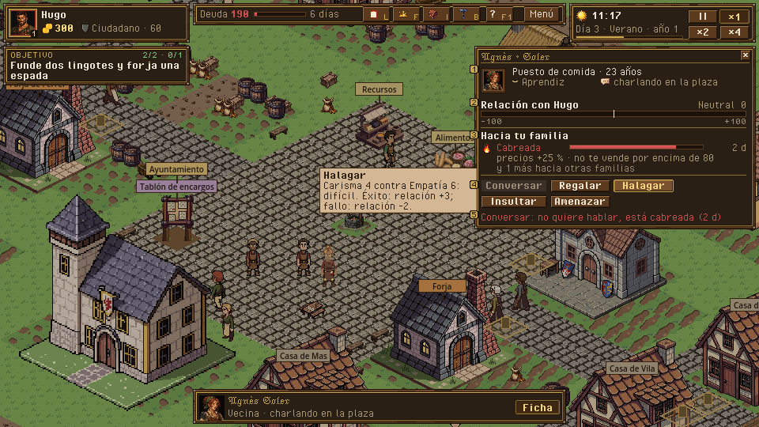
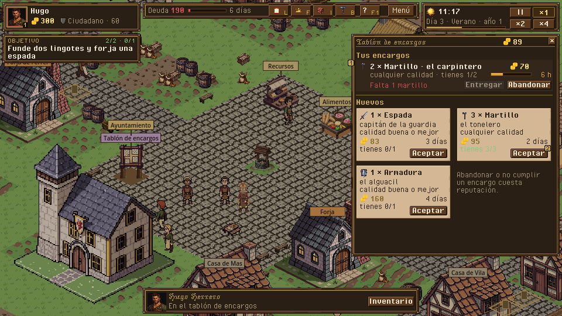
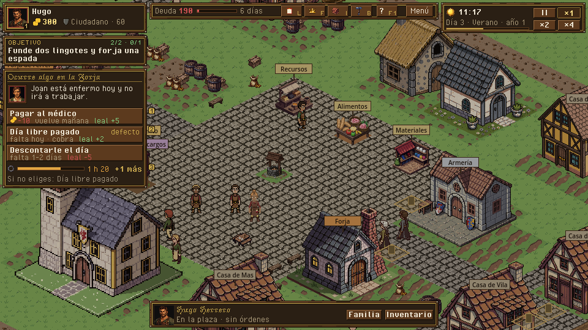
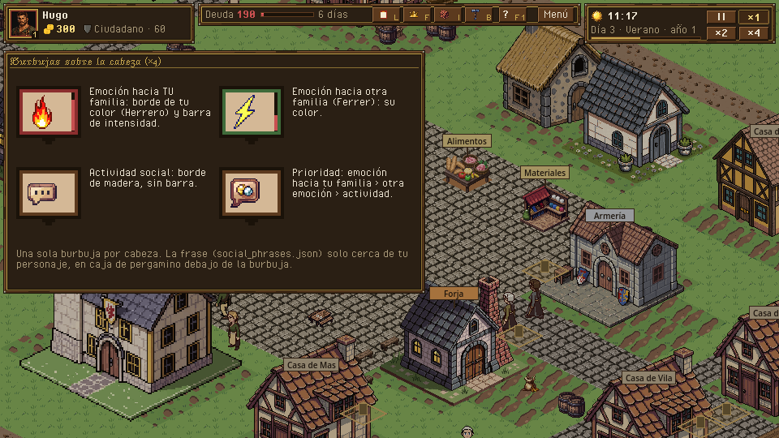

# Ciudad viva · ficha de vecino, tablón, microeventos y burbujas

> Dueño: mecánicas-social · Estado: borrador · Fecha: 2026-11-02
> Guía de estilo: [00_lenguaje_visual.md](../00_lenguaje_visual.md) · Zonas y reglas del HUD: [01_hud.md](../01_hud.md) · Convenciones: [_comun.md](_comun.md), [_social.md](_social.md)

Mecánica de H7 (GDD 4.11, 4.20) y del tablón de H3 (4.5.6). Cuatro piezas de interfaz:

| Pieza | Escena hoy | Qué es |
|---|---|---|
| Ficha de vecino | `game/ui/npc_panel.tscn` | Quién es un vecino, cómo está contigo y qué le puedes hacer. |
| Tablón de encargos | `game/ui/board_panel.tscn` | Encargos abiertos y los tuyos. |
| Tarjeta de microevento | `game/ui/microevent_card.tscn` | Una decisión rápida que no pausa. |
| Burbujas sobre la cabeza | `game/visuals/bubbles/*.tscn` + `game/world/character_view.gd` | Qué hace y qué siente cada vecino, sin abrir nada. |

Capturas de hoy (tema pixel art, 2026-11-02): `../maquetas/ciudad_viva_hoy_ficha.png`, `../maquetas/ciudad_viva_hoy_plaza.png`,
`../maquetas/ciudad_viva_hoy_microevento.png`, `../maquetas/ciudad_viva_hoy_tablon.png`.

Medidas en píxeles lógicos (960×540). Zonas, rejilla y reglas comunes: [`_comun.md`](_comun.md) y
[`_social.md`](_social.md). La ficha de vecino y el tablón van en la **zona 5** del HUD (`[600, 58, 356, 430]`); el microevento
en la **columna izquierda** (zona 4, 236 de ancho, bajo el objetivo plegado).

---

## 1. Para qué sirve y qué pregunta responde

| Pieza | Pregunta del jugador |
|---|---|
| Ficha de vecino | «¿Quién es esta persona, me tiene manía y qué gano hablándole?» · «¿Por qué no me deja conversar?» |
| Tablón | «¿Qué encargo me compensa con lo que tengo en el almacén y el tiempo que me queda?» · «¿Llego al plazo?» |
| Microevento | «¿Qué pasa, cuánto me cuesta cada opción y qué ocurre si no hago nada?» |
| Burbujas | «¿Qué hace la gente ahora?» · «¿Quién está enfadado con mi familia?» (de un vistazo, sin clic) |

## 2. Cómo se abre / cierra y la pausa

| Pieza | Abrir | Cerrar | Pausa |
|---|---|---|---|
| Ficha de vecino | Clic izquierdo sobre un vecino (no de tu familia). | X, ESC, clic en otro vecino (la sustituye), muerte del vecino. | No pausa (GDD 4.1). |
| Tablón | Mandar a alguien al tablón (clic derecho): se abre al llegar. | X, ESC, o al alejarse del tablón. | No pausa. |
| Microevento | Aparece solo cuando el sim crea uno para tu familia. | Al elegir, al vencer el plazo (opción por defecto) o con «Más tarde» (se pliega, no se descarta). | No pausa (GDD 4.20). |
| Burbujas | Siempre visibles en el mapa sobre vecinos en actividad social o con emoción. | — | — |

La ficha de vecino y el tablón siguen abiertos aunque el tiempo corra; el tablón exige estar en él (lo comprueba
`SimQuery.board_view(...).at_board`), la ficha no: desde lejos las acciones encolan el paseo.

## 3. Jerarquía de información

### Ficha de vecino

1. **Primero**: retrato 32 con el color de su familia, nombre y familia; debajo, oficio · rango · edad.
2. **Segundo**: la **relación con quien actúa**, como barra −100..+100 con su palabra (Enemigo · Hostil · Frío · Neutral ·
   Cordial · Amigo) y el número pequeño al lado; y sus **emociones hacia tu familia** (icono de la burbuja + nombre +
   barra de intensidad que se vacía). Las emociones hacia otras familias, en gris y plegadas («y 1 más»).
3. **Tercero**: qué hace ahora (texto de `SimQuery.town_state_text`) con el icono de su burbuja.
4. **Acciones**: Conversar · Regalar · Halagar · Insultar · Amenazar, con lo que pasa al usarlas.
5. **A demanda (tooltip)**: el efecto previsto de cada acción («+2 relación», «Halagar: Carisma 4 contra Empatía 6 ·
   difícil»), el regalo que se va a dar, y en las emociones cuánto duran y qué hacen («precios +25 %, no comercia por
   encima de 80»).

### Tablón

1. **Primero**: tu oro y la línea «Tus encargos» arriba si tienes alguno (lo urgente antes que lo nuevo).
2. **Segundo**: cada encargo como una **nota clavada**: icono del objeto 16 × cantidad, cliente, paga en oro (dorado),
   calidad mínima (icono de calidad), plazo.
3. **Tercero**: si **ya lo puedes cumplir** con lo del almacén (marca «Tienes 2/2»), y en los tuyos el tiempo que queda como
   barra que pasa a rojo en las últimas 6 h.
4. **A demanda**: la prima por calidad y la penalización por no cumplir (−5 de reputación, GDD 4.12.1).

### Microevento

1. **Primero**: título corto con icono del ámbito (edificio / persona) y el texto («Joan está enfermo hoy y no irá a la
   Forja»).
2. **Segundo**: las opciones, cada una con su **coste o efecto en una segunda línea** con iconos (oro, lealtad, relación),
   no metido en el texto del botón.
3. **Tercero**: el **reloj** (barra que se vacía en 2 h de juego) y cuál se aplica si no eliges (marca «por defecto»).

### Burbujas

Prioridad (GDD 4.11.5): **emoción hacia tu familia** > actividad social > nada. Una sola burbuja por cabeza. La frase
(`social_phrases.json`) solo cerca de tu personaje, debajo de la burbuja, con caja de pergamino.

## 4. Acciones y sus estados

### Ficha de vecino (`NpcActions.status(sim, actor, target, action)`)

| Acción | Normal | Deshabilitado (motivo visible, no solo tooltip) | Confirmación |
|---|---|---|---|
| Conversar | `npc_talk` | `refuses_talk` «No quiere hablar: está ofendido» · `already_today` «Ya hablasteis hoy» · `too_young` | No |
| Regalar | `npc_gift` con el objeto más valioso que lleva (`CourtshipPanel.best_gift`) | `no_item` «No llevas nada que regalar» | **Sí si el regalo vale ≥ 50 de oro**: «¿Regalar Espada (buena, 72 de oro) a Agnès?» |
| Halagar | `npc_flatter` (SkillCheck Carisma vs Empatía) | `already_today` | No |
| Insultar | `npc_insult` (−10, Ofendido) | — | **Sí, siempre** (irreversible, baja la relación y bloquea el cortejo) |
| Amenazar | `npc_threaten` (SkillCheck Arte Marcial vs Arte Marcial) | — | **Sí, siempre** |
| (lejos) | `too_far`: el botón sigue activo con el icono de «caminar» y el texto «Irá hasta allí» | | |

Regla de oro para toda la UI social: **el motivo de un botón apagado se ve escrito en la ficha** (una línea gris bajo la
fila de acciones con el motivo del botón sobre el que está el ratón, o del primero apagado), no solo en el tooltip.
Hoy «Conversar» sale apagado sin decir por qué (`../maquetas/ciudad_viva_hoy_ficha.png`).

### Tablón (`SimQuery.board_view(sim, actor)`)

| Acción | Orden | Estados |
|---|---|---|
| Aceptar | `accept_contract {actor, contract}` | Apagado con `reason.<status>` visible (p. ej. «Ya tienes 2 encargos»). |
| Entregar | `deliver_contract` | Apagado si falta mercancía: «Te faltan 1 Martillo (calidad buena)». Activo y resaltado (borde dorado) si se puede. |
| Abandonar | `abandon_contract` | **Confirmación**: «Abandonar cuesta 5 de reputación. ¿Seguro?» |

### Microevento (`resolve_microevent {actor, microevent, choice}`)

Cada opción es un botón ancho de dos líneas (texto + efectos). Sin confirmación: es una decisión rápida y no se puede
deshacer, pero el coste ya está a la vista. Si una opción no se puede pagar (oro), sale apagada con «No tienes 10 de
oro» y el plazo sigue corriendo.

## 5. Estados especiales

| Estado | Ficha de vecino | Tablón | Microevento |
|---|---|---|---|
| Vacío | «Sin emociones hacia tu familia» en gris, pero la sección se mantiene para que el hueco enseñe que existe. | «No hay encargos nuevos. Vuelve mañana.» / «No tienes encargos.» | Oculta. |
| Bloqueado | Niño (< 16): sin acciones, línea «Es un niño». Mismo apellido: no se abre (se abre la ficha de familiar). | — | — |
| Error | Vecino muerto con la ficha abierta: la ficha se cierra con aviso «Agnès ha muerto» en el registro (hoy se cierra en silencio). | Encargo que caduca mientras miras: la nota se tacha 1 s y desaparece. | Plazo vencido: la tarjeta muestra 1 s «Se aplicó: Día libre pagado» antes de cerrarse. |
| Varios | — | — | Una tarjeta visible; debajo, lengüeta «+2 más» que despliega las otras (hoy solo texto). |
| Primera vez | Primera ficha abierta: globo de ayuda «Lo que hagas cambia la relación y los precios que te pone». | Primer tablón: el objetivo 3 de la cadena ya guía; resaltar el encargo guionizado. | Primera tarjeta: globo «El tiempo no se para: si no eliges, se aplica la marcada». |

## 6. Maqueta

Composición (zonas de [`_social.md`](_social.md)):

```
+---- HUD superior (kit) --------------------------------------------------------------+
| [1][2][3]                                                                            |
| +-- ZONA 4 x 4..240 -----+                          +-- ZONA 5 x 600..956 ----------+ |
| | microevento           |      mapa                | ficha de vecino  o  tablón     | |
| | (+1 más)              |                          | (uno a la vez)                 | |
| +-----------------------+       (o)  burbuja       |                                | |
|                                 /|\  "¡Ja! Esa sí  |                                | |
|                                      que es buena" +--------------------------------+ |
+---- línea de ayuda ------------------------------------------------------------------+
```

Ficha de vecino (zona 5, 356 × ~232 desde y 58):

```
+================================================+  <- marco de madera (panel.png)
| [retrato]  Agnès · Soler                    [x]|
| [  32   ]  Puesto de comida · Aprendiz · 23    |
| [  fam  ]  [burbuja] charlando en la plaza     |
|------------------------------------------------|
| Relación con Hugo                     Neutral  |
| [-100 ===========|=========== +100]       0    |
|------------------------------------------------|
| Hacia tu familia                               |
| [>:(] Cabreada         [##########----]  2 d   |
|       precios +25 % · no comercia > 80         |
| (y 1 más hacia otras familias)                 |
|------------------------------------------------|
| [Conversar] [Regalar] [Halagar]                |
| [Insultar ] [Amenazar]                         |
| > No quiere hablar: está cabreada contigo      |  <- motivo visible
+================================================+
```

Tablón (zona 5, 356 × ~380):

```
+==================================================================+
| TABLÓN DE ENCARGOS                       oro 89            [x]   |
|------------------------------------------------------------------|
| TUS ENCARGOS                                                     |
| [martillo] 2 × Martillo · el carpintero        70 oro           |
|   cualquier calidad · Tienes 1/2  [=======----] 1 d 4 h          |
|                                      [ENTREGAR] [Abandonar]      |
|------------------------------------------------------------------|
| NUEVOS                                                           |
| +--nota------------------+  +--nota------------------+           |
| | [espada] 1 × Espada    |  | [martillo] 3 × Martillo|           |
| | capitán de la guardia  |  | el tonelero            |           |
| | [*] buena o mejor      |  | cualquier calidad      |           |
| | 3 días · 83 oro        |  | 2 días · 95 oro        |           |
| |            [ACEPTAR]   |  |            [ACEPTAR]   |           |
| +------------------------+  +------------------------+           |
+==================================================================+
```

Tarjeta de microevento (columna izquierda, zona 4: 236 × ~196, x 4, y 112 bajo el objetivo plegado):

```
+==============================================+
| [casa] Ocurre algo en la Forja               |
| Joan está enfermo hoy y no irá a trabajar.   |
|----------------------------------------------|
| [ Pagar al médico                         ]  |
| [   -10 oro · vuelve mañana · lealtad +5  ]  |
| [*Día libre pagado              por defecto] |
| [   falta hoy · cobra · lealtad +2        ]  |
| [ Descontarle el día                      ]  |
| [   falta 1-2 días · lealtad -5           ]  |
| [reloj] [==============------] 1 h 20        |
|                         +2 más  · Más tarde  |
+==============================================+
```

Burbujas (sobre la cabeza, 16 × 16 de icono dentro de un bocadillo de 20 × 18):

```
 emoción hacia tu familia (borde del color de tu familia)     actividad (borde neutro)
   .--------.                                                   .------.
   | >:( |##|  <- 2 px de barra de intensidad a la derecha       | zZ   |
   '---.----'                                                   '--.---'
       v                                                           v
```

**PNG** (hechas con `tools/ui/maqueta.py`; fuente: `docs/ui/maquetas/src/ciudad_viva.py`): `../maquetas/ciudad_viva_ficha.png`, `../maquetas/ciudad_viva_tablon.png`, `../maquetas/ciudad_viva_microevento.png`, `../maquetas/ciudad_viva_burbujas.png` (y sus `_x2`). Los números de oro de las maquetas remiten a §3 y §4.






**Piezas del kit que usa**: `parchment` (notas del tablón), `ui:marks/rank_1` (galón de Aprendiz en la ficha). **Piezas de kit pendientes**: barra bipolar (−100..+100 con marca en el cero); nota de tablón (pergamino clavado, 9-patch);
botón de dos líneas (texto + línea de efectos con iconos); lengüeta «+N más»; bocadillo de emoción con borde de color y
barra de intensidad; iconos 16 de oro, lealtad, relación, reloj y calidad (los de Guild Renew `icon_oro`, `state_*`,
`icon_pending` sirven de base).

## 7. Datos

| Lee | De |
|---|---|
| Personaje (nombre, familia, edad, oficio, rango) | `state.characters[id]`, `Kin.age`, `SimQuery.occupation_name`, `SimQuery.rank_name` |
| Relación | `Emotions.relation(state, actor, target)` (−100..100) |
| Emociones | `Emotions.list(sim, target)` → `[{state, source, intensity, icon, name_key}]`; efectos de `data/town.json` `emotions.<id>` (`buy_mult`, `sell_mult`, `refuses_talk`, `refuses_trade_over`, `duration_days`) |
| Actividad | `TownLife.view(sim, chr)` → `{state, activity, bubble, occupation}`; `SimQuery.town_state_text` |
| Estado de cada acción | `NpcActions.status`, `NpcActions.in_range`; efectos previstos de `data/town.json` `actions` |
| Probabilidad de Halagar / Amenazar | `SkillCheck` (GDD 4.2.4): umbral = 50 + (stat_actor − stat_objetivo) × 5 → banda Fácil (≥ 65) · Dudoso · Difícil (≤ 35) |
| Tablón | `SimQuery.board_view(sim, actor)` → `{at_board, open: [...], accepted: [...]}` con `id, client, qty, item, min_quality, deadline_days, pay, status, hours_left` |
| «Tienes 1/2» | Almacenes de la familia (nueva consulta de solo lectura en `SimQuery`, no regla) |
| Microevento | `Microevents.active_for(sim, fam)`, `Microevents.view(sim, id)` → `{id, def, text_key, params, choices, default, building, minutes_left}`; efectos de las opciones de `data/microevents/<id>.json` |

| Emite | Cuándo |
|---|---|
| `npc_talk` · `npc_gift {item, quality}` · `npc_flatter` · `npc_insult` · `npc_threaten` | Botones de la ficha (lejos: `exit_building` + `move_to` + la acción con `queued`). |
| `accept_contract` · `deliver_contract` · `abandon_contract` | Tablón. |
| `resolve_microevent {microevent, choice}` | Tarjeta. |

Falta en el sim para la UI (solo consultas, sin reglas nuevas): un `Microevents.choice_effects(sim, def, choice)` que
devuelva los efectos de cada opción en forma legible (oro, lealtad, relación, días), para no duplicar las cifras en
`i18n`. Hoy el coste vive dentro del texto traducido («Pagar al médico (10 de oro)»): si cambia el dato, el texto miente.

## 8. Sonido y feedback

| Momento | Evento de `data/audio.json` | Estado |
|---|---|---|
| Abrir el tablón | `ui.panel_open_by.board_panel` → `voice_board_crier` | Existe |
| Entregar encargo | `contract_delivered` → `sfx_contract_done` | Existe |
| Saludo de un vecino | `greeted` → `voice_greeting` | Existe |
| Microevento nuevo | `notice.microevent.<id>` (`sfx_cough`, `voice_haggle`, `sfx_thief_alarm`) | Existe |
| Abrir/cerrar la ficha de vecino | `ui.panels` no incluye `npc_panel` | **Falta**: añadir `npc_panel` a `ui.panels` |
| Acción social con éxito / fallo (halagar, amenazar) | — | **Falta**: `npc_action.ok` / `npc_action.fail` (sugerencia: `sfx_ui_click` + voz corta; sin nuevo audio de pago) |
| Insultar | — | **Falta**: `npc_action.insult` (murmullo de enfado) |
| Plazo de microevento a punto de vencer (15 min de juego) | — | **Falta**: `microevent_expiring` (tic de reloj) |

Feedback visual: tras una acción, número flotante sobre el vecino («+2», verde; «−10», rojo) y la barra de relación se
mueve con una animación de 4 fotogramas. La emoción nueva aparece en la burbuja con un «pop» de 2 fotogramas.

## 9. Diferencias con hoy y tareas

| Hoy | Debería |
|---|---|
| Ficha sin retrato; relación como «Relación con Hugo: 0». | Retrato 32 con color de familia; barra bipolar con palabra. |
| Botones apagados sin motivo a la vista (solo tooltip). | Línea de motivo visible bajo las acciones. |
| Insultar y Amenazar sin confirmación. | Confirmación. |
| Emociones de todas las familias mezcladas. | Las de tu familia primero, las demás plegadas. |
| Tablón como lista de texto; no dice si ya puedes cumplirlo. | Notas con icono del objeto y «Tienes x/y». |
| Abandonar sin confirmación ni coste visible. | Confirmación con el coste. |
| Microevento con el coste dentro del texto de un botón en Silkscreen mayúsculas, ilegible en 2 líneas (`../maquetas/ciudad_viva_hoy_microevento.png`). | Botón de dos líneas con fuente de cuerpo; efectos con iconos; Silkscreen solo en botones cortos. |
| Reloj del microevento como texto. | Barra que se vacía + marca «por defecto». |
| Burbuja de emoción con borde genérico. | Borde del color de la familia hacia la que siente la emoción + barra de intensidad. |

Tareas (cada una pequeña, en este orden):

1. Kit: barra bipolar, botón de dos líneas, nota de tablón, bocadillo con borde de color (pieza de kit pendiente).
2. `npc_panel`: retrato y cabecera; barra de relación; separar emociones propias/ajenas.
3. `npc_panel`: línea de motivo visible; confirmación de Insultar/Amenazar y de regalos ≥ 50 de oro.
4. `npc_panel`: tooltip de efecto previsto y banda de SkillCheck.
5. `board_panel`: notas con icono; «Tienes x/y»; barra de plazo; confirmación de Abandonar.
6. Sim (consulta): `Microevents.choice_effects`; `microevent_card`: botón de dos líneas, barra de reloj, lengüeta «+N».
7. Burbujas: borde por familia y barra de intensidad (`character_view.gd`).
8. Audio: `npc_panel` en `ui.panels`; eventos `npc_action.*` y `microevent_expiring` (con sonidos ya pagados).

## 10. Criterios de aceptación

- [ ] En una captura a 960×540 de la ficha de un vecino cabreado se lee, sin pasar el ratón, la relación (palabra y
      número), la emoción hacia tu familia con su efecto en precios y por qué no se puede conversar.
- [ ] Insultar, Amenazar y Abandonar piden confirmación; Conversar, Halagar y Aceptar no.
- [ ] El tablón marca en verde los encargos que ya se pueden entregar con lo que hay en los almacenes de la familia.
- [ ] Ningún texto de opción de microevento se parte en más de 2 líneas a 960×540, y el coste se lee como iconos.
- [ ] Con dos microeventos activos se ve la lengüeta «+1 más» y se puede abrir el segundo.
- [ ] En la plaza al atardecer cada vecino tiene como mucho una burbuja y las emociones hacia tu familia llevan su color.
- [ ] Cambiar una cifra en `data/microevents/sick_employee.json` cambia lo que dice la tarjeta sin tocar `i18n`.
- [ ] `tests/test_game_*`: la ficha muestra el motivo `refuses_talk` como texto (no solo tooltip).
