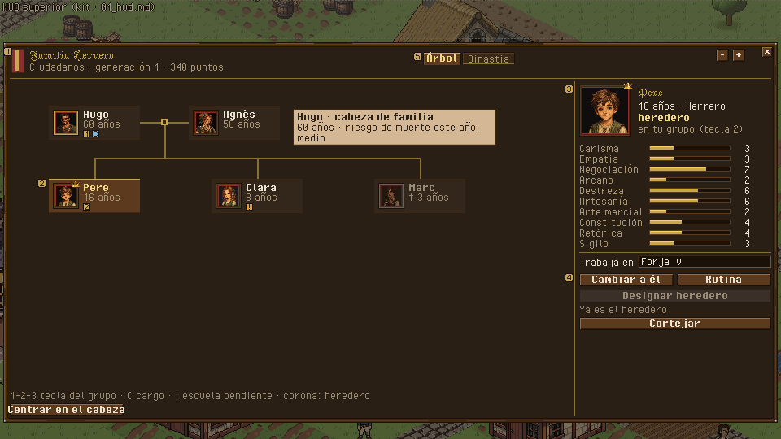
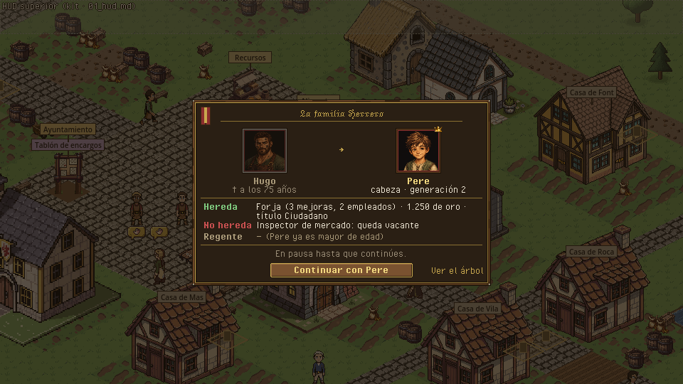
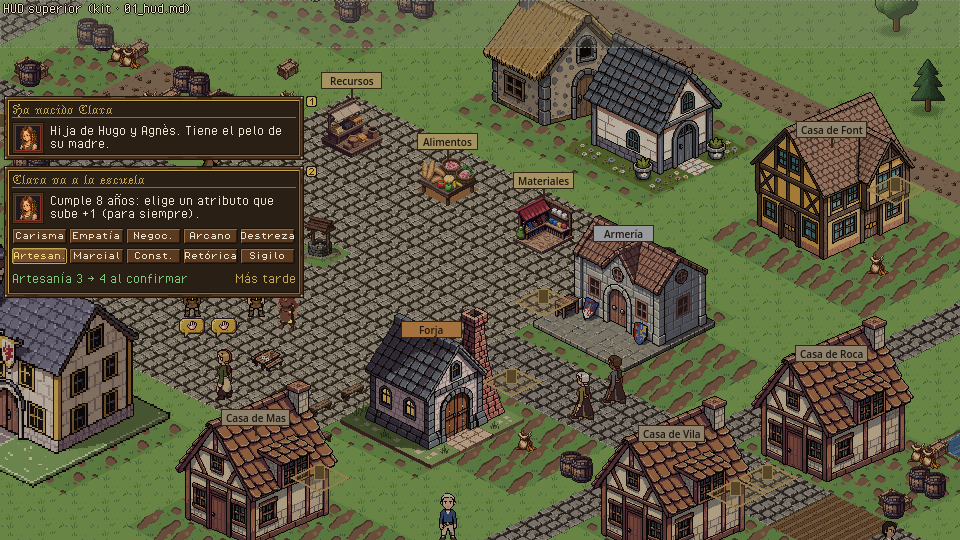

# Familia · árbol genealógico, retratos, herencia y muerte

> Dueño: mecánicas-social · Estado: borrador · Fecha: 2026-11-02
> Guía de estilo: [00_lenguaje_visual.md](../00_lenguaje_visual.md) · Zonas y reglas del HUD: [01_hud.md](../01_hud.md) · Convenciones: [_comun.md](_comun.md), [_social.md](_social.md)

Mecánica de H8 (GDD 4.10.4-4.10.9, 4.2.5, 4.17). Piezas:

| Pieza | Escena hoy | Qué es |
|---|---|---|
| Árbol genealógico | `game/ui/family_tree_panel.tscn` | La dinastía entera, quién hereda y qué puede hacer cada uno. |
| Nodo del árbol | `game/ui/family_tree_node.tscn` | Una persona dentro del árbol. |
| Marco de retrato | `game/ui/portrait_frame.tscn` | El retrato con el color de la familia y sus marcas; lo usan el HUD (grupo 1-2-3), el árbol y las fichas. |
| Momentos de vida | — (hoy solo avisos del registro) | Nacimiento, escuela (8), mayoría de edad (16), muerte, **sucesión**, fin de la dinastía. |

Capturas de hoy: `../maquetas/familia_hoy_arbol.png` (tema pixel art), `../maquetas/familia_hoy_fin.png`. Rutina (`routine_editor`) no es de este
documento: se enlaza desde la ficha lateral.

---

## 1. Para qué sirve y qué pregunta responde

- **Árbol**: «¿Quién heredará si muero mañana?» · «¿Cuántos años le quedan al cabeza?» · «¿Quién de los míos puede
  casarse, trabajar o pasar a mi grupo?» · «¿Se nota que son mi familia?» (colores y rasgos, GDD 4.10.9).
- **Retrato**: «¿A quién controlo ahora y quién más está disponible?» (HUD) · «¿Es de mi familia, es el heredero, está
  muerto?».
- **Momentos de vida**: «¿Qué acaba de pasar en mi familia y qué tengo que decidir?» (escuela a los 8, el heredero, quién
  gestiona si el heredero es menor).

## 2. Cómo se abre / cierra y la pausa

| Pieza | Abrir | Cerrar | Pausa |
|---|---|---|---|
| Árbol | Tecla **F**, botón «Familia» de la barra superior (hoy no existe: solo tecla), clic en el aviso de un hecho de familia (abre el árbol con esa persona elegida). | F, ESC, X. | No pausa (GDD 4.10.7). |
| Retratos del HUD | Siempre visibles (grupo 1-2-3). Clic = elegir; doble clic = centrar cámara (GDD 4.10.5). | — | — |
| Nacimiento, mayoría de edad, muerte de un familiar | Tarjeta lateral no bloqueante (como el microevento) durante `view.family_card_seconds` [propuesta: 8 s] y queda en el registro. | Clic o tiempo. | No pausa. |
| Escuela (8 años) | Tarjeta lateral con la elección de atributo; no caduca (el sim espera con `life.school = "pending"`). | Al elegir; «Más tarde» la pliega a una lengüeta. | No pausa. |
| **Sucesión** (muere el cabeza) | Carta central grande. | Botón «Continuar con Pere». | **Decisión del owner** (ver abajo). |
| Fin de la dinastía | Pantalla de final (`ending_screen`). | Partida nueva / salir. | Partida terminada. |

> [!NOTE]
> **Decisión del owner · ¿la muerte del cabeza de familia pausa el juego?** El GDD dice que el tiempo solo se para con la
> pausa (4.1), pero en la sucesión cambia a quién controlas, se va el grupo y puede haber regente.
> (a) **Pausa automática** al morir el cabeza, la carta explica la herencia y al cerrarla se reanuda a la velocidad que
> había. (b) Sin pausa: carta no bloqueante. (c) Configurable en opciones, por defecto (a).
> **Recomendación: (a)**. Es el momento más importante de una generación (cada ~17 h reales) y sin pausa el jugador
> puede perderse el cambio de personaje en mitad de una tarea. No cambia ninguna regla del sim: la pausa es de la vista.

## 3. Jerarquía de información

### Árbol

1. **Primero**: la **cabecera de la dinastía**: estandarte con los colores de la familia, nombre, título, generación y
   puntos. Y en el árbol, **el cabeza** (marco grueso) y **el heredero** (corona) se encuentran sin buscar.
2. **Segundo**: cada nodo: retrato 32 (con el pelo y la piel de la persona), nombre, edad, y una fila de **insignias**
   de 8×8: controlable (anillo dorado) · tecla 1-2-3 · cargo (H10) · casado (anillo) · difunto (cruz) · escuela pendiente
   (signo «!»).
3. **Tercero**: la **ficha lateral** de la persona elegida: retrato 64, roles, atributos como barras 1-10, a quién está
   asignado y las acciones.
4. **A demanda**: tooltip del nodo («Hugo · 60 años · cabeza de familia · riesgo de muerte este año: alto»); la banda de
   riesgo sale de `Lifecycle.death_chance` (Bajo < 5 % · Medio < 15 % · Alto ≥ 15 %), sin dar el número.
5. Pestaña **Dinastía**: puntos desglosados (`Dynasty.score`), metas (`Dynasty.goals_view`) y los cabezas de familia con
   sus fechas (`Dynasty.summary.heads`).

### Retrato (marco)

Capas, de fuera adentro (GDD 4.10.7, 4.10.9): borde de 2 px en el **color primario de la familia** → anillo de 1 px
dorado (controlable) o gris (no) → fondo (claro si es el activo) → retrato. Marcas encima: corona (heredero) arriba a la
izquierda, tecla 1-2-3 abajo a la derecha, cruz y desaturado si ha muerto, insignia de cargo abajo a la izquierda.
Tamaños: 32 (HUD y árbol) y 64 (ficha y cartas).

### Sucesión

1. **Primero**: retrato 64 del difunto con cruz y «Hugo ha muerto a los 75 años».
2. **Segundo**: retrato 64 del heredero con la corona: «Pere es el nuevo cabeza de los Herrero · generación 2».
3. **Tercero**: qué hereda (edificios, oro, título) y qué **no** (cargos: «Inspector de mercado queda vacante»).
4. Si el heredero es menor: «Agnès gestiona como regente hasta que Pere cumpla 16 (faltan 2 años, 16 días)».

## 4. Acciones y sus estados

Ficha lateral (las mismas órdenes que hoy):

| Acción | Orden | Deshabilitado (motivo visible) | Confirmación |
|---|---|---|---|
| Cambiar a este personaje | (vista: `switch_requested`) | «No está en tu grupo» · «Ya es el activo» · difunto | No |
| Designar heredero | `designate_heir {heir}` | `Kin.can_inherit` falso: «Es menor de 16» no lo impide (hereda con regente) · «No es descendiente» · «Ya es el heredero» | **Sí**: «Pere pasará a ser el heredero en lugar de Clara.» |
| Trabaja en | `assign_building {character, building}` | Menor de 16 (la fila se oculta, como hoy) | No |
| Escuela (+1 atributo) | `school_choice {child, stat}` | Solo con `life.school == "pending"` | **Sí** (irreversible): «+1 Artesanía para Clara. ¿Seguro?» |
| Cortejar | (vista: `court_requested`, abre el cortejo) | No soltero · menor · no controlable | No |
| Rutina | (vista: abre `routine_editor`) | No controlable | No |
| Cerrar la dinastía | `close_dynasty` | Solo si `family.succession.voluntary_close` (D19) | **Doble**: escribir el nombre de la familia o mantener pulsado 2 s |

Carta de sucesión: un único botón «Continuar con Pere» (o «… con Agnès como regente»). Debajo, enlace «Ver el árbol».

## 5. Estados especiales

| Estado | Qué se ve |
|---|---|
| Familia de una persona (inicio) | El árbol con el fundador solo y una silueta punteada a su lado: «Cásate para continuar la dinastía» (abre cortejo). |
| Sin heredero válido | Banda roja fija en la cabecera: «Sin heredero: si Hugo muere, la dinastía termina». Es la regla de Game Over (4.10.4) y hoy no se avisa. |
| Heredero menor | Insignia «regente» en la pareja y línea en la cabecera. |
| Muertos | Nodos desaturados al 60 % con cruz; edad «† 75». El árbol no los quita. |
| Árbol grande | Zoom −/+ (0,5-2), arrastrar con el botón central, y botón «Centrar en el cabeza». Generaciones fuera de vista: flecha en el borde. |
| Escuela pendiente | Signo «!» en el nodo y en la pestaña; la tarjeta lateral de la elección. |
| Primera vez | Primera apertura: globo sobre la corona «El heredero recibe todo si muere el cabeza. Cámbialo en su ficha». |

## 6. Maqueta

Árbol (panel grande de [`_social.md`](_social.md): x 4..956, y 52..520; el HUD superior queda visible):

```
+==========================================================================================+
| [estandarte] FAMILIA HERRERO · Ciudadanos      Generación 2 · 340 pts   [Árbol][Dinastía] [-][+][x] |
| ! Sin heredero: si Hugo muere, la dinastía termina                       (solo si aplica)   |
|------------------------------------------------------------------+-----------------------|
|                                                                  | [retrato 64]  Pere    |
|   +[32]Hugo------+ (o) +[32]Agnès-----+                          |  16 años · Herrero    |
|   |  60 · CABEZA |-----|  56          |                          |  [corona] heredero    |
|   |  o 1  [insp] |     |  o           |                          |  [o] controlable · 2  |
|   +--------------+  |  +--------------+                          |-----------------------|
|          +----------+----------+                                 | Carisma     [###-----]3|
|   +[32]Pere------+       +[32]Clara-----+                        | Empatía     [###-----]3|
|   | ♛ 16         |       |  12   !      |                        | Negociación [#######-]7|
|   |  o 2         |       |              |                        | ... (10 barras 1-10)  |
|   +--------------+       +--------------+                        |-----------------------|
|                                                                  | Trabaja en [Forja  v] |
|                                                                  | [CAMBIAR A ÉL][RUTINA]|
|                                                    [Centrar]     | [DESIGNAR HEREDERO]   |
|                                                                  | [CORTEJAR]            |
+==========================================================================================+
```

Nodo (104 × 40 a zoom 1):

```
+--------------------------------------+
|[ret]  Pere                         ♛ |
|[32 ]  16 años                        |
|[   ]  [o][2][⚒][!]  <- insignias 8×8  |
+--------------------------------------+
```

Carta de sucesión (420 × 240, centrada, sobre velo oscuro):

```
+==========================================================+
|                 LA FAMILIA HERRERO                       |
|   [ret 64 †]          ->          [ret 64 ♛]             |
|   Hugo                            Pere                   |
|   murió a los 75                  cabeza · generación 2  |
|----------------------------------------------------------|
| Hereda: Forja (3 mejoras, 2 empleados) · 1.250 oro ·     |
|         título Ciudadano                                 |
| No se hereda: Inspector de mercado (queda vacante)       |
| Regente: — / Agnès hasta que Pere cumpla 16              |
|----------------------------------------------------------|
|              [ CONTINUAR CON PERE ]   Ver el árbol       |
+==========================================================+
```

Tarjeta de vida (columna de tarjetas, 300 × ~60):

```
+============================================+
| [ret 32]  Ha nacido Clara                  |
|           hija de Hugo y Agnès · pelo de   |
|           su madre                         |
+============================================+
```

**PNG** (fuente: `docs/ui/maquetas/src/familia.py`): `../maquetas/familia_arbol.png` (árbol con nodos e insignias y ficha lateral), `../maquetas/familia_sucesion.png`, `../maquetas/familia_tarjetas_vida.png` (nacimiento y escuela), y sus `_x2`.





**Piezas de kit pendientes**: estandarte de familia (9-patch vertical teñido con `colors.primary/secondary`); insignias
8×8 (anillo, cruz, corona, «!», cargo, regente; base: `icon_crown`, `icon_deceased`, `icon_ring`, `icon_controllable`
de Guild Renew reescalados a mano); barra de atributo 1-10 en 10 segmentos; velo oscuro de carta modal; línea de
árbol de 2 px en dorado con la unión de pareja (anillo 6×6).

## 7. Datos

| Lee | De |
|---|---|
| Familia | `state.families[fam]` → `name`, `colors {primary, secondary}`, `head`, `founder`, `members`, `generation`, `regent`; título `Titles.current(sim, fam)` |
| Personas | `state.characters[id]` → `name`, `alive`, `death_day`, `spouse`, `children`, `controlled_by`, `class`, `profession`, `stats`, `assigned`, `life.school`, `life.former_spouses` |
| Edad, heredero, grupo | `Kin.age`, `Kin.heir`, `Kin.can_inherit`, `Kin.group`, `Kin.is_adult`, `Kin.is_single` |
| Riesgo de muerte (banda) | `Lifecycle.death_chance(sim, chr)` |
| Dinastía | `Dynasty.score`, `Dynasty.goals_view`, `Dynasty.summary` |
| Retrato | `Identity.of(state, chr)` (pelo, piel, color primario); escena `game/visuals/characters/portrait.tscn` |
| Disposición del árbol | `FamilyTreePanel.layout(state, fam)` (vista) |
| Cargo de la persona (H10) | `Offices.of_character(state, chr)` (rama `h10-cargos`) |
| Sucesión | evento `character_died` y la entrada de crónica `inheritance {from, heir, generation, regent}`; edificios y oro del heredero desde el estado |
| Actitudes morales | `families[fam].attitudes` **cuando exista** (hoy no está en el estado: la ficha no muestra la sección) |

| Emite |
|---|
| `designate_heir {actor, heir}`, `assign_building {actor, character, building}`, `school_choice {actor, child, stat}`, `close_dynasty {actor}` |

Falta (solo vista o consultas): un evento o entrada que diga **qué no se heredó** (cargos que quedan vacantes): hoy se
deduce de `office_left {reason: died}` (H10). Basta con leerlo en la carta.

## 8. Sonido y feedback

| Momento | Evento | Estado |
|---|---|---|
| Abrir/cerrar árbol | `ui.panels` no incluye `family_tree_panel` | **Falta** añadirlo |
| Nacimiento | `notice.child_born` | **Falta** sonido (`sfx_birth`: campanilla suave; reutilizable `sfx_objective_done` mientras no haya otro) |
| Mayoría de edad | `notice.came_of_age` | **Falta** (`sfx_objective_done`) |
| Muerte de un familiar | `notice.death` → hoy suena `notice_added.urgent` (`sfx_alarm`) | **Cambiar**: una alarma no es un duelo; `sfx_death_bell` (campana lenta) |
| Sucesión | `notice.inheritance` | **Falta** música corta (`music_succession`, 6-8 s) |
| Designar heredero | — | `sfx_ui_click` + corona que «cae» sobre el nodo (3 fotogramas) |

Feedback: al designar, la corona se mueve del nodo viejo al nuevo; al nacer alguien, su nodo aparece con un destello de
2 fotogramas si el árbol está abierto.

## 9. Diferencias con hoy y tareas

| Hoy (`../maquetas/familia_hoy_arbol.png`) | Debería |
|---|---|
| Cabecera solo con nombre y título. | Estandarte con colores, generación y puntos; aviso «sin heredero». |
| Dos tercios del panel vacíos con una familia pequeña. | El árbol se centra y la ficha ocupa una columna fija de 220 px. |
| Nodo sin insignias (solo marco); heredero con una corona pequeña. | Fila de insignias (controlable, tecla, cargo, escuela). |
| Atributos como texto «Carisma 3». | Barras 1-10. |
| Metas y puntos mezclados bajo la ficha. | Pestaña Dinastía. |
| Designar heredero sin confirmación. | Confirmación. |
| Escuela como fila dentro de la ficha que hay que descubrir. | Tarjeta lateral al cumplir 8 + «!» en el nodo. |
| Muerte y sucesión: un aviso urgente con alarma. | Carta de sucesión con qué se hereda y qué no; campana. |
| Sin aviso de que no hay heredero. | Banda roja en el árbol y aviso en el registro al quedarse sin heredero. |

Tareas:

1. Kit: estandarte, insignias 8×8, barra 1-10, velo modal (pendientes).
2. `portrait_frame`: insignias de cargo y regente; desaturado del difunto.
3. `family_tree_node`: fila de insignias y edad «† 75».
4. `family_tree_panel`: cabecera con estandarte; pestañas Árbol/Dinastía; ficha de 220 px con barras; botón Centrar.
5. `family_tree_panel`: confirmaciones (heredero, escuela, cierre); banda «sin heredero».
6. Nueva `family_card` (tarjeta lateral de vida) para nacimiento, mayoría de edad, escuela y muertes no del cabeza.
7. Nueva `succession_card` (carta central) + decisión de pausa.
8. HUD: botón «Familia (F)» en la barra superior.
9. Audio: eventos de nacimiento, muerte y sucesión con sonidos ya pagados o pedidos con la próxima tanda.

## 10. Criterios de aceptación

- [ ] En el escenario `founder_old`, con el árbol abierto a 960×540, se ve sin clic quién es el cabeza, quién el
      heredero y quién está en el grupo (y con qué tecla).
- [ ] En `founder_no_heir` el árbol muestra la banda «Sin heredero».
- [ ] Designar heredero y elegir escuela piden confirmación; la corona se mueve al confirmar.
- [ ] Al morir el cabeza (escenario `founder_old` con `--dev-time`) sale la carta de sucesión con lo heredado, lo que
      queda vacante y el regente si lo hay; con la opción (a), el juego está en pausa hasta pulsar Continuar.
- [ ] Un nacimiento muestra la tarjeta lateral con el retrato del bebé con los colores de la familia.
- [ ] La captura del árbol cumple el criterio de H8: la familia se reconoce por sus colores y los hijos llevan el pelo o
      la piel de un padre.
