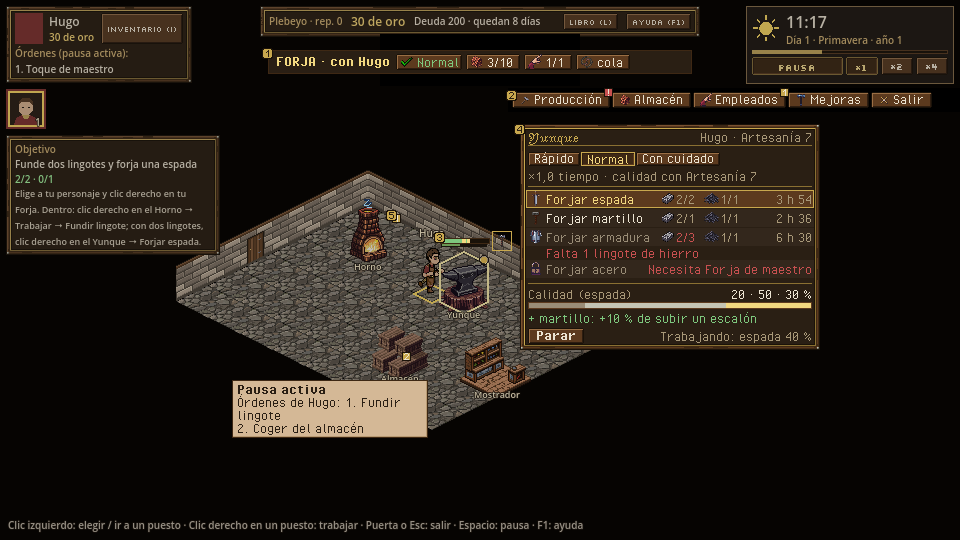
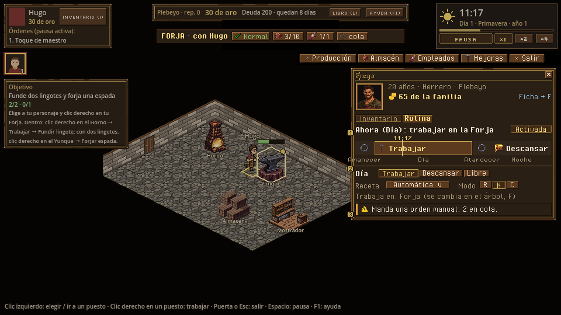

# Forja por dentro: interior, menú de puesto, pausa activa y rutina

> Dueño: mecánicas-economía · Estado: borrador · Fecha: 2026-11-02
> Guía de estilo: [00_lenguaje_visual.md](../00_lenguaje_visual.md) · Zonas y reglas del HUD: [01_hud.md](../01_hud.md)

Id: `forja_interior` · Paneles de hoy: `game/interior/*`, `game/ui/station_menu.tscn`, `game/ui/routine_editor.tscn`
· GDD 4.1 (pausa activa), 4.4.3-4.4.5, 4.6.4, 4.10.8 · Convenciones: [_comun.md](_comun.md)

## 1. Para qué sirve

Es la pantalla donde más horas pasa el jugador en la rebanada vertical. Responde a estas preguntas:

- **«¿Qué está haciendo cada puesto ahora mismo?»** Quién trabaja, qué fabrica, cuánto le falta y si está parado.
- **«¿Cómo me pongo a trabajar yo, y qué calidad me va a salir?»** El modo, la receta, lo que gasta, cuánto tarda y
  la probabilidad de cada calidad.
- **«¿Cuándo tengo que hacer el toque de maestro?»** Verlo venir antes de que se abra la ventana, no solo cuando ya
  parpadea.
- **«¿Qué hará mi gente cuando no la mire?»** La rutina por franjas de cada personaje controlado.

## 2. Cómo se abre y se cierra

| Qué | Abrir | Cerrar | Pausa |
|---|---|---|---|
| Interior con personaje | Clic derecho en la Forja con un personaje elegido (camina y entra) | Puerta, *Salir* o Esc | No pausa (GDD 4.6.4) |
| Interior en gestión | Doble clic en la Forja, o *Gestionar* en su ficha del mapa | *Salir* o Esc | No pausa |
| Menú de puesto | Clic derecho en un puesto | Esc, clic fuera o al elegir | No pausa |
| Toque de maestro | Clic izquierdo en el puesto mientras la ventana está abierta | — | Con pausa activa se encola (GDD 4.1) |
| Rutina | Ficha del personaje (I) → pestaña *Rutina*, o clic en el retrato del grupo → *Rutina* | Esc o X | No pausa |

Esc cierra primero lo más cercano: el menú de puesto, después el panel lateral y, por último, sale del interior.
Hoy ya funciona así; se mantiene.

## 3. Jerarquía de información

**Lo primero que se ve (sin pasar el ratón):**
1. Los **puestos** y su **estado**: un icono de 16 px sobre cada puesto. Puede ser `icon_working`, `icon_idle`,
   `icon_warning` (parado: almacén lleno, sin entradas) o la ventana del toque abierta (martillo dorado parpadeando).
2. La **barra de progreso del ciclo**, sobre el puesto y no sobre el personaje, con la **ventana del toque de maestro
   marcada en dorado** dentro de la propia barra. Así se ve venir.
3. La **placa del edificio** (arriba en el centro, bajo el HUD): nombre, quién mira (con Hugo / gestión) y 4 fichas
   de estado clicables: estado del edificio, almacén `3/10`, empleados `1/1` y cola en marcha o en pausa.

**Lo segundo (en el menú de puesto, al hacer clic derecho):** modo de trabajo, recetas con lo que gastan y lo que
hay, duración real y probabilidad de cada calidad.

**A demanda (tooltip):** la receta completa al pasar por un puesto (quién, receta, modo, minutos que faltan, qué
saldrá), el motivo exacto de un puesto parado y la fórmula del modo.

```
 placa del edificio (centro, y=52)
 ┌──────────────────────────────────────────────────────────────┐
 │ FORJA · con Hugo   [● Normal] [▦ 3/10] [☺ 1/1] [▶ cola]      │
 └──────────────────────────────────────────────────────────────┘
          barra del puesto (32×4) con la ventana del toque en dorado
                 ┌────────────────────────────────┐
                 │███████████▓▓▓▓░░░░░░░░░░░░░░░░│  ▓ = ventana (1 h de juego)
                 └────────────────────────────────┘
                       ⚒  ← icono de estado del puesto (16 px)
                    [ YUNQUE ]  ← nombre del puesto (fuente pequeña)
```

## 4. Acciones y sus estados

### 4.1 Menú de puesto (hoy: dos pasos, modo y después receta)

Hoy hay que elegir el modo, después la receta en otra caja y, si te equivocas de modo, volver con *Atrás*. Se
propone **una sola caja** con el modo arriba como selector de tres y las recetas debajo. Un clic en una receta da
la orden. El modo elegido se recuerda en la vista para ese personaje y ese puesto.

```
 ┌ YUNQUE ───────────────────────── Hugo · Artesanía 7 ┐  216 px de ancho
 │ ( Rápido )( ■ Normal )( Con cuidado )               │  selector de modo
 │ ×1,0 tiempo · calidad con tu Artesanía (7)          │  qué hace el modo, en una línea
 ├─────────────────────────────────────────────────────┤
 │ [⚔] Forjar espada         ▣ 2/2  ◆ 1/1      3 h 54  │  receta disponible
 │ [⚒] Forjar martillo       ▣ 2/1  ◆ 1/1      2 h 36  │
 │ [▤] Forjar armadura       ▣ 2/3  ◆ 1/1      6 h 30  │  deshabilitada
 │     Falta 1 lingote de hierro                       │  motivo en rojo, siempre visible
 │ [🔒] Forjar acero          Necesita Forja de maestro │  bloqueada (min_craft)
 ├─────────────────────────────────────────────────────┤
 │ Calidad (espada):  ███▒▒▒▒▒▒▒▒░░░░░   20 · 50 · 30 %│  barra de 3 tramos: normal/buena/excelente
 │ + martillo equipado: +10 % de subir un escalón      │  solo si has_right_tool
 ├─────────────────────────────────────────────────────┤
 │ [ Parar ]                     Trabajando: espada 40 %│  solo si ya trabaja aquí
 └─────────────────────────────────────────────────────┘
```

| Elemento | Normal | Deshabilitado (motivo visible) | Notas |
|---|---|---|---|
| Modo | Tres botones; el activo, con filete dorado | — | *Con cuidado* añade «+ toque de maestro» en su línea |
| Receta | Clic → `work_at` | `missing_inputs`: «Falta 1 lingote de hierro». `no_room`: «El almacén está lleno» | Las entradas como icono + `tengo/necesito`, en rojo si falta |
| Receta bloqueada | — | `locked`: «Artesanía 6 (tienes 4)» con `icon_locked`; receta que da una mejora: «Necesita *Forja de maestro*» → Mejoras | Se ve aunque no se pueda: enseña lo que viene |
| Calidad | Barra de la receta bajo el ratón o, si no hay, de la primera disponible | — | Cambia al cambiar de modo: es el porqué de *Con cuidado* |
| Parar | `stop_work` | No aparece si el personaje no trabaja en este puesto | Línea «Se devuelven: 2 lingotes» (D11) en el tooltip |

**Sin personaje dentro (gestión):** la caja muestra el trabajo en curso del puesto (quién, receta, %) y la línea
«Entra con un personaje para trabajar aquí». Lleva un botón *Producción* que abre el panel lateral. Hoy pone
«no_actor» y nada más.

**Otro personaje en el puesto:** la caja dice «Ocupado por Joan (empleado) · espada 40 %». Las recetas se ven
deshabilitadas con el motivo `station_busy`.

**Personaje que no puede trabajar ahora** (`may_work`): el selector y las recetas se ven deshabilitados con el
motivo arriba, por ejemplo `under_works`: «En obras: Fuelle mejorado, quedan 12 h».

### 4.2 Toque de maestro

| Momento | Qué se ve | Qué se oye |
|---|---|---|
| Ciclo *con cuidado* en marcha | Barra del puesto con un tramo dorado apagado (la ventana futura) | — |
| Se abre la ventana (`master_window`) | El tramo dorado se enciende. Sobre el puesto parpadea un martillo dorado de 16 px. Filete dorado alrededor del puesto | Campanilla corta (falta, ver 8) |
| Clic en el puesto con el personaje dentro → `master_touch` | Destello de 1,5 s (`touch_feedback_seconds`), «+ Toque de maestro» flotando y el tramo queda con un check | `sfx_master_touch` |
| La ventana se cierra sin toque | El tramo se vuelve gris. No se pierde nada (GDD 4.4.5) | — |
| En pausa | El clic encola «Toque de maestro» en la lista del personaje (como hoy) | — |

El toque se da con clic **izquierdo** en el puesto, como hoy. El clic derecho sigue siendo el menú. Si el
personaje no está en ese puesto, el clic izquierdo es «ir allí» (`go_to_station`), como hoy.

### 4.3 Pausa activa en el interior

- Las órdenes dadas en pausa se ven en dos sitios:
  - la lista numerada del retrato (es del HUD del kit);
  - aquí, como **marcas numeradas en dorado** (①②③) sobre el puesto o la casilla destino de cada una.
  Se entiende dónde irá el personaje sin leer la lista.
- Al reanudar, las marcas se borran a medida que se cumplen.
- Una orden dada sin pausa sustituye la cola (GDD 4.1): las marcas viejas desaparecen de golpe.

### 4.4 Barra de herramientas del interior

Hoy: *Mejoras · Almacén · Empleados · Producción · Salir*, solo con texto. Se propone:

- icono de 16 px y texto en cada botón, en este orden de uso: **Producción · Almacén · Empleados · Mejoras · Salir**;
- el botón del panel abierto, con filete dorado (hoy ya se resalta);
- **insignia** en el botón cuando hay algo que mirar: un `!` rojo en *Producción* si la cola está parada, un
  número en *Empleados* si hay un ascenso por responder y un martillo en *Mejoras* durante una obra.

El orden lo fija la UI, no es una regla del juego: GDD 4.6.4 los enumera sin orden de uso.

### 4.5 Rutina (editor de la ficha del personaje)

Hoy son 4 filas con tres desplegables cada una (acción, receta, modo). Funciona, pero no se ve **cuándo** cae cada
franja ni **qué hace ahora**. Se propone una **tira del día** proporcional a la estación en curso, con un bloque por
franja, y un detalle debajo de la franja elegida.

```
 ┌ Rutina de Pere ─────────────────────────────── [■ Activada] ┐  336 px (dentro de la ficha)
 │ Ahora (Día): Trabajar en la Forja · automática              │
 │ ┌───┬──────────────────────────┬───┬─────────────────┐      │
 │ │ ☼ │ ⚒ TRABAJAR                │ ☾ │ ☾☾ DESCANSAR     │      │  ancho = % de la franja
 │ │ ? │                          │ ? │                 │      │  (primavera 10/50/10/30)
 │ └───┴──────────▲───────────────┴───┴─────────────────┘      │  ▲ = hora actual
 │  Amanecer       Día               Atardecer  Noche          │
 ├──────────────────────────────────────────────────────────────┤
 │ Día ─ ( Trabajar )( Descansar )( Libre )                     │  franja elegida
 │ Receta: [ Automática ▾ ]   Modo: ( Rápido )(■Normal)( Cuidado )│
 │ Trabaja en: Forja  (se cambia en el árbol, F)                │
 ├──────────────────────────────────────────────────────────────┤
 │ ⚠ Manda una orden manual: 2 en cola. Al acabar, vuelve aquí. │  solo si manual
 └──────────────────────────────────────────────────────────────┘
```

| Acción | Orden | Estados |
|---|---|---|
| Clic en un bloque | Lo elige (solo vista) | El bloque activo con filete dorado |
| Elegir acción, receta o modo | `set_schedule` con la rutina entera (como hoy) | Receta y modo deshabilitados si la acción no es *Trabajar* |
| *Activada / Desactivada* | `set_schedule` con la rutina por defecto o `null` | Desactivada: la tira en gris con la línea «Solo órdenes manuales» |
| Personaje no controlado o muerto | — | El editor no aparece (hoy igual) |

## 5. Estados especiales

| Estado | Qué se ve |
|---|---|
| **Primera vez dentro** | Los nombres de los puestos siempre visibles y un globo sobre el horno: «Clic derecho: trabajar aquí». Desaparece al dar la primera orden `work_at`. El objetivo 1 de la cadena (GDD 4.16) ya guía; el globo solo señala dónde |
| **Primer ciclo con cuidado** | Al abrirse la primera ventana, un globo sobre el puesto: «¡Ahora! Clic en el yunque: toque de maestro». Solo una vez por partida |
| **Edificio en obras** | Ficha de estado ámbar «En obras · 12 h», puestos con `icon_locked` y menú con el motivo `under_works`. La barra de la obra está en Mejoras |
| **Edificio dañado** (D15 b) | Ficha roja «Dañado · mantenimiento sin pagar». Tooltip: «Paga 40 de mantenimiento atrasado y vuelve a Normal» |
| **Almacén lleno** | Icono `icon_warning` sobre el puesto parado y ficha `10/10` en rojo. El menú enseña el motivo `no_room` |
| **Noche** | Los empleados se van. Los puestos sin nadie, con `icon_moon` pequeño en vez de `icon_idle`; el jugador sí puede trabajar (GDD 4.4.3) |
| **Entradas devueltas al parar** | Texto flotante «+2 lingotes al almacén» (o «al suelo del yunque» si no caben, D11). Lo del suelo se queda marcado con un saco hasta que alguien lo recoja |
| **Rutina vacía (personaje recién controlable)** | La tira con la rutina por defecto (Día = Trabajar) y la línea «Rutina por defecto: cámbiala aquí» |

## 6. Maqueta

- Hoy: [forja_interior_hoy_menu.png](../maquetas/forja_interior_hoy_menu.png) (menú en dos pasos, sin calidad ni
  entradas), [forja_interior_hoy_toque.png](../maquetas/forja_interior_hoy_toque.png) (la ventana es un punto
  amarillo de 4 px) y [forja_interior_hoy_rutina.png](../maquetas/forja_interior_hoy_rutina.png) (rutina con 12
  desplegables).
- Propuesta (con `tools/ui/maqueta.py`; guion `docs/ui/maquetas/src/forja_interior.py`, también en `_x2`):
  - [forja_interior.png](../maquetas/forja_interior.png): placa del edificio (1), barra de herramientas con insignias (2), barra
    del yunque con la ventana del toque encendida (3), menú de puesto en una caja (4) y órdenes de la pausa activa
    sobre sus destinos (5);
  - [forja_interior_rutina.png](../maquetas/forja_interior_rutina.png): pestaña *Rutina* de la ficha, con la tira del día (1),
    el detalle de la franja (2) y el aviso de orden manual (3).
- El HUD, el objetivo y el interior del fondo son una captura real de hoy, oscurecida.




**Piezas de kit pendientes:**
- selector de 3 (segmented control) con el filete dorado;
- barra de progreso con tramo marcado (32×4 y 64×6);
- barra de 3 tramos para la calidad;
- insignia de botón (`!` y número);
- martillo dorado de 16 px para la ventana: se deriva de `icon_martillo` con el filete dorado, en el workbench;
- marcas numeradas ①②③ de 9 px;
- tira del día con bloques proporcionales.

## 7. Datos

| Lee | De dónde |
|---|---|
| Recetas del puesto y su estado | `SimQuery.recipe_options(sim, actor, building, zone)` → `[{recipe, status}]` |
| Entradas, salida, duración base, `min_craft` | `sim.catalog.recipes()[id]` |
| Lo que hay en el almacén | `state.buildings[bld].storage` vía `Inventory.count` |
| Duración real del modo | `Production.owner_cycle_minutes(sim, bld, recipe, mode)` |
| Probabilidad de calidad | `Production.quality_chances(catalog.production, craft + modes[mode].craft_delta)` + `tool_step_up_chance` si `Production.has_right_tool` |
| Trabajo de un puesto | `SimQuery.job_view(sim, bld, zone)` → `{actor, recipe, mode, progress, window_open, touched, blocked}` |
| Rutina | `Schedules.view(sim, chr)` → `{schedule, phase, now, manual}`; franjas de la estación en `catalog.time` |
| Cola de órdenes del personaje | `SimQuery.queue_lines(sim, actor, pending, paused)` |

**Consulta ampliada que hace falta:** `job_view` debe devolver también `window_from` y `window_to` como fracciones
0..1 del ciclo (salen de `job.window`, `job.start` y `job.end`) para pintar el tramo dorado antes de que se abra. Hoy
solo dice `window_open`.

**Órdenes que emite:** `work_at {building, zone, recipe, mode}`, `stop_work`, `master_touch {building, zone}`,
`go_to_station`, `exit_building`, `set_schedule {character, schedule}`.

## 8. Sonido y feedback

| Evento | Sonido (data/audio.json) | Feedback visual |
|---|---|---|
| `work_started.furnace` | `sfx_furnace` | El fuego del horno se aviva |
| `work_done` | `sfx_hammer` | «+1 Espada buena» flotando (hoy ya) con el color de la calidad |
| `master_window` | **falta**: `sfx_master_window`, una campanilla corta | Tramo dorado encendido y martillo parpadeando |
| `master_touch_done` | `sfx_master_touch` | Destello y check en el tramo |
| `station_blocked` | **falta**: `sfx_station_blocked`, un golpe sordo | `icon_warning` sobre el puesto |
| `work_interrupted` | — | «+2 lingotes al almacén» flotando |
| `order_queued` (en pausa) | `sfx_ui_click` | Marca numerada nueva |
| Abrir y cerrar el menú de puesto | `sfx_panel_open` / `sfx_panel_close` | — |

## 9. Diferencias con hoy y tareas

| Hoy | Propuesta |
|---|---|
| Menú en dos pasos (modo → receta → *Atrás*) | Una caja: selector de modo + recetas |
| Recetas como «Forjar espada (2 lingote de hierro, 1 carbón)» | Icono + entradas `tengo/necesito` + duración real |
| Motivo solo en tooltip | Motivo escrito bajo la receta |
| Sin probabilidad de calidad | Barra de 3 tramos por receta y modo |
| Ventana del toque = punto amarillo | Tramo dorado en la barra + martillo + campanilla |
| Barra de progreso sobre el personaje | Barra sobre el puesto (el personaje puede moverse; el ciclo es del puesto) |
| «Forja · gestión» y la obra en otra línea | Placa con fichas de estado clicables |
| Barra de herramientas solo con texto | Iconos, orden de uso e insignias |
| Rutina con 12 desplegables | Tira del día + detalle de la franja |

Tareas (cada una cabe en un commit):
1. `job_view` con `window_from/window_to` (sim, con su prueba). Lo hace el hito que implemente esto, no esta rama.
2. `StationMenu`: una caja con selector de modo, filas con icono y entradas, motivo visible y barra de calidad.
3. Barra del puesto con tramo de ventana en la vista del interior (`game/interior/`), y fuera la barra del personaje.
4. Icono de estado por puesto (trabajando, libre, parado, ventana, noche).
5. Placa del edificio con fichas clicables que abren su panel.
6. Barra de herramientas con iconos, orden e insignias.
7. Marcas numeradas de la pausa activa sobre los destinos.
8. `RoutineEditor` como tira del día con detalle (sin cambiar `set_schedule`).
9. Globos de primera vez (puesto y toque), con su marca de «visto» en el perfil de usuario, no en la partida.
10. `sfx_master_window` y `sfx_station_blocked` en `data/audio.json` (los sonidos, con encargo de ElevenLabs o de
    la biblioteca libre).

### Observación para el owner (no es una decisión de esta rama)

Con la tabla de 4.4.2, *Con cuidado* (Artesanía +2) solo cambia la calidad cuando cruza un tramo: de 2-3 a 4-5, de
5 a 7 y de 8 a 10. El protagonista empieza con Artesanía 7 (más los puntos libres): para él, *Con cuidado* da la
**misma** tabla que *Normal* y su única ventaja es el toque de maestro. La barra de calidad lo hará visible al
jugador. Si se quiere que *Con cuidado* se note siempre, es un ajuste de [balance] de 4.4.5 (por ejemplo, +1 escalón
fijo de probabilidad en vez de +2 de Artesanía). Aquí no se toca.

## 10. Criterios de aceptación

- [ ] Con Hugo dentro y 2 lingotes + 1 carbón, un clic derecho en el yunque y un clic en *Forjar espada* dan
      `work_at` (2 clics, hoy 3).
- [ ] Cada receta que no se puede hacer enseña su motivo escrito sin pasar el ratón.
- [ ] Con Artesanía 7, al pasar de *Normal* a *Rápido* la barra de calidad de la espada pasa de 20/50/30 a
      50/40/10 (se lee con Artesanía 4) y la duración de 3 h 54 a 2 h 44; con *Con cuidado*, a 5 h 51 y la línea
      «+ toque de maestro».
- [ ] En un ciclo con cuidado, el tramo dorado se ve en la barra desde el primer minuto del ciclo.
- [ ] El tramo se enciende, suena la campanilla y el toque dado deja un check visible.
- [ ] En pausa, tres órdenes a tres puestos se ven como ①②③ sobre esos puestos.
- [ ] Con la cola parada, la insignia `!` aparece en *Producción* sin abrir el panel.
- [ ] La tira de la rutina en invierno tiene la noche más ancha que en verano (46 % frente a 26 %).
- [ ] Con una orden manual en curso, el editor dice «Manda una orden manual».
- [ ] Captura a 960×540 sin solapes: el menú de puesto abierto no tapa el panel lateral ni la placa.
