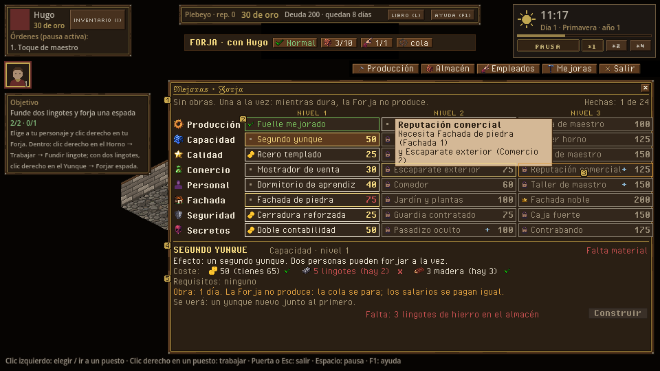
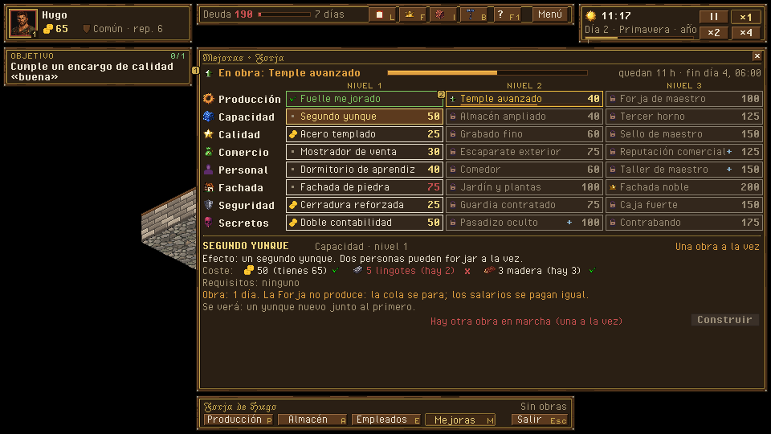
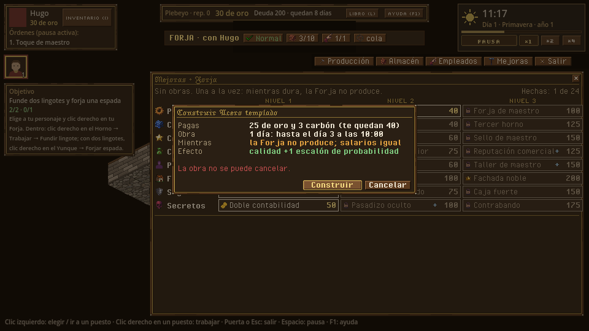

# Mejoras: árbol de mejoras del edificio

> Dueño: mecánicas-economía · Estado: borrador · Fecha: 2026-11-02
> Guía de estilo: [00_lenguaje_visual.md](../00_lenguaje_visual.md) · Zonas y reglas del HUD: [01_hud.md](../01_hud.md)

Id: `mejoras` · Panel de hoy: `game/ui/upgrade_panel.tscn` · GDD 4.8 (y 4.7.3, 4.4.2, 4.5.4 por los efectos) ·
Datos: `data/upgrades/forge/*.json`, `data/upgrade_rules.json`, `data/view.json` → `upgrades` · Convenciones:
[_comun.md](_comun.md)

## 1. Para qué sirve

24 mejoras en 8 ramas de 3 niveles. Cada una cuesta oro, materiales del almacén y días sin producir, y no se puede
cancelar. Preguntas que responde:

- **«¿Qué mejora compro ahora y qué me da, en números?»** El efecto escrito con su consecuencia.
- **«¿Me la puedo permitir?»** Oro, materiales (lo que hay en el almacén) y requisitos, con lo que falta en rojo.
- **«¿Qué pierdo mientras dura la obra?»** Días sin producir; los salarios se siguen pagando.
- **«¿Qué abre el siguiente paso?»** Niveles siguientes y prerrequisitos cruzados (Comercio 3 pide Fachada 1).

## 2. Cómo se abre y se cierra

- Botón *Mejoras* de la barra del interior, (tecla M); durante una obra, el botón lleva insignia y la barra del edificio dice «En obras».
- Enlaces de otros paneles: «Almacén ampliado → Mejoras», «Dormitorio de aprendiz → Mejoras», «Necesita *Forja de
  maestro*». Abren este panel con esa mejora elegida.
- Se cierra con X, con Esc u otro panel. No pausa.

Es el único panel de estas mecánicas que usa el **panel ancho**: vista + lateral del HUD propuesto, `[244, 58, 712, 430]`. No pisa la columna, la selección ni los avisos. Ocho filas de
nombres enteros («Dormitorio de aprendiz») no caben en 352 px. Tapa la mitad derecha del interior; comprar una mejora es un momento de gestión,
no de mirar los puestos.

## 3. Jerarquía de información

1. Arriba, la **obra en curso** (si hay) con su barra y su hora de fin.
2. La **rejilla 8×3**: icono de rama + nombre de la rama a la izquierda y, en cada casilla, el nombre de la mejora,
   su estado (icono + color) y su precio en oro.
3. El **detalle** de la casilla elegida: efecto con su consecuencia, coste con lo que hay, requisitos con ✓/✗, obra
   y lo que implica, y lo que se verá. Botón *Construir*.
4. A demanda: al pasar por una casilla, sus prerrequisitos se marcan con filete dorado en la rejilla.

## 4. Acciones y sus estados

```
 ┌ MEJORAS · Forja ─────────────────────────────────────────────────────────── [x] ┐
 │ Sin obras. Una a la vez: mientras dura, la Forja no produce.        Obras hechas 1 │
 │              NIVEL 1                 NIVEL 2                  NIVEL 3            │
 │ [i] Producción ✓ Fuelle mejorado  · Temple avanzado 40   🔒 Forja de maestro 100 │
 │ [i] Capacidad  ⦿ Segundo yunque 50  · Almacén ampliado 40  🔒 Tercer horno 125   │
 │ [i] Calidad    ⦿ Acero templado 25  🔒 Grabado fino 60   🔒 Sello de maestro 150 │
 │ [i] Comercio   · Mostrador 30       🔒 Escaparate 75     🔒 Rep. comercial 125 ⛓ │
 │ [i] Personal   · Dormitorio 40      🔒 Comedor 60        🔒 Taller maestro 150 ⛓ │
 │ [i] Fachada    · F. de piedra 75    🔒 Jardín 100        🔒 Fachada noble 200 ♛  │
 │ [i] Seguridad  ⦿ Cerradura 25       🔒 Guardia 75        🔒 Caja fuerte 150      │
 │ [i] Secretos   · Doble contab. 50   🔒 Pasadizo 100 ⛓    🔒 Contrabando 175      │
 ├──────────────────────────────────────────────────────────────────────────────────┤
 │ SEGUNDO YUNQUE · Capacidad · nivel 1                               Disponible     │
 │ Efecto: un segundo yunque. Dos personas pueden forjar a la vez.                   │
 │ Coste:  ⦿ 50 (tienes 65) ✓   ▣ 5 lingotes (hay 2) ✗   ▤ 3 madera (hay 3) ✓        │
 │ Requisitos: ninguno                                                               │
 │ Obra: 1 día. La Forja no produce: la cola se para; los salarios se pagan igual.   │
 │ Se verá: un yunque nuevo junto al primero.                                        │
 │ Falta: 3 lingotes de hierro en el almacén               [ Construir ] (apagado)   │
 └──────────────────────────────────────────────────────────────────────────────────┘
   ⦿ = se puede pagar ya · · = disponible pero falta algo · ✓ hecha · ⚒ en obra · 🔒 bloqueada
   ⛓ = prerrequisito de otra rama · ♛ = pide título
```

### Estados de una casilla

Los colores salen de `data/view.json` → `upgrades.status_colors`. Cada estado lleva además su icono.

| Estado (`status_of`) | Icono | Texto de la casilla | Motivo en el detalle |
|---|---|---|---|
| `owned` | `icon_completed` | Nombre, sin precio | «Hecha el día 4» |
| `in_works` | `icon_in_progress` + barra de 2 px | Nombre | «En obra: quedan 12 h» |
| `available` y se puede pagar | `icon_oro` | Nombre + precio | — (botón activo) |
| `missing_materials` / `not_enough_gold` | punto tenue | Nombre + precio en rojo | «Falta: 3 lingotes de hierro en el almacén» / «Te faltan 15 ⦿» |
| `busy` | punto tenue | Nombre + precio | «Hay otra obra en marcha (una a la vez)» |
| `needs_upgrade` | `icon_locked` | Nombre + precio | «Necesita *Fachada de piedra* (Fachada 1)», con enlace que la elige |
| `stat_too_low` | `icon_locked` | Nombre + precio | «Artesanía 6 (Hugo tiene 5)» |
| `title_too_low` | `icon_locked` + corona | Nombre + precio | «Título Ciudadano (eres Plebeyo) → ver requisitos» (abre *Reputación* del libro) |

### Construir

| Acción | Orden | Confirmación |
|---|---|---|
| Clic en una casilla | La elige (vista) y marca sus prerrequisitos | — |
| *Construir* | `buy_upgrade {building, upgrade}` | **Siempre**: es cara y no se cancela (decisión del manager, 2026-11-01). Caja centrada: «Segundo yunque: 50 ⦿, 5 lingotes y 3 madera. La Forja no producirá durante 1 día (hasta el día 4 · 10:00). La obra no se puede cancelar.» [*Construir*] [*Cancelar*] |

**Efecto en palabras.** Sale de `SimQuery.effect_text` y se le añade una consecuencia de vista cuando hay una cifra
que la permita:

- `production_speed ×1,2` → «la espada pasa de 3 h 54 a 3 h 15»;
- `extra_storage +10` → «el almacén pasa de 10 a 20 pilas»;
- `max_employees +1` → «2 huecos de empleado».

Son cuentas de presentación con la cifra del efecto y la duración base. No son reglas.

## 5. Estados especiales

| Estado | Qué se ve |
|---|---|
| **Obra en curso** | Franja de obra arriba en el panel, «En obras» en la barra del edificio, andamio en el mapa (hoy ya) y barra sobre el edificio. El resto de casillas disponibles dicen «una a la vez» |
| **Obra terminada** | `upgrade_done`: la casilla pasa a ✓ con destello. El aviso del libro y el efecto visual del interior (yunque nuevo) aparecen a la vez |
| **Mejora destruida** (incendio o sabotaje, EA) | La casilla vuelve a disponible con la marca «destruida el día 30». No está en el MVP; aquí solo se reserva el estado |
| **Rama Secretos** | Al elegir una de Secretos, el detalle añade en rojo: «Ilegal. Riesgo de inspección +5 %/día; si te pillan, multa y juicio». Con alguna construida, abajo sale la sección de inspecciones: riesgo diario actual, veces pillado, multas pagadas y, con *Pasadizo*, si está listo |
| **Edificio sin árbol** | El botón *Mejoras* no aparece |
| **Primera vez** | Primera apertura: globo sobre la casilla más barata que se pueda pagar: «Las mejoras paran la Forja mientras dura la obra» |

## 6. Maqueta

- Hoy (rama ui-economia): [mejoras_hoy.png](../maquetas/mejoras_hoy.png),
  [mejoras_hoy_obra.png](../maquetas/mejoras_hoy_obra.png), [mejoras_hoy_confirmar.png](../maquetas/mejoras_hoy_confirmar.png)
  y [mejoras_hoy_fachada.png](../maquetas/mejoras_hoy_fachada.png).
- Propuesta (guion `docs/ui/maquetas/src/mejoras.py`):
  - [mejoras.png](../maquetas/mejoras.png): sin obra (1), rejilla con estados (2), prerrequisitos de *Reputación comercial*
    marcados (3), detalle con coste por material (4) y obra (5);
  - [mejoras_obra.png](../maquetas/mejoras_obra.png): franja de obra en curso y «una obra a la vez»;
  - [mejoras_confirmar.png](../maquetas/mejoras_confirmar.png): confirmación.





**Piezas de kit pendientes:**
- casilla del árbol (150×20) en los 4 estados de color, con icono y precio;
- filete dorado de prerrequisito;
- iconos de rama de 16×16: `icon_rama_*` de Guild Renew, reducidos en el workbench;
- check de requisito (✓ verde y ✗ roja, 8×8).

## 7. Datos

| Lee | De dónde |
|---|---|
| Árbol | `SimQuery.upgrade_tree(sim, actor, bld)` → `Upgrades.tree_view`: `{owned, work {upgrade, progress, minutes_left}, branches: [{id, name_key, upgrades: [{id, level, status, cost {gold, items}, requires {upgrades, stat, title}, build_days, effects, visual}]}]}` |
| Obra | `SimQuery.upgrade_works(sim, bld)` |
| Lo que hay en el almacén | `Inventory.count(storage, item)` (cualquier calidad, como cobra el sim) |
| Atributo del dueño y título | `state.characters[actor].stats`, título de la familia (`Upgrades` lo lee igual) |
| Texto del efecto | `SimQuery.effect_text(catalog, effect)` |
| Inspecciones | `SimQuery.inspection_view(sim, bld)` |
| Día de fin de la obra | `work.end` → `SimQuery.minute_label` |

**Ampliación pequeña de la consulta:** que `tree_view` diga en cada mejora `owned_day` (el día en que se terminó),
para «Hecha el día 4». Hoy `upgrades` guarda el orden, no el día. Es opcional: sin ella, la casilla dice «Hecha».

**Órdenes que emite:** `buy_upgrade`.

## 8. Sonido y feedback

| Evento | Sonido | Visual |
|---|---|---|
| `upgrade_started` | **falta**: `sfx_build_start`, una sierra y un martillo | Andamio en el mapa, ficha ámbar, la casilla pasa a ⚒ |
| `upgrade_done` | `sfx_upgrade_done` | Destello en la casilla; el nodo visual aparece en el interior o el exterior |
| `inspection` (multa) | **falta**: `sfx_inspection`, golpes en la puerta | Aviso urgente; sección de inspecciones en rojo |
| Elegir casilla | `sfx_ui_click` | Filete dorado en ella y en sus prerrequisitos |

## 9. Diferencias con hoy y tareas

| Hoy | Propuesta |
|---|---|
| Panel lateral estrecho con nombres en mayúsculas de 8 px | Panel ancho con nombres legibles en la fuente de cuerpo |
| Estado solo por color del texto | Icono + color + precio por casilla |
| Coste en una línea toda roja si falta algo | Cada coste con «tienes / hay» y su ✓ / ✗ |
| Requisitos «ninguno» o lista sin estado | Lista con ✓ / ✗ y enlace a lo que falta |
| «Obra: 12 h» | Obra + qué implica (no produce, salarios igual) + hora de fin |
| Comprar sin confirmación | Confirmación con todas las cifras (no se cancela) |
| Sin ver prerrequisitos cruzados | ⛓ en la casilla y filete en los prerrequisitos |

Tareas:
1. Panel ancho = vista + lateral (que la barra del edificio y la columna sigan visibles).
2. Casilla del árbol con icono, nombre, precio y estado (pieza del kit + escena).
3. Detalle con coste por material, requisitos con ✓/✗ y enlaces, obra y consecuencia, «se verá».
4. Caja de confirmación común (la de `_comun.md`).
5. Prerrequisitos resaltados al pasar el ratón.
6. Sección de inspecciones con riesgo diario (ya existe la consulta).
7. `owned_day` en `tree_view` (opcional, en su hito).
8. `sfx_build_start` y `sfx_inspection` en `data/audio.json`.

## 10. Criterios de aceptación

- [x] Los 24 nombres se leen enteros a 960×540 sin mayúsculas forzadas.
- [x] Con 65 ⦿, 2 lingotes y 3 madera, *Segundo yunque* enseña ✓ en oro y madera y ✗ en «5 lingotes (hay 2)», y el
      motivo «Falta: 3 lingotes» junto al botón apagado.
- [x] Al pasar por *Reputación comercial*, *Fachada de piedra* se marca con filete dorado.
- [x] *Construir* siempre pide confirmación y la caja dice cuándo termina la obra.
- [x] Durante una obra, las demás casillas disponibles dicen «una a la vez».
- [x] El estado de cada casilla se distingue en una captura en escala de grises (icono, no solo color).

## Implementado (rama ui-economia, 2026-11-03)

Capturas (`--smoke-script=economia --eco=mejoras`, partida nueva con 65 de oro, 2 lingotes y 3 de madera puestos en el
estado para el caso del documento): [árbol](../maquetas/mejoras_hoy.png), [confirmación](../maquetas/mejoras_hoy_confirmar.png),
[obra en curso](../maquetas/mejoras_hoy_obra.png) y [fachada](../maquetas/mejoras_hoy_fachada.png).

- Panel ancho (712×430, zona ancha del HUD) con la franja de obra arriba («Sin obras. Una a la vez…» o «En obra: …
  quedan 12 h · termina …» con su barra) y «Obras hechas: N».
- Más visual (petición del owner): cada rama con su icono `icon_rama_*` de Guild Renew; cada casilla con la miniatura
  de lo que pone en el edificio (el sprite del mueble de `game/visuals/interiors/forge.tscn` → `Upgrades/`, el puesto
  nuevo de `Stations/` o el añadido de la fachada de `game/visuals/buildings/forge.tscn`; sin sprite, el icono de la
  rama), nombre entero (dos líneas si no cabe), precio e icono de estado (hecha, en obra con barra de 2 px, se puede
  pagar, punto si falta algo, candado, corona si pide título) y la llave si un prerrequisito es de otra rama.
- «Se verá»: una vista pequeña del interior (o de la fachada) con las mejoras hechas y la elegida encendida en dorado
  con un pulso lento, acercada a la pieza nueva (`game/ui/upgrade_preview.gd`). Así se ve qué cambia en el edificio
  antes de pagar.
- Al pasar por una casilla se encienden con filete dorado sus prerrequisitos (los de la elegida si no).
- Detalle: efecto con su consecuencia en cifras (velocidad: «Forjar armadura pasa de 6 h 30 a 5 h 25»; almacén
  «de 10 a 20 pilas»; huecos; puesto nuevo «dos personas pueden trabajar a la vez»), coste material a material con
  «(hay N)» y ✓/⚠, requisitos con su estado (clic en una mejora que falta la elige), obra con lo que implica y cuándo
  acabaría, «Falta: …» junto a *Construir*, y el aviso en rojo de la rama Secretos.
- *Construir* siempre pide confirmación con todas las cifras, la duración y el día y hora de fin.
- Durante una obra, las casillas que solo esperan a la obra dicen «una a la vez»; las que además piden otra mejora
  siguen con su candado.
- Lectura nueva en el sim: `Upgrades.mult_if` (la velocidad con la mejora, para la cuenta de la consecuencia).

Falta:
- `owned_day` («Hecha el día 4»): la casilla dice «Construida»; guardar el día pide tocar el sim (opcional en el doc).
- Destello al terminar la obra y globo de primera vez; `sfx_build_start` y `sfx_inspection` (sin créditos de audio).
- El enlace «→ ver requisitos» del título al libro (*Reputación*): el detalle dice el título que falta y el que tienes.
