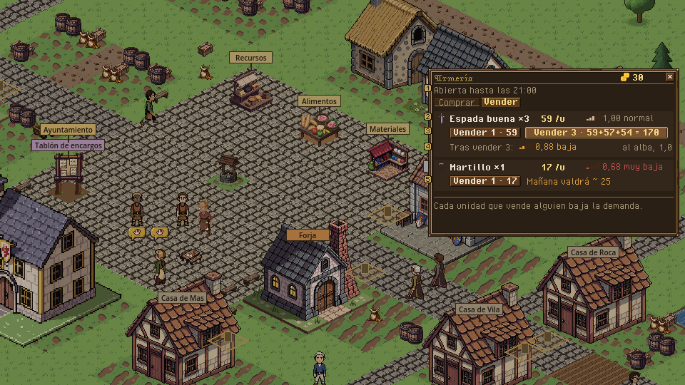
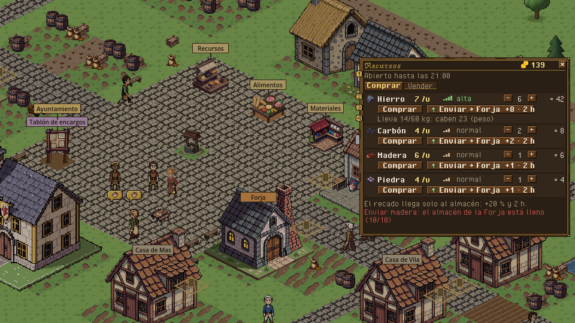
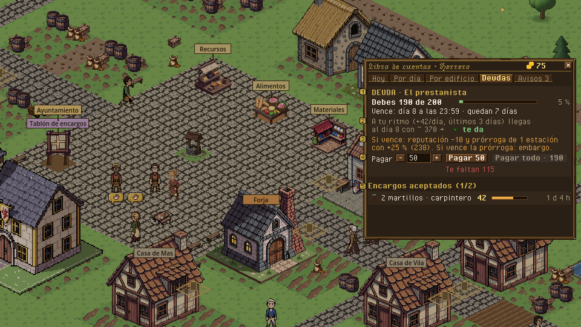
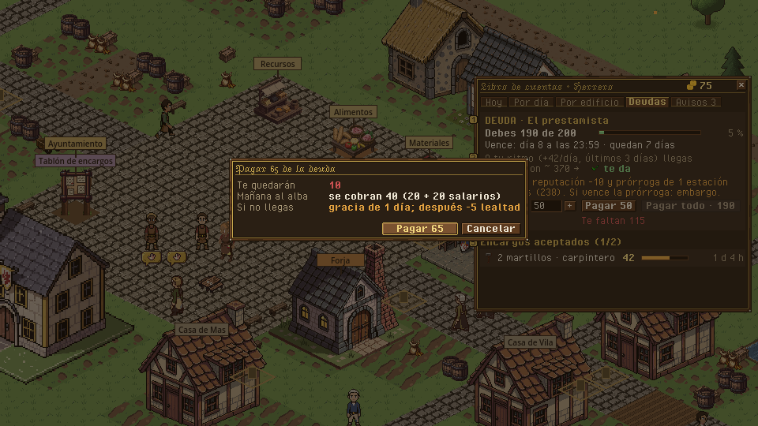

# Mercado y libro de cuentas: comprar y vender, precios y demanda, libro y deuda inicial

> Dueño: mecánicas-economía · Estado: borrador · Fecha: 2026-11-02
> Guía de estilo: [00_lenguaje_visual.md](../00_lenguaje_visual.md) · Zonas y reglas del HUD: [01_hud.md](../01_hud.md)

Id: `mercado_y_libro` · Paneles de hoy: `game/ui/market_panel.tscn`, `game/ui/ledger_panel.tscn` · GDD 4.5.1-4.5.3,
4.5.7, 4.16 (deuda), 4.18, 4.19 · Convenciones: [_comun.md](_comun.md)

## 1. Para qué sirve

El dinero es el hilo de la rebanada vertical: comprar hierro, vender espadas y devolver 200 de oro antes del día 8.
Preguntas que responde:

- **«¿A cuánto compro y vendo, y me compensa vender ahora o esperar?»** Precio y **demanda**. Cada unidad vendida
  baja la demanda 0,04 y al alba se recupera 0,4 hacia 1,0. Hoy la demanda no se ve en ningún sitio: el jugador
  vende 5 espadas y no sabe por qué la quinta vale menos.
- **«¿Me compensa el recado?»** El sobrecoste (+20 %) y cuándo llega (2 h), frente a cargar el peso.
- **«¿Gano o pierdo dinero, y en qué se me va?»** Por día y por categoría.
- **«¿Me da para pagar la deuda?»** Lo que debo, cuándo vence, qué pasa si no pago y, a mi ritmo, cómo llego.

## 2. Cómo se abre y se cierra

| Qué | Abrir | Cerrar | Pausa |
|---|---|---|---|
| Panel de puesto o tienda | Al llegar el personaje al puesto (clic derecho en el puesto) o, en la Armería, clic derecho en el mostrador | X, Esc, o si el personaje se aleja (`Market.stall_at`) | No |
| Libro de cuentas | Tecla L, botón *Libro (L)* del HUD, ficha de deuda del HUD (abre *Deudas*), clic en un aviso emergente (abre *Avisos*) | L, X, Esc u otro panel | No |

## 3. Jerarquía de información

**Puesto:**
1. Cabecera: nombre del puesto, si está abierto y hasta qué hora, y el oro de la familia.
2. Filas: icono, nombre, precio por unidad, **indicador de demanda**, cantidad, total, acción.
3. A demanda (tooltip): demanda exacta (0,82), cuánto se recupera al alba, qué receta lo usa o lo produce.

**Libro:**
1. *Hoy*: el neto del día en grande y las categorías en barras.
2. *Deudas y encargos*: lo que vence, con su cuenta atrás.
3. El resto de pestañas a demanda: *Por día*, *Por edificio*, *Avisos*, *Reputación* (esta la diseña el worker social
   en `titulos_y_reputacion.md`).

## 4. Acciones y sus estados

### 4.1 Puesto: pestaña Comprar

```
 ┌ RECURSOS · abierto hasta las 21:00 ────── 139 ⦿ ─ [x] ┐
 │ [■ Comprar] [Vender]                                    │
 │ ▪ Hierro      7 ⦿/u  demanda ▃▄▅ alta   [-] 6 [+]  = 42 │
 │               [ Comprar ]  [ Enviar → Forja  +8 · 2 h ] │
 │               Lleva 14/60 kg: caben 23                  │  límite por peso y oro
 │ ◆ Carbón      4 ⦿/u  demanda ▃ normal   [-] 2 [+]  = 8  │
 │               [ Comprar ]  [ Enviar → Forja  +2 · 2 h ] │
 │ ▤ Madera      6 ⦿/u  demanda ▃ normal   [-] 1 [+]  = 6  │
 │               [ Comprar ]  [ Enviar → Forja  +1 · 2 h ] │
 │ ...                                                     │
 ├─────────────────────────────────────────────────────────┤
 │ El recado llega solo al almacén: +20 % y 2 h.           │  ayuda fija
 └─────────────────────────────────────────────────────────┘
```

| Elemento | Normal | Deshabilitado (motivo visible) | Orden |
|---|---|---|---|
| Cantidad −/+ | De 1 a `max_qty` (oro y peso) | + deshabilitado en `max_qty`; la línea dice qué limita: «caben 23 (peso)» u «oro para 19» | — |
| *Comprar* | Compra la cantidad | `not_enough_gold`: «Te faltan 12 ⦿» · `too_heavy`: «Pesa 12 kg y te quedan 4» · `market_closed` | `buy {stall, item, quality, qty}` |
| *Enviar → Forja* | Recado al único edificio propio; con 2 o más, *Enviar a… ▾* con la lista | `storage_full`: «El almacén de la Forja no tiene hueco (10/10)» · `not_enough_gold` con el sobrecoste incluido | `buy {…, deliver_to: bld}` |

El botón del recado lleva el **sobrecoste en oro** y el **tiempo** escritos. Hoy dice «ENVIAR A…» y se corta.

### 4.2 Puesto: pestaña Vender

```
 ┌ ARMERÍA · abierta hasta las 21:00 ──────── 30 ⦿ ─ [x] ┐
 │ [Comprar] [■ Vender]                                    │
 │ ⚔• Espada buena ×3     59 ⦿/u   demanda ▃▄ 1,00 normal  │
 │    [ Vender 1 · 59 ]  [ Vender 3 · 59+57+54 = 170 ]     │  precio unidad a unidad
 │    Tras vender 3: demanda 0,88 ▂  · al alba vuelve a 1,0 │  efecto en la demanda
 │ ⚒ Martillo ×1          17 ⦿/u   demanda ▁ 0,68 muy baja │
 │    [ Vender 1 · 17 ]                                    │
 │    Baja: mañana valdrá ~ 25                             │  si la demanda < 0,9
 ├─────────────────────────────────────────────────────────┤
 │ Cada unidad que vende alguien baja la demanda.          │  ayuda fija
 └─────────────────────────────────────────────────────────┘
```

| Elemento | Normal | Deshabilitado / especial | Orden |
|---|---|---|---|
| *Vender 1* | Vende 1 al precio de la fila | `market_closed`, `not_at_stall` | `sell {stall, item, quality, qty: 1}` |
| *Vender todo* | Vende todo; el botón dice la suma unidad a unidad | Igual | `sell {…, qty: todo}` |
| Línea «Tras vender» | Demanda que quedará y que se recupera al alba | Solo si se vende más de 1 | — |
| Línea «mañana valdrá» | Con demanda < 0,9: el precio tras la recuperación del alba | — | — |

**Indicador de demanda**: 5 escalones, con palabra y número. La palabra se lee de un vistazo; el número es para
quien echa cuentas.

| Demanda | Escalones | Palabra | Color |
|---|---|---|---|
| < 0,7 | ▁ | muy baja | `#c85050` |
| 0,7-0,9 | ▂ | baja | ámbar |
| 0,9-1,1 | ▃ | normal | `#d4b896` |
| 1,1-1,5 | ▄ | alta | `#7ec87e` |
| > 1,5 | ▅ | muy alta | `#7ec87e` |

Los cortes son de vista (`data/view.json`), no reglas del juego.

### 4.3 Libro de cuentas

Pestañas: **Hoy · Por día · Por edificio · Deudas y encargos · Avisos · Reputación**. Son las de hoy; se mantienen.

```
 ┌ LIBRO DE CUENTAS · Herrero ──────────────── 75 ⦿ ─ [x] ┐
 │ [Hoy][Por día][Por edificio][■ Deudas y encargos][Avisos (3)][Rep.] │
 │ ┌ DEUDA · El prestamista ──────────────────────────────┐ │
 │ │ Debes 190 de 200   ██████████████████████░░  5 % pagado│ │
 │ │ Vence: día 8 a las 23:59 · quedan 7 días             │ │
 │ │ A tu ritmo (+42 ⦿/día, últimos 3 días) llegas al      │ │  previsión
 │ │ día 8 con ~ 370 ⦿  →  te da  ✓                        │ │  verde si da, rojo si no
 │ │ Si vence: reputación −10 y prórroga de 1 estación     │ │
 │ │ con +25 % (238). Si vence la prórroga: embargo.       │ │
 │ │ Pagar [-] 50 [+]  [ Pagar 50 ]  [ Pagar todo · 190 ]  │ │
 │ └──────────────────────────────────────────────────────┘ │
 │ ENCARGOS ACEPTADOS (1/2)                                 │
 │ ⚒ 2 martillos · carpintero · 42 ⦿   ██████░░ quedan 1 d 4 h │
 └──────────────────────────────────────────────────────────┘
```

| Acción | Orden | Estados y confirmación |
|---|---|---|
| Elegir importe | — | De 1 a `min(oro, pendiente)`; los botones −/+ van de 10 en 10 |
| *Pagar N* | `repay_loan {loan, amount}` | `not_enough_gold`: «Tienes 75». **Confirmación** si deja el oro por debajo de lo que se cobra mañana al alba: «Te quedarán 10 ⦿. Mañana se cobran 20 de mantenimiento y 20 de salarios» |
| *Pagar todo* | `repay_loan {amount: pendiente}` | Deshabilitado si no alcanza, con «Te faltan 115» |
| Clic en un encargo | Centra la cámara en el tablón (vista) | — |

**Hoy** (neto en grande y categorías):

```
 │ Hoy, día 2           +42 ⦿                            │  neto en grande, verde o rojo
 │ ▲ Ventas en el mercado   +170  ██████████████          │
 │ ▲ Encargos               +42   ████                    │
 │ ▼ Compras               −121   ██████████              │
 │ ▼ Recados                −11   █                       │
 │ ▼ Mantenimiento          −20   ██                      │
 │ ▼ Salarios               −20   ██                      │
```

**Por día:** 8 barras del neto (verde arriba y rojo abajo de la línea cero), con ingresos y gastos al pasar el
ratón. Debajo, «media de los 8 días: +38/día». **Por edificio:** tabla edificio × categoría con su neto (útil desde
el segundo negocio, H6). **Avisos:** lista con icono de gravedad (info, aviso, urgente), día y hora, texto y destino.
Clic en un aviso → centra o abre su panel (hoy ya). Filtros arriba: *Todos · Urgentes · Sin leer*.

## 5. Estados especiales

| Estado | Qué se ve |
|---|---|
| **Mercado cerrado** (amanecer y noche) | El panel no se abre. Sobre el puesto, la placa «Cerrado · abre a las 07:00» (hoy ya hay un texto parecido). En la Armería no se puede entrar (`shop_closed`) |
| **No estás en el puesto** | El panel se cierra solo si el personaje se aleja (hoy ya) |
| **Nada que vender** | Pestaña *Vender*: «No llevas nada que se venda aquí. La Armería compra espadas, martillos y armaduras». Lista **qué** compra |
| **Primera venta** | Globo sobre el indicador de demanda la primera vez que baja de escalón: «Cada venta baja la demanda; al alba se recupera» |
| **Deuda a 2 días y a 1 día** | Aviso urgente (hoy ya). La ficha de deuda del HUD pasa a ámbar (≤ 3 días) y a rojo (≤ 1 día). La ficha es del kit; aquí se pide el umbral |
| **Deuda vencida (prórroga)** | La tarjeta en rojo: «En prórroga: debes 238 · embargo el día 10». El texto del embargo enumera lo que se llevaría: «el oro y después la mercancía del almacén» |
| **Deuda pagada** | La tarjeta pasa a «Pagada el día 6 ✓» y se mueve al final; el objetivo 6 se cumple (hoy ya) |
| **Ruina** (D18) | Pantalla de final; no es de este documento (kit: fin de partida) |
| **Mantenimiento impagado** (D15 b) | En *Deudas*, una tarjeta más: «Mantenimiento atrasado de la Forja: 40 ⦿ · 2 días · al 3.º, dañada». Se cobra solo en cuanto hay oro, así que no tiene botón de pagar |
| **Libro vacío** (día 1, antes de nada) | *Hoy*: «Aún no has movido oro hoy». *Por día*: la barra del día 1 sola |

## 6. Maqueta

- Hoy: [mercado_y_libro_hoy_puesto.png](../maquetas/mercado_y_libro_hoy_puesto.png) (sin demanda; «ENVIAR A…»
  cortado), [mercado_y_libro_hoy_armeria.png](../maquetas/mercado_y_libro_hoy_armeria.png) (una fila, sin el precio
  de vender todo) y [mercado_y_libro_hoy_deuda.png](../maquetas/mercado_y_libro_hoy_deuda.png) (deuda en una línea,
  sin plazo visual, sin consecuencias ni previsión).
- Propuesta (guion `docs/ui/maquetas/src/mercado_y_libro.py`):
  - [mercado_y_libro.png](../maquetas/mercado_y_libro.png): Armería, *Vender*, con demanda (2), suma unidad a unidad (3),
    demanda tras vender (4) y «mañana valdrá» (5);
  - [mercado_y_libro_recado.png](../maquetas/mercado_y_libro_recado.png): Recursos, *Comprar*, con demanda (2), botón de
    recado con coste y tiempo (3) y lo que limita la cantidad (4);
  - [mercado_y_libro_deuda.png](../maquetas/mercado_y_libro_deuda.png): libro, *Deudas*, con la tarjeta de la deuda (1-4) y
    los encargos (5);
  - [mercado_y_libro_confirmar.png](../maquetas/mercado_y_libro_confirmar.png): confirmación de un pago que deja el oro por
    debajo del cobro del alba.






**Piezas de kit pendientes:**
- indicador de demanda de 5 escalones (20×8);
- barra de progreso de pago;
- gráfico de 8 barras con eje cero (dibujo dinámico; el kit da colores y grosor);
- tarjeta con cabecera (deuda, mantenimiento atrasado);
- chip de filtro (*Todos · Urgentes · Sin leer*);
- icono de recado (carro de 16 px; en Guild Renew no hay, se deriva de `assets/sprites/props/cart` en el
  workbench).

## 7. Datos

| Lee | De dónde |
|---|---|
| Ofertas del puesto | `SimQuery.market_offers(sim, actor, stall)` → `{open, reason, buy: [{item, quality, price, max_qty, status}], sell: [{item, quality, qty, price}], deliver_to}` |
| Demanda | `Market.demand(sim, item)` y `catalog.market.demand` (`recover_per_day`, `rest`) |
| Hora de cierre y apertura | `catalog.market.open_phases` + `Clock`; `SimQuery.market_opens_text` |
| Sobrecoste y tiempo del recado | `Market.errand_surcharge(sim, cost)`, `Market.errand_minutes(sim)` |
| Libro | `Ledger.summary(sim, fam, "today" / "days" / "buildings" / "debts")` |
| Deuda | `Loans.status(sim, id)` → `{principal, outstanding, due_minute, extended, state, days_left}` + los términos (`overdue_reputation`, `extension_surcharge`, `extension_seasons`) |
| Avisos | `state.notices` vía `SimQuery.notice_text` |

**Consultas nuevas** (en su hito, con prueba):
- `Market.sell_preview(sim, actor, stall, item, quality, qty)` → `{prices: [int], total, demand_after}`. La regla
  unidad a unidad vive en `order_sell`; la vista no la repite.
- `Market.demand_tomorrow(sim, item)`: la demanda tras la recuperación del alba (para «mañana valdrá»).
- `Ledger.forecast(sim, fam, until_minute)` → `{avg_net, days, gold_at}`. Es la media del neto de los últimos 3
  días por los días que quedan, más el oro de ahora. Es una estimación de vista, pero se pide al sim para que
  bots y UI la calculen igual.
- `Upkeep.due_next_dawn(sim, fam)` → mantenimiento + salarios que se cobrarán al alba (para la confirmación de
  pago).

**Órdenes que emite:** `buy`, `sell`, `repay_loan`, `read_notices`.

## 8. Sonido y feedback

| Evento | Sonido | Visual |
|---|---|---|
| Abrir el puesto | `voice_market_vendor` (`panel_open_by`) | — |
| `market_bought` | `sfx_coins` + `voice_market_deal` | Oro del HUD baja con «−42» flotando |
| `market_sold` | `sfx_sale` | Oro sube con «+170»; el indicador de demanda baja de escalón con un parpadeo |
| `demand_changed` | — | El indicador se actualiza en vivo |
| `errand_sent` / `errand_arrived` | **falta** `sfx_delivery` (compartido con el almacén) | Carro pequeño en la placa del almacén hasta que llega |
| `loan_payment` | `sfx_coins` | La barra de pago avanza |
| `loan_repaid` | **falta**: `sfx_loan_repaid`, fanfarria corta, más que `sfx_objective_done` | Sello «Pagada» sobre la tarjeta |
| `notice.loan_*` urgente | `sfx_alarm` | Aviso emergente (kit) |

## 9. Diferencias con hoy y tareas

| Hoy | Propuesta |
|---|---|
| Sin demanda visible | Indicador de 5 escalones con palabra y número en cada fila |
| *Vender todo* sin saber cuánto da | El botón dice la suma unidad a unidad; línea «tras vender» |
| «ENVIAR A…» cortado, sin coste | «Enviar → Forja +8 · 2 h» |
| Límite de cantidad sin explicar | «caben 23 (peso)» / «oro para 19» |
| Sin hora de cierre en el panel | «abierto hasta las 21:00» en la cabecera |
| Deuda en una línea con un campo y *Pagar* | Tarjeta con barra, plazo, consecuencias, previsión y confirmación |
| Libro: tablas de texto | Neto en grande, barras por categoría, gráfico de 8 días |
| Avisos sin filtro | Filtros y contador de no leídos en la pestaña |

Tareas:
1. Pieza de demanda + cortes en `data/view.json`.
2. `MarketPanel`: cabecera con horario, filas con demanda, botón de recado con coste y tiempo, línea de límite.
3. *Vender*: suma unidad a unidad y línea «tras vender» (cuando el sim tenga `sell_preview`).
4. Consultas `sell_preview`, `demand_tomorrow`, `forecast`, `due_next_dawn` en el sim, con pruebas.
5. `LedgerPanel` *Deudas*: tarjeta de deuda con previsión y confirmación de pago; tarjeta de mantenimiento atrasado.
6. *Hoy* y *Por día* con barras (dibujo dinámico de la vista).
7. *Avisos* con filtros y contador.
8. Umbrales de color de la ficha de deuda del HUD (al kit).
9. `sfx_delivery` y `sfx_loan_repaid` en `data/audio.json`.

## 10. Criterios de aceptación

- [ ] En la Armería, con 3 espadas buenas y demanda 1,0, el botón de vender todo dice «59+57+54 = 170» y, tras
      vender, la fila enseña demanda 0,88 «baja».
- [ ] La demanda de cada objeto se ve sin pasar el ratón, con palabra y número.
- [ ] El botón de recado dice el sobrecoste en oro y «2 h»; con el almacén lleno, se ve deshabilitado con el
      motivo escrito.
- [ ] La tarjeta de la deuda dice cuánto se debe, cuándo vence, qué pasa si vence y la previsión «te da / no te
      da».
- [ ] Pagar dejando menos oro que el cobro del alba pide confirmación con las cifras.
- [ ] La ficha de deuda del HUD cambia a ámbar con 3 días y a rojo con 1.
- [ ] *Por día* enseña 8 barras con la línea cero; un día de pérdidas va en rojo, por debajo.
- [ ] A 960×540, la fila de compra con los dos botones no se corta («Enviar → Forja +8 · 2 h» entero).
