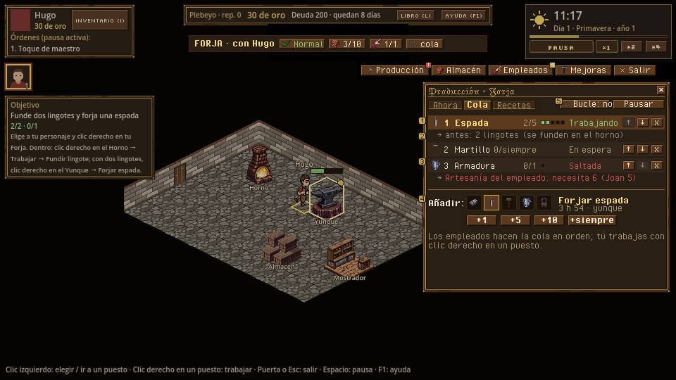
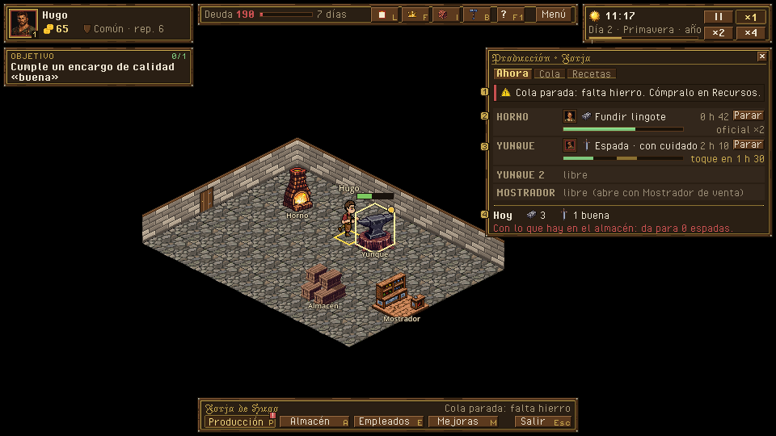

# Producción: panel de producción, cola, recetas y tiempos

> Dueño: mecánicas-economía · Estado: borrador · Fecha: 2026-11-02
> Guía de estilo: [00_lenguaje_visual.md](../00_lenguaje_visual.md) · Zonas y reglas del HUD: [01_hud.md](../01_hud.md)

Id: `produccion` · Panel de hoy: `game/ui/production_panel.tscn` · GDD 4.4.1, 4.4.3, 4.7.4 · Convenciones:
[_comun.md](_comun.md)

## 1. Para qué sirve

Es el panel de los empleados: el jugador no les da órdenes una a una, define **qué quiere producir** (GDD 4.7.4).
Responde a:

- **«¿Qué se está fabricando y cuánto falta?»** Puesto por puesto: quién, qué, cuánto lleva y cuánto le queda.
- **«¿Por qué está parado?»** El motivo de cada entrada saltada y el aviso general, con el arreglo a un clic.
- **«¿Qué necesito para hacer una espada, y cuánto tarda con mi gente?»** La cadena hierro → lingote → espada y la
  duración real según quién la haga.
- **«¿Cuánto saldrá de aquí al final del día?»** Una estimación sencilla con lo que hay en el almacén.

## 2. Cómo se abre y se cierra

- Botón *Producción* de la barra del interior, la línea de estado de la barra del edificio, o clic en un aviso de la
  cola en el libro (abre el interior en gestión con este panel).
- Desde el mapa: ficha del edificio → *Gestionar* → abre el interior con *Producción*.
- Se cierra con X, con Esc o abriendo otro panel lateral. No pausa.

## 3. Jerarquía de información

Tres pestañas en el panel lateral (352×420): **Ahora** (por defecto) · **Cola** · **Recetas**.

1. **Primero, «Ahora»:** una fila por puesto con retrato de quien trabaja, receta, barra con el tramo del toque (si
   es el jugador con cuidado), tiempo que falta y estado. Arriba del todo, si la cola está parada, la **franja roja
   con el motivo** y su arreglo.
2. **Segundo, «Cola»:** las entradas con su cantidad, progreso, estado y, en gris, las dependencias que se harán
   antes («2 lingotes se funden antes»). Abajo, el selector de recetas y +1 / +5 / +10 / ∞.
3. **A demanda, «Recetas»:** la cadena del edificio y cada receta con entradas, duración por persona, Artesanía
   mínima y calidad esperada.

## 4. Acciones y sus estados

### 4.1 Pestaña «Ahora»

```
 ┌ PRODUCCIÓN · Forja ─────────────────────────── [x] ┐
 │ [Ahora] [Cola] [Recetas]                           │
 │ ┌────────────────────────────────────────────────┐ │
 │ │ ⚠ Cola parada: falta hierro. Compra en Recursos │ │  franja roja (solo si stalled)
 │ └────────────────────────────────────────────────┘ │
 │ HORNO   [☺Joan] ▣ Fundir lingote      ▶ 0 h 42 [■]│  fila de puesto
 │         ████████████░░░░░░░░░  60 %  oficial ×2    │
 │ YUNQUE  [☺Hugo] ⚔ Espada · con cuidado ▶ 2 h 10 [■]│
 │         █████▓▓▓░░░░░░░░░░░░░  25 %  toque 1 h 30  │  tramo dorado = ventana
 │ YUNQUE 2  —  libre                                 │
 │ MOSTRADOR [☺Joan] atiende a un cliente             │  (H7)
 │────────────────────────────────────────────────────│
 │ Hoy: 3 lingotes · 1 espada buena                   │  lo terminado desde el alba
 │ Al alba: 5 hierro, 2 carbón → da para 2 espadas    │  con lo que hay en el almacén
 └────────────────────────────────────────────────────┘
```

| Elemento | Estados | Orden |
|---|---|---|
| Fila de puesto | Trabajando (barra verde) · Libre · Parado (`icon_warning` + motivo: «Almacén lleno») · En obras · Noche (empleados en casa) | — |
| Retrato | 16×16 de quien trabaja; tooltip con rango, velocidad y eficiencia | — |
| Parar `[■]` | Visible si hay trabajo. Tooltip: «Se devuelven: 2 hierro» (D11) | `stop_work {actor}` |
| Franja de cola parada | Motivo + arreglo: «falta hierro» → *Comprar en Recursos* (texto: el jugador tiene que ir, no hay orden a distancia); «nadie puede» → *Empleados*; «almacén lleno» → *Almacén* | Abre el panel |
| «Hoy» | Unidades terminadas desde el alba en este edificio, por calidad | — |
| «Al alba / Ahora da para» | Cuántas unidades de la primera entrada de la cola se pueden hacer con lo que hay | — |

### 4.2 Pestaña «Cola»

```
 ┌ PRODUCCIÓN · Forja ─────────────────────────── [x] ┐
 │ [Ahora] [Cola] [Recetas]      (⟳ Bucle: no) (⏸ Pausar)│
 │ 1 ⚔ Espada              2/5   ●●○○○   Trabajando ▲▼x│
 │     └ antes: 2 lingotes (se funden en el horno)     │  dependencia, en gris
 │ 2 ⚒ Martillo            0/∞           En espera  ▲▼x│
 │ 3 ▤ Armadura            0/1   Saltada: Artesanía ▲▼x│  motivo en rojo
 │                                del empleado (6)     │
 │────────────────────────────────────────────────────│
 │ Añadir:  [▣][⚔][⚒][▤][🔒]   ⚔ Forjar espada 3 h 54  │  rejilla de recetas (iconos)
 │          [+1] [+5] [+10] [+∞]                       │
 │ Los empleados hacen la cola en orden; tú trabajas   │  ayuda de una línea
 │ con clic derecho en un puesto.                      │
 └────────────────────────────────────────────────────┘
```

| Elemento | Normal | Deshabilitado / especial | Orden |
|---|---|---|---|
| Entrada | Icono, nombre, `hechas/total` (∞ si −1), pips de progreso | `status`: Trabajando · En espera · Saltada + motivo (`missing_inputs`, `storage_full`, `skill_too_low`, `needs_upgrade`, `no_worker`) | — |
| ▲ ▼ | Mueve una posición | ▲ deshabilitado en la primera, ▼ en la última | `queue_move {entry, to}` |
| x | Quita la entrada; tooltip «El ciclo en marcha termina igual» | — | `queue_remove {entry}` |
| Rejilla de recetas | Una casilla de 20×20 por receta del edificio; la elegida con filete dorado; nombre y duración al lado | Bloqueada con `icon_locked` (sigue elegible: la cola la salta con su motivo, como hoy) | — |
| +1 / +5 / +10 / +∞ | Añade la elegida | — | `queue_add {recipe, qty}` |
| Bucle | Interruptor con estado escrito («Bucle: sí/no») | — | `queue_loop {on}` |
| Pausar | Interruptor; con la cola en pausa, la pestaña y el botón de la barra llevan `⏸` | — | `queue_pause {on}` |

Las dependencias (GDD 4.7.4: «primero se funden los lingotes de *esa* espada») se pintan bajo la entrada como una
sublínea gris. Es lo que hoy no se entiende: el jugador pone «Espada ×5» y ve al empleado en el horno sin saber por
qué.

### 4.3 Pestaña «Recetas»

```
 ┌ PRODUCCIÓN · Forja ─────────────────────────── [x] ┐
 │ [Ahora] [Cola] [Recetas]                           │
 │  hierro ×2 ──horno──▶ lingote ──yunque──▶ espada   │  cadena del edificio
 │                ▲ carbón                 ▲ carbón   │
 │────────────────────────────────────────────────────│
 │ ⚔ Forjar espada   yunque · Artesanía 4             │
 │   ▣ lingote ×2  ◆ carbón ×1  →  ⚔ espada ×1        │
 │   Tú: 3 h 54 · Oficial: 1 h 57 · Aprendiz: 3 h 54  │  duración real por quien la haga
 │   Calidad (tú): 20 · 50 · 30 %                      │
 │   Vale hoy: 59 en la Armería (demanda 0,9)         │  precio de venta actual
 │ ▣ Fundir lingote  horno · Artesanía 1 ...           │
 └────────────────────────────────────────────────────┘
```

Solo lectura. El precio de venta del día responde «¿qué me conviene fabricar?» sin decidir por el jugador. El
coste de las entradas va en el mercado (ver [mercado_y_libro.md](mercado_y_libro.md)).

## 5. Estados especiales

| Estado | Qué se ve |
|---|---|
| **Sin empleados** | «Ahora» normal (el jugador). «Cola» con la franja: «La cola la trabajan los empleados. Aún no tienes ninguno → *Empleados*». La cola se puede preparar igual |
| **Empleado contratado que empieza mañana** | En «Ahora», fila gris: «Joan empieza el día 3 al alba» |
| **Cola vacía** | «Cola» con «Añade lo que quieres que fabriquen» y la rejilla resaltada. Si hay empleados, `icon_idle` sobre el edificio en el mapa (hoy ya) |
| **Cola parada** (`stalled`) | Franja roja arriba en ambas pestañas, insignia `!` en el botón *Producción*, aviso en el libro |
| **Noche** | «Los empleados vuelven al alba (05:00)» en lugar de sus filas; el jugador puede seguir |
| **En obras** | Franja ámbar «En obras: no se produce hasta el día 3 · 06:00». La cola se puede editar |
| **Receta nueva por mejora** (acero) | En la rejilla, la casilla nueva con un brillo hasta abrirla una vez |
| **Primera vez** | La primera vez que se abre con un empleado: globo en la rejilla «Elige qué fabricar y cuántos» |

## 6. Maqueta

- Hoy (rama ui-economia, `--smoke-script=economia --eco=produccion`): [produccion_hoy_ahora.png](../maquetas/produccion_hoy_ahora.png),
  [produccion_hoy_cola.png](../maquetas/produccion_hoy_cola.png) y [produccion_hoy_recetas.png](../maquetas/produccion_hoy_recetas.png).
- Propuesta (guion `docs/ui/maquetas/src/produccion.py`):
  - [produccion.png](../maquetas/produccion.png): pestaña *Cola*, con una entrada trabajando y su dependencia (1, 2), una
    saltada con su motivo (3), la rejilla de recetas con +1 / +5 / +10 / +siempre (4) y los interruptores (5);
  - [produccion_ahora.png](../maquetas/produccion_ahora.png): pestaña *Ahora*, con la franja de cola parada (1), los puestos
    con quién y su barra (2, 3) y el resumen del día (4).
- La fuente de hoy no tiene `∞`, `▲` ni `▼`. En la maqueta van «siempre», `↑` y `↓`, y queda como pieza de kit
  pendiente: el glifo `∞` o la palabra.




**Piezas de kit pendientes:**
- fila de puesto (retrato 16 + icono + barra);
- pips de progreso;
- franja de aviso (roja y ámbar);
- rejilla de recetas de 20×20 con estado elegido y bloqueado;
- interruptor con estado escrito;
- flecha de la cadena (`──▶` con etiqueta).

## 7. Datos

| Lee | De dónde |
|---|---|
| Puestos del edificio | `catalog.buildings()[type].zones` + los de mejoras (`Upgrades`, `new_zone`) |
| Trabajo de cada puesto | `SimQuery.job_view(sim, bld, zone)` |
| Cola | `SimQuery.queue_view(sim, bld)` → `{entries: [{id, recipe, qty, done, status}], loop, paused, stalled}` |
| Empleados ociosos | `SimQuery.idle_employees(sim, bld)` |
| Recetas del edificio | `SimQuery.building_recipes(state, catalog, bld)` |
| Duración por persona | `Production.owner_cycle_minutes` (dueño) y `Production.employee_cycle_minutes` (empleado por rango) |
| Calidad | `Production.quality_chances` (ver [forja_interior.md](forja_interior.md)) |
| Precio de venta | `Market.price(sim, item, quality, "sell")` y `Market.demand(sim, item)` |

**Consultas nuevas que hacen falta** (en el hito que lo implemente):
- `WorkQueue.view` con, por entrada, `deps: [{recipe, qty}]`: los intermedios que va a hacer para la unidad
  siguiente. Hoy la resolución por dependencias es interna (`_assign`) y la vista no la ve.
- `Production.done_today(sim, bld)` → `{item: {quality: qty}}`: lo terminado desde el alba. Puede salir de los
  eventos `work_done` del día si se guardan en el estado (si no, se cuenta en la vista y se pierde al cargar;
  aceptable para un indicador).
- «Da para N»: cuántas unidades permite el almacén para la primera entrada. Es la misma cuenta que hace la cola: se
  pide al sim (`WorkQueue.can_make(sim, bld, recipe)`) para que la UI no la repita.

**Órdenes que emite:** `queue_add`, `queue_remove`, `queue_move`, `queue_loop`, `queue_pause`, `stop_work`. La firma
es como hoy: el personaje elegido si es de la familia del edificio; si no, el primer miembro.

## 8. Sonido y feedback

| Evento | Sonido | Visual |
|---|---|---|
| `queue_changed` (añadir, mover, quitar) | `sfx_ui_click` | La entrada nueva entra con un parpadeo dorado |
| `queue_entry_done` | **falta**: `sfx_queue_done`, más suave que `sfx_contract_done` | Pips llenos y la entrada sale (sin bucle) |
| `queue_entry_blocked` | `sfx_notice` (vía `notice_added.warning`) | Motivo en rojo en la entrada |
| `queue_stalled` | `sfx_notice` | Franja roja + insignia `!` |
| `employee_idle` | — | `icon_idle` sobre el edificio (mapa) y sobre el empleado (interior) |
| `work_done` | `sfx_hammer` | «+1» en la fila del puesto |

## 9. Diferencias con hoy y tareas

| Hoy | Propuesta |
|---|---|
| Puestos en texto plano «Horno: libre» | Filas con retrato, receta, barra, tiempo, estado y *Parar* |
| Entrada sin estado claro (solo el aviso si se salta) | Estado siempre visible, motivo en rojo, dependencias en gris |
| Desplegable de recetas | Rejilla de iconos con la elegida y su duración |
| Bucle y Pausa como botones sin estado escrito | Interruptores con «sí/no» y símbolo en la pestaña |
| Sin cadena ni duraciones por rango | Pestaña «Recetas» con cadena, duraciones por quien la haga y precio del día |
| Sin «lo hecho hoy» | Resumen del día y «da para N» |

Tareas:
1. Pestañas en `ProductionPanel` (Ahora / Cola / Recetas) dentro del panel lateral de 352×420.
2. Fila de puesto con retrato y barra (reutiliza la barra con tramo de `forja_interior`).
3. Estado y motivo por entrada; sublínea de dependencias (cuando el sim dé `deps`).
4. Rejilla de recetas en lugar del `OptionButton`.
5. Franja de cola parada con enlace al panel que lo arregla; insignia en la barra del interior.
6. Pestaña «Recetas» (solo lectura).
7. Consultas `deps`, `done_today` y `can_make` en el sim, con pruebas, en su hito.
8. `sfx_queue_done` en `data/audio.json`.

## 10. Criterios de aceptación

- [ ] Con Joan en el horno fundiendo para una espada de la cola, la entrada «Espada» dice «antes: 2 lingotes».
- [x] Sin hierro en el almacén, las dos pestañas enseñan «Cola parada: falta hierro» sin pasar el ratón, y la
      barra del interior lleva `!`.
- [x] La pestaña «Recetas» da la misma duración que tarda de verdad un oficial (comprobado con un ciclo a ×4).
- [x] Bucle y Pausa dicen su estado con palabras.
- [x] Añadir «Espada ×5» son 2 clics (receta + «+5»).
- [x] Ninguna fila se corta a 960×540 con 3 puestos, 5 entradas y la franja de aviso a la vez (la lista de la cola
      hace scroll; la rejilla y los botones de añadir quedan fijos abajo).

## Implementado (rama ui-economia, 2026-11-03)

- Pestañas *Ahora · Cola · Recetas* en la zona 5. *Ahora*: fila por puesto con quién, receta, modo, barra con el tramo
  del toque, tiempo que falta y *Parar*; «da para N» (`WorkQueue.can_make`, lectura nueva). *Cola*: entradas con icono,
  `hechas/total`, barra, estado en palabras (en curso, en espera, saltada: motivo), ↑ ↓ x; *Bucle: sí/no* y *Pausa:
  sí/no*; rejilla de recetas fija abajo con la elegida, su duración y +1 / +5 / +10 / +siempre. *Recetas*: cadena del
  edificio, entradas → salida, duración para ti y por rango (`Production.rank_cycle_minutes`, lectura nueva), calidad y
  precio de hoy. Franja roja de cola parada en *Ahora* y *Cola* con el panel que lo arregla.

Falta (el sim no lo da y es más que una lectura):
- Dependencias por entrada («antes: 2 lingotes»): la resolución es interna de `WorkQueue._assign`; hace falta `deps` en
  la vista, en su hito.
- «Hoy: 3 lingotes · 1 espada buena»: el estado no guarda lo terminado en el día (`done_today`).
- `sfx_queue_done`: sin créditos de audio en esta fase.
- «Joan empieza el día 3» y el brillo de la receta nueva por mejora: sin hacer.
