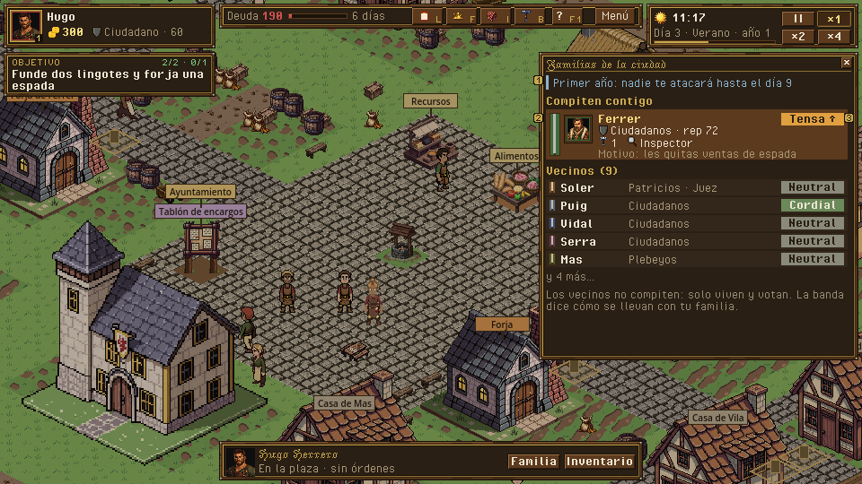
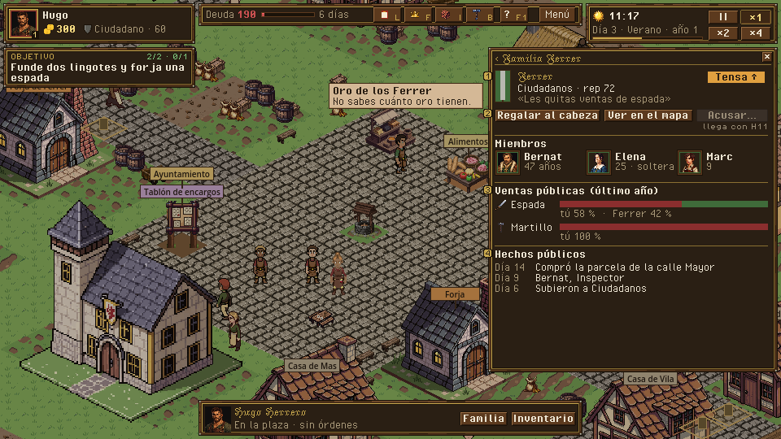
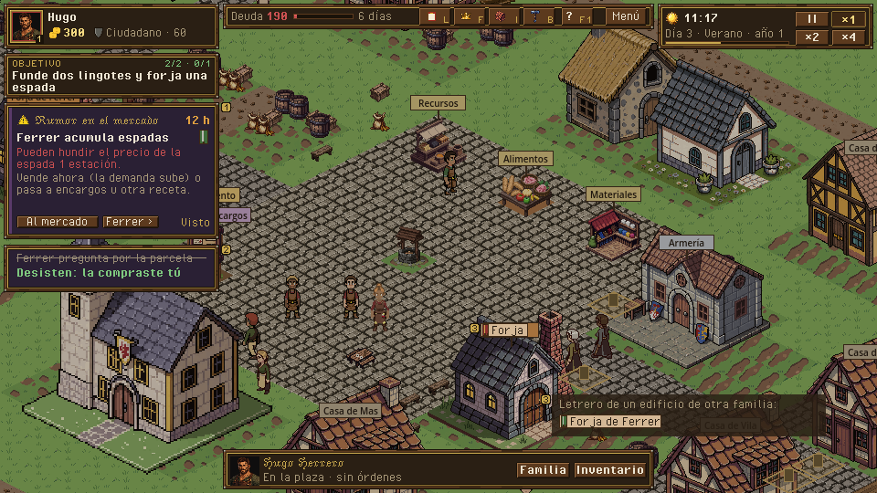

# Rivales · cómo ve el jugador a las otras familias

> Dueño: mecánicas-social · Estado: borrador · Fecha: 2026-11-02
> Guía de estilo: [00_lenguaje_visual.md](../00_lenguaje_visual.md) · Zonas y reglas del HUD: [01_hud.md](../01_hud.md) · Convenciones: [_comun.md](_comun.md), [_social.md](_social.md)

Solo la interfaz. La IA rival tiene su diseño en `docs/gdd/04c_ia_rival.md`, **pendiente de aprobar por el owner** (Gate
antes de H6); aquí no se toca ninguna regla de la IA. Lo que este documento enseña al jugador es exactamente lo que 04c
dice que un jugador puede saber (4.21.4, «ve lo que vería un jugador») y lo que 04c promete mostrar: **bandas de
rivalidad con motivo, presagios y avisos de ataque** (4.21.2 punto 6, 4.21.9.2). Donde 04c tiene una pregunta abierta
(Q4, Q5, Q6) la UI se diseña para la recomendación de 04c y se dice qué cambia con las otras opciones.

Piezas:

| Pieza | Escena hoy | Qué es |
|---|---|---|
| Panel de familias | — (no existe) | Todas las familias de la ciudad, lo público de cada una y tu rivalidad con las que juegan. |
| Ficha de familia | — | Una familia en detalle: miembros, negocios, cargos, ventas públicas, hechos. |
| Presagio | — (04c, H6) | Tarjeta que avisa de un ataque que viene, con margen para reaccionar. |
| Ataque detectado | aviso urgente del registro (H6) | Lo que te han hecho y quién. |
| Marcas en el mapa | Letreros «Forja de Ferrer» (sin color de familia) | De quién es cada edificio. |

Hoy el jugador solo sabe de los rivales por el letrero «Forja de Ferrer» y por lo que le pase en el mercado
(`../maquetas/ciudad_viva_hoy_plaza.png`). Zonas y reglas: [`_comun.md`](_comun.md), [`_social.md`](_social.md).

---

## 1. Para qué sirve y qué pregunta responde

- «¿Quién manda en esta ciudad?» (títulos, cargos, negocios).
- «¿Quién me tiene manía y por qué?» (banda de rivalidad y motivo principal).
- «¿Me van a atacar? ¿Qué puedo hacer para evitarlo?» (presagios y cómo responder).
- «¿Con quién me conviene casar a mi hijo, o a quién regalar para calmar las cosas?» (relación entre cabezas, título).
- «¿Quién me hace la competencia en las espadas?» (ventas públicas, si se aprueba Q4).

## 2. Cómo se abre / cierra y la pausa

| Pieza | Abrir | Cerrar | Pausa |
|---|---|---|---|
| Panel de familias | Tecla **G** (de *gremio*; la H está libre pero se reserva para ayuda contextual) y botón «Familias» de la barra superior; clic en el estandarte de un letrero del mapa; enlace desde la ficha de un vecino («de la familia Soler ›»). | G, ESC, X. | No pausa. |
| Ficha de familia | Clic en una fila del panel (misma caja lateral, con «‹ Volver»). | — | No pausa. |
| Presagio | Lo crea el sim (04c 4.21.9.1). Tarjeta en la columna izquierda con su plazo. | Al cumplirse o cancelarse el ataque, o «Entendido» (se pliega a lengüeta). | No pausa. |
| Ataque detectado | Aviso urgente (`notice_added.urgent`). Clic: centra en el edificio o abre la ficha de la familia (GDD 4.18). | — | No pausa. |

## 3. Jerarquía de información

### Panel de familias

Dos grupos: **«Compiten contigo»** (familias IA con perfil: Ferrer en el MVP; las 5 del EA) arriba, y **«Vecinos»**
(familias de hogar) plegado debajo. Cada fila:

1. **Primero**: estandarte con sus colores, nombre, y la **banda de rivalidad** hacia ti (Cordial · Neutral · Tensa ·
   Hostil · Enemiga, con color de aviso creciente) con una flecha de tendencia (sube/baja en los últimos 2 días).
2. **Segundo**: título, reputación pública, nº de negocios (icono), cargos que ocupa (insignias).
3. **Tercero**: el **motivo principal** de la rivalidad en una línea («Les quitas ventas de espada») y el cabeza de
   familia (retrato 32).

### Ficha de familia

1. Cabecera: estandarte grande, nombre, título, reputación, banda de rivalidad + motivo + tendencia.
2. **Qué puedes hacer**: «Regalar al cabeza» (abre su ficha de vecino con Regalar: los regalos bajan la rivalidad,
   04c 4.21.8.1), «Ver en el mapa», «Acusar…» (H11).
3. Miembros visibles (retrato, nombre, edad, cargo; los niños sin detalle), negocios (con su estado por fuera: abierto,
   en obra, en venta), cargos.
4. **Ventas públicas** del último año por objeto en barras (si Q4 (a)): «Espada: tú 58 % · Ferrer 42 %».
5. **Hechos públicos** recientes: «Compró la parcela de la calle Mayor (día 14)», «Se presentó a Inspector», «Subió a
   Ciudadano», «Multa de inspección». Son los que puede conocer cualquiera.

Lo que **no** se ve nunca: su oro, sus almacenes, su cola, sus mejoras interiores (04c 4.21.4). Si el jugador pasa el
ratón por el hueco donde iría el oro: «No sabes cuánto oro tienen».

### Presagio

Tarjeta con borde púrpura (paleta secundaria: intriga) y el icono del tipo de ataque. Tres líneas: **qué se rumorea**
(«Los Ferrer acumulan espadas»), **qué puede pasar** («Pueden hundir el precio de la espada durante 1 estación») y **qué
puedes hacer** («Vende ahora: la demanda está subiendo · pasa a encargos u otra receta»), con el tiempo que queda.

## 4. Acciones y sus estados

La IA no recibe órdenes desde aquí: estas acciones son las del jugador, las mismas que existen en otros paneles.

| Acción | Orden | Deshabilitado | Confirmación |
|---|---|---|---|
| Regalar al cabeza | (vista: abre la ficha de vecino del cabeza con Regalar) → `npc_gift` | Sin objeto que regalar | La de la ficha de vecino |
| Ver en el mapa | (vista: centra la cámara en el negocio principal) | — | — |
| Acusar… | `accuse` (H11, [`tribunal.md`](tribunal.md)) | Antes de H11, oculto; luego, sus motivos | La del tribunal |
| Abrir mercado / encargos desde un presagio | (vista) | — | — |
| «Entendido» en un presagio | (vista: pliega) | — | — |

## 5. Estados especiales

| Estado | Qué se ve |
|---|---|
| Primer año (protección del inicio, 04c 4.21.8.2) | Línea fija en el panel: «Primer año: nadie te atacará hasta el día 9». La rivalidad se ve igual. |
| Tregua de sucesión (P8) | «Tregua por la muerte de Hugo: hasta el día 52». |
| Ataque anunciado cancelado (el jugador reaccionó) | La tarjeta del presagio se tacha y dice «Los Ferrer han desistido» (es una victoria del jugador: 04c 4.21.9.1). |
| Familia venida a menos (Q9 (b)) | Su fila en gris, «sin negocio»; sus miembros aparecen como candidatos a empleado. |
| Boda entre familias | La banda baja con la flecha y el motivo «Boda entre las familias». |
| Sin familias que compitan (escenarios vacíos) | Solo el grupo «Vecinos». |
| Primera vez | Al abrir el panel la primera vez: globo «La rivalidad sube si les quitas ventas, parcelas o cargos, y baja con el tiempo y los regalos». |

> [!NOTE]
> **Depende de 04c (owner).** Q5 (cuánto se ve de la rivalidad): diseñado para **(b) banda + motivo** (la
> recomendación). Con (a) se añade el número junto a la banda; con (c) desaparecen banda y motivo y la fila solo enseña lo
> público. Q4 (registro público de ventas): con (b) desaparece la sección «Ventas públicas». Q6 (poderes de cargo de la
> IA): no cambia la UI de este documento; si fuera (b), habría un presagio más («abuso de cargo»).
> **Decisión del owner propia de la UI · tecla del panel**: G (recomendada) o sin tecla, solo botón.

## 6. Maqueta

Panel de familias (zona 5 del HUD, `[600, 58, 356, 430]`):

```
+==================================================================+
| FAMILIAS DE LA CIUDAD                                       [x]  |
| Primer año: nadie te atacará hasta el día 9                      |
| COMPITEN CONTIGO                                                 |
| [band][ret] FERRER · Ciudadanos · rep 72     [TENSA ↑]           |
|             1 negocio · Inspector   «Les quitas ventas de espada» |
| VECINOS (9)                                              ▼        |
| [band] Soler · Patricios · Juez, Alguacil          Neutral        |
| [band] Puig · Ciudadanos                           Cordial        |
| ...                                                              |
+==================================================================+
```

Ficha de familia, presagio y letrero del mapa: en los PNG.

**PNG** (fuente: `docs/ui/maquetas/src/rivales.py`): `../maquetas/rivales_panel.png`, `../maquetas/rivales_ficha.png`,
`../maquetas/rivales_presagio.png` (con los letreros del mapa con estandarte), y sus `_x2`.





**Piezas del kit que usa**: `ui:marks/badge_title_<id>` y `ui:marks/badge_office_<id>` (filas y ficha de familia). **Piezas de kit pendientes**: estandarte pequeño 10×16 para filas y letreros; chip de banda de rivalidad (5 tonos de
neutro a lacre, con texto encima); tarjeta de presagio (borde púrpura de la paleta secundaria); iconos 16 de rumor
(oreja o boca), guerra de precios (moneda con flecha abajo), parcela, urna y sabotaje (antorcha, EA); letrero del mapa
con banderín de familia (la pieza actual del letrero + 4 px de banderín a la izquierda).

## 7. Datos

Todo de solo lectura y **solo lo público** (04c 4.21.4).

| Lee | De |
|---|---|
| Familias | `state.families` → `name`, `colors`, `controlled_by`, `head`, `members`, `title` (`Titles.current`), `reputation` (`Reputation.of`) |
| ¿Compite? | `families[fam].ai_profile` (perfil de `data/ai_profiles/`) presente = compite; sin perfil = hogar (`TownLife.is_household`) |
| Negocios | `Titles.business_ids(sim, fam)` y `state.buildings[b]` (tipo, estado por fuera) |
| Cargos | `Offices.of_family(sim, fam)` (rama `h10-cargos`) |
| Rivalidad | `state.rivalry["<fam>|<tu fam>"]` → **consulta nueva** `Rivalry.band(sim, from, to) -> {band, reason_key, trend}` (04c: el jugador ve banda y motivo, no el número) |
| Relación entre cabezas | `Emotions.relation(state, head_a, head_b)` |
| Ventas públicas (Q4) | **consulta nueva** `Market.public_sales(sim, item) -> {fam: percent}` redondeado al 10 % (04c 4.21.4) |
| Hechos públicos | `state.chronicle` filtrado a tipos públicos (compras, títulos, cargos, juicios, multas) de esa familia |
| Protecciones | **consulta nueva** `Rivalry.protection(sim, fam) -> {kind: "first_year" \| "succession" \| "", until_day}` |
| Presagios y ataques | avisos del registro con `notice.omen.<ataque>` y `notice.attack.<ataque>` (nombres propuestos: los fija el contrato de H6) con `{family, building?, item?, until}` |

Emite: nada propio (las acciones abren otros paneles que ya dan sus órdenes).

## 8. Sonido y feedback

| Momento | Evento | Estado |
|---|---|---|
| Abrir el panel | `ui.panels` | **Falta** añadir `families_panel` |
| Presagio | `notice.omen.*` | **Falta** `sfx_rumor` (susurro corto); mientras, `sfx_notice` |
| Ataque detectado | `notice.attack.*` → `notice_added.urgent` (`sfx_alarm`) | Existe (sirve) |
| Ataque cancelado | — | **Falta**: `sfx_objective_done` sirve |
| Cambio de banda | — | Sin sonido; la fila parpadea 2 fotogramas al abrir el panel |

## 9. Diferencias con hoy y tareas

| Hoy | Debería |
|---|---|
| No hay forma de ver las otras familias. | Panel de familias y ficha de familia. |
| Letrero «Forja de Ferrer» sin color de familia. | Letrero con banderín de los colores de la familia dueña (también en tus edificios). |
| No existen presagios ni rivalidad en el sim (H6, 04c sin aprobar). | Tarjeta de presagio y banda de rivalidad cuando H6 los traiga. |

Tareas (en H6, cuando el owner apruebe 04c; las de solo vista pueden ir antes):

1. Kit: estandarte pequeño, chip de banda, tarjeta de presagio, iconos, letrero con banderín (pendientes).
2. Antes de H6 (solo vista, con lo que ya hay): `families_panel` con título, reputación, negocios, cargos y hechos
   públicos; ficha de familia; letreros con banderín; botón y tecla.
3. H6: consultas `Rivalry.band`, `Rivalry.protection`, `Market.public_sales` (si Q4); banda en filas y ficha.
4. H6: tarjeta de presagio (columna izquierda, zona 4) y su tachado al cancelarse.
5. Audio: `families_panel` en `ui.panels`; `sfx_rumor`.

## 10. Criterios de aceptación

- [ ] Desde el mapa, con un clic en el letrero de la Forja de Ferrer, se abre su ficha de familia.
- [ ] La ficha no enseña oro, almacenes ni mejoras interiores de otra familia (test de vista: los campos no se leen).
- [ ] Con H6: la banda de rivalidad de Ferrer y su motivo se leen a 960×540 sin pasar el ratón; el número no aparece
      (si Q5 = (b)).
- [ ] Con H6: cada ataque ejecutado tuvo antes su tarjeta de presagio con el plazo de 04c; un ataque cancelado tacha
      su tarjeta.
- [ ] En el primer año el panel dice hasta qué día dura la protección.
