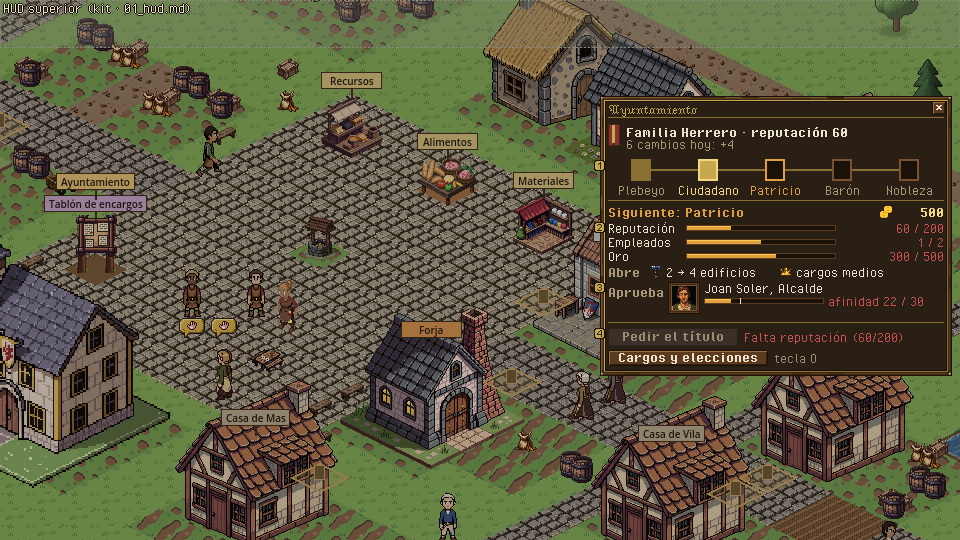
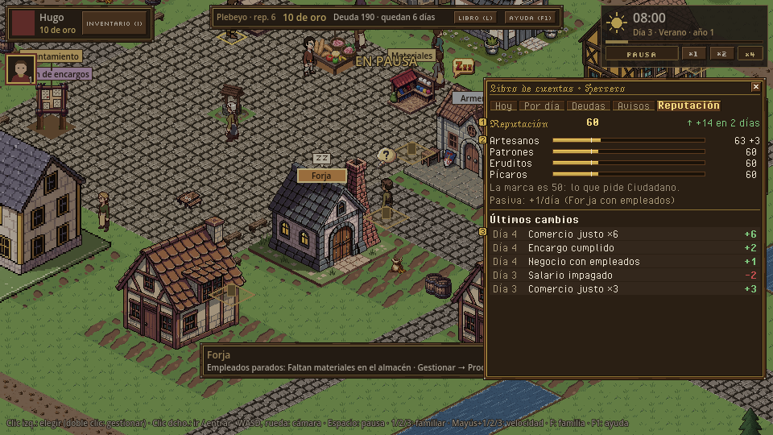
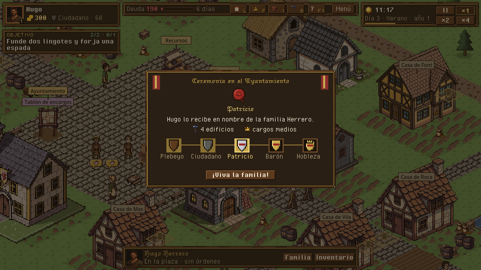

# Títulos y reputación · Ayuntamiento y ceremonia

> Dueño: mecánicas-social · Estado: borrador · Fecha: 2026-11-02
> Guía de estilo: [00_lenguaje_visual.md](../00_lenguaje_visual.md) · Zonas y reglas del HUD: [01_hud.md](../01_hud.md) · Convenciones: [_comun.md](_comun.md), [_social.md](_social.md)

Mecánica de H9 (GDD 4.12.1, 4.12.2; contrato `docs/contratos/h9_titulos.md`). Piezas:

| Pieza | Escena hoy | Qué es |
|---|---|---|
| Panel del Ayuntamiento | `game/ui/town_hall_panel.tscn` | Tu título, lo que pide el siguiente y el botón para pedirlo. |
| Carta de la ceremonia | `game/ui/title_card.tscn` | El momento en que la familia sube de título. |
| Reputación | pestaña «Reputación» del libro (`ledger_panel`) + «rep. N» en la barra superior | Cuánta tienes, con quién y por qué ha cambiado. |

Capturas de hoy: `../maquetas/titulos_y_reputacion_hoy_ayuntamiento.png`, `../maquetas/titulos_y_reputacion_hoy_ceremonia.png`,
`../maquetas/titulos_y_reputacion_hoy_reputacion.png`. Zonas y reglas: [`_comun.md`](_comun.md), [`_social.md`](_social.md).

---

## 1. Para qué sirve y qué pregunta responde

- Ayuntamiento: «¿Qué me falta para el siguiente título y cuánto me cuesta?» · «¿Qué gano con él?» (edificios, votar,
  cargos) · «¿Quién tiene que aprobarlo y le caigo bien?».
- Reputación: «¿Por qué ha bajado mi reputación?» · «¿Con qué clase me va mejor?» · «¿Cuánto me falta para los 200 de
  Patricio, y a qué ritmo subo?».
- Ceremonia: «Lo he conseguido: ¿qué se abre ahora?».

## 2. Cómo se abre / cierra y la pausa

| Pieza | Abrir | Cerrar | Pausa |
|---|---|---|---|
| Ayuntamiento | Mandar a alguien al Ayuntamiento (clic derecho): se abre al llegar a su casilla de servicio (como hoy). **Nuevo:** consulta a distancia desde la barra superior (clic en el título) en modo solo lectura: se ve todo, «Pedir el título» dice «Hay que ir al Ayuntamiento» y un botón «Ir allí» da la orden de caminar. | X, ESC, alejarse (el modo de consulta no se cierra al moverse). | No pausa. |
| Reputación | Clic en «rep. N» de la barra superior → libro, pestaña Reputación (hoy solo desde el libro). | X, ESC, L. | No pausa. |
| Ceremonia | Evento `title_granted` de tu familia. | Botón o `view.title_card_seconds` (8 s, como hoy). | No pausa. |

## 3. Jerarquía de información

### Ayuntamiento

1. **Primero**: la **escalera de títulos**: cinco peldaños (Plebeyo · Ciudadano · Patricio · Barón · Nobleza) con el
   actual marcado y el siguiente resaltado. Se entiende de un vistazo dónde está la familia.
2. **Segundo**: el **siguiente título**, cada requisito como **barra con su cifra** (Reputación 60/200, Empleados 1/2,
   Oro 300/500), en verde los cumplidos y con el motivo en rojo los que no.
3. **Tercero**: **lo que abre**, con iconos: edificios (2 → 4), votar, cargos (menores → medios); y **quién lo aprueba**
   (GDD 4.12.2): «Lo aprueba el Alcalde, Joan Soler: afinidad 22 de 30» con su retrato, o «Alcaldía vacante: se aprueba
   sola».
4. **A demanda**: tooltip de cada peldaño con lo que pide y abre ese título; tooltip del requisito con cómo se consigue
   («Reputación: encargos cumplidos, salarios pagados, comercio justo… ver Libro › Reputación»).
5. Botón a **Cargos y elecciones** (H10, ya en la rama `h10-cargos`).

### Reputación (pestaña del libro)

1. **Primero**: la cifra global grande y la **tendencia** de los últimos 2 días (+14, flecha arriba).
2. **Segundo**: con cada clase (artesanos, patrones, eruditos, pícaros) como **barras** con el modificador
   (+3) a la derecha; la clase que más pesa para el cargo o título que persigues, resaltada.
3. **Tercero**: últimos cambios (`reputation_log`, 12), **agrupados** por motivo y día («Comercio justo ×6 · +6»), no una
   fila por venta.
4. **A demanda**: de dónde sale la reputación pasiva («+1/día por la Forja con empleados»).

### Ceremonia

Estandarte de la familia, **sello de lacre** con la inicial del título, nombre del título grande, quién lo recibe, y lo
que abre en iconos. La escalera debajo con el peldaño nuevo encendiéndose.

## 4. Acciones y sus estados

| Acción | Orden | Estado deshabilitado (motivo visible) | Confirmación |
|---|---|---|---|
| Pedir el título | `request_title {actor}` | `Titles.status(sim, actor).reason`: `title_needs_reputation` · `title_needs_businesses` · `title_needs_employees` · `title_needs_event` · `not_enough_gold` · `title_not_approved` («El Alcalde no te aprueba: afinidad 22 de 30») · `not_at_town_hall` («Hay que ir al Ayuntamiento») · `max_title` | **Sí**, porque cobra: «Pagar 500 de oro por el título de Patricio. Te quedan 120.» |
| Ir allí (modo consulta) | `move_to` a la casilla de servicio (`Titles.service`) | — | No |
| Cargos y elecciones | (vista: abre el organigrama de H10) | — | No |

## 5. Estados especiales

| Estado | Qué se ve |
|---|---|
| Título máximo | Escalera completa en oro; «La familia tiene el título más alto». Sin botón. |
| Requisito sin diseñar | Nobleza pide `event: noble_event`, que el GDD aún no define: la fila dice «Hazaña especial (por definir)» en gris. **Decisión del owner** pendiente fuera de la UI (qué evento es). |
| Aprobador vacante | Retrato vacío con «VACANTE» y «se aprueba sola». |
| Aprobador con baja afinidad | Retrato del Alcalde, barra de afinidad con la marca de 30 y el consejo «Habla con él o regálale algo» (enlace a su ficha). |
| Reputación negativa | La cifra en rojo y, en la escalera, nota «Con reputación negativa no se puede subir de título» (es lo que pasa con las cifras de hoy). |
| Primera vez | Primer Ayuntamiento: globo sobre la escalera «Cada título abre más edificios y cargos; se pide aquí pagando oro». |

## 6. Maqueta

Ayuntamiento (panel lateral, 352 × ~360):

```
+==================================================================+
| AYUNTAMIENTO                                               [x]   |
| [band] Familia Herrero · reputación 60                           |
|------------------------------------------------------------------|
|  Plebeyo    Ciudadano   Patricio    Barón      Nobleza           |
|   [##]--------[##]--------[  ]--------[  ]--------[  ]           |
|              (actual)   (siguiente)                              |
|------------------------------------------------------------------|
| SIGUIENTE: PATRICIO                        [oro] 500             |
| Reputación  [######--------------]  60 / 200   (falta 140)       |
| Empleados   [##########----------]   1 / 2                       |
| Oro         [############--------] 300 / 500                     |
| Abre: [casa] 2 -> 4 edificios · [corona] cargos medios           |
| Aprueba: [ret] Joan Soler, Alcalde · afinidad [===|] 22/30        |
|------------------------------------------------------------------|
| [ PEDIR EL TÍTULO ]   > Te falta reputación (60 de 200)          |
| [ Cargos y elecciones ]                                          |
+==================================================================+
```

Reputación (pestaña del libro):

```
| REPUTACIÓN  60   ↑ +14 en 2 días                                 |
| Artesanos  [#############-------] 63 (+3)                        |
| Patrones   [############--------] 60                             |
| Eruditos   [############--------] 60                             |
| Pícaros    [############--------] 60                             |
| Pasiva: +1/día (Forja con empleados)                             |
| Últimos cambios                                                  |
| Día 4  Comercio justo ×6                         +6              |
| Día 4  Encargo cumplido                          +2              |
| Día 3  Salario impagado                          −2              |
```

Ceremonia (carta, 380 × 220):

```
+======================================================+
| [band]          CEREMONIA EN EL AYUNTAMIENTO  [band] |
|                     ( sello P )                      |
|                      PATRICIO                        |
|  Hugo lo recibe en nombre de la familia Herrero.     |
|  Abre: [casa] 4 edificios · [corona] cargos medios   |
|  Plebeyo — Ciudadano — [PATRICIO] — Barón — Nobleza  |
|                 [ ¡VIVA LA FAMILIA! ]                |
+======================================================+
```

**PNG** (fuente: `tools/ui/mecanicas/titulos_y_reputacion.py`): `../maquetas/titulos_y_reputacion_ayuntamiento.png`,
`../maquetas/titulos_y_reputacion_reputacion.png`, `../maquetas/titulos_y_reputacion_ceremonia.png`, y sus `_x2`.





**Piezas de kit pendientes**: escalera de títulos (5 peldaños con estados actual / siguiente / lejano / conseguido);
sello de lacre 24×24 con inicial (sin texto dentro del sprite: la letra se pone encima con la fuente); icono de «edificio»
16 para los límites (base `icon_build_mode` de Guild Renew); flecha de tendencia (la fuente ya tiene ↑ ↓).

## 7. Datos

| Lee | De |
|---|---|
| Estado del título | `Titles.status(sim, actor)` → `{family, current, next, cost, requirements: [{kind, need, have, ok}], at_town_hall, reason}` |
| Escalera | `catalog.titles()` (rango, `cost_gold`, `reputation`, `requires`, `unlocks`) |
| Lo que abre | `TownHallPanel.unlocks_text` (hoy) → mejor por campos: `unlocks.max_buildings`, `unlocks.vote`, `unlocks.office_rank` |
| Quién aprueba | `Titles.approved(sim, actor)` + **consulta nueva** `Titles.approver(sim, actor) -> {office, character, affinity, need}` (solo lectura; hoy la lógica está dentro de `approved`) |
| Reputación | `Reputation.of`, `Reputation.with_class`, `Reputation.class_mod`; `families[fam].reputation_log` (`{minute, amount, reason, class, class_amount}`); pasiva de `data/politics.json` `reputation.passive` |
| Tendencia | Suma de `reputation_log` de los 2 últimos días (vista) |
| Ceremonia | evento `title_granted {family, actor, title, from}` |

| Emite |
|---|
| `request_title {actor}`; en modo consulta, `move_to {actor, tile}` hacia `Titles.service(sim)` |

## 8. Sonido y feedback

| Momento | Evento | Estado |
|---|---|---|
| Abrir/cerrar Ayuntamiento | `ui.panels` no incluye `town_hall_panel` | **Falta** |
| Ceremonia | `title_granted` | **Falta** `sfx_title_fanfare` (fanfarria corta; mientras tanto `sfx_upgrade_done`) |
| Cambio de reputación | `reputation_changed` | Sin sonido (sería ruido). Feedback visual: «+2» flotante junto a «rep.» en la barra superior, agrupado por hora de juego. |
| Requisito cumplido mientras miras | — | La barra pasa a verde con un destello de 2 fotogramas. |

## 9. Diferencias con hoy y tareas

| Hoy | Debería |
|---|---|
| Requisitos como texto «[ok] Reputación: 60 / 50». | Barras con cifra; motivo en rojo. |
| No se ve la escalera completa. | Escalera de 5 peldaños. |
| No se dice quién aprueba ni con qué afinidad (si no te aprueba, solo lo dice el tooltip del botón). | Fila «Aprueba» con retrato y afinidad. |
| Solo se abre estando en el Ayuntamiento. | Consulta a distancia desde la barra superior con «Ir allí». |
| Pedir el título cobra sin confirmar. | Confirmación con el oro que queda. |
| Reputación: lista larga de cambios sueltos («Comercio justo +1» × N) y «Hechos anteriores +49». | Cambios agrupados; tendencia; barras por clase. |
| Ceremonia: franjas de color y texto. | Estandarte, sello, escalera. |

Tareas:

1. Kit: escalera de títulos, sello de lacre, icono de edificio (pendientes).
2. Sim (consulta): `Titles.approver`.
3. `town_hall_panel`: escalera; requisitos con barras; fila Aprueba; confirmación.
4. `town_hall_panel`: modo consulta a distancia + «Ir allí»; clic en el título de la barra superior.
5. `ledger_panel` (pestaña Reputación): barras por clase, tendencia, cambios agrupados; clic en «rep.» la abre.
6. `title_card`: sello y escalera.
7. Audio: `town_hall_panel` en `ui.panels`; `title_granted` → fanfarria.

## 10. Criterios de aceptación

- [ ] En `title_ready`, a 960×540, el Ayuntamiento enseña la escalera y, sin ratón, qué requisito falta y cuánto.
- [ ] Con el Alcalde ocupado y afinidad < 30 se lee «no te aprueba» con la afinidad y quién es.
- [ ] Desde la barra superior se consulta el Ayuntamiento lejos de él; el botón dice que hay que ir y «Ir allí» camina.
- [ ] Pedir el título pide confirmación con el oro restante.
- [ ] La pestaña Reputación agrupa cambios del mismo motivo y día en una fila.
- [ ] La ceremonia muestra el peldaño nuevo encendido en la escalera.
