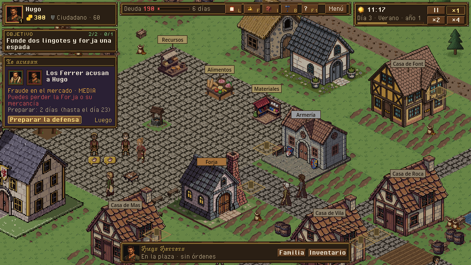
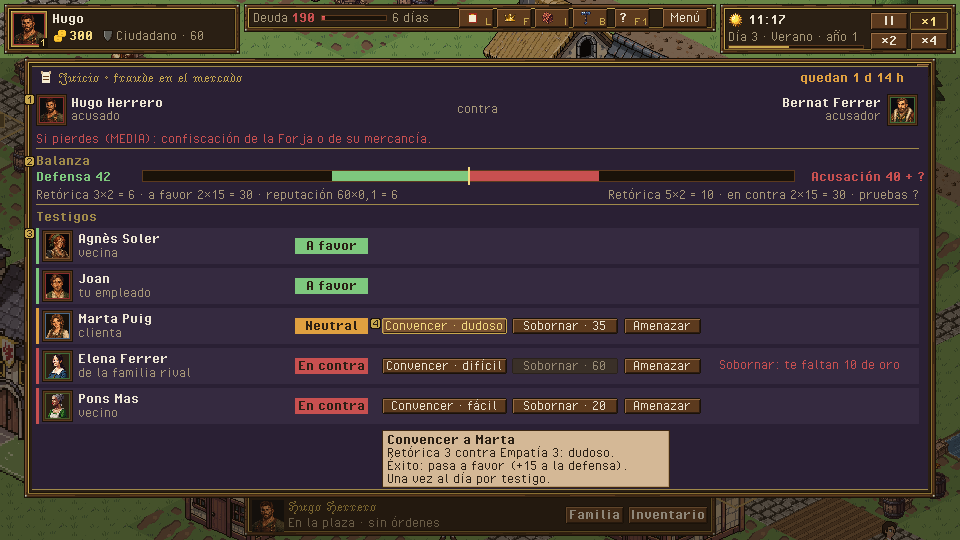
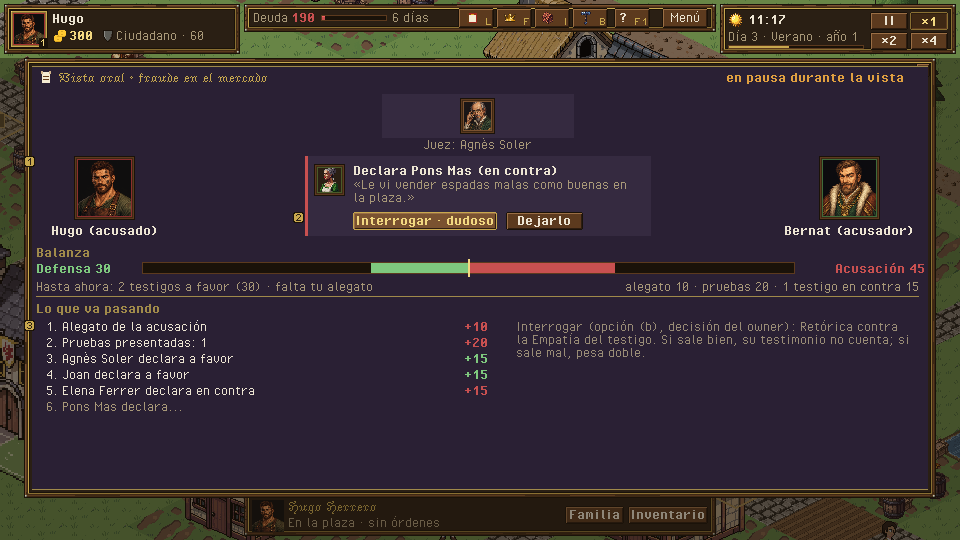
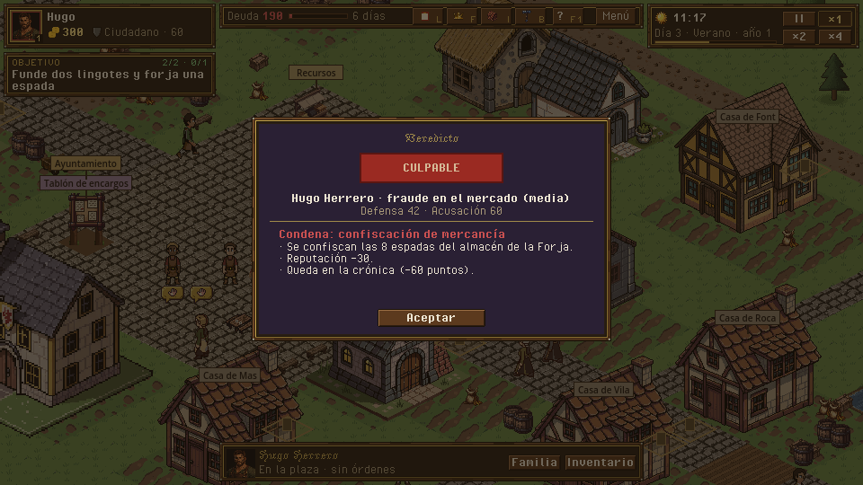

# Tribunal · acusación, preparación, vista oral y condena

> Dueño: mecánicas-social · Estado: borrador · Fecha: 2026-11-02
> Guía de estilo: [00_lenguaje_visual.md](../00_lenguaje_visual.md) · Zonas y reglas del HUD: [01_hud.md](../01_hud.md) · Convenciones: [_comun.md](_comun.md), [_social.md](_social.md)

Mecánica de H11 (GDD 4.12.5; ataques de la IA en 04c 4.21.9). **No está hecho**: no hay escenas, ni sim, ni contrato. Este
documento diseña la interfaz sobre el GDD; los nombres de datos y órdenes son **propuestos** y los fija el contrato de
H11 (`docs/contratos/h11_tribunal.md`, cuando exista). Zonas y reglas: [`_comun.md`](_comun.md), [`_social.md`](_social.md).

Paleta: la biblia reserva la **secundaria (otoñal)** para el tribunal: gris oscuro, púrpura profundo, oro apagado. El
panel del juicio usa el mismo marco de madera, con la sección interior en púrpura oscuro (`#2a2034`) y filetes de oro
apagado, para que se note que estás en otro sitio.

---

## 1. Para qué sirve y qué pregunta responde

- Al ser acusado: «¿De qué me acusan, quién, qué me puede pasar y cuánto tiempo tengo?».
- En la preparación: «¿Qué testigos tengo en contra y cómo los gano?» · «¿Voy ganando el juicio?» · «¿Cuánto me cuesta
  y qué riesgo corro?».
- En la vista oral: «¿Qué está pasando y qué puedo hacer ahora?».
- En el veredicto: «¿Qué he perdido o ganado y qué cambia?».
- Al acusar (yo): «¿Tengo con qué acusar? ¿Qué arriesgo si fabrico pruebas?».

## 2. Cómo se abre / cierra y la pausa

| Pieza | Abrir | Cerrar | Pausa |
|---|---|---|---|
| Carta «Te acusan» | Acusación contra alguien de tu familia. | «Preparar la defensa» (abre el juicio) o «Más tarde». | No pausa (el plazo es de 2 días). |
| Panel del juicio (preparación) | Carta, aviso del registro, o botón «Juicios» de la barra superior (aparece solo con un juicio abierto; tecla **J**). | J, ESC, X. | No pausa. |
| Vista oral | Al acabar la preparación, si el acusado o el acusador es de tu familia: el panel del juicio pasa a la vista. | Al veredicto. | **Pausa automática** durante la vista (ver decisión). |
| Carta de veredicto | Fin de la vista. | Botón. | — |
| Acusar | Ficha de vecino o de familia rival → «Acusar…» (Ciudadano o más). | Confirmar / cancelar. | No pausa. |
| Presidir (si eres Juez) | Aviso «Juicio que presides: elige veredicto». | Al elegir. | Pausa como la vista. |

## 3. Jerarquía de información

### Panel del juicio · preparación (modal grande)

1. **Primero**: cabecera con **acusado contra acusador** (retratos y familias), el **cargo** y su **gravedad**
   (leve · media · grave · máxima) con la **condena posible** escrita («Grave: pierdes el cargo y el título baja un
   nivel»), y los **días que quedan** de preparación.
2. **Segundo**: la **balanza**: defensa contra acusación, con sus sumandos a la vista (GDD 4.12.5):
   `defensa = retórica × 2 + testigos a favor × 15 + reputación × 0,1`,
   `acusación = retórica del acusador × 2 + testigos en contra × 15 + pruebas × 20`.
   Las pruebas del acusador salen como «?» hasta la vista (ver decisión).
3. **Tercero**: los **testigos** (3-5), cada uno con retrato, familia, por qué está ahí («vecino», «tu empleado»,
   «rival»), su **disposición** (a favor · neutral · en contra, con icono y color) y las acciones sobre él.
4. **A demanda**: tooltip de cada acción con la banda de la tirada y el riesgo («Amenazar: Arte Marcial 3 contra 6 ·
   difícil · si falla, pasa en contra y puede denunciarte»).

### Vista oral

Escena en el mismo panel: el estrado (Juez arriba), acusador a un lado, acusado al otro, los testigos en fila. Se revela
**paso a paso**: alegato de la acusación, pruebas, cada testigo declara (su ficha se gira y mueve la balanza), alegato de
la defensa, veredicto. Cada paso deja una línea en la crónica del juicio a la derecha.

### Veredicto

Sello grande «INOCENTE» (oro) o «CULPABLE» (lacre), la condena con sus efectos concretos («−20 de oro», «La Forja queda
confiscada», «Inspector de mercado: lo pierdes», «Pere desterrado hasta el día 41») y, si la acusación era falsa y
ganas, «Los Ferrer pierden 50 de reputación».

## 4. Acciones y sus estados

| Acción | Orden (propuesta) | Deshabilitado (motivo visible) | Confirmación |
|---|---|---|---|
| Convencer a un testigo | `witness_action {actor, trial, witness, kind: convince}` (Retórica) | Ya a favor · ya lo intentaste hoy · lejos (camina primero) | No |
| Sobornar a un testigo | `witness_action {kind: bribe}` (oro según codicia) | Sin oro (cuánto falta) | **Sí**: «35 de oro. Si te denuncia: nuevo cargo de soborno (grave).» |
| Amenazar a un testigo | `witness_action {kind: threaten}` (Arte Marcial) | — | **Sí**: «Si falla, pasa en contra y puede denunciarte.» |
| Acusar | `accuse {actor, target, charge, evidence: [hecho] \| fabricate: true}` | Título < Ciudadano · sin hechos que lo prueben (y sin elegir fabricar) · ya hay juicio abierto contra esa familia | **Sí**, con el riesgo: «Si es falsa y pierdes: −50 de reputación.» Fabricar: banda de Sigilo/Destreza |
| Elegir veredicto (si eres Juez) | `trial_verdict {actor, trial, verdict}` | Solo el titular del cargo de Juez | **Sí** si va contra la balanza: «−20 Honestidad y riesgo de escándalo.» |
| Vista oral (interactiva) | ver decisión | | |

> [!NOTE]
> **Decisión del owner · ¿qué es «interactiva» en la vista oral?** El GDD lo exige (en el primer intento se
> autorresolvía) pero no dice qué decide el jugador. Opciones, de menos a más regla nueva:
> (a) **Vista animada sin decisiones**: la vista se juega paso a paso y el jugador solo mira; lo interactivo es la
> preparación. No cambia reglas, pero incumple el «debe ser interactiva».
> (b) **Una intervención por testigo**: cuando declara un testigo en contra, el acusado puede **interrogarle** una vez
> (SkillCheck Retórica contra la Empatía del testigo): si sale bien, su testimonio no cuenta (−15 a la acusación); si
> sale mal, pesa doble. Regla nueva pequeña, con las piezas que ya existen (SkillCheck, testigos, ±15).
> (c) **Alegato elegido**: al final, el acusado elige un enfoque (apelar a la reputación, al carácter del acusador o a la
> falta de pruebas), cada uno con su SkillCheck y su bonificación. Más regla nueva y más cifras que equilibrar.
> **Recomendación: (b)**. Da 1-3 decisiones tensas por juicio, se entiende en la misma pantalla y no añade atributos ni
> recursos. Si se elige, se escribe en el GDD 4.12.5 y en el contrato de H11 antes de implementarlo.

> [!NOTE]
> **Decisión del owner · ¿se ven las pruebas del acusador antes de la vista?** (a) Sí (la balanza exacta). (b) **No:
> «?» hasta la vista**, con una pista («Los Ferrer dicen tener pruebas»). (c) Ni la balanza. **Recomendación: (b)**: el
> jugador sabe qué controla (testigos, su retórica) y la vista guarda una sorpresa razonable.

> [!NOTE]
> **Decisión del owner · ¿la vista oral pausa el juego?** Dura poco (6-10 pasos) y pide atención. **Recomendación:
> pausa automática** mientras dura, como la sucesión ([`familia.md`](familia.md)); el sim no cambia.

## 5. Estados especiales

| Estado | Qué se ve |
|---|---|
| Sin juicios | El botón «Juicios» no aparece en la barra. |
| Testigo muerto o que se va | Su ficha se tacha: «Ya no declarará» y la balanza se recalcula. |
| Dos juicios a la vez | Pestañas en el panel del juicio, una por juicio. |
| Desterrado (condena máxima) | Insignia «desterrado hasta el día 41» en su retrato (HUD, árbol); no se puede elegir en el grupo; tooltip «No puede actuar en la ciudad; el resto de la familia sí». |
| Acusación fabricada descubierta | Aviso urgente y la acusación pasa contra quien la fabricó (motivo real para acusarle). |
| Juicio entre otras familias | Solo un aviso informativo; se puede abrir en modo espectador (sin acciones). |
| Primera vez | Primer juicio: globo sobre la balanza «Gana quien más pese al final: gana testigos a tu favor antes de la vista». |

## 6. Maqueta

Carta «Te acusan» (columna izquierda, zona 4, 236 de ancho):

```
+==============================================+
| [mazo] TE ACUSAN                             |
| [ret Ferrer] Los Ferrer acusan a [ret Hugo]  |
| Cargo: fraude en el mercado · MEDIA          |
| Puede costarte: la Forja o su mercancía      |
| Preparación: 2 días (hasta el día 23)        |
| [ PREPARAR LA DEFENSA ]        Más tarde     |
+==============================================+
```

Panel del juicio · preparación: **no cabe en la zona 5**, va como **modal grande a pantalla completa** (`[24, 58, 912, 440]`, 01_hud §4.7), igual que la vista oral; la carta «Te acusan» va en la columna izquierda (zona 4):

```
+============================================================================================+
| JUICIO · fraude en el mercado (MEDIA)                     quedan 1 d 14 h          [x]     |
| [ret] Hugo Herrero (acusado)     contra     Bernat Ferrer (acusador) [ret]                  |
| Si pierdes: confiscación de la Forja o de su mercancía                                      |
|--------------------------------------------------------------------------------------------|
| BALANZA                                                                                     |
|   Defensa 42  [#####################----------------]  Acusación 40 + ?                     |
|   Retórica 3×2=6 · a favor 2×15=30 · reputación 60×0,1=6     Retórica 5×2=10 · en contra 2×15=30 · pruebas ? |
|--------------------------------------------------------------------------------------------|
| TESTIGOS                                                                                    |
| [ret] Agnès Soler · vecina        A FAVOR   (verde)                                         |
| [ret] Joan · tu empleado           A FAVOR                                                  |
| [ret] Marta Puig · clienta         NEUTRAL   [Convencer: dudoso] [Sobornar 35] [Amenazar]    |
| [ret] Elena Ferrer · rival         EN CONTRA [Convencer: difícil] [Sobornar 60] [Amenazar]   |
| [ret] Pons · vecino               EN CONTRA [Convencer: fácil]  [Sobornar 20] [Amenazar]    |
+============================================================================================+
```

Vista oral y veredicto: en los PNG.

**PNG** (fuente: `docs/ui/maquetas/src/tribunal.py`): `../maquetas/tribunal_acusacion.png`,
`../maquetas/tribunal_preparacion.png`, `../maquetas/tribunal_vista.png`, `../maquetas/tribunal_veredicto.png`, y sus
`_x2`.






**Piezas del kit que usa**: `ui:marks/seal` como base del sello de veredicto. **Piezas de kit pendientes**: marco del tribunal (variante de `panel` con sección púrpura `#2a2034` y filete oro
apagado); balanza (barra doble enfrentada con fiel en el centro); sellos INOCENTE / CULPABLE (sin texto dentro del
sprite: el texto va encima); iconos 16 de mazo, pergamino de acusación, ojo (testigo), cadena (destierro); insignia
«desterrado» 8×8.

## 7. Datos (propuestos: los fija el contrato de H11)

| Lee | De |
|---|---|
| Juicios abiertos | `state.trials` → `[{id, accuser, accused, accuser_family, accused_family, charge, severity, phase: "prep" \| "hearing" \| "done", prep_until, witnesses: [{character, role, disposition: "for" \| "neutral" \| "against", tried: {kind: day}}], evidence: n, fabricated, verdict, sentence}]` |
| Balanza | **Consulta** `Trials.balance(sim, trial) -> {defense: {rhetoric, witnesses, reputation, total}, prosecution: {rhetoric, witnesses, evidence, total}}` (la UI no calcula la fórmula) |
| Estado de una acción | `Trials.action_status(sim, actor, trial, witness, kind)` con motivos `reason.*` |
| Banda de tirada | `SkillCheck` (Retórica contra Empatía, Arte Marcial contra Arte Marcial) |
| Precio del soborno | `Trials.bribe_cost(sim, witness)` (codicia) |
| Condenas | `data/` del contrato (gravedad → multa, confiscación, cargo + título, destierro 8 días) |
| Hechos que permiten acusar | `Trials.evidence_for(sim, actor, target)` (multas de inspección públicas, robos vistos: 04c 4.21.4) |
| Vista oral | eventos `trial_step {trial, kind, witness?, delta}` en orden; `trial_verdict {trial, verdict, sentence}` |

| Emite (propuesto) |
|---|
| `accuse`, `witness_action {kind: convince \| bribe \| threaten}`, `trial_verdict` (Juez), y si el owner elige (b), `cross_examine {trial, witness}` |

## 8. Sonido y feedback

| Momento | Evento | Estado |
|---|---|---|
| Te acusan | `notice.accused` (urgente) | **Falta** `sfx_gavel` (mazo) en vez de `sfx_alarm` |
| Testigo cambia de lado | `trial_witness_changed` | **Falta** (pasar página) |
| Cada paso de la vista | `trial_step` | **Falta** murmullo de sala; mazo al veredicto |
| Veredicto | `trial_verdict` | **Falta** `sfx_verdict_innocent` / `sfx_verdict_guilty` |
| Música | — | **Falta** tema de tribunal (paleta otoñal también en audio: cuerdas graves) |

Feedback: la balanza se inclina con animación de 4 fotogramas cuando cambia un testigo o declara en la vista.

## 9. Diferencias con hoy y tareas

Hoy no hay nada del tribunal. Los poderes `arrest`, `investigate`, `preside_trial` y `pardon` existen en datos en la rama
`h10-cargos` con `ready: "H11"` y salen apagados en la pestaña Poderes ([`cargos_y_elecciones.md`](cargos_y_elecciones.md)).

Tareas (en H11, tras su contrato):

1. Owner: decisiones de la vista interactiva, pruebas visibles y pausa.
2. Kit: marco de tribunal, balanza, sellos, iconos (pendientes).
3. Sim (consultas): `Trials.balance`, `action_status`, `bribe_cost`, `evidence_for`.
4. `trial_card` (te acusan) en la columna izquierda (zona 4).
5. `trial_panel`: preparación (cabecera, balanza, testigos y acciones con confirmación).
6. `trial_panel`: vista oral paso a paso (+ interrogatorio si (b)).
7. `verdict_card`.
8. «Acusar…» en la ficha de vecino y de familia rival; insignia de desterrado en `portrait_frame`.
9. Audio de tribunal.

## 10. Criterios de aceptación

- [ ] Al ser acusado, la carta dice de qué, quién, qué puedes perder y hasta qué día, sin abrir nada más.
- [ ] En la preparación, a 960×540, se ven a la vez la balanza con sus sumandos y todos los testigos con su disposición.
- [ ] Sobornar, amenazar y acusar piden confirmación con el riesgo por bandas.
- [ ] La vista oral se juega paso a paso y la balanza se mueve con cada testigo; con (b), cada testigo en contra ofrece
      «Interrogar» una vez.
- [ ] El veredicto enumera los efectos concretos de la condena; un desterrado lleva su insignia en el HUD y el árbol.
- [ ] El bot `crook` (criterio de H11) acaba en juicio y su panel se puede abrir en modo espectador.
